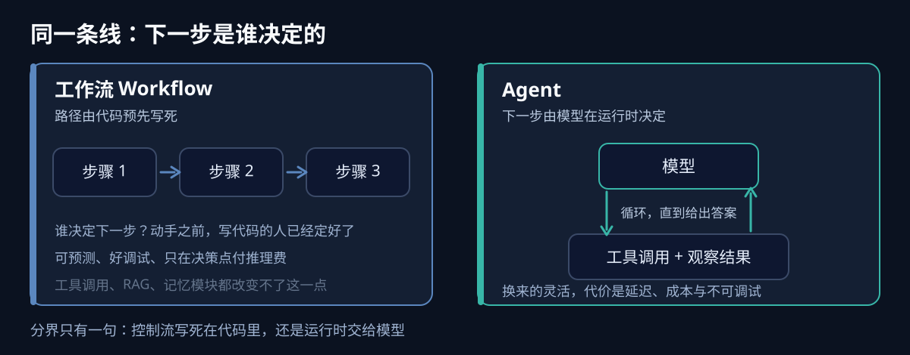
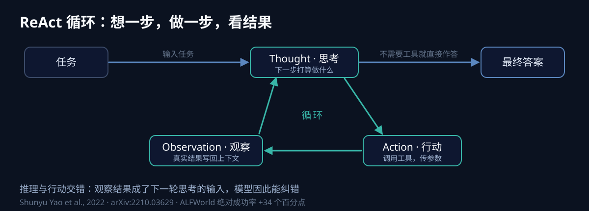
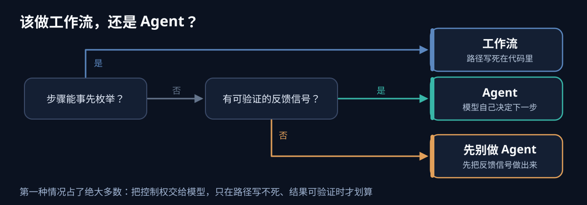

> 2025 年 6 月 25 日，Gartner 在新闻稿里造了一个词：**"agent washing"**。他们清点了市面上号称 agentic AI 的厂商，结论是——几千家里**只有约 130 家是真的**，剩下的只是把旧的客服机器人、RPA 流程和"AI 助手"换了个名字。同一份稿子里还有一条更不好看的预测：**到 2027 年底，超过 40% 的 agentic AI 项目会被取消**，原因是成本失控、价值说不清、风险控制不足。（一手：[Gartner 新闻稿](https://www.gartner.com/en/newsroom/press-releases/2025-06-25-gartner-predicts-over-40-percent-of-agentic-ai-projects-will-be-canceled-by-end-of-2027)）

一年过去，这个词不但没过时，反而更准了。今天任何一个能调 API 的产品都自称 Agent。所以这篇不打算再抄一遍"Agent = 大模型 + 规划 + 记忆 + 工具"的零件清单——那张清单你能背下来，但它判断不了一个系统到底是不是 Agent，也解释不了为什么那么多"零件齐全"的项目最后烂尾。

我认为判断只归结为一句话：

> **下一步做什么，是模型在运行时自己决定的，还是人提前在代码里写死的。前者是 Agent，后者是工作流。**

这篇文章就沿着这条线展开：先讲清这条分界（第一节），再看过了分界的 Agent 内部在跑什么（第二节），写一个几十行的最小实现（第三节），然后回答"那框架还值不值得用"（第四节），最后给出一个残酷但省钱的结论——大多数"Agent 项目"该做的是工作流（第五节）。

## 一、一条线：控制流归谁

给"Agent"下过最好定义的不是哪家厂商的白皮书，是 Anthropic 2024 年 12 月那篇工程博客。它把带 LLM 的系统分成两种（[原文](https://www.anthropic.com/engineering/building-effective-agents)）：

- **工作流（Workflow）**：LLM 和工具通过**预定义的代码路径**被编排（"orchestrated through predefined code paths"）。
- **Agent**：LLM **动态地主导自己的流程和工具使用**，自己掌握"怎么完成任务"（"dynamically direct their own processes and tool usage"）。

两者都算"agentic system"，区别只在一点：**决定下一步的人，是写代码的你，还是运行时的大模型。**

这句话值得停一秒。它意味着"用了 function calling"不等于 Agent，"接了 RAG"不等于 Agent，"有记忆模块"也不等于 Agent——只要那套流程的顺序是你写死在代码里的，它就是个（可能很复杂的）工作流。

Anthropic 把工作流本身又拆成五种模式，这份清单基本成了行业通用词汇：

| 模式 | 干什么 | 典型场景 |
| --- | --- | --- |
| Prompt chaining | 把一个任务拆成顺序执行的多次调用，步与步之间加校验 | 大纲 → 起草 → 校对 |
| Routing | 先分类输入，再分发给专门的提示或模型 | 工单分流、简单问题走小模型 |
| Parallelization | 并发跑独立子任务（分片），或同一任务跑多次投票 | 多角度审查、提高置信度 |
| Orchestrator-workers | 一个中心模型在运行时拆出子任务，分给 worker 再汇总 | 步数不可预测的复杂任务 |
| Evaluator-optimizer | 一个模型生成，另一个模型评审，循环到达标 | 有明确评分标准的迭代优化 |

这五种模式共享同一个前提：**控制流是代码预先定好的**。而 Agent 恰恰是把这个前提抽掉了——没有人知道它要走几步。

这里有个很容易被误读的地方。"Agent 比工作流高级"是错的。Anthropic 自己的建议是反过来的：

> 构建 LLM 应用时，建议寻找最简单的方案，只在必要时才增加复杂度。

原文还补了一句更直接的：这可能是**根本不构建 agentic 系统**。因为多出来的每一分自主性都要用可预测性、延迟和钱去换：

| 维度 | 工作流 | Agent |
| --- | --- | --- |
| 适合 | 步骤固定、可事先枚举的任务 | 步数不可预测的开放式任务 |
| 可预测性 | 高，代码路径是显式的 | 低，控制流由模型决定 |
| 成本 / 延迟 | 每个决策点才付推理费 | 每个额外回合都在叠加 |
| 可调试性 | 出错能定位到某一步 | 需要沙箱测试和护栏 |
| 错误传播 | 局部 | 早期错误会被后续回合放大 |



所以判断一个需求要不要做成 Agent，有个很朴素的测试：**你能不能在写代码之前，把步骤一条条列出来？** 能，就别上 Agent。退款审批有个已知的流程形状；"调研一下我们第二季度流失率为什么会飙升"没有。

## 二、过了那条线，内部在跑什么

跨过那条线的 Agent，内部并不是什么神秘结构。它的原型在 2022 年就定型了。

2022 年 10 月，Shunyu Yao 等人发表了 [ReAct](https://arxiv.org/abs/2210.03629)（arXiv:2210.03629，ICLR 2023）。在那之前，CoT 擅长"想"但不接触外部世界，行动类方法擅长"做"但不会推理。ReAct 把两者交错起来，形成一个三步循环：

- **Thought（思考）**：模型先写下"我打算做什么"，这段推理留在上下文里，可被记录和审计。
- **Action（行动）**：据此发起一次工具调用，指定工具名和参数。
- **Observation（观察）**：把工具返回结果写回上下文，作为下一轮思考的输入。

这个循环的成绩是可以查的：在 ALFWorld 上，ReAct 只用一两个上下文示例，就比当时的模仿学习和强化学习方法高出了 **34 个百分点的绝对成功率**；在 WebShop 上是 **10 个百分点**（[论文摘要](https://arxiv.org/abs/2210.03629)）。它的影响力更直观——截至 2026 年 10 月，Google Scholar 上被引用超过 9,500 次，几乎所有现代 Agent 框架跑的都是它的变体。



用这个视角看，一个 Agent 通常由四样东西拼起来，而这个分法出自 Lilian Weng 那篇被引无数的综述（[LLM Powered Autonomous Agents](https://lilianweng.github.io/posts/2023-06-23-agent/)）：

1. **模型**：负责推理和决策的那个大脑，也是唯一算得上"智能"的部分。
2. **工具（Tools）**：模型做不到或不知道的事的接口——搜索、数据库、代码执行器、你的业务 API。这是**大部分 Agent 项目真正的工作量所在**，因为你要把模型接到一堆"从没被设计成要应付一个会自信地搞错的东西"的旧系统上。
3. **记忆（Memory）**：短期记忆就是上下文窗口，有限且昂贵；长期记忆通常是向量库或知识图谱，按需检索。它解决的是"窗口装不下"和"跨会话要记得"。
4. **规划（Planning）**：把任务拆成子目标、对失败路径自我批判再重试。说白了是提示工程加记账，不是另一个模型。

我想强调的是：**后三样都是管道，不是智能。** 这也解释了一个常见困惑——为什么很多团队把四个零件都拼齐了，做出来的东西却依然像个工作流。因为只要那套编排顺序还是你写死的，零件再多也改变不了它的性质。

## 三、一个最小 Agent，核心只有四步

把上面那套循环落到代码上，它短得有点让人失望。对齐 OpenAI function calling 的循环描述，骨架是这四步：

1. 把任务和可用工具清单发给模型；
2. 如果模型要求调用工具，就执行它，并把结果发回模型；
3. 重复；
4. 直到模型给出最终答案，**或者触发了你自己设的上限**。

```python
def run_agent(task, tools, model, max_steps=10):
    messages = [{"role": "user", "content": task}]
    for step in range(max_steps):                 # 步骤 4：硬上限，必须有
        resp = model.chat(messages, tools=tools)   # 步骤 1
        messages.append(resp)

        if not resp.tool_calls:                    # 模型不再调工具 = 给出答案
            return resp.content

        for call in resp.tool_calls:               # 步骤 2：执行工具
            result = dispatch(call.name, call.args)  # 参数要在这里校验
            messages.append({"role": "tool",
                             "tool_call_id": call.id,
                             "content": result})    # 步骤 3：观察写回

    return "达到最大步数仍未完成"                    # 显式区分"成功终止"和"被截断"
```

一个能跑通 Demo 的 Agent 就这么几十行。它的价值在于帮你把注意力从"框架该选哪个"拉回到真正决定成败的地方：

- **工具定义**：名字、参数 schema、描述，尤其是"什么时候不该用它"。工具描述写不清楚，模型就会幻觉出根本不存在的参数。
- **停止条件**：`max_steps` 只是底线。还要能识别"同一组工具被反复调用"这种循环，并主动降级到"我不知道"。
- **错误与校验**：模型吐出来的参数先在边界上用 Pydantic / Zod 校验，再打到下游系统。
- **可观测**：每一次模型调用和工具调用都得留下输入、输出、耗时、token。没有 trace 的 Agent 优化就是蒙眼调参。

Anthropic 在确认"这个场景确实需要 Agent"之后，把设计收敛成三件事：**环境**（Agent 看到的世界）、**工具**（它的手脚）、**系统提示**（目标、约束、停止规则）。其余的缓存、并行调用、进度 UI，都是行为跑通之后才谈的优化。

## 四、那 LangChain 这类框架到底解决了什么

关于框架，最常见的问法是"LangChain 为什么必要"。我觉得这个问法本身有点歪——框架解决的从来不是"让模型更聪明"。

框架真正的价值是把上面那个循环**工程化**，具体是三件事：

1. **状态持久化与断点恢复**。一个任务跑几十分钟、中间机器重启、用户取消，你需要能暂停、检查、恢复一次运行。这是从 Demo 到生产最硬的一道坎。
2. **可观测与评估**。把 trace/span、成本字段、失败分类统一起来，接上 LangSmith、Langfuse 这类平台。
3. **多模型、多工具的路由与适配**。不同厂商的 tool 调用格式、流式协议、重试语义都不一样，框架帮你抹平。

但代价也明摆着。Anthropic 的建议是**能用模型原生 API 就别上框架**，理由是框架常常把 prompt 藏起来，还鼓励过度设计。这个提醒对 2026 年的语境依然成立：现在模型原生的 tool use 和结构化输出已经足够好用，很多时候你需要的不是一层编排抽象，而是一个能读懂 trace 的调试习惯。

我的经验法则是：

| 你的处境 | 建议 |
| --- | --- |
| 单流程、验证概念、就想看看模型行不行 | 直接调 API，几十行搞定 |
| 需要断点、重放、审计轨迹 | 上带 checkpoint 的图式框架（如 LangGraph 这类） |
| 需要跨语言、跨团队统一工具接入 | 把工具层标准化（MCP），框架保持可替换 |
| 只是想要"看起来像 Agent" | 先回到第一节，重新判断你需不需要 Agent |

工具标准化这一层值得单独提一句。**Model Context Protocol（MCP）** 不是框架，是一个让模型统一访问外部工具和数据的协议。它的意义在于：框架会过时，但你为了接入自家系统而写的那套工具定义可以活得更久。这是少数值得长期投入的资产。协议本身的演变，这个系列有单独一篇梳理。

## 五、大多数"Agent 项目"该做的是工作流

回到开头 Gartner 那 40%。被取消的 project 里，很多不是技术不行，是**从第一步就问错了问题**。

判断顺序其实很短：



1. **步骤能不能事先枚举？** 能 → 工作流，别犹豫。退款审批、周报生成、工单分流，全是工作流。
2. **不能枚举，但有没有可验证的反馈信号？** 比如测试跑不跑得过、环境状态对不对、截图里按钮在不在。**有**，Agent 才成立——因为它能靠反馈自我纠错，这也是它值得多花那些 token 的理由。**没有**，那就先别做 Agent，你会得到一个既贵又无法判断对错的系统。
3. **既有开放式路径，又有反馈信号**，这才是 Agent 该出现的地方。软件开发（多文件改动 + 测试作为 ground truth）、需要反复试错的调研、可控环境里的计算机操作，都属于这一类。

这也顺带解释了为什么"编程 Agent"是这两年跑得最扎实的一类：不是因为它场景最热，而是因为它的反馈信号最便宜、最客观——`pytest` 不会拍马屁。

## 我的判断

三句话，写给正在决定要不要做 Agent 的人：

**第一，Agent 这个词确实被营销用坏了，但它指向的技术分界是真的。** "下一步谁决定"是一条清晰、可操作、且能省下大笔预算的线。先学会用它切分需求，再谈框架选型。

**第二，你需要的多半是工作流。** 把控制权交给模型，换来的是灵活性，付出的是延迟、成本、错误传播和不可调试性。这笔交易只在"路径无法预先写死、且结果可被验证"时才划算。

**第三，一套 Agent 系统的质量，主要不取决于模型和 prompt，取决于工具、反馈信号和停止条件。** 把 prompt 调得再漂亮，也救不了一个没有 ground truth、没有上限、工具描述含糊的循环。

## 总结

- **判据**：下一步由模型在运行时决定 → Agent；由你写死在代码里 → 工作流。function calling、RAG、记忆模块都不是判据。
- **原型**：ReAct（2022）定下的 Thought → Action → Observation 循环，是所有现代 Agent 框架的共同骨架。
- **实现**：核心循环只有四步、几十行代码；工作量在工具定义、停止条件、参数校验和可观测上。
- **框架**：解决的是状态持久化、可观测、多模型适配；能直接用原生 API 时，先别上框架。
- **选型**：能枚举步骤就做工作流；不可枚举但有可验证反馈，才轮到 Agent。

如果你正在做一个"Agent 项目"，我建议先花十分钟回答一个问题：**这个任务的成功，我能不能用一行代码判定？** 能，你就有资格谈 Agent；不能，先回去把反馈做出来。

## 参考

- [Gartner: Over 40% of Agentic AI Projects Will Be Canceled by End of 2027](https://www.gartner.com/en/newsroom/press-releases/2025-06-25-gartner-predicts-over-40-percent-of-agentic-ai-projects-will-be-canceled-by-end-of-2027)（一手，含 "agent washing" 与约 130 家真实厂商的估算）
- [Anthropic: Building effective agents](https://www.anthropic.com/engineering/building-effective-agents)（工作流与 Agent 的定义、五种工作流模式）
- [ReAct: Synergizing Reasoning and Acting in Language Models](https://arxiv.org/abs/2210.03629)（Yao et al., 2022，ICLR 2023）
- [Lilian Weng: LLM Powered Autonomous Agents](https://lilianweng.github.io/posts/2023-06-23-agent/)（planning / memory / tools 三分法）

延伸阅读（同栏目）：

- [Agent 工程实战开篇：从 Demo 到生产还有多远](/p/agent-工程实战开篇从-demo-到生产还有多远/)——把上面这套概念推进到生产的常见陷阱
- [Agent 生产工程全景手册：从 Runtime 到业务闭环](/p/agent-production-engineering-handbook/)——Runtime、评测、治理与业务闭环
- [2026 年 AI Agent 现状：一次带出处的全景清点](/p/ai-agent-landscape-2026-audit/)——框架消长与协议标准化的最新盘点
