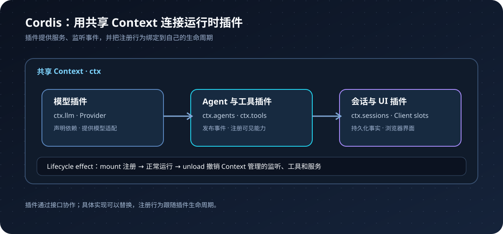
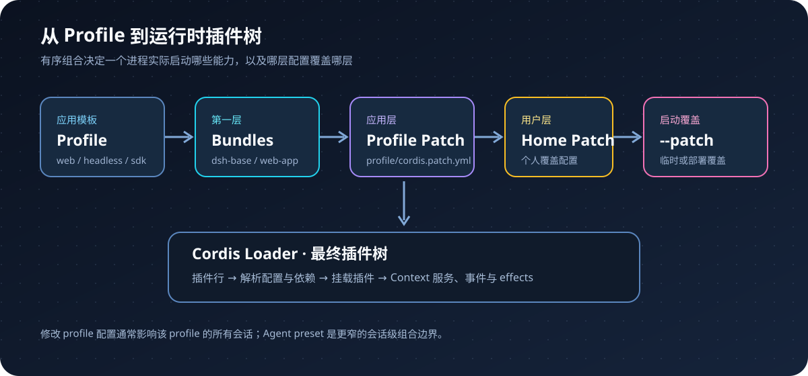
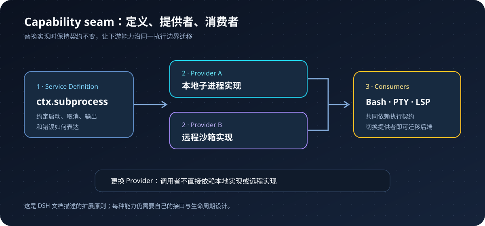
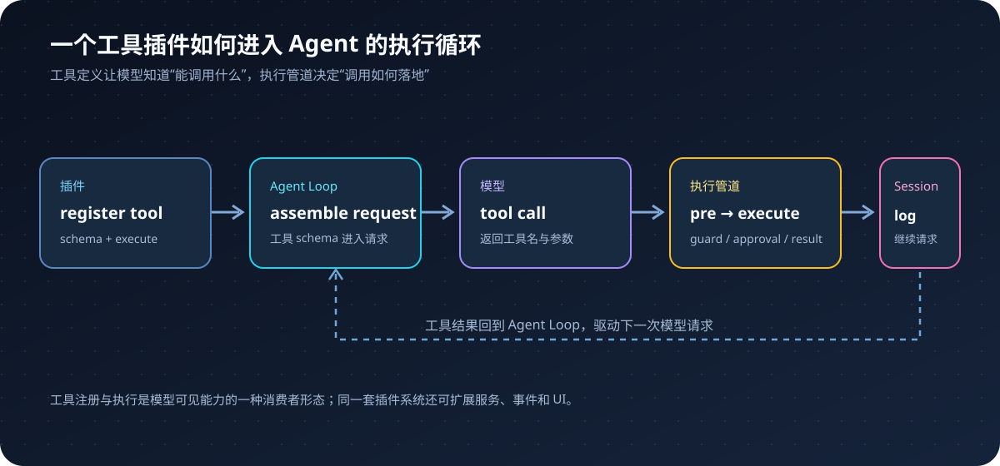

# DeepSeek Harness 的插件架构：把 Agent 运行时拆成可替换的能力

DeepSeek Harness 的介绍页把架构概括成一句话：Everything is a plugin。乍看像是把“插件”这个词用得很宽：模型、工具、会话、Agent 循环、界面，怎么好像什么都能叫插件？

这里的“插件式”有明确的工程含义。DeepSeek Harness（下文简称 DSH，命令名 `dsh`）用它仓库内的 Cordis 插件框架，把产品能力装配成一棵可配置的运行时插件树。插件之间通过共享上下文里的服务和有类型的事件协作；配置层决定哪些插件进入一个运行环境，以及它们如何组合。**插件不是 Agent 外面再加的一层扩展，而是 DSH 组织运行时本身的基本方式。**

这篇面向想理解 Agent Runtime 或准备开发 DSH 插件的工程师。我会从 Cordis 的基本对象讲到 profile、bundle、preset、工具调用和 Web 界面，并把插件的能力边界与安全代价分开说明。下文的版本状态按 2026 年 11 月 20 日可查的官方仓库和产品文档整理；DSH 仍在快速迭代，具体 API 应以你安装版本附带的文档为准。

## 一、先区分“插件”这个词的几种意思

DSH 中至少有几层东西会被口头叫作“插件”。它们有关联，但不是同一个对象。

| 名称 | 它是什么 | 解决的问题 |
| --- | --- | --- |
| **Cordis 插件** | 被 Loader 挂载的运行时模块，通常导出 `apply(ctx)` | 向运行时注册服务、事件监听、工具或其他能力 |
| **npm 包** | 插件代码的分发单元 | 把代码、依赖和元数据装进可安装的包 |
| **Bundle** | 带有 `dsh.bundle` 元数据的配置层 | 将一个或多个插件行加入某个 profile 的组合 |
| **Profile** | 一套可启动的运行时组合，例如 `web`、`headless` 或 `sdk` | 决定应用启动时加载哪些 bundles 和配置 |
| **Agent preset** | 某类 Agent 使用的能力与提示配置 | 为一个会话中的 Agent 选择不同的工具或行为 |
| **Skill / MCP** | 分别是可按需加载的行为说明、外部工具协议 | 提供可复用指令，或把外部服务接成模型可调用的工具 |

因此，“我安装了插件”“这个 profile 会加载它”“某个 Agent 能调用它的工具”是三个不同判断。包可能已安装，却没有被 profile 选中；插件行可能已存在，却被配置为禁用；工具也可能注册了，但没有进入某个 Agent 的可见工具集合。

DSH 官方架构文档把插件运行机制归给 Cordis，把启动组合归给 profiles 和 bundles。理解这两个层次，才能读懂 `Everything is a plugin` 具体指什么。[官方架构文档](https://github.com/deepseek-ai/deepseek-harness/blob/master/docs/architecture.md)

## 二、Cordis 的四个基本部件

### 1. 插件是一个挂载到 Context 的模块

Cordis 插件可以是一个实现插件协议的对象，也可以是普通函数式模块。DSH 面向插件开发的入门示例，使用 TypeScript 模块导出 `apply(ctx)`：Loader 准备好依赖后调用这个函数，插件再通过 `ctx` 接入运行时。

```ts
import type { Context } from '@deepseek-ai/cordis'

export const name = 'hello-plugin'

export function apply(ctx: Context) {
  // 在这里注册服务、事件监听器或工具
}
```

这段代码里需要关注的不是 `apply` 函数本身，而是参数 `ctx`。它是插件看到的运行时上下文，插件通过上下文访问其他插件提供的服务，而不是到处直接导入某个具体实现。DSH 的 [Cordis Primer](https://github.com/deepseek-ai/deepseek-harness/blob/master/docs/cordis-primer.md) 把这几项概念作为编写插件的基础。

### 2. Context 像一个有约定的服务目录

服务（service）是插件之间共享能力的接口，挂在稳定的 `ctx.<key>` 上，例如 `ctx.tools`、`ctx.llm`、`ctx.sessions`。一个插件声明自己依赖哪些服务；Loader 会等这些服务就绪后再挂载它，所以插件之间的先后关系主要由依赖描述表达，而不必由入口文件手写一长串启动顺序。

关键区别是：服务接口与服务实现可以分开。调用者依赖 `ctx.shell` 这样的能力约定；本地 Shell 或远程沙箱可以作为不同提供者接上去。这样，下游消费者不用为了换执行环境而各自改写一遍。

DSH 还用 scope 表达一次注册属于哪个 Agent。要把工具限制在单个 Agent 上，应通过该 Agent 的 `agent.ctx` 调用支持作用域的注册 API。只因为代码拿到了某个 Agent 的上下文，并不能保证任意服务都会自动隔离；隔离取决于具体服务是否实现了作用域规则。这让 profile 级插件与 Agent 级能力能够共存，但也要求插件作者查清每个服务的作用域契约。

### 3. 事件是插件协作的另一条通道

服务适合“我需要调用某项能力”；事件适合“运行时走到这里，允许其他插件观察或参与”。DSH 有会话事件、Agent 生命周期事件、工具执行事件以及文件系统、遥测等能力事件。插件可以在请求、模型流、工具执行等边界监听或介入，而不必把自己的逻辑塞进 Agent Loop 的实现文件里。

事件不是一种统一的回调。Cordis 为事件声明分发方式：`emit` 用于通知监听者，`parallel` 等待并行监听者完成，`serial` 按顺序等待，`bail` 允许监听者提前给出结果；`waterfall` 则让多个插件按顺序包装一次调用，监听者通常要调用 `next()` 才把执行权交给后续环节。**分发方式属于事件接口的一部分**，它决定插件到底是在旁观、串行协作，还是有权改变调用链。

### 4. 注册行为是可撤销的 effect

工具、事件监听、提示词段落和能力提供者等注册，不是插件启动时随手写进一个永久全局表。Cordis 将它们作为插件生命周期内的 effect 管理：插件卸载时，对应的注册会一起撤销。这样配置热重载或禁用插件时，不会只移除插件代码，却把旧监听器和旧工具留在运行时里。

这一点也有边界：通过 Cordis 管理的注册可以跟随插件卸载；插件自己启动的外部进程、文件监控、网络连接等资源，仍要由它正确收尾。插件生命周期提供了清理机制，不会自动替插件理解所有外部副作用。



## 三、`Everything is a plugin` 不等于“没有内核”

DSH 把模型适配器、会话日志、工具注册表、Agent 接口和默认 Agent Loop 都拆成插件，并定义它们之间可依赖的接口。架构文档明确列出 `ctx.sessions`、`ctx.systemPrompt`、`ctx.tools`、`ctx.agents`、`ctx.agentLoop` 等核心服务。默认 Agent Loop 是 Agent 接口的一种实现；其他插件依赖 Agent 契约，运行循环可以在组合层被替换。

所以这句口号更准确的解释是：**产品能力没有被焊死在一个不可替换的大对象里；核心运行时仍有 Cordis、Loader、服务契约和启动器。** 插件必须遵守这些接口，配置也必须能解析成 Loader 能挂载的插件树。DSH 不是任意 JavaScript 都能无条件塞进来的“无内核平台”。

这也解释了它与常见“给 Agent 加几个工具”的框架有什么差别：后者通常把插件放在 Agent Loop 外围，扩展工具集合；DSH 进一步把 Loop、模型适配、会话、客户端 UI 等产品组件也放进同一套组合与生命周期体系中。

## 四、Profile、Bundle 和 Patch 怎样拼出一个运行环境

Cordis 插件定义“运行时能提供什么”；配置组合定义“当前应用实际装入什么”。DSH 用几层对象管理后者：

- **Profile** 是完整的启动组合。仓库提供 `web`、`headless`、`sdk`、`sdk-minimal`、`acp` 等 profile 模板。
- **Bundle** 是一组 Cordis 配置行及其代码的分发单元。npm 包的 `package.json` 里用 `dsh.bundle.patch` 指向它的补丁文件。
- **Patch** 以插件行的 `id` 为目标，可以插入新行，也可以整体替换某行的配置。
- **Preset** 面向 Agent 级别的能力组合；profile 插件通常影响这个 profile 下的运行时，而 preset 用来决定特定 Agent 使用什么能力。

一个最小的本地开发流程，是在 `cordis.yml` 中插入本地插件文件，再用 `dsh web --patch ...` 启动 Web profile。要发布成可安装 bundle，包需要声明 `dsh.bundle`，并在 patch 中插入对应的插件行。例如：

```json
{
  "name": "dsh-hello-plugin",
  "version": "0.1.0",
  "type": "module",
  "main": "index.js",
  "dsh": {
    "bundle": { "patch": "./cordis.patch.yml" }
  }
}
```

```yaml
- insert:
    - id: hello
      name: dsh-hello-plugin
```

启动时，DSH 先应用 profile 声明的 ordered bundles，再应用 profile 自己的 `cordis.patch.yml`、用户 home 下的补丁，最后处理命令行传入的 `--patch`。上层 patch 可以覆盖此前同 ID 插件行的整份配置。官方架构文档还提供 `dsh --profile web --dump-config`，用来查看机器实际启动的插件树。



插件管理器把这套配置变成可操作的界面：可以启用或禁用插件行、安装或移除外部 bundle、选择 profile 使用哪些 bundles。配置变化是否立即生效，取决于 profile 是否启用了 HMR，以及当前插件变化能否热加载；否则要重启。配置属于 profile，**一次修改会影响正在使用该 profile 的所有会话**，不是只影响打开插件管理页的那一个 Agent。[插件管理器说明](https://github.com/deepseek-ai/deepseek-harness/blob/master/packages/boot/plugin-manager/README.md)

## 五、它插拔的是“能力接口”，不只是工具列表

DSH 官方架构文档用三个角色描述可替换能力（capability seam）：

1. **Service Definition**：声明调用者依赖的接口。
2. **Service Provider**：提供该接口的一种实现。
3. **Consumer**：使用接口的组件，可能是工具、Agent Loop 或其他服务。

一个完整能力可以由一个包承担多个角色，但设计时要分清接口、实现和使用者。以进程执行为例，Shell、持久终端和语言服务器等能力可以接到同一执行环境。若将本地子进程提供者换为远程沙箱提供者，下游的 Bash、PTY、LSP 可以沿着共同的执行边界切换，不用分别为每个消费者写远程版本。



可替换点不仅是执行环境。DSH 的官方扩展点还包括：

- **模型**：向 `ctx.llm` 注册不同的 LLM adapter。
- **模型可见工具**：向 `ctx.tools` 注册工具，其 schema 会进入模型请求的工具定义。
- **会话与状态**：扩展持久化后端、Session 事件或状态投影。
- **执行与策略**：替换 `ctx.fs`、`ctx.shell`、`ctx.sandbox` 提供者，或监听 `tools/*`、`agent/*` 事件。
- **界面**：增加 Web Client 插件、插槽内容、编辑器或对话消息节点。

每类能力有自己的接口和适用范围。插件系统提供共用的装配方式，不代表所有服务都能通过同一个通用 API 互相替换。

## 六、工具插件怎样走完一次模型调用

“工具插件”是常见的一类插件，但它只是插件架构的一部分。以一个查询本地项目依赖的工具为例，过程大致如下：

1. 插件向 `ctx.tools` 注册工具定义，包括名称、描述、参数 schema 和执行函数。
2. Agent Loop 组装当前请求时，读取该 Agent 可见的工具定义，并把 schema 放入模型请求。
3. 模型选择调用工具后，调用经过 `tools/pre-execute`、`tools/execute`、`tools/post-execute` 等阶段。
4. 执行结果以工具结果进入 Session，Agent Loop 再决定是否发起下一次模型请求。



这条链上，插件有多个介入位置：注册定义、影响工具对哪个 Agent 可见、在执行前检查权限或策略、调用实际提供者、把结果交回运行循环。工具定义和工具执行因此能独立于模型本身。

但要特别注意“服务可用”与“模型可见”并不相同。服务可能只被其他插件调用；只有消费者将能力包装成工具、并把工具 schema 加入当前请求，模型才知道可以调用它。反过来，注册了工具也不保证每个 Agent 都能看到它：作用域、preset、启用状态和工具过滤都会影响最终的可见集合。

## 七、Host 插件、Client 插件和 Creator Mode

DSH 的 Web 插件可能同时包含两半：

- **Host 半边**运行在 Node 端，可接入 Cordis 服务、工具、模型和文件系统等运行时能力。
- **Client 半边**运行在浏览器端，通过 `dsh.client` 声明打包后按需加载，并向 Web UI 的 slot（界面插槽）注册组件或操作。

Client 插件不会仅因代码在 npm 包里就自动显示。它还要有正确的 `dsh.client` 清单、Client bundle，以及能插入的 UI slot。页面启用插件后，客户端模块系统再加载对应 bundle；禁用时，系统等待插件副作用卸载后清理不再使用的模块和样式。[Client 模块系统说明](https://github.com/deepseek-ai/deepseek-harness/blob/master/packages/client/modules/README.md)

官方产品页展示的 Creator Mode，则是在这个基础上把插件开发交给 Agent 协助：用户描述想要的功能，Agent 查询插件开发 Skill、检查可用服务或 UI slot、生成插件包，再通过插件管理流程安装并验证。它更像“用自然语言驱动现有插件开发与安装流程”，并没有取消 TypeScript 模块、包元数据、配置层和生命周期这些底层约束。[官方产品介绍](https://deepseek.com/en/harness/)；[官方发布记录](https://github.com/deepseek-ai/deepseek-harness/releases)

这一层面也要和 MCP、Skill 分清：MCP 通常把外部服务作为工具接入；Skill 提供按需加载的行为说明；Cordis 插件可以直接扩展 DSH 的 Host 运行时或 Web 界面。它们有时会组合使用，但不是互相替代的同义词。

## 八、这种设计带来什么，也让团队多承担什么

### 收益：扩展和替换沿着同一套边界发生

传统做法可能是为工具写一套注册机制、为模型写 Provider 接口、为 Web 界面再写一套插件 API。DSH 仍然保留不同能力的专用接口，但把它们都纳入 Cordis 的依赖、事件、配置和生命周期管理。用户或维护者可以在组合层替换模型、存储、沙箱或执行后端，也能通过 bundle 增加一块功能，而不必维护一个私有分叉。

### 成本：组合关系本身成了需要维护的产品面

插件边界越多，团队越需要维护稳定的服务契约、配置字段、依赖声明、事件顺序、作用域规则、兼容版本和卸载行为。一次插件改动可能牵涉 profile bundle 的优先级、Host 与 Client 版本匹配、模型工具 schema 数量，以及 HMR 是否能安全完成。对一个只有两三个工具、执行路径固定的个人 Agent 来说，这套框架可能比业务逻辑本身更重。

### 风险：安装插件不等于在 Agent 沙箱里运行插件

这是 DSH 插件模型的关键边界。官方插件管理器说明明确写到：profile 安装的 Host 代码在 `dsh` 进程内执行，**位于 Agent 工作区沙箱之外**。Agent 的 Bash/文件权限设置不能被理解为插件的安全隔离层；插件代码及依赖获得的是运行 DSH 进程的权限。

插件管理器对 Agent 触发的管理操作会要求 `danger-full-access` 或相应批准，依赖安装脚本也有单独的审批过程。但这不改变安装后 Host 插件的执行边界。实操时，应把安装 npm/Git 插件视为引入一段受信任的本机程序：检查源码与依赖、关注安装脚本、锁定来源和版本，并优先在隔离 profile 或测试环境中试用。这个建议是根据官方执行边界得出的安全判断，不等于所有插件都存在恶意行为。

## 九、什么时候用插件，什么时候用其他机制

| 需求 | 优先机制 | 判断理由 |
| --- | --- | --- |
| 增加 DSH 内部服务、工具、策略或运行时事件处理 | Cordis 插件 | 需要进入 Host 运行时并依赖 DSH 服务契约 |
| 增加或替换模型、沙箱、文件系统等实现 | Provider 插件 / profile bundle | 需要从配置组合层替换能力实现 |
| 增加设置页、对话节点或侧边栏入口 | Client 插件 | 需要注册到 Web UI slot 或节点渲染机制 |
| 接入一个已有外部工具服务器 | MCP | 服务已独立运行，目标是协议化地暴露工具 |
| 让 Agent 遵循某种操作流程或领域指南 | Skill | 重点是指令与知识，不需要改运行时接口 |

开始开发之前，可以先运行 `dsh --profile web --dump-config` 看实际插件树，再分别回答三个问题：能力由哪个 service 承担？它应对 profile 全局生效，还是放进 Agent preset？如果暴露给模型，工具 schema 和执行权限由谁管理？答案清楚后，再决定用 Cordis、MCP、Skill 或几者组合。

## 结论

DeepSeek Harness 的插件式，核心不是“把每个功能做成可下载的插件包”，而是用 Cordis 把运行时能力拆成可组合的服务、事件和可撤销的注册，再用 profile、bundle、patch 和 Agent preset 决定每个环境实际挂载什么。

因此它适用于需要替换模型、执行后端、状态存储、Agent 策略或界面的运行时平台。代价是团队必须认真设计能力接口、配置优先级、版本兼容、卸载过程和插件信任边界。**当 Agent 的运行环境本身需要被组合和替换时，插件是架构；如果只想让模型多调一个外部 API，MCP 或普通工具注册往往更合适。**

### 参考资料

- [DeepSeek Harness Architecture](https://github.com/deepseek-ai/deepseek-harness/blob/master/docs/architecture.md)
- [Cordis Primer](https://github.com/deepseek-ai/deepseek-harness/blob/master/docs/cordis-primer.md)
- [Your First Plugin](https://github.com/deepseek-ai/deepseek-harness/blob/master/docs/user/develop/basic/index.md)
- [Plugin Manager](https://github.com/deepseek-ai/deepseek-harness/blob/master/packages/boot/plugin-manager/README.md)
- [Client Modules](https://github.com/deepseek-ai/deepseek-harness/blob/master/packages/client/modules/README.md)
