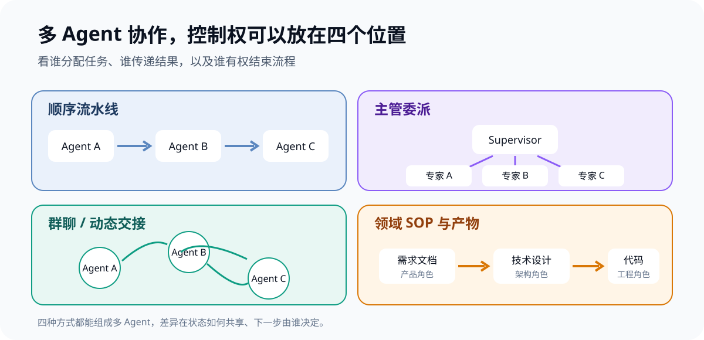
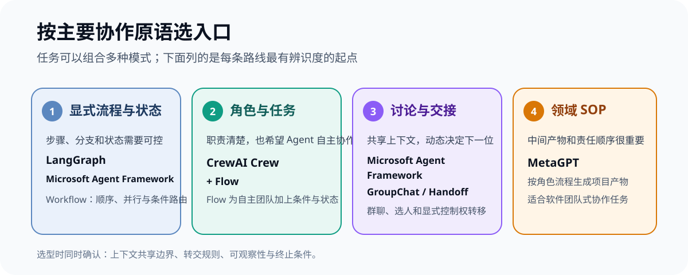
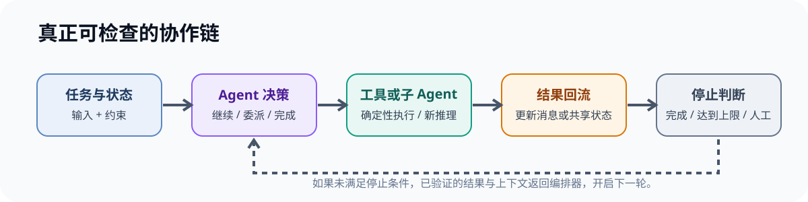

把三个不同 system prompt 连续发给同一个模型，很容易被称作「多 Agent」。但判断它是不是协作系统，关键不在 Agent 数量，而在三件事：**角色有没有明确分工，结果有没有在 Agent 之间流动，下一步由什么规则决定。**

正文深入对照 LangGraph、CrewAI、Microsoft Agent Framework 和 MetaGPT 的官方仓库与文档。它们都能组织多个 Agent，却把控制权放在不同位置：图里的状态与边、角色和任务、群聊选人，或一套领域 SOP。后面再列出六个值得纳入第二轮评估的开源候选。选型时应先说清楚要谁来决定下一步，再挑框架。



## 先把「协作」拆成能检查的机制

多 Agent 协作至少要有一条真实的数据和控制链：某个 Agent 产出结果，另一个 Agent 能拿到它；系统能决定谁接着工作；并且有停止条件。只把多个角色名写进提示词、最后仍只发起一次模型调用，不会自动变成协作。

工程上可以沿着四个问题检查：

1. **角色边界：** 每个 Agent 是否有不同目标、上下文或工具？
2. **状态传递：** 上一步的消息、工具结果或结构化产物怎样交给下一步？
3. **控制权：** 谁决定下一位 Agent，是固定流程、主管模型，还是群聊调度器？
4. **停止条件：** 何时结束，是否有限轮数、超时或人工确认？

这些维度比「用了几个 Agent」更能说明框架适不适合。两个 Agent 在共享历史里轮流发言，和一个主管把任务拆给只看各自子任务的专家，所需的状态设计和错误处理都不一样。

### 工作流与共享黑板，是两种不同的协作组织方式

工作流把「谁先做、谁后做」写在节点和边里：A 的输出进入 B，B 完成后进入 C。共享黑板（blackboard）则把公共任务、事实和 Agent 的中间发现放在同一份可追加的工作区；Agent 读取板上的内容，再把自己的新发现写回去，之后的参与者据此继续工作。黑板需要明确帖子来源、冲突处理和停止条件，否则不同 Agent 留下的互相矛盾的结论会越积越多。

两种方式并不互斥：黑板说明 Agent 通过什么共享信息，工作流或调度器说明谁在什么时候读取、写入。LangGraph 的 `StateGraph` 状态本来就是供节点读取并返回更新的共享数据；给帖子列表配置追加 reducer，就可以把它用作一块留言板。反过来，仅仅让多个节点读写不同的状态字段，并不等于黑板模式。([LangGraph Graph API：共享状态与 Reducer](https://docs.langchain.com/oss/python/langgraph/use-graph-api))

## 四个开源项目，把协作控制权放在不同地方

### LangGraph：把协作过程建模成有状态的图

LangGraph 定位为低层级的状态化 Agent 编排框架。开发者将节点、状态更新和路由条件连成图；节点可以是普通函数，也可以是一个 Agent 或子图。官方仓库强调持久执行、状态检查点、流式输出和人在环路，适合需要循环、分支、暂停后恢复或人工审批的任务。([LangGraph 仓库](https://github.com/langchain-ai/langgraph)；[持久化文档](https://docs.langchain.com/oss/python/langgraph/persistence))

这种灵活性意味着团队要自己定义共享状态、转交消息的格式和停止规则。它适合希望把协作过程变成显式控制流、并且需要逐节点检查的工程；简单的固定流水线则可能写得比业务本身还复杂。

### CrewAI：先定义角色和任务，再用 Flow 收住流程

CrewAI 提供两个相互配合的抽象。Crew 是带角色的 Agent 团队，围绕任务协作；Flow 用事件、状态和条件组织更精确的执行路径，也可以在某一步调用 Crew。官方文档把 Crew 描述为偏自主协作，把 Flow 描述为结构化、可控的工作流。([CrewAI Crews 文档](https://docs.crewai.com/en/concepts/crews)；[Flows 文档](https://docs.crewai.com/en/concepts/flows))

它的优势是概念容易映射到业务团队：「研究员完成调研，分析师给结论，编辑负责成稿」。如果任务需要确定的校验、分支和重试，可以把控制放在 Flow；如果所有步骤都交给 Crew 的自主行为，团队仍需要额外观察任务是否真的按预期完成。

### Microsoft Agent Framework：把群聊、交接和工作流都做成编排原语

AutoGen 的 AgentChat 提供轮流发言、模型选择下一位发言者和显式交接等团队模式；群聊里可以共享对话上下文，并用消息数、文本标记或特定 Agent 发言等条件终止。([AutoGen 团队文档](https://microsoft.github.io/autogen/stable/user-guide/agentchat-user-guide/tutorial/teams.html)；[终止条件](https://microsoft.github.io/autogen/stable/user-guide/agentchat-user-guide/tutorial/termination.html))

不过，新项目需要区分 AutoGen 与它的后续方向：微软官方仓库已将 AutoGen 标注为维护模式，并建议新用户看 Microsoft Agent Framework。后者由 Microsoft Agent Framework 仓库维护，面向 Python 与 .NET，提供顺序、并行、交接、群聊和 Magentic 等工作流构建器。([AutoGen 仓库状态](https://github.com/microsoft/autogen)；[Microsoft Agent Framework 仓库](https://github.com/microsoft/agent-framework)；[编排模式示例](https://github.com/microsoft/agent-framework/tree/main/python/samples/03-workflows/orchestrations))

如果团队已经有 AutoGen 代码，迁移路径值得认真评估；如果是新项目，Microsoft Agent Framework 更适合作为当前入口。它覆盖的概念多，代价是要先决定使用较高层的 Agent/Orchestration API，还是直接编排底层 Workflow。

### MetaGPT：把协作规则写成一套软件团队 SOP

MetaGPT 的出发点是把产品经理、架构师、项目经理和工程师等角色组织成一个模拟软件团队。不同角色接收需求、执行动作并发布产物；标准操作流程（SOP）规定任务先后和应交付的中间文件。项目 README 将其核心思想概括为「Code = SOP(Team)」，官方概念文档则描述了 Agent、环境、SOP、通信等组成部分。([MetaGPT 仓库](https://github.com/FoundationAgents/MetaGPT)；[官方概念文档](https://docs.deepwisdom.ai/enus/guide/tutorials/concepts.html))

它适合软件研发流程或明确业务流程的探索：需求、设计、任务拆分和代码产物本身就是协作对象。固定 SOP 能让产物结构更清楚，但不保证模型每次都遵守流程，也不代表生成内容正确；仍需检查产物质量、模型输出和执行权限。



## 横向对比：先看谁控制下一步

| 项目 | 协作原语 | 谁决定下一步 | 更适合 |
|---|---|---|---|
| LangGraph | 状态图、节点与路由 | 图的条件或节点内的模型 | 自定义控制流、状态恢复、人工介入 |
| CrewAI | Crew 角色团队 + Flow | Crew 自主协作，Flow 控制流程 | 角色化业务任务，兼顾自主性与确定性 |
| Microsoft Agent Framework | 顺序、并行、交接、群聊等工作流 | 编排器或工作流图 | Python/.NET 团队、显式流程和群聊模式 |
| MetaGPT | 角色、环境消息与 SOP 产物 | 领域流程与角色动作 | 软件团队式任务、固定中间交付物 |

这张表比较的是官方公开的协作抽象，不是同一任务、同一模型和同一预算下的性能评测。不能从中推出哪个框架回答更准确或更省钱；这些结果会随模型、提示词、工具和流程配置变化。

## 还有哪些开源框架值得看

上面的四个项目不是完整名单。下面这些项目同样能组织多 Agent，但它们各自的主要抽象不同，适合按需求补充比较：

| 项目 | 主要协作方式 | 和共享黑板的关系 | 更值得考虑的场景 |
|---|---|---|---|
| Google ADK | Workflow 图、动态执行与协作式主管 | 图节点可传递状态，但黑板结构通常由应用定义 | 希望把 Agent 与普通代码节点放进同一张流程图，或需要 Google ADK 的多语言生态 |
| OpenAI Agents SDK | 专家 Agent 作为主管的工具，或通过 handoff 转交控制权 | 主要通过工具结果、运行上下文和交接传信息；没有以黑板为中心的默认抽象 | 想用较少概念快速搭建主管委派、路由和专家 Agent |
| Agno | Team 的 coordinate、route、broadcast、tasks 模式 | 有团队共享 session state，也能广播同一任务；成员状态可能通过复制与合并回流，并行写同一键不是原子事务 | 想直接配置成员广播与团队状态，做一版共享信息协作原型 |
| LlamaIndex | AgentWorkflow handoff、主管调用子 Agent 工具，或自定义工作流 | Workflow `Context` 和初始状态可承载累积笔记，黑板需要自己定义记录结构 | 多 Agent 与检索、知识库、文档处理紧密结合的应用 |
| Langroid | Agent/Task、分层任务委派与消息轮转 | 默认以消息和子任务委派为中心；若要公共留言板，需自行设计共享状态或工具 | 希望用轻量、可组合的 Agent 与任务抽象组织消息驱动协作 |
| CAMEL-AI | Agent Societies、角色扮演与 Workforce | 更侧重 Agent 社会和角色交互；不是以固定状态图或黑板协议为核心 | Agent 社会研究、角色协作、模拟与多 Agent 任务自动化 |

这六个项目并非同一类产品的直接排名。Google ADK 的新一代图式 `Workflow` 与协作式 Workflow 是 ADK 2.0 起的能力；旧的顺序、并行和循环模板正在被更灵活的 Workflow 取代，选型时要核对所用版本。OpenAI Agents SDK 虽然也能用代码串联或并行运行 Agent，但其文档重点是「Agent 作为工具」和 handoff 两种 LLM 编排模式。LlamaIndex 的 AgentWorkflow 则内置 handoff，也支持由主管 Agent 决定调用哪些专家。

**如果你特别关心共享留言板，Agno 是值得优先试的现成团队抽象；如果你需要自己控制每条留言怎样追加、排序、归并和检查，LangGraph 仍更适合这个 Demo。** Agno 的 session state 是共享协作数据，不等同于带事务保证的数据库；多个 Agent 并行更新同一键时，需要自己设计冲突处理。LlamaIndex 和 Langroid 也能扩展出留言板，但前者的强项是与数据/RAG 工作流结合，后者更强调消息传递和任务委派。

## 怎么选：从任务结构开始，而不是从 Agent 数量开始

**顺序已知、状态需要保留。** 先把每步画成普通程序流程。如果有循环、分支、检查点、暂停恢复或复杂状态共享，再考虑 LangGraph 或 Microsoft Agent Framework Workflow。若只是 A 输出传给 B，几行串联调用通常够了。

**角色明确、任务边界容易描述。** CrewAI 的 Crew 能把业务角色和职责映射到 Agent；若流程还包含条件、重试和人工确认，就把步骤和状态收进 Flow。

**下一位参与者需要看讨论再决定。** 采用群聊或 handoff 模式，明确共享哪些上下文、怎样限制发言轮数，以及谁拥有结束权。AutoGen 展示了这些交互模式；新项目应同时评估其后续框架 Microsoft Agent Framework。

**任务本身遵循一套领域 SOP。** MetaGPT 这类角色与产物模型适合把中间文件、责任归属和操作顺序显式化。若团队流程频繁变化，先确认更新 SOP 的成本是否能接受。



## 让 Demo 证明 Agent 真正在协作

一个可检查的演示不该只打印最后答案。它至少要展示模型请求与角色、Agent 的原始返回、结果怎样传递、控制权如何切换，以及什么条件让流程结束。

当前仓库的 `Agent/examples/multi-agent-collab/` 用 LangGraph `StateGraph` 实现了四种真实 API 场景。主管图从数据节点分出两个并行专家分支，汇合后由主编总结；共享留言板图让专家把内容追加到同一份公共状态，审阅员和主编再读取累积留言；流水线图把提炼、改写和行动建议串成有向工作流；谈判图用条件路由轮流调用买家和卖家，并以 `thread_id`、内存检查点支持页面逐轮恢复。四种场景使用同一组 OpenAI-compatible 运行时配置，但每个 Agent 的系统提示、输入上下文和协作规则不同。Streamlit 页面能展示实际图结构、节点请求、模型回复、共享板面和状态变化。

从仓库根目录可直接启动 Supervisor 或共享留言板场景；页面版会打开四种协作模式：

```bash
bash scripts/run-multi-agent-collab.sh --scene supervisor
bash scripts/run-multi-agent-collab.sh --scene blackboard
bash scripts/run-multi-agent-collab-ui.sh
```

这个 Demo 用来观察协作机制，不是框架横评或生产模板。销售数据和谈判规则是示例数据；当前检查点保存在进程内，进程重启后不会保留。换成真实业务前，还要接入持久化 checkpointer，并完善业务级重试预算、输出校验、权限隔离与成本控制。

## 结论

这四个项目并没有在争夺同一种「多 Agent」。LangGraph 和 Microsoft Agent Framework 更强调编排控制，CrewAI 以角色团队和流程两层降低建模门槛，MetaGPT 把领域 SOP 和中间产物放在中心。先定任务的状态流转和停止条件，再决定让模型拿多少控制权，通常比先选一个框架、再把需求硬塞进去更省返工。

如果你还不能回答「谁把什么交给谁、谁决定下一步、什么时候停」，先把这条链画清楚，再开多 Agent。

## 官方资料

- [LangGraph GitHub](https://github.com/langchain-ai/langgraph) · [LangGraph Graph API](https://docs.langchain.com/oss/python/langgraph/graph-api) · [LangGraph Persistence](https://docs.langchain.com/oss/python/langgraph/persistence)
- [CrewAI Crews](https://docs.crewai.com/en/concepts/crews) · [CrewAI Flows](https://docs.crewai.com/en/concepts/flows)
- [AutoGen AgentChat Teams](https://microsoft.github.io/autogen/stable/user-guide/agentchat-user-guide/tutorial/teams.html) · [Microsoft Agent Framework](https://github.com/microsoft/agent-framework)
- [MetaGPT GitHub](https://github.com/FoundationAgents/MetaGPT) · [MetaGPT Concepts](https://docs.deepwisdom.ai/enus/guide/tutorials/concepts.html)
- [Google ADK Workflows](https://google.github.io/adk-docs/workflows/) · [Google ADK Python Workflow](https://github.com/google/adk-python/blob/main/docs/guides/workflow/workflow/index.md)
- [OpenAI Agents SDK: Agent orchestration](https://openai.github.io/openai-agents-python/multi_agent/)
- [Agno Teams](https://docs.agno.com/teams/overview) · [Agno Team Session State](https://docs.agno.com/state/team/overview)
- [LlamaIndex Multi-Agent Patterns](https://developers.llamaindex.ai/python/framework/understanding/agent/multi_agent/)
- [Langroid GitHub](https://github.com/langroid/langroid) · [Langroid Task Delegation](https://langroid.github.io/langroid/quick-start/multi-agent-task-delegation/)
- [CAMEL-AI GitHub](https://github.com/camel-ai/camel) · [CAMEL-AI Agent Societies](https://docs.camel-ai.org/)

*资料核对日期：2026-10-21。框架能力与项目维护状态以各自官方仓库和文档为准；本文没有做同任务基准测试。*
