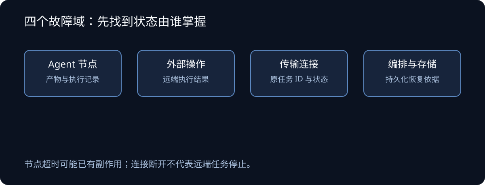
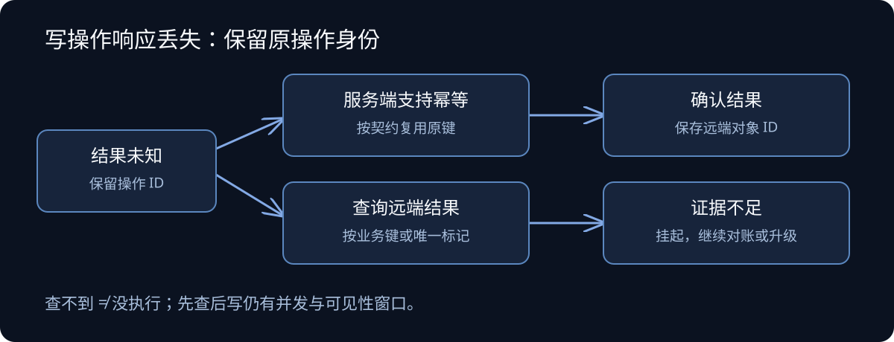
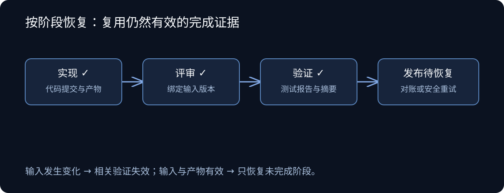

一条自动化开发流程已经完成代码修改和测试，准备发布结果时，外部接口返回了 `EOF`。如果系统把这个错误统一记成“任务失败”，下一轮就可能重新启动 Agent，让它再做一遍已经完成的工作。

换成创建工单、发送消息或提交订单，问题会更棘手：远端已经执行成功，只是响应在途中丢了。此时再次执行，可能产生两个工单、两条消息或两笔订单。

这两个场景指向同一个设计问题：恢复机制需要知道失败发生在哪里、操作结果是否确定，以及重复执行会造成什么影响。**恢复的目标是推进尚未完成的工作，同时保住已经完成的结果。**

本文面向需要调用工具、跨阶段运行或连接远程服务的 Agent 系统。下面的故障分类、状态模型和落地顺序是一套工程设计建议；框架机制与接口语义则在相应位置附上官方来源。

## 一、先区分四个故障域

“中断”只是调用方看到的现象。决定恢复动作的，是执行状态由谁掌握。

| 故障域 | 常见现象 | 恢复前要确认什么 |
|---|---|---|
| Agent 推理与执行节点 | 模型超时、输出格式错误、循环、进程退出 | 有哪些产物和工具操作已经完成 |
| 外部操作 | API 报错、限流、连接重置 | 请求是否生效，重复执行是否安全 |
| 传输连接 | SSE 断流、WebSocket 断开、轮询失败 | 远端任务是否仍在运行 |
| 编排与状态存储 | 调度进程崩溃、检查点写入失败 | 哪份持久化状态可以作为恢复依据 |



*图 1：同一条流程中，节点、外部服务、连接和状态存储分别掌握不同的恢复信息。*

Agent 节点超时也不意味着没有副作用。一个节点可能先改了文件、创建了远端资源，再卡在下一次模型调用上。恢复时既要检查对话与中间产物，也要检查工作区和工具操作记录。

连接断开同样不能证明任务停止。对于已经拿到任务 ID 的远程任务，应先用这个 ID 查询状态：完成就获取结果，运行中就恢复观察，需要输入就等待输入。只有远端明确不存在该任务，并且重新提交的语义安全时，才考虑创建新任务。查询暂时失败时，继续保留“未知”，不能据此推断任务不存在。

编排层则负责保留这些证据。如果检查点写入失败，却继续执行下一次外部写操作，系统重启后就可能连“刚才执行到了哪里”都不知道。因此，在依赖持久化状态保证恢复安全的边界上，写入失败应阻止流程继续推进。

## 二、把“结果未知”单独建模

对一次操作，至少需要区分三类结果：

- **确定成功。** 有符合接口契约的成功凭据，例如资源 ID、完成状态或可验证的持久化结果。
- **确定未执行。** 能确认目标副作用没有发生，例如服务端明确在执行前拒绝了参数。
- **结果未知。** 请求可能已经到达并生效，但调用方没有拿到足够证据。

超时、`EOF` 和部分服务端错误都可能落入第三类。甚至收到 HTTP 200 也不一定代表业务流程完成：异步接口可能只确认接收请求，业务是否完成还要看任务状态或返回体。

状态码适合帮助分类，但不足以独立决定恢复。认证失败可能允许刷新凭据后再试；403 可能表示权限不足，也可能被某些服务用于限流；429 通常需要等待，但具体的副作用保证仍应以接口契约为准。适配器应结合状态码、业务错误码、请求类型和响应内容作判断。

这里还需要第二个维度：幂等性。它表示同一个操作重复执行，对目标状态的预期影响与执行一次相同，并不要求每次返回完全相同的响应。HTTP 规范将 PUT、DELETE 和安全方法定义为幂等方法；应用仍需确认实际接口遵守相应语义。[RFC 9110：Idempotent Methods](https://www.rfc-editor.org/rfc/rfc9110.html#section-9.2.2)

| 操作条件 | 结果未知时的动作 | 注意事项 |
|---|---|---|
| 符合契约的只读操作 | 在预算内重试 | 重试读到的可能是更新后的数据 |
| 有服务端幂等保障的写操作 | 按契约复用原操作标识重试 | 核对参数、作用域和去重有效期 |
| 可以查询结果的非幂等写操作 | 先对账，再决定是否补发 | 查不到不一定表示没执行 |
| 无法去重、无法可靠查询的写操作 | 挂起并升级处理 | 自动补发可能放大损失 |

发送邮件、扣款或推送消息是否能安全重试，取决于接入服务提供什么保证，不能仅凭业务名称判断。扣款接口可能提供强幂等保障，邮件服务也可能支持业务消息 ID；反过来，一个看似简单的“更新”接口，也可能每调用一次就触发一次通知。

## 三、写操作恢复：先保留操作身份，再处理未知结果

以“创建一条通知”为例：调用方发出请求，服务端保存了通知，但响应丢失。此时本地应记录的是“通知创建结果未知”，并保留本次业务操作的身份。



*图 2：结果未知时，优先使用原操作标识去重或对账；证据不足就保持挂起。*

### 服务端支持幂等键时，恢复必须使用原来的键

幂等键是调用方为一次逻辑操作生成的稳定标识。首次请求和后续重试共享同一个键，服务端据此识别重复请求。每次重试生成新键，会失去去重作用。

Stripe 的官方接口展示了这一模式：连接异常后可以复用幂等键重试。其 API v1 会在执行开始后保存首次请求的状态码与响应体，包括部分失败响应；相同键配不同参数会被拒绝，键也有保留期限。这说明客户端必须理解具体服务的契约，不能把“带了一个键”当成永久安全保证。[Stripe：Idempotent requests](https://docs.stripe.com/api/idempotent_requests)

### 先查后写能减少重复，但有并发窗口

没有服务端幂等键时，可以用业务 ID、外部引用或内容中的唯一标记查询结果。查到匹配对象，就把远端对象 ID 写回本地，继续下一步。

但“没查到就创建”不能单独保证幂等。两个执行器可能同时查到不存在，然后各创建一次；查询也可能因为最终一致性，暂时看不到已经创建的对象。

如果需要更强的保证，应优先依赖远端唯一约束、条件创建或原子去重。只有客户端能配合时，可以通过单一执行者、租约或锁减少竞争，并考虑旧执行者在租约失效后仍继续运行的情况。若远端无法拒绝旧执行者的写入，客户端锁仍不能消除所有重复风险。

### 账本记录恢复证据，不承诺自动消除重复

对有风险的写操作，可以持久化一份小账本，记录操作 ID、参数摘要、远端对象 ID、尝试次数与当前状态。写入意图应先于发送；如果进程在发送后、确认前崩溃，恢复时就按结果未知处理。

```text
prepared  →  in_flight  →  confirmed
                  ↓
               unknown  →  对账确认成功 → confirmed
                  ↓
          证据不足，保持挂起
```

账本让系统知道要查哪一笔，但无法独自关闭“远端成功、本地尚未记账”的窗口。安全恢复仍然依赖服务端去重或可靠对账。

更复杂的系统可以采用 Outbox：在同一个本地事务中保存业务状态和待投递意图，再由投递器发送。它解决本地状态与发送意图的一致性，投递端仍可能重复发送，接收端仍需去重。补偿流程也要单独设计，例如取消预订或退款；它们可能失败，且不一定能完全撤销原操作的影响。

## 四、检查点保存进度，恢复前还要验证产物有效

一个自动化开发流程可以拆成实现、评审、验证、发布。每个阶段保存产物和完成证据，发布连接异常时，就可以保留此前完成的代码与验证结果，只恢复发布相关操作。



*图 3：阶段产物保持有效时，恢复范围可以限制在尚未完成的发布阶段。*

LangGraph 的检查点用于保存线程内的图状态，支持中断恢复与容错；用于进程崩溃恢复时，还需要选择能够跨进程保存数据的后端。[LangGraph：Persistence](https://docs.langchain.com/oss/python/langgraph/persistence)

检查点的粒度也有边界。假如一个节点先发送通知，再保存节点完成状态，进程可能在两者之间退出。恢复后重新进入节点，仍然可能重复发送通知。Temporal 因此建议 Activity 具备幂等性：Activity 可能被重试，重复执行不应产生意外副作用。[Temporal：Activity Definition](https://docs.temporal.io/activity-definition#idempotency)

**检查点保存“执行到了哪里”，幂等与对账处理“这一步是否已经生效”。** 两者需要配合。

阶段结果还要绑定输入。例如测试结果应绑定代码提交、依赖或配置版本；代码在验证后发生变化，就要使相关验证失效。否则“从发布阶段继续”可能变成发布未经验证的新内容。

一种实用的阶段记录可以包含：

```yaml
phase: verification
input_revision: <commit-sha>
status: completed
artifact: artifacts/test-report.json
artifact_digest: <sha256>
```

恢复时先验证输入版本和产物完整性。满足条件就复用，不满足就重新执行受影响的阶段。恢复范围取决于哪些证据仍然有效，不能只看最后一个成功阶段的名字。

### Temporal：事件历史重放，重建的是编排状态

Temporal 把 Workflow 的编排决策与 Activity 的实际执行分开。Workflow 决定接下来调用哪个 Activity、等待哪个事件；模型请求、外部 API 和文件操作放在 Activity 中。

恢复时，Worker 可以从头执行 Workflow 代码，通过事件历史还原已有决策。已经记录完成结果的 Activity 会返回历史中的结果，不会因这次重放再次调用模型或外部接口。Workflow 因而必须保持确定性：直接读取随机数、系统时间或调用网络，可能使重放走上不同分支；应使用框架提供的相应能力，或把非确定性操作放入 Activity。[Temporal：Workflow replay](https://docs.temporal.io/workflows)

例如，历史已经记录“生成方案完成”和“测试完成”，发布 Activity 尚未确认完成。Worker 重启后可以复用前两步结果，继续处理发布。但如果发布已在远端成功、完成记录却没有送达，Activity 仍可能重试。事件重放不会替代外部接口的幂等保证。

### Temporal：用不同超时区分排队、执行与失联

Activity 的几类超时分别限制不同时间范围：

| 配置 | 限制范围 | 主要用途 |
|---|---|---|
| `Schedule-To-Start` | 单次任务从入队到 Worker 接手 | 发现排队过久、Worker 容量问题 |
| `Start-To-Close` | 一次尝试从开始到结束 | 给单次执行设上限，发现执行者失联 |
| `Schedule-To-Close` | 从首次调度到最终完成，包含重试等待 | 限制整个 Activity 的总耗时 |
| `Heartbeat Timeout` | 相邻心跳的最大间隔 | 更早发现长任务失联 |

心跳超时后是否重试，还取决于重试策略；超时本身也不能保证旧进程已经停止写入远端。恢复时仍应防范旧执行者与新尝试同时运行。[Temporal：Detecting Activity failures](https://docs.temporal.io/encyclopedia/detecting-activity-failures)

长 Activity 可以在心跳中携带已完成批次等进度，新尝试读取这些信息，显式跳过已完成部分。SDK 可能节流心跳，因此刚在本地调用心跳后立刻崩溃，最新进度不一定已经送达；这段重做范围仍要保证安全。Python SDK 提供 `activity.heartbeat(...)` 和 `activity.info().heartbeat_details` 来写入和读取这些进度，但不会自动恢复函数的局部变量或指令位置。[Temporal：Activity heartbeat](https://docs.temporal.io/encyclopedia/detecting-activity-failures#activity-heartbeat)、[Python Activity Info](https://python.temporal.io/temporalio.activity.Info.html)

### LangGraph：完整检查点与并行节点写入是两层记录

LangGraph 在 super-step 边界保存完整检查点。super-step 可以理解为同一轮被调度的节点集合，其中的节点可能并行执行。除此以外，已完成节点的输出还会单独保存为 pending writes。

假设一轮中节点 A 分析代码，节点 B 查询依赖。A 已完成并保存写入，B 失败；从该轮恢复时，A 的成功输出可以复用，避免把两个节点一起重跑。这些节点写入不是任意位置的完整快照；失败节点内部尚未记录的工作仍可能重新执行。[LangGraph：Checkpointers](https://docs.langchain.com/oss/python/langgraph/checkpointers)

持久化时机也可以选择：

| 模式 | 写入时机 | 恢复代价 |
|---|---|---|
| `exit` | 执行正常结束、报错退出或受控中断时 | 运行中进程崩溃，无法依靠本轮中间进度恢复 |
| `async` | 下一步执行时异步保存 | 崩溃可能丢失尚未写完的检查点 |
| `sync` | 保存完成后才启动下一步 | 增加写入等待，缩小进度丢失窗口 |

这三个模式决定何时保存，checkpointer 后端决定保存在哪里。`sync` 配内存后端仍不能跨进程恢复；需要持久化后端、稳定的 `thread_id` 和可用的产物存储共同配合。这些模式也不能代替后端自身的数据可靠性保障。[LangGraph：Durability 定义](https://github.com/langchain-ai/langgraph/blob/main/libs/langgraph/langgraph/types.py)、[Persistence](https://docs.langchain.com/oss/python/langgraph/persistence)

## 五、重试应该有归属、预算和停止条件

网络读取异常适合重试，但参数错误需要修改输入，权限不足需要修复授权，模型循环则需要限制步数或改变执行策略。一套统一的“失败就等一秒再来”无法覆盖这些情况。

重试策略至少应说明：谁负责重试，单次调用允许多久，总共允许多久或多少次，什么条件下停止。瞬时故障可使用指数退避与随机抖动；服务端明确提供等待时间时，应结合接口契约遵守该时间。持久化唤醒时间比让执行进程长时间占用等待更适合需要跨重启恢复的任务。

AWS 对重试的讨论强调了两类风险：重试增加故障服务的负载，多层重试还会放大调用量。其建议包括退避、抖动以及在调用链中选择合适的层负责重试。[AWS：Timeouts, retries and backoff with jitter](https://aws.amazon.com/builders-library/timeouts-retries-and-backoff-with-jitter/)

在 Agent 系统里，可以让工具适配器吸收一部分短暂故障，预算耗尽后向编排器返回结构化结果。编排器再决定挂起、恢复某个阶段或请求人工处理。下面是建议的数据格式，不是某个框架的标准协议：

```json
{
  "domain": "external_operation",
  "category": "outcome_unknown",
  "operation_id": "notification-42",
  "attempts": 3,
  "safe_to_repeat": false,
  "next_action": "reconcile"
}
```

需要模型修改参数、选择替代方案或解释业务拒绝时，可以把工具错误交给模型。对未知结果的写操作，工具层仍应守住安全边界：模型提出“再试一次”，不能绕过原有操作 ID、去重规则与对账流程。

同时要区分暂停的原因。等待用户输入、等待授权、用户要求取消、自动重试预算耗尽，是不同状态。用户主动要求停止时，应停止调度后续动作，并处理正在执行的调用；取消请求无法证明已经发生的远端写入被撤销，仍需确认其最终结果。

### LangGraph 的默认重试，必须结合异常类型理解

以下针对 Python 版本，依据 2026 年 10 月 24 日公开文档与主分支源码；不能直接套用到 JavaScript SDK 或任意旧版本。节点通过 `retry_policy` 配置重试，`RetryPolicy` 的默认参数包括：

```python
RetryPolicy(
    max_attempts=3,        # 包含首次执行，共三次尝试
    initial_interval=0.5, # 秒
    backoff_factor=2.0,
    max_interval=128.0,   # 秒
    jitter=True,
)
```

默认异常判断不是“出错全部重试”：`ValueError`、`TypeError`、`RuntimeError`、`OSError` 等多类异常被排除，HTTP 状态异常还会按状态码分类。配置了尝试次数，也不代表任意异常都会耗完次数。[LangGraph：Fault tolerance](https://docs.langchain.com/oss/python/langgraph/fault-tolerance)

源码中还有一个容易忽略的顺序：Python 内置 `ConnectionError` 在 `OSError` 排除判断之前被明确允许重试。HTTP 客户端自己的连接异常、命令行工具的非零退出、stderr 中的一句 `EOF`，则不一定映射到这个类型。因此适配器需要先把错误规范化，再为可安全重复的操作配置 `retry_on`；不能仅凭日志里出现“connection”来推断框架会怎样处理。[LangGraph：default_retry_on 源码](https://github.com/langchain-ai/langgraph/blob/main/libs/langgraph/langgraph/_internal/_retry.py)

更需要注意的是，节点重试会重新执行节点函数。如果节点先写远端、后抛异常，重试仍会经过写操作。对未知结果的写入，应先进入对账路径，不能用一个宽泛的 `retry_on=lambda exc: True` 覆盖安全边界。

## 六、停滞治理：分别观察存活、活动与有效进展

一个 Agent 持续输出“继续检查”，进程也正常发送心跳，却可能一直在重复同一条失败命令。反过来，安静运行的编译或训练任务也可能在正常推进。只看“多久没输出”，容易同时漏报循环和误杀长任务。

### 公开实现怎样识别循环

OpenHands 的 `StuckDetector` 从最近的事件序列中识别重复动作与观察、重复动作与错误、连续独白，以及两组动作来回交替等模式。这给出了一个可借鉴的方向：比较工具名、参数和观察结果，识别重复模式，而非只限制运行总时长。

但规则检测也有实现边界。本文查到的源码中，上下文窗口错误循环的检测函数仍直接返回 `False`，不能因函数名存在就认为该能力已经生效。重复轮询本身也可能合法，接入业务时需要结合任务状态区分。[OpenHands：StuckDetector 源码](https://github.com/OpenHands/software-agent-sdk/blob/main/openhands-sdk/openhands/sdk/conversation/stuck_detector.py)

### 监督器需要三类信号

下面是一套应用层设计建议，不要求监督器本身也是模型。它可以是与执行节点分离的调度组件，持续读取事件和持久化进度。

| 信号 | 可以证明什么 | 不能单独证明什么 |
|---|---|---|
| 进程心跳、租约续期 | 执行者还能通信 | 任务已经推进 |
| token、日志、工具开始与结束事件 | 系统仍有活动 | 活动产生了新结果 |
| 新证据、完成批次、已确认子目标 | 出现可检查的阶段进展 | 整个任务已经正确完成 |

建议分别保留 `last_heartbeat_at`、`last_activity_at`、`last_progress_at`。进展信号应绑定证据，例如新保存的分析结果、已处理批次 ID、一次改变了诊断结论的测试结果。单纯改了文件、重复写日志或消耗更多 token，不应自动刷新有效进展时间；探索任务中，“排除了一个假设”也可以是进展，但应保留排除依据。

监督器再组合使用单次调用期限、无进展窗口、重复模式阈值和整个任务预算。它们分别约束长时间阻塞、空转、循环与总成本。阈值应按阶段设置：查询 API、全量测试和大型构建的正常耗时不同；不存在适用于所有 Agent 的统一“五分钟无输出就杀掉”规则。

LangGraph 的 Python 文档也区分了 `run_timeout` 与 `idle_timeout`：前者约束一次执行的总时长，后者在观察到活动时刷新。默认活动信号可以包含 token 和回调，因而仍可能被无效输出刷新；显式心跳模式能缩小刷新来源，但心跳何时发送仍由应用负责。文档将节点超时与 graceful shutdown 标注为需要 `langgraph>=1.2`，节点超时仅适用于异步节点，接入时应核对安装版本。[LangGraph：TimeoutPolicy 源码](https://github.com/langchain-ai/langgraph/blob/main/libs/langgraph/langgraph/types.py)

### 触发停滞后，先收束工作，再决定如何恢复

可采用“提示纠偏 → 有限宽限期 → 挂起或终止”的升级顺序。纠偏提示应带证据，例如“同样参数的工具调用连续得到同样错误，请修正参数或选择其他路径”。若没有新证据，不应让相同恢复提示无限循环。

在宽限期内，停止发起新的高风险操作，允许正在执行的安全工作收束。提前、增量地保存以下内容，而不要等到超时才要求模型写总结：

- **已确认发现。** 结论、证据路径、测试结果与输入版本。
- **未完成工作。** 当前假设、已尝试路径、失败原因和下一步候选。
- **外部操作。** 操作 ID、远端资源 ID，以及尚未确认结果的写入。
- **本地产物。** 工作区位置、差异或提交引用、报告路径和完整性摘要。

模型生成的交接摘要有助于继续推理，但应与可验证的文件、事件和操作账本一起保存。强制杀进程、机器断电或模型服务失联时，最后一次总结可能根本无法执行；能够保住的只有此前已经持久化的内容。

受控关闭也有边界。LangGraph 文档提供了在当前 super-step 完成后保存检查点并退出的 graceful shutdown；它不会立即抢占正在执行的节点。已经卡死的节点仍需要执行超时与取消机制兜底，不能把“请求安全退出”当成“保证立即停止”。[LangGraph：Graceful shutdown](https://docs.langchain.com/oss/python/langgraph/fault-tolerance#graceful-shutdown)

恢复前重新核对产物、输入版本和未知写入，再决定继续原节点、换策略或交给人处理。若新尝试只拿到同一份上下文、运行同样动作，停滞检测就只是把无限循环切成多段循环。

## 七、用故障注入验证恢复边界

恢复机制是否可靠，取决于它在不利的时序下会做什么。测试可以通过本地假服务、代理或测试替身制造中断，不需要给生产流程增加故障开关。

| 注入场景 | 要验证的行为 | 关键断言 |
|---|---|---|
| 只读请求连续断开后恢复 | 预算内退避重试 | 上游已完成阶段没有重跑 |
| 写入成功，但响应被丢弃 | 去重或对账恢复 | 远端只存在一个目标对象 |
| 发送后、确认记账前进程退出 | 重启后识别未知结果 | 保留原操作 ID，不盲目补发 |
| 两个执行器同时恢复同一操作 | 唯一约束或执行权规则生效 | 重复写入被拒绝或被识别 |
| 远程任务运行中连接断开 | 按原任务 ID 恢复观察 | 没有重复创建任务 |
| 检查点持久化失败 | 阻止下一项危险操作 | 没有越过失去恢复依据的边界 |
| 验证后代码发生变化 | 失效相关验证结果 | 新版本经过所需验证 |

停滞与框架恢复另外验证：

| 注入场景 | 要验证的行为 | 关键断言 |
|---|---|---|
| 心跳正常但重复同一失败动作 | 识别循环并限制纠偏次数 | 不因持续输出而无限续期 |
| 长任务没有日志但批次持续完成 | 认可持久化的批次进展 | 不因安静运行被误杀 |
| 超时前尚未生成交接总结 | 从增量记录恢复 | 已确认发现和未知写入记录仍在 |
| 并行节点 A 成功、B 失败 | 从同一执行记录恢复 | 已持久化的 A 输出复用 |
| Activity 远端成功后 Worker 退出 | 重试仍遵守操作去重契约 | 不把重放当成恰好执行一次 |

“未发现重复”还不够。测试应同时核对账本状态、远端对象数量、阶段调用次数与恢复后的结果，防止系统通过跳过必要操作来掩盖重复问题。

日志也应支持这些检查：哪一个任务、哪一个阶段、哪一笔操作，结果是否未知，尝试了几次，下一步准备做什么。只记录异常堆栈，难以判断恢复是否安全。

## 八、从一次外部写操作开始落地

小型系统可以先从代价较高的一类操作入手，例如创建工单或发送通知。给它稳定的操作 ID，明确未知结果的处理方式，再补上重启恢复测试。与此同时，把外部调用失败与实现、验证失败分开记录，避免一次连接抖动触发整个 Agent 阶段重做。

当流程需要跨进程长期运行、保存大量等待状态，或协调多步跨系统操作时，再评估持久化工作流引擎的收益。引擎能承担调度与恢复基础设施，但应用仍要定义副作用、操作身份、幂等契约和产物有效性。

一个可直接采用的起点是：列出系统所有外部写操作，逐项回答“响应丢失后，我凭什么知道它做完了”。答不出来的那几项，就是恢复设计应优先补上的边界。
