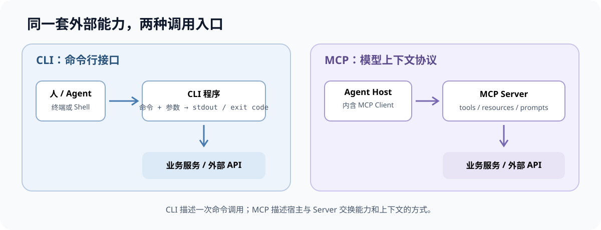
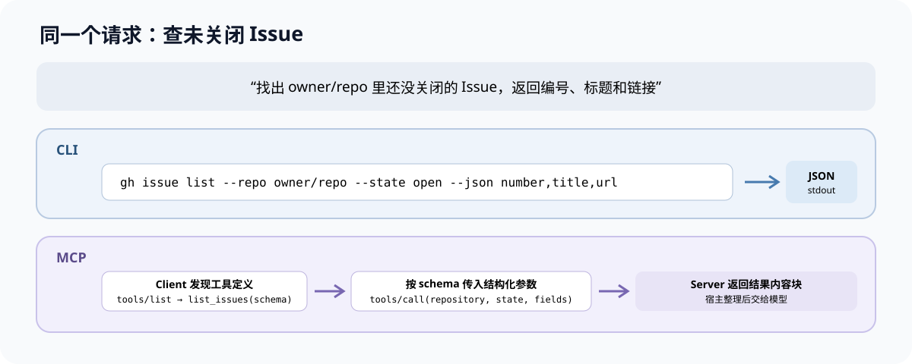
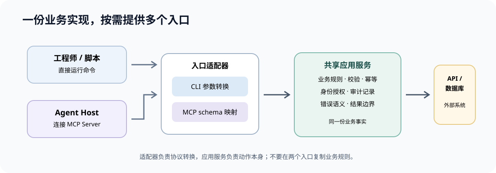
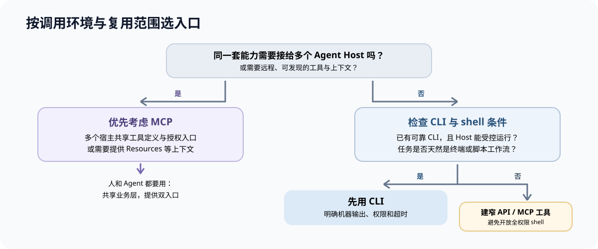

Agent 要查一个 GitHub Issue，常见有两条接法：让它在终端里运行 `gh issue list`，或者给它连接一个提供 Issue 工具的 MCP Server。两条路都能查到数据，也都能继续接模型推理；关键差异在于，能力以什么契约交给 Agent、由谁负责发现和调用，以及要为运行环境付出多少维护成本。

先给结论：**CLI 是程序的命令行入口，MCP 是 Agent 宿主与外部能力之间的通信协议。它们不在同一层，所以可以互相替代一部分集成工作，也可以一起使用。** 如果团队已经有稳定、适合自动化的 CLI，而且 Agent 有安全的 shell 执行环境，先用 CLI 往往接入成本更低；如果需要把一组工具和上下文以标准方式提供给多个 Agent 宿主，或宿主无法执行本地命令，MCP 更合适。人和 Agent 都要用同一套能力时，通常应该共享底层业务逻辑，再分别提供 CLI 和 MCP 入口。



*▲ CLI 通过命令和进程输入输出暴露能力；MCP 规定 Agent 宿主与服务端如何交换可发现的工具和上下文。图：自绘*

## 一、先把两个词放回正确的层次

### CLI：以命令行为契约的程序入口

CLI 是 Command-Line Interface 的缩写，即命令行界面。它通常是一段可执行程序，用户或脚本通过命令名、参数、标准输入调用它，再从标准输出、标准错误和退出码读取结果。

例如：

```bash
gh issue list \
  --repo owner/repo \
  --state open \
  --json number,title,url
```

这条命令的契约主要是命令结构、参数和输出约定。程序可以把结果打印成表格，也可以提供 JSON 等机器可读格式；能否被 Agent 稳定调用，取决于命令是否非交互、参数是否清楚、输出是否稳定、错误码是否有意义。CLI 不天然等于“只给人用”：GitHub CLI 就允许 `gh issue list` 通过 `--json` 指定字段，并用 `--jq` 继续处理 JSON 输出。[GitHub CLI 的 Issue 列表命令](https://cli.github.com/manual/gh_issue_list) · [GitHub CLI 的 JSON 格式化说明](https://cli.github.com/manual/gh_help_formatting)

### MCP：宿主和服务端之间的通用协议

MCP（Model Context Protocol，模型上下文协议）规定 Agent 宿主如何连接服务端、发现能力、提交结构化参数并接收结果。典型架构有三部分：

- **Host（宿主）**：用户实际使用的 AI 应用或 Agent Runtime。
- **Client（客户端）**：运行在宿主里的 MCP 客户端，负责与某个 Server 通信。
- **Server（服务端）**：封装外部 API、数据库、文件或业务能力，并按 MCP 约定开放给客户端。

MCP 服务端可提供三类能力：`tools` 是可以执行的操作，`resources` 是供宿主读取并作为上下文使用的数据，`prompts` 是可由用户选择的提示模板。控制权也不完全一样：通常由模型决定是否调用工具，由宿主决定何时读取资源，由用户选择是否使用提示模板。[MCP Python SDK 对 Host、Client、Server 和三类能力的说明](https://py.sdk.modelcontextprotocol.io/get-started/first-steps/)

MCP 本身不负责模型“想出”下一步。模型的工具调用能力负责从候选工具中选择操作并构造参数；MCP 提供一套让宿主发现并执行这些工具的通信约定。也就是说，模型的 tool calling 和 MCP 经常协作，但前者是模型与工具的交互能力，后者是宿主和服务端之间的接口协议。

这里还有一个容易漏掉的细节：MCP 不等于远程 HTTP。常见的本地接法是宿主启动一个 MCP 子进程，通过标准输入和标准输出通信；远程服务则常用 Streamable HTTP。采用 MCP 仍然要安装、启动和维护服务端进程或服务，只是接口不再由每个宿主各自发明。[MCP TypeScript SDK 的 stdio 传输说明](https://ts.sdk.modelcontextprotocol.io/v2/serving/stdio)

## 二、同一个任务，两种调用链

假设用户说：“找出 `owner/repo` 里还没关闭的 Issue，只给我编号、标题和链接。”

### CLI 调用

```bash
gh issue list \
  --repo owner/repo \
  --state open \
  --json number,title,url
```

Agent 得先知道机器上安装了 `gh`、认证上下文可用、当前命令支持这些参数，并且要把自然语言条件翻译成正确的 flags。结果是一段命令输出；如果命令有稳定 JSON，Agent 或后续脚本可以解析它。需要串接筛选时，还能用 `jq`、管道或另一个程序继续处理。

### MCP 调用

MCP Client 先能看到 Server 公布的工具清单和参数描述。下面是表达意图的伪代码，实际 SDK 的 API 名称会因语言而异：

```text
tools/list
  -> list_issues(repository, state, fields)

tools/call
  -> {
       name: "list_issues",
       arguments: {
         repository: "owner/repo",
         state: "open",
         fields: ["number", "title", "url"]
       }
     }
```

宿主把 Agent 选出的工具名和结构化参数交给 MCP Server；Server 再调用 GitHub API 或其他内部服务，把结果以约定的内容块交回来。Agent 不需要知道这个服务内部用了哪个 SDK、数据库查询还是 HTTP API。



*▲ 两种入口表达同一查询：CLI 把参数编码在命令行里，MCP 把操作名与参数交给宿主内的协议客户端。图：自绘*

差异不是“一个有结构化数据，一个没有”。设计良好的 CLI 可以输出严格的 JSON；MCP 也要依赖工具说明和 schema 写得是否清楚。更实用的对比是：**谁来发现能力、如何表达调用、输入输出如何验证，以及集成由谁维护。**

## 三、按同一把尺子比较

| 维度 | CLI | MCP |
| --- | --- | --- |
| 契约形态 | 命令名、flags、标准输入输出、退出码 | 协议操作、工具名、结构化参数与结果 |
| 主要调用方 | 人、Shell 脚本、CI，也可以是有 shell 权限的 Agent | 实现了 MCP Client 的 Agent 宿主 |
| 能力发现 | `--help`、命令树、schema 命令或 Skill 文档 | Client 向 Server 获取能力清单 |
| 组合方式 | Shell 管道、脚本和已有命令生态 | 宿主按工具定义进行编排；上下文也可通过资源等能力提供 |
| 接入成本 | 已有 CLI 时很低；不同宿主需要能执行它 | 多一个 Server、传输和配置面；多个宿主可共享协议接入 |
| 部署位置 | 通常在命令运行的机器或容器 | 本地 stdio 子进程，或远程 MCP 服务 |
| 出错线索 | 退出码、stdout、stderr、进程状态 | 协议错误、工具结果、Server 日志与传输状态 |
| 主要维护点 | CLI 参数、机器输出、认证、安装版本 | 工具 schema、协议/SDK 兼容、服务部署、认证授权 |

表格描述的是一般工程形态，具体能力会随实现变化。例如 CLI 也能提供运行时 schema，MCP 工具也可以由服务端调用本地命令；不要仅凭协议名推断可用性或安全性。

## 四、什么情况下优先用 CLI

**终端工作流。** 运维、开发、排障和发布任务本来发生在 shell 里。Agent 能复用现有命令时，通常不需要再为同一个动作搭一个新服务。

**成熟 CLI。** 安装量大、参数稳定、认证方式清楚、非交互模式可靠、JSON 输出可解析时，接入成本会很低。已有成熟工具的真实价值在于多年积累的参数、校验和错误语义；重新用 MCP 包一遍不一定能增加能力。

**管道与批处理。** 例如筛选一批 Issue、从日志中提取错误码、把 JSON 转成 CSV、把结果写到文件。Shell 适合组合简单步骤，尤其当结果需要交给 `jq`、`git` 或其他系统命令继续处理时。

**受控 Shell。** coding agent、开发容器或 CI Worker 本来就有终端工具，采用 CLI 不需要另加一个网络服务。要把“受控”落实为系统权限、工作目录、命令 allowlist、网络边界和审批规则，不能把 shell 访问直接等同于无风险。

CLI 要成为可靠的 Agent 接口，至少得补好几个契约：非交互默认、可预测的 `--help`、机器模式输出、stdout 与 stderr 分离、稳定退出码、合理的超时和分页。机器模式最好显式打开，例如 `--json`；不要因为输出被重定向就悄悄改变旧脚本看到的格式。更多 CLI 设计细节可参考仓库里的[给 Agent 用的 CLI 设计文章](/p/cli-for-agents-design-audit/)。

## 五、什么情况下优先用 MCP

**多宿主复用。** MCP 的主要收益来自统一接入契约：服务端维护一份能力定义，支持 MCP 的宿主可以用自己的客户端连接。它降低的是“每个宿主都各写一套集成”的重复工作；每个宿主仍然需要配置 Server、权限和版本兼容。

**没有 Shell。** 只开放 `search_docs`、`get_order` 这类窄工具，比给一个通用 shell 更容易说明授权边界和操作审计。具体能否做到最小权限，仍取决于服务端的实现、身份设计和宿主的确认流程。

**结构化发现。** 工具名、描述、参数 schema 能减少 Agent 对命令语法和自然语言输出的猜测。schema 只能约束形状，不能保证描述完整、结果语义正确，也不能代替服务端校验业务规则。

**提供上下文。** 例如项目约定、数据库结构、可检索文档、应用状态快照。MCP Resources 能让宿主按应用策略读取数据并放进模型上下文；如果你的系统只有几个简单动作，专门建 Resources 未必值得。

**集中治理。** MCP Server 可以部署在共享服务端，由平台团队统一做认证、审计和版本管理。此时架构收益来自服务化和权限边界，MCP 协议本身不会替你自动完成治理。

## 六、混合使用时，底层业务能力只维护一份

如果人类操作者和 Agent 都要访问同一项能力，可以采用“一个业务服务、多个入口适配器”的结构：

1. **领域/应用服务**负责核心业务规则，例如列 Issue、检查权限、删除资源前验证状态。
2. **CLI 适配器**把命令行参数转换为应用服务调用，再把结果编码成表格或 JSON。
3. **MCP 适配器**把协议工具名和结构化参数映射到同一个应用服务，返回符合 MCP 的结果。



*▲ CLI 与 MCP 是入口适配器，共享领域校验与应用服务；API、权限和审计策略留在服务边界内。图：自绘*

这个方案有几个现实好处：业务规则不会在两条入口里各写一遍；人可以直接在终端排查；Agent 宿主仍能使用 MCP 的能力发现和结构化调用。也不要求每个项目一开始就同时做两套接口：先服务好当前明确的调用方，出现第二类稳定需求后再加适配器。

让 MCP Server 直接执行 CLI 也有适用范围：现成程序功能复杂，短期内无法抽出库或服务接口；团队又需要快速提供一个小型内部工具。此时要固定 executable 路径和参数映射，避免把模型提供的自由文本拼成 shell 命令，限制运行时长、输出大小、工作目录和权限。长期维护时，MCP 直接调用应用服务通常更易测试和治理。

## 七、安全边界：两种方式都要按实际权限审查

CLI 进程通常以启动它的操作系统用户权限运行。它可能读到工作目录文件、环境变量、网络或本机凭据，也可能调用其他可执行程序。MCP Server 同样会以自身身份访问它能访问的资源；远程服务还会引入服务端身份、OAuth 或其他认证配置。换了调用协议，底层权限不会自动收窄。

对两类入口都应检查：

- **只暴露需要的动作。** 读取仓库 Issue，不需要授予删除仓库的能力；模型给出的参数都必须做服务端校验。
- **写操作要确认。** 创建、发布、删除、部署等影响外部状态的动作，应明确呈现目标和变更内容。
- **按最小权限发凭据。** Agent 专用账号或 token 只应拥有本任务需要的权限，凭据不得放进普通日志、命令回显或仓库。
- **对输入、输出和执行时间设限。** 文件路径、URL、查询范围、分页、日志长度和超时都需要边界。
- **保留可追溯记录。** 记录谁发起、宿主/Server 身份、选择的工具或命令、目标对象、结果和失败原因，同时避免把秘密写进日志。

MCP 官方安全指南专门讨论授权范围、token 处理、本地 Server 风险和常见实现错误，读者在暴露生产能力前应结合具体部署方式逐项评估。[MCP Security Best Practices](https://modelcontextprotocol.io/docs/tutorials/security/security_best_practices)

## 八、选型清单：先回答这几个问题



可以直接按下面的顺序做决定：

1. **已有 CLI？** 能力是否有质量不错的 CLI？有的话，先确认它是否支持非交互调用、机器输出、清晰退出码和最小权限。
2. **Host 能运行 CLI？** 能，并且目标任务本来就在终端完成，先走 CLI。
3. **需要跨 Host？** 是否要提供远程工具和上下文？是的话，优先设计 MCP Server。
4. **人和 Agent 共用？** 把业务服务作为共同实现，按需要对外提供 CLI 和 MCP。
5. **必须开放 Shell？** 先把高风险动作拆成更窄、可审计的工具或命令；不要把“Agent 能完成任务”建立在不必要的全权限上。

## 结论：按调用边界选，再按真实需求扩展

CLI 的优势是简单直接、便于人工排查、易与脚本和操作系统工具组合；代价是 Agent 要知道命令语法，并且输出与 shell 权限都需要认真治理。MCP 的优势是用统一协议发现和调用工具，并能提供结构化输入、结果及上下文；代价是要维护 Server、配置、传输和兼容性。

当前 MCP 规范与 SDK 还在演进。官方 TypeScript SDK v2 文档已分别说明 `2026-07-28` 与更早协议版本的兼容行为；新项目选 SDK 时应核对宿主支持的协议版本、传输方式和所需能力，不要照搬旧教程里的握手或 SSE 配置。[MCP TypeScript SDK 协议版本说明](https://ts.sdk.modelcontextprotocol.io/v2/protocol-versions) · [MCP `2026-07-28` 规范发布说明](https://blog.modelcontextprotocol.io/posts/2026-07-28/)

一个实用规则是：**本地终端工作流先做好 CLI；跨宿主、远程或需要上下文发现时再引入 MCP；同时服务人和 Agent 时共享业务层，各自提供合适入口。**

## 参考资料

- [MCP Python SDK：First steps](https://py.sdk.modelcontextprotocol.io/get-started/first-steps/)：Host、Client、Server 和工具、资源、提示模板。
- [MCP TypeScript SDK：stdio transport](https://ts.sdk.modelcontextprotocol.io/v2/serving/stdio)：本地宿主通过 stdin/stdout 与子进程通信。
- [MCP TypeScript SDK：Protocol versions](https://ts.sdk.modelcontextprotocol.io/v2/protocol-versions)：当前 SDK 对新旧协议行为的说明。
- [GitHub CLI：gh issue list](https://cli.github.com/manual/gh_issue_list) 与 [格式化输出](https://cli.github.com/manual/gh_help_formatting)：命令参数、JSON 字段和 jq 过滤。
- [MCP Security Best Practices](https://modelcontextprotocol.io/docs/tutorials/security/security_best_practices)：MCP Server 和授权流程的安全风险与缓解措施。

