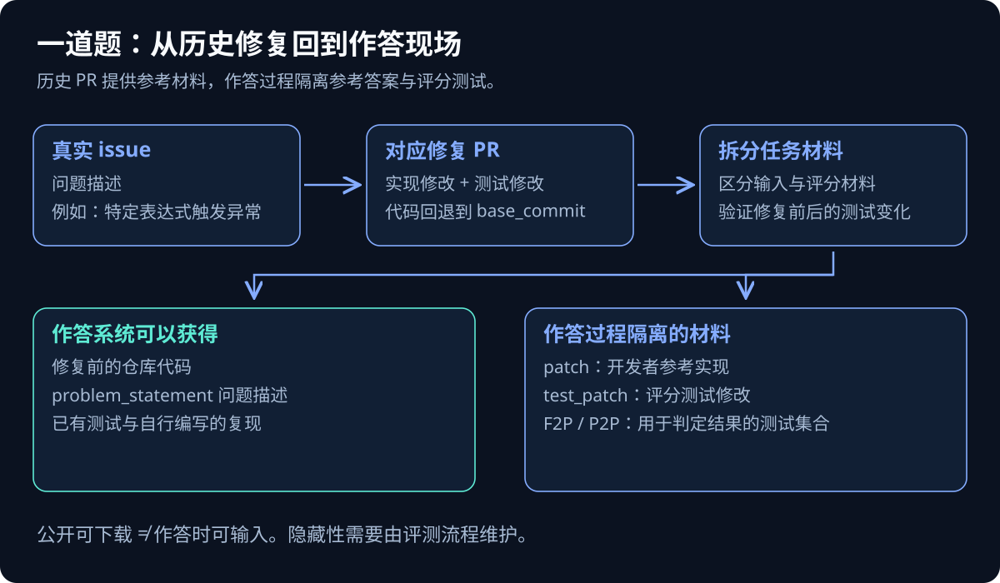
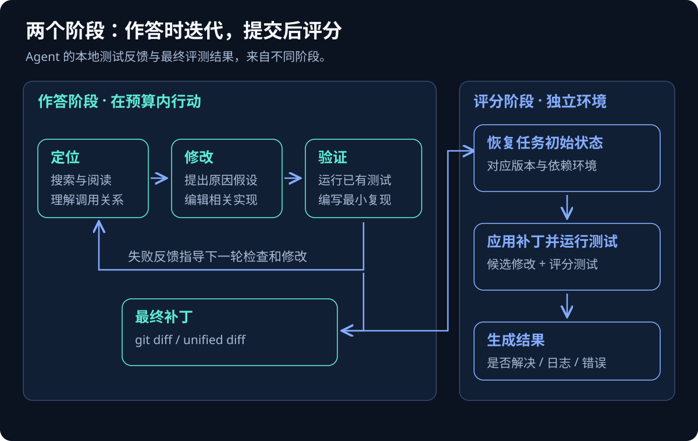
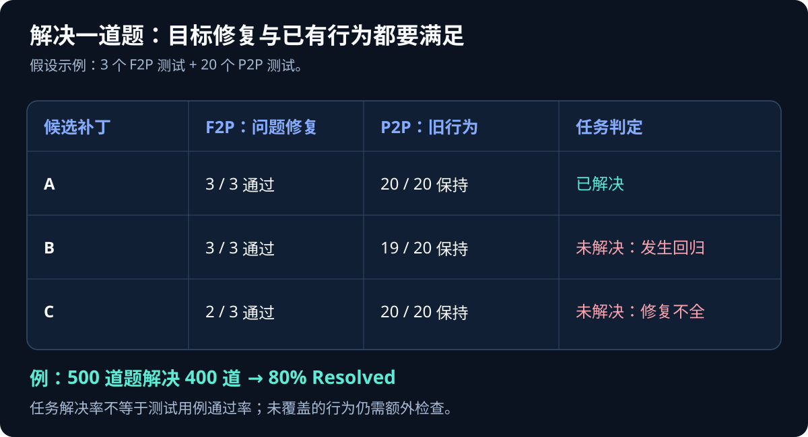

SymPy 曾有这样一个问题：调用 `kernS("(2*x)/(x-1)")`，预期得到正确的符号表达式，实际却抛出了 `UnboundLocalError`。如果把这个问题交给 AI，它需要找到相关实现、理解触发异常的分支、修改代码，再确认其他表达式仍能正常处理。这是 SWE-bench Verified 发布说明中展示过的真实任务。[SymPy 示例与 Verified 说明](https://openai.com/index/introducing-swe-bench-verified/)

这类任务与“补全一个函数”之间，隔着整个项目的上下文。异常出现在什么位置、应该改哪一层、怎样兼容其他调用路径，都需要作答者自己判断。最终补丁即使只有几行，也可能建立在大量定位和验证工作上。

SWE-bench 用真实 GitHub issue 和代码仓库测试这种能力：给 AI 修复前的代码与问题描述，收回一个修改补丁，再运行测试判定结果。理解它需要同时看清题目、作答系统和判分方式；一个百分比只能概括其中一部分。

本文面向想读懂 AI 编程榜单、理解 Coding Agent 评测的开发者。版本、命令和审计信息核对至 **2026 年 10 月 26 日**；下文的机制示意与假设数字不代表实际模型成绩。

## 一、从独立编程题走向已有项目

SWE 是 Software Engineering，bench 来自 benchmark。原始论文于 2023 年发布，并被 ICLR 2024 接收。原始测试集包含来自 12 个 Python 仓库的 2,294 道任务，涉及 Django、SymPy、scikit-learn 等项目。[原始论文](https://arxiv.org/abs/2310.06770)

两种评测的工作方式可以这样比较：

| 维度 | 独立函数类编程题 | SWE-bench |
|---|---|---|
| 输入 | 函数签名、需求和示例 | issue 描述与已有仓库 |
| 定位工作 | 题目通常指定待实现位置 | 自己寻找相关代码 |
| 上下文 | 主要在题面与函数内部 | 项目结构、调用关系、兼容约定 |
| 提交内容 | 一段实现 | 对仓库的修改补丁 |
| 验证目标 | 输出是否符合要求 | 问题修复且受检行为未回归 |

以开头的 SymPy 问题为例，知道 `UnboundLocalError` 的含义，只完成了很小的一步。还要判断变量为何在特定路径上未赋值，修复应放在初始化还是条件分支，以及修改会不会影响其他合法输入。异常消失也可能只是错误被吞掉了，表达式计算本身仍然有问题。

SWE-bench 因此能观察代码定位、项目理解和维护修改等能力。但它覆盖的软件工程范围仍然有限：需求访谈、长期架构演进、多人协作、生产运维等工作，需要额外评估。

## 二、一道题怎样从历史 PR 中产生

构造任务时，研究者找到真实 issue 及其修复 PR，将仓库恢复到修复前的提交，再分离出开发者的实现补丁与测试补丁。通过比较参考修复前后的测试结果，可以得到用于判分的测试集合。[论文：任务构造与执行验证](https://arxiv.org/html/2310.06770v3)



*图 1：同一份历史 PR 提供参考实现与测试材料；作答输入保留修复前的代码和问题描述。图为任务构造示意。*

阅读数据集时，会遇到这些字段：

| 字段 | 含义 | 使用位置 |
|---|---|---|
| `instance_id` | 任务唯一标识 | 对应补丁、日志与评分结果 |
| `repo` | 所属仓库 | 获取项目代码 |
| `base_commit` | 修复前的提交 | 恢复任务初始状态 |
| `problem_statement` | 问题描述 | 提供给作答系统 |
| `patch` | 开发者的参考实现补丁 | 数据验证、研究分析 |
| `test_patch` | 原始 PR 的测试修改 | 构造评分测试 |
| `FAIL_TO_PASS` | 参考修复后由失败变为通过的测试 | 检查问题修复 |
| `PASS_TO_PASS` | 参考修复前后都通过的测试 | 检查已有行为 |

参考实现通常叫作 gold patch。它是一个已经存在的修复方案，不代表只有这种代码写法才能解决问题。理想的评分测试应该接受满足需求的不同实现。

公开数据集里能下载 `patch` 和 `test_patch`，并不意味着做题时可以把它们交给模型。规范的作答过程应隔离参考答案和评分测试；Agent 可以阅读修复前仓库已有的测试，也可以自行写复现脚本。这里的“隐藏测试”，指对作答过程隐藏，不能据此推断它从未公开过。

如果评测系统直接把整条数据记录塞进提示词，连同 `patch` 一起交给模型，就已经泄漏了答案。即使没有发生这种输入泄漏，公开历史仍可能在模型训练阶段造成污染，后文会讨论。

## 三、Agent 怎样做题，评测器怎样收卷

现代 Coding Agent 通常会多次搜索、阅读、修改和执行。它可能先写最小复现，看到报错后调整假设；也可能先阅读相关测试，再决定修改方式。SWE-bench 的任务形式允许研究不同解题系统，并不强制所有系统采用同一种推理流程。



*图 2：Agent 在作答阶段使用执行反馈迭代；最终补丁交给独立评测环境，按规定测试判分。*

这里要区分两类反馈。作答阶段，Agent 能运行自己看得到的测试，用结果指导下一步行动。评分阶段，评测器在对应环境中应用最终补丁和评测测试，检查规定行为。官方 harness 使用 Docker 提高运行环境的一致性。[官方评测指南](https://www.swebench.com/SWE-bench/guides/evaluation/)

Agent 最后的自然语言消息通常不是主要评分对象。“已经修复”“测试全绿”这些陈述，不能替代补丁和评测日志。Agent 自己运行的测试可能遗漏边界条件，也可能执行了错误的测试入口。

工具日志则有另一种价值：它能解释失败发生在哪里。未找到相关文件、修改方向错误、依赖安装失败、测试超时，以及补丁无法应用，属于不同问题。只看最终零分，会把这些情况压缩成同一个结果。

## 四、F2P 和 P2P 怎样决定解决率

FAIL_TO_PASS，简称 F2P，检查本次问题：相关测试在参考修复前失败，在参考修复后通过。PASS_TO_PASS，简称 P2P，检查已有行为：相关测试在参考修复前后都通过。对于原始 Python 任务的核心判定，候选补丁需要通过规定的两组测试，才能被算作完全解决。[论文附录 A.4](https://arxiv.org/html/2310.06770v3)

下面用一组假设结果说明两者的配合：



*图 3：假设一道题包含 3 个 F2P 和 20 个 P2P 测试。修好目标问题、同时破坏一个受检旧行为，仍然不能算完全解决。数字仅用于说明机制。*

主指标 `% Resolved` 表示任务解决率：

```text
解决率 = 被判定为已解决的任务数 / 评测任务总数 × 100%
```

假设完整评测 500 道题，其中 400 道被判定解决，成绩就是 80%。在这个任务数下，每道题对应 0.2 个百分点，提升 1 个百分点对应多解决 5 道题。

因此，**80% 表示该配置解决了题集中的 80% 任务**。它不能直接推出测试用例通过率、生成代码正确率，或现实开发工作的可替代比例。比较结果前，还要核对题集是否完整，以及环境错误、超时和空补丁是否被一致地计入。

P2P 也有覆盖边界：它证明的是被检查的旧行为得到保持。未运行的测试、未描述的性能约束和未覆盖的安全问题，仍可能存在。随着任务类型与 harness 版本扩展，日志解析等细节也会变化；严谨复现需要固定数据和评测器版本。[当前评分代码](https://github.com/SWE-bench/SWE-bench/blob/main/swebench/harness/grading.py)

## 五、一个分数由模型、Agent 和预算共同产生

SWE-bench 是基准，SWE-agent、mini-SWE-agent 是作答框架，评测 harness 则负责运行评分流程。资料里有时会把作答系统也叫 harness，阅读时要先确认它指哪一部分。

模型负责分析问题与生成行动；Agent 框架负责组织工具、消息历史和执行循环；运行环境提供计算与文件系统；评分器决定什么算成功。比较成绩时，至少需要记录以下条件：

| 层次 | 影响结果的配置 |
|---|---|
| 模型 | 模型快照、采样参数、推理强度 |
| Agent | 提示词、工具、上下文管理、候选选择 |
| 预算与环境 | token、步数、费用、超时、CPU、内存、网络 |
| 评分 | 数据版本、测试集合、harness 版本、失败处理 |

同一个模型换用不同工具接口、上下文管理或预算，可能得到不同成绩。要比较模型，就尽量固定其他条件；要比较完整产品，则需要把真实运行成本一起报告。

官方 Verified 榜单目前默认提供 Bash Only 设置，让模型在相同的 mini-SWE-agent 环境中运行。mini-SWE-agent 主要通过 Bash 执行动作，使用较简单的控制流程来减少作答框架差异。这有助于比较模型，但仍需要核对预算和模型设置。[官方榜单](https://www.swebench.com/)、[mini-SWE-agent 文档](https://mini-swe-agent.com/latest/)

### 一次尝试可以包含很多轮工具调用

`pass@1` 关注一次完整尝试的成功情况。一次尝试内部，可以先搜索代码，再多次修改和运行测试，最终交出一个补丁。因此，它不等于只调用一次模型。

`pass@k` 关注多次尝试中至少一次成功的情况。若生成多个候选再选择一个，还要说明选择器使用了什么信息。依赖最终隐藏测试挑选答案，与使用作答阶段可获得的测试选择答案，是不同的实验设置。

接近的单次成绩也需要看波动。在同一批题上重复运行、报告逐题成功频率，并比较两个系统各自新增解决和新增失败的任务，会比只比较一个总百分比更有解释力。

## 六、Full、Lite、Verified 与 Pro 分别是什么

这些名字代表不同任务分布和筛选方式。下表列的是主要版本；具体评测还应注明 split 和修订版本。

| 版本 | 规模 | 主要用途 |
|---|---|---|
| 原始 SWE-bench / Full | 2,294 道测试题 | 原始 Python 仓库级任务 |
| SWE-bench Lite | 300 道测试题 | 降低评测成本、便于迭代 |
| SWE-bench Verified | 500 道测试题 | 对原始任务进行人工质量筛选 |
| SWE-bench Multilingual | 300 道任务 | 42 个仓库、9 种编程语言 |
| SWE-bench Multimodal v2 | 480 道任务 | 包含截图等视觉信息的问题 |
| SWE-Bench Pro | 总计 1,865 道；公开集 731 道 | 扩展项目范围与任务复杂度 |

### Lite 与 Verified 的筛选目标不同

Lite 对参考补丁和题面作了限制，例如排除参考实现修改多个文件、编辑块过多等任务。它便于低成本评测，但筛选也改变了任务分布。另外提供的 23 道开发任务不应混入 300 道测试题的成绩。[Lite 官方说明](https://www.swebench.com/lite.html)

Verified 最初通过人工检查题意充分性、测试公平性等因素，筛出 500 道任务。名称中的“验证”针对数据质量，并不表示每个榜单补丁都经过人工代码审查，也不保证题目永远没有缺陷。[Verified 发布说明](https://openai.com/index/introducing-swe-bench-verified/)

### Multilingual 与 Multimodal 扩展了任务输入和领域

Multilingual 的“多语言”指编程语言。它覆盖 C、C++、Go、Java、JavaScript、TypeScript、PHP、Ruby 和 Rust，用于观察 Python 之外的仓库修改能力。[Multilingual 官方说明](https://www.swebench.com/multilingual.html)

Multimodal 在问题中引入截图等视觉信息。官方于 2026 年 9 月 1 日发布的 v2 保留了 480 道可复现评测的任务，并调整了 Docker 环境和部分评分处理。引用其成绩时应注明版本，避免与早期规模混用。[Multimodal 官方说明](https://www.swebench.com/multimodal.html)

### Pro 来自 Scale AI，比较时继续核对其子集

SWE-Bench Pro 由 Scale AI 发布，包含 731 道公开任务、858 道保留任务和 276 道商业项目任务，共涉及 41 个仓库。它的设计目标包括提高复杂度、增加项目多样性和降低污染影响。[Scale AI 发布说明](https://scale.com/blog/swe-bench-pro)

不同版本的百分比不能直接比较。一个系统在 Verified 上得到 80%、在 Pro 上得到 50%，单凭这两个数字无法判断能力变化，因为考题已经改变。版本名称也不能单独证明数据质量：Pro 同样需要审计。

## 七、2026 年的审计怎样改变分数解读

测试判分有两个方向的误差：测试过严，可能拒绝功能正确的实现；覆盖不足，可能接受不完整甚至投机的实现。一个测试能区分原始代码和参考补丁，只证明它检测到了某种变化，还需要继续检查这种变化是否准确对应题面需求。

例如，题面只要求抛出某类异常，测试却强制要求一段未说明的文案，就可能排除合理解法。反过来，如果只测一个示例输入，硬编码这个输入也可能过关。这些是评分机制的假设示例，不指向某一道具体任务。

### Verified：审计子集比例不能外推到全集

2026 年 2 月 23 日，OpenAI 发布分析，宣布停止报告 SWE-bench Verified 成绩。它审计了模型经常失败的 138 道题，占全集的 27.6%；报告称，至少 59.4% 的被审计任务存在会拒绝功能正确解法的测试问题。**59.4% 的分母是这 138 道题，且它们不是全集的均匀随机样本。**[Verified 审计](https://openai.com/index/why-we-no-longer-evaluate-swe-bench-verified/)

该审计还报告了污染迹象：受测模型能在部分任务上复现参考补丁或题目特定信息。由于 issue、PR、代码和发布说明都可能进入训练语料，一次成功可能同时包含现场推理和既有记忆。仅凭最终分数，很难分开两者。

### Pro：更换题集仍需验证需求与测试是否对齐

2026 年 7 月 8 日，OpenAI 又发布 Pro 审计。针对 731 道公开任务，其 Agent 辅助审计认定 200 道存在问题，人工标注认定 249 道；报告据此估计约 30% 的任务存在影响有效评分的缺陷，并撤回此前建议采用 Pro 的推荐。[Pro 审计](https://openai.com/index/separating-signal-from-noise-coding-evaluations/)

这些数字属于该团队的审计结论，不同复核路径也存在差异。它们支持的判断是：使用这些成绩前，需要检查题目和评分质量；不能据此把所有任务、所有系统的成绩都判为无效。

公开基准仍可用于复现和比较实验，但越是接近的高分，越需要逐题证据。某次提升究竟来自模型能力、更多预算、污染、任务筛选还是评分修订，必须靠实验配置和运行结果区分。

## 八、亲手看一道题，再跑一次评分

入门可以先查看数据，再验证评分环境，最后接入 Agent。这样遇到失败时，能够区分是环境没跑通，还是模型没有解决问题。

### 先查看任务输入

安装 Hugging Face 的 `datasets` 包后，可以读取 Verified：

```bash
python -m pip install datasets
```

```python
from datasets import load_dataset

tasks = load_dataset(
    "SWE-bench/SWE-bench_Verified",
    split="test",
)

task = tasks[0]
for key in ("instance_id", "repo", "base_commit", "problem_statement"):
    print(f"{key}: {task[key]}")
```

这个例子只读取作答所需的基本信息。若是在训练自己理解任务，建议先读题面和修复前代码，再看参考实现，比较题面要求、实现变化和测试断言之间的关系。[官方数据集](https://huggingface.co/datasets/SWE-bench/SWE-bench_Verified)

### 用参考补丁验证环境

当前官方仓库提供 v5 CLI。先安装并启动 Docker，再按官方 README 安装 SWE-bench、准备任务仓库。下面是在独立实验目录中的示例；实际 Python 版本要求以所用代码版本的项目配置为准。

```bash
git clone https://github.com/SWE-bench/SWE-bench.git
cd SWE-bench
python3 -m venv .venv
source .venv/bin/activate
python -m pip install -e .
git clone --depth 1 https://github.com/SWE-bench/swe-bench-tasks.git ./swe-bench-tasks
swebench dataset check ./swe-bench-tasks
swebench eval verified --gold \
  -i sympy__sympy-20590 \
  --run-id validate-gold \
  --task-repo ./swe-bench-tasks
```

`--gold` 运行参考补丁，用于检查任务环境和评分流程，没有测试模型能力。这条环境验证命令使用的任务也与开头的 SymPy 示例不同。[当前官方安装说明](https://github.com/SWE-bench/SWE-bench#-set-up)

全量评测需要较多镜像空间和计算资源。官方建议为较大规模本地评测准备至少 120GB 空闲存储、16GB 内存和 8 个 CPU 核；ARM 支持仍标为实验性，M 系列 Mac 应按当前说明通过任务仓库和 Docker Buildx 本地构建镜像。单题入门可以降低并行度，但不能据此假定所有任务都能在很小的资源配置下运行。

### 再提交自己的补丁

模型预测通常保存为 JSONL，每行一条任务记录。必要字段示意如下，`model_patch` 需要替换成真实的 unified diff：

```json
{
  "instance_id": "sympy__sympy-20590",
  "model_name_or_path": "my-agent",
  "model_patch": "<替换为真实补丁文本>"
}
```

保存为 `predictions.jsonl` 后，可以只评测这一题：

```bash
swebench eval verified \
  -p predictions.jsonl \
  -i sympy__sympy-20590 \
  --run-id my-agent-run-001 \
  --task-repo ./swe-bench-tasks \
  -j 1
```

这一步消费已经生成的补丁。让 Agent 读仓库、调用模型并生成补丁，是前面的推理阶段，需要另外配置模型和作答框架。修改补丁后重评时，还要更换 `run_id`，避免命中旧结果缓存。[预测格式与评测指南](https://www.swebench.com/SWE-bench/guides/evaluation/)

正式比较时，应保存代码提交、数据修订、模型设置、Agent 配置、预算和逐题日志。本文命令依据官方文档整理，未在本文写作过程中执行完整的 SWE-bench 容器评测；复现结果需要在实际环境中确认。

## 九、怎样把榜单变成自己的判断依据

阅读一个成绩，可以依次核对：

1. **题集。** 具体版本、split、修订版本和实际题数是什么？
2. **系统。** 使用哪个模型快照、Agent、提示词和工具？
3. **预算。** 每题允许多少时间、费用、步数和独立尝试？
4. **评分。** 如何处理环境错误、超时、空补丁，是否有任务排除？
5. **证据。** 是否公开补丁、轨迹、日志，以及重复运行的波动？
6. **适用性。** 任务语言、项目类型和修改规模与自己的工作接近吗？

如果目的是理解模型研究，固定配置后的公开基准比较很有价值。如果目的是为团队选择开发工具，还需要加入自己的仓库任务，并检查通过测试后的代码质量、稳定性和每次成功的成本。

可以从少量历史 issue 起步，重建修复前环境，隐藏参考实现，设计与需求对齐的测试，再用人工检查补足测试覆盖边界。挑选真实失败案例回流到任务集，会比长期追逐某个公开榜单的第一名更直接地改善团队判断。

继续搭建团队评测体系，可阅读本站的[《Coding Agent 评测体系：公开基准怎么读，自己那套怎么搭》]()。SWE-bench 提供了观察 AI 修改真实仓库的窗口；让分数指导决策，需要把窗口里的任务、运行条件和验收标准一起看清。
