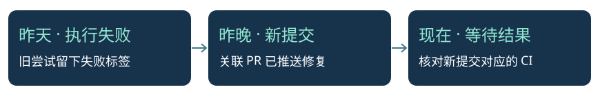
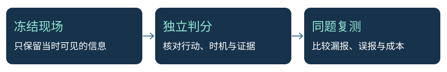

假设周一早上打开 GitHub，一条 Issue 还挂着“执行失败”的标签。点进关联的 PR，却看到昨晚已经有人推了修复。最新一轮 CI 正在跑。这个时候给维护者发一句“任务失败，请尽快处理”，每个字似乎都有出处，整句话却会让人白忙一场。

把这个仓库交给一个数字员工值班，我们期待它做什么？它得认出失败属于上一次执行，找到最新提交对应的检查，记下还在等什么。等 CI 有结果，再决定是请作者修代码、请维护者审阅，还是结束跟进。**一个岗位的价值，往往就体现在它知道什么时候值得打扰你。**

## 一个 Agent 怎样承担一个岗位

“数字员工”在本文里的意思，是由软件持续承担一项有边界的岗位职责。模型提供读文档、解释上下文、选择下一步的能力；执行框架把工具、身份、状态和权限交给它；团队约定什么结果算交付。这里的“持续”可以很朴素：GitHub 有事件时启动一次，处理结束就退出，下次从已保存的记录继续。

同一个 Codex，今天被临时叫来摘要一条 PR，明天也可以承担仓库值班。后者多了几个具体约定：它负责哪些仓库，什么事件要醒来，能替谁做决定，事情交给人以后什么时候再看。给发票做初审的数字员工遵循同样的逻辑，只是输入变成订单、发票和收货记录，产物变成可入账清单与待核对差异。岗位设计可以从一句话开始：**谁会拿着它的产物，做出什么决定？**

## 仓库值班员的一次交接

回到开头的例子。值班员首先要把几条带时间的信息对齐。Issue 描述了要解决的问题；PR 描述了候选修复；CI 检查绑定到具体提交；执行器还可能保留某一次失败尝试的记录。相同任务名下可以同时存在“上次失败”和“本次运行中”。只有将检查结果对应到当前 PR 的提交，才能解释这两个状态。

假设检查随后通过，但审阅者之前要求补一个恢复场景的测试。CI 绿灯只能说明实际运行的检查通过。值班员还要看那条审阅意见、关联改动和讨论是否已解决。此时一条有用的交接可以很短：

> 修复提交的 CI 已通过。审阅者要求覆盖的恢复场景仍有一条未解决讨论，请 PR 作者回应。下一次在作者回复或提交更新时复查。

实际交付时，“修复提交”“CI”“未解决讨论”都应该能点回原始记录。值班员只需保存 PR 编号、上次看到的提交、等待的事件，以及是否已经提醒过。收到重复事件时，它能认出这件事已经交接。作者推了新提交时，它也知道旧结论需要重查。这种记忆可以放在普通数据库里，原始事实仍然留在 GitHub。

这个岗位适合从只读开始。让它先输出值班清单，人可以低成本纠正一次误判。等判断稳定后，再给它在指定 Issue 下评论或维护特定标签的权限。合并 PR 会改变代码库，关闭 Issue 会改变团队对任务是否完成的判断，这两种动作都值得单独约定授权。自动化程度可以逐步增加，岗位的责任从第一天就能写清楚。

## 三个开源项目，各自解决了哪一段

Paperclip 适合研究一个岗位怎样长期运转。 它把工作关联到项目、目标和负责的 Agent，可以按计划唤醒执行器，记录运行日志和成本，给任务设置审批或预算。设想仓库值班员休眠了一晚，早上醒来要找回自己的待办，负责人想知道它昨天花了多少，这些都是 Paperclip 直接处理的管理问题。它的任务系统有自己的 Issue；把岗位放到真实团队里时，仍要约定哪个系统保存权威状态。[Paperclip 官方仓库](https://github.com/paperclipai/paperclip)

GitHub Agentic Workflows 最贴近仓库现场。 维护者用 Markdown 描述工作流，在 GitHub Actions 里按事件或计划执行。官方列出的场景包括 Issue 分诊、PR 审查和 CI 失败调查。值得借鉴的一处设计是把模型判断与写操作分开授权。例如允许工作流提出一条评论，由限定权限的步骤执行发布。团队可以沿用已有的 Issue、PR 和通知入口，直接观察这些判断有没有帮到负责的人。[官方仓库](https://github.com/github/gh-aw) · [工作流与权限说明](https://github.github.com/gh-aw/reference/faq/)

PR-Agent 展示了把岗位缩小的收益。 它围绕一条 PR 提供审查、描述和问答等能力。作者可以对着具体变更追问，审阅者也可以回到对应代码核对评论。这样的职责边界容易检验：某条建议能否指出真实问题，维护者要花多久验证它？如果团队的耗时主要集中在逐条读 diff，这种专门工具比先搭建一整套岗位管理系统更容易试出价值。[PR-Agent 官方仓库](https://github.com/The-PR-Agent/pr-agent)

## 可量化、可迭代、可以成长，具体怎么验

在 KedaCode 的语境里，harness 指围绕 Agent 执行任务的那套工程设施。Keda 已有从 Issue 到 PR 的交付链和版本化评测题库。仓库值班员是可以用这些设施验证的岗位设想。GitHub 提供公开协作的事实，执行器补充本机认领、重试和验证记录，两边接起来，就能出一道很实际的考题：**在当时那个时刻，是否已经需要人接手？** [Keda 路线图](https://github.com/ZataZhang/keda/blob/main/ROADMAP.md) · [评测方案](https://github.com/ZataZhang/keda/blob/main/docs/project/agent-improvement.md)

出题时可以从多个 Issue 抽取同一类难点。比如一次误报来自旧标签，一次来自旧提交上的红灯，还有一次是修复提交确实失败。选定观察时刻，只把那一刻以前可见的记录交给值班员。维护者单独保存预期判断、可接受的下一步和理由。后来发生的事情可以辅助复核；如果当时的信息不足，“等指定检查结束再看”也应该能得分。否则，评测奖励的会是事后猜中结局。

假设一组十道历史题中，有三道确实需要人工介入。值班员一共提醒四次，其中两次有必要。维护者于是得到两个可行动的数字：三次真正的阻塞漏掉一次，四次提醒里有两次打扰了人。再看每条提醒附带的证据，可能发现两次误报都读了旧提交的 CI。那么下一版就可以只改一处，让值班员显式核对检查所属提交，然后在相同题目和预算下重跑。这里的数字是演算示例，实际改进还要用没参与调试的案例复核。

这也是给第一个数字员工选岗位时最实用的尺度。找一项团队经常重复、事实可以回查、做错以后知道错在哪的工作。先让一个 Agent 值几班，记录它漏掉的阻塞、发出的无效提醒，以及人核对它的判断所花的时间。等这些记录真的揭示了交接或复核的瓶颈，再决定第二名员工该坐在哪个位置。
