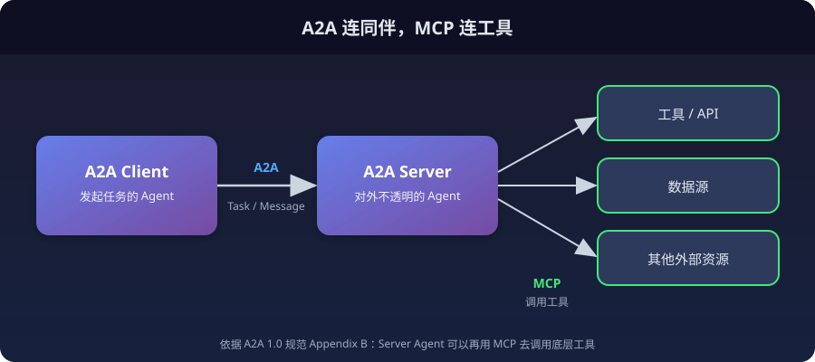
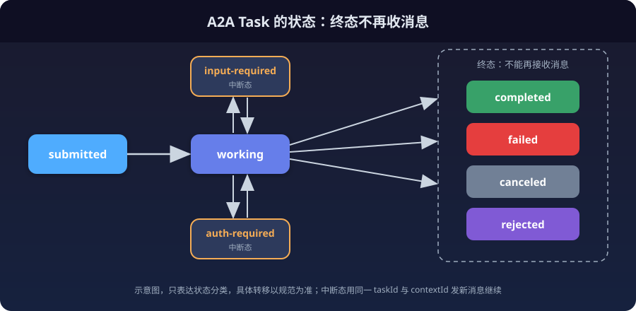
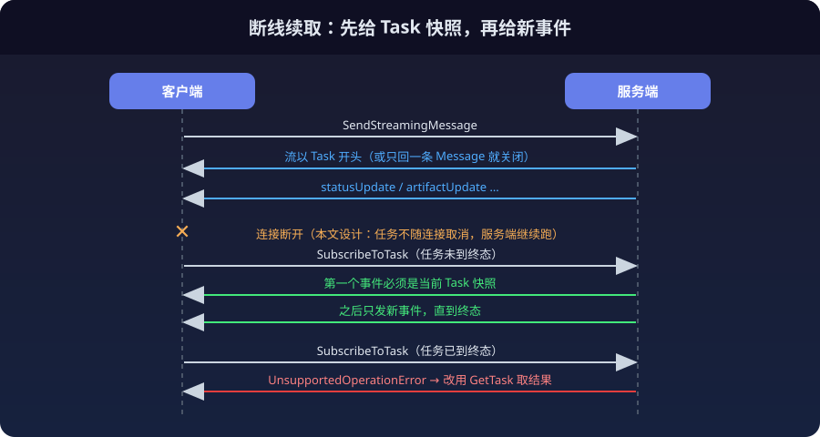

给自己的 Agent 平台设计 A2A 服务端时，评审里冒出来的第一个问题很小：Agent Card 该放在哪个 URL 上。

规范说放在 `/.well-known/agent-card.json`，而且公开的 Card 不需要认证。我的设计里，一个 API Key 只对应一个 Agent，Card 要按 Key 返回，所以必须认证。接着查部署，前面那层 Next.js 网关只把 `/share/api/*` 和 `/api/*` 转给后端，根路径下的 well-known 根本到不了后端。一个 URL，牵出了规范、授权和部署三件事。

我对照 1.0 规范读了 Card、Task、流式和授权几章，核心判断是：**A2A 的价值在 Task，不在 Card**。发现可以靠人手递一个 URL，任务的生命周期必须靠协议约定，而这份约定的成本几乎全落在服务端。下面先讲规范规定了什么，再讲自己做服务端要付哪些成本。

## 先看规范现状（2026-10-15）

| 项 | 值 |
|---|---|
| 规范 | [A2A Protocol 1.0 Specification](https://a2a-protocol.org/v1.0.0/specification/) |
| 发布 | v1.0.0 于 2026-03-12 发布首个稳定版，v1.0.1 于 2026-05-26（[GitHub releases](https://github.com/a2aproject/A2A/releases)） |
| 传输绑定 | JSON-RPC、gRPC、HTTP+JSON/REST 三种 |
| 核心方法 | SendMessage、SendStreamingMessage、GetTask、ListTasks、CancelTask、SubscribeToTask |
| 其他方法 | 四个推送通知配置方法（创建、获取、列出、删除）、GetExtendedAgentCard |

本文依据规范原文，没有做互通实测。服务端设计那一节是评审阶段的方案，尚未实现，也没有压测。A2A 在整个 Agent 协议版图里的位置，可以看站内《2026年AI Agent现状：一次带出处的全景清点》和《AG-UI：当 Agent 学会了和前端说话》两篇，这里只讲 A2A 自己。

规范附录 B 把它和 MCP 的分工写得很直白，大意是：A2A 标准化独立的、往往不透明的 Agent 之间如何作为对等方通信协作，MCP 标准化模型和 Agent 如何连接工具、API 和数据源。两者可以串起来用：A2A 的服务端 Agent 收到任务后，再用 MCP 去调用底层工具。



"不透明"这个词决定了后面所有设计：调用方只能看到 Task、Message 和 Artifact，看不到对方的提示词、工具列表和模型。

## Agent Card：公开名片加认证后的扩展卡

Card 是服务端发布的 JSON 元数据，描述身份、能力、技能、服务端点和认证要求。几个读规范时值得记下的点：

- **位置与认证：** 标准发现路径是 `https://{server_domain}/.well-known/agent-card.json`，公开 Card 不需要认证。
- **扩展卡：** `capabilities` 里的 `extendedAgentCard` 为 true 时，认证后的调用方可以再用 GetExtendedAgentCard 拿到更详细的卡，规范要求这个操作必须认证。
- **缓存与签名：** 服务端应当带 `Cache-Control: max-age` 和 `ETag`；Card 可以用 JWS（RFC 7515）签名，签名前按 RFC 8785 规范化。
- **能力声明：** `capabilities` 声明 streaming、pushNotifications，`skills` 列技能，`securitySchemes` 与 `security` 描述怎么认证。

回到开头的问题。规范的模型是"公开名片 + 认证扩展卡"，我的设计是"整张 Card 都要 Key，按 Key 返回"。这是对规范的偏离，好处是没有 Key 就拿不到任何关于 Agent 的信息，不可枚举；代价是标准的发现流程失效，调用方必须被人手把 Card URL 交到手里，我的方案是创建 Key 时在一次性展示面板里一并给出。如果你的 Agent 本来就是公开的，直接按规范来；如果它是按凭证私有的，要把这个偏离写进文档，别让接入方猜。

另一个和协议无关、但每个自己部署的人都会撞上的问题：只要 A2A 服务前面还有一层网关或前端，就要先确认 `/.well-known/` 会被原样转发到后端。我这次是在评审时翻 `next.config.ts` 才发现它不会，最后把 Card 路径挪到了已被转发的前缀下。

## Task：协议真正规定的东西

规范里的几个核心对象：

- **Message：** 一次通信，带 `role`（user 或 agent）和若干 Part，`messageId` 由创建者生成。
- **Part：** 最小内容单位，文本、文件引用或结构化数据。
- **Artifact：** 任务的产出，由 Part 组成，比如一份文档或一段结构化结果。
- **Context：** 可选的 `contextId`，把相关的任务和消息分到一组，服务端用它维护对话历史或 LLM 上下文。

Task 是"基本工作单位"，有唯一 ID、生命周期状态和一组 Artifact。状态分三类：

| 类别 | 状态 |
|---|---|
| 进行中 | submitted、working |
| 中断态 | input-required、auth-required |
| 终态 | completed、failed、canceled、rejected |



围绕这个状态机，规范有几条约束，每一条都对服务端有直接后果：

**taskId 归服务端。** 新任务的 ID 由服务端生成，客户端不能为新任务指定 taskId；消息里带了 taskId，就必须指向一个已存在的任务。`contextId` 则可以由服务端生成，也可以接受客户端提供的值。

**终态之后不再收消息。** 规范写明，发给终态任务（completed、canceled、rejected 等）的消息不能被接受。想在同一段对话里继续，就要在同一个 `contextId` 下新开一个 Task。规范在我读到的范围内没有展开"新开之后历史怎么带"，这一块由服务端自己定。

**中断态同 taskId 续。** Agent 处理到一半需要更多输入，就把任务转到 input-required，客户端用相同的 taskId 和 contextId 再发一条消息继续。

**返回 Task 或 Message。** 响应是二选一：一个简单的、无状态的 Agent 可以直接回一条 Message，根本不建 Task。同时，`returnImmediately` 默认是 false，也就是服务端默认要等任务结束才返回；长任务要么把它设成 true 再用 GetTask 轮询，要么直接走流式。

这几条合起来，意味着只要你打算支持长任务，服务端就必须有一个"任务表"，这也是后面成本清单的起点。

## 流式与断线续取

SendStreamingMessage 和 SubscribeToTask 返回 SSE 流，每个 `data:` 行是一个 JSON-RPC 响应，`result` 是一个 StreamResponse，可以是 task、message、statusUpdate（TaskStatusUpdateEvent）或 artifactUpdate（TaskArtifactUpdateEvent）：

```text
data: {"jsonrpc": "2.0", "id": 1, "result": { /* StreamResponse object */ }}
data: {"jsonrpc": "2.0", "id": 1, "result": { /* StreamResponse object */ }}
```

响应的 Content-Type 是 `text/event-stream`。规范对首个事件有硬性规定：SendStreamingMessage 的流必须以 Task 开头，或者只包含一条 Message 然后立即关闭；SubscribeToTask 必须以当前 Task 作为第一个事件。



SubscribeToTask 还有一条容易漏的规定：任务已经在终态时，调用会返回 UnsupportedOperationError。结论很实际，任务结束之后想取结果，只能用 GetTask，不能靠重新订阅。

这两条合起来，对服务端提了一个具体要求：订阅一个进行中的任务时，要能随时给出"当前 Task 快照"，包括已经生成的 Artifact，再接上之后的新事件。内存里的事件队列做不到这一点，进程一重启或者请求落到另一个副本上，快照就没了。

## 授权：不能泄露存在性

规范在授权上写得很硬：实现必须有合适的授权作用域，保证客户端只能访问被授权的任务；认证缺失或无效时服务端必须拒绝；服务端不得泄露客户端无权访问的资源是否存在。

最后一条的工程含义是：不存在的 Task 和别人的 Task，对调用方要表现得一样。规范里 TaskNotFoundError 的 JSON-RPC 错误码是 -32001：

```jsonc
{
  "jsonrpc": "2.0",
  "id": 2,
  "error": {
    "code": -32001,
    "message": "Task not found",
    "data": [ /* error details */ ]
  }
}
```

只统一错误码还不够。如果"不存在"和"无权限"的响应体长度、字段顺序或耗时不同，调用方照样能探测出任务存在。我的做法是在测试里对这两种响应做逐字节相等的断言，而不是只比状态码。

另外，客户端每次请求都必须带 `A2A-Version` 头（`1.0` 这种主次版本格式），不支持时服务端必须返回 VersionNotSupportedError。这一条写 SDK 对接时最容易漏。

## 自己做服务端：成本清单

把前面几条规定翻译成服务端要做的事：

| 规范约束 | 服务端要做的事 | 我的取舍（未实现） |
|---|---|---|
| 订阅首事件必须是 Task | 持久化 Task 当前快照和有序事件 | 两张表：Task 和事件，事件带单调递增序号 |
| 终态后仍可 GetTask | 终态任务保留一段时间 | 终态后保留 24 小时，到期即时不可见再批量清理 |
| 不泄露存在性 | 所有查询按调用者作用域过滤 | 每个 Key 只对应一个 Agent，Task 绑定 Key |
| messageId 由创建者生成 | 重复提交是否去重由服务端决定 | 同 Key 同 messageId 相同正文返回原 Task，改正文则拒绝 |

规范没有规定"重复提交怎么处理"和"终态任务保留多久"，我读到的范围里这两点都留给了实现。下面三个问题，是评审时被我改过方案的地方。

**写放大。** 起初的方案是每个 token 增量都写一条事件，并重写整块 Task 快照。快照是一整块 JSON，每次都重写，累计写入量随输出长度平方增长。改成两步：增量在内存里攒到 256 字符或 300ms 再合并成一条事件，快照只在状态转换和终态时重写，执行中的文本从事件日志重建。这两个阈值是设计取值，没有压测过。顺带一个坑：执行流是 async，而数据库 Session 是同步的，同步写库必须放进线程池，否则会拖住事件循环。

**任务领取。** 多个应用副本共享一张任务表，需要保证一个任务只被一个 worker 执行。最初的方案是 `SELECT ... FOR UPDATE SKIP LOCKED`，问题在于 SQLite 会忽略行锁，测试里永远证明不了它。改用条件 UPDATE：`UPDATE ... SET status='running' WHERE id=:id AND status='submitted'`，以影响行数是否为 1 判断领取成功，这在各种数据库方言下语义一致。竞争测试至少要在生产方言的真实库上跑一次。

**崩溃恢复。** worker 在任务执行中崩溃，有两种做法：自动重放，或者把任务置为 failed。重放会重复调用模型并重复扣费，所以不重放。但无条件置 failed 也有问题：模型已经跑完并已扣费，只是 Task 收尾前崩了，调用方会拿到 failed 却被扣了钱。我的方案是恢复时先按任务的稳定幂等键去计费流水里反查，查到成功记录就把任务收尾为 completed，并标注结果可能不完整，查不到才标 failed。这个方案依赖计费系统能按幂等键反查，没有这个接口就得先补。

## 结论

什么时候该上 A2A：对方是另一个独立的 Agent，任务可能很长，需要取消、续取、查询历史，而且你们不想互相暴露内部实现。这时 Task 的状态机和订阅语义省掉了两边各造一套的成本。如果只是自家前端调自家 Agent 做一问一答，A2A 偏重，直接用 HTTP 加 SSE 更省事，前端那一层可以看 AG-UI。

决定上之前，先回答三个服务端问题：Task 存在哪、保留多久，多副本怎么领取任务，崩溃之后账怎么算。这三个问题协议不替你回答，而它们决定了实现的大半工作量。

发现可以靠手递一个 URL，任务的生命周期必须靠协议和一张持久化的表。

## 参考

- [A2A Protocol 1.0 Specification](https://a2a-protocol.org/v1.0.0/specification/)：Card、Task、状态、方法、流式、授权与附录 B 均出自此处
- [A2A GitHub releases](https://github.com/a2aproject/A2A/releases)：版本与发布日期
