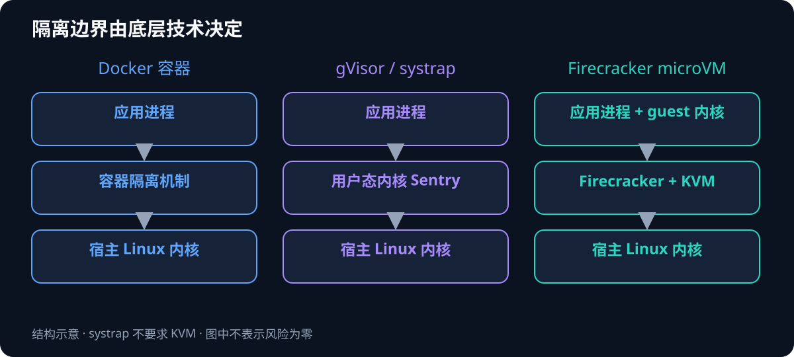
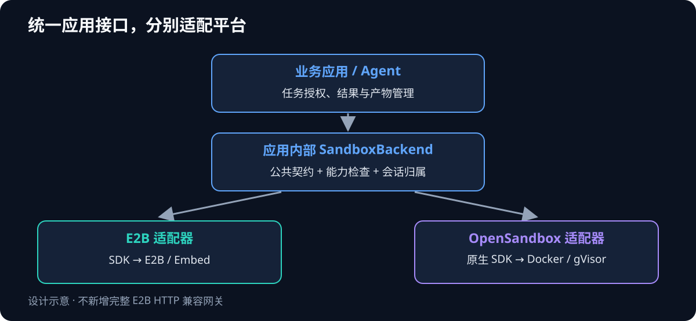
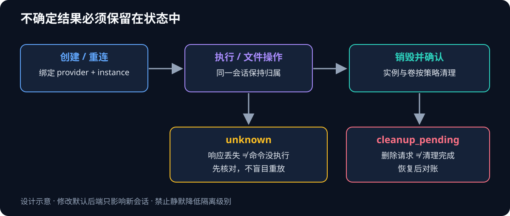

一台 Linux 服务器已经安装 Docker，数据盘也有足够空间，却没有 `/dev/kvm`。如果应用目前用 E2B SDK 执行代码，下一步究竟是换服务器、换沙箱平台，还是改应用的接入方式？

这三个选择解决的是不同问题。硬件决定可以运行哪些隔离技术，平台决定提供哪些管理能力，应用接口决定切换后端要改多少业务代码。把它们混在一起，就容易从“E2B 标准部署需要 KVM”推导出“这台服务器不能部署任何沙箱”。

本文建议：在业务应用中定义一组有明确行为的沙箱接口，保留 E2B 适配器，同时评估基于 OpenSandbox 的容器适配器；由部署配置决定容器使用普通运行时还是 gVisor。统一接口只承诺真实需要、能够验证的功能，高级能力通过显式能力声明开放。

> 文档状态：工程设计草稿，外部资料核对日期为 2026-10-21。这里的接口、配置键与文件组织都是建议，不代表 ZataTree 或其他业务仓库已实现。ZataTree 是本文的知识文档载体；本文没有部署任何沙箱，也没有完成跨后端兼容测试。文中不包含真实服务器清单、凭据或私有资产信息。

## 一、先区分执行引擎、沙箱平台和应用接口

### 执行引擎决定隔离边界

Docker 容器通常通过 Linux namespaces、cgroups 等机制隔离进程与资源，容器仍然共享宿主内核。Firecracker 创建 microVM，也就是微型虚拟机，每个实例运行自己的 guest kernel。gVisor 在用户态提供系统调用处理层，减少应用直接接触宿主内核的接口面；它不等于为每个容器启动一套完整虚拟机。

gVisor 本身还支持不同平台。其 `systrap` 通过 seccomp 捕获系统调用，官方将其作为虚拟机内或无硬件虚拟化支持环境的选择；gVisor 的 KVM 平台则利用虚拟化扩展。因此，“gVisor 需要不需要 KVM”必须连同运行模式一起回答。[gVisor Platform Guide](https://gvisor.dev/docs/architecture_guide/platforms/)



图 1：隔离边界示意。该图解释技术结构，不表示三种方案经过了同一套安全测试，也不代表任何方案没有逃逸风险。

### 沙箱平台提供环境管理

执行引擎之上，还需要创建环境、识别实例、执行命令、传文件、设置生命周期、清理资源以及访问实例端口。E2B、OpenSandbox 和 AgentENV 在这个层面提供产品或平台能力，Docker、gVisor 与 Firecracker 则位于底层运行时。一个平台可以接入多个运行时。

本项目讨论的 E2B Embed 标准安装直接运行 Firecracker，并要求 KVM 和 TUN 设备。把其控制面装进 Docker 并不会消除 Firecracker 对宿主能力的要求。[E2B Embed Compose 部署说明](https://github.com/e2b-dev/runtime/blob/main/embed/compose/README.md)

### 应用接口决定业务耦合

业务真正关心的是“运行这段命令并取回文件”，通常不关心后端使用哪一种 HTTP 路径或 SDK 类型。可以把第三方 SDK 限定在适配器内部，把业务需要的行为定义在应用自己的边界上。

这是一种有公开项目实践的设计，并非行业已经统一了协议。Deep Agents 的 backend 体系提供统一接口并接入不同实现；OpenSandbox 则维护自己的协议。[Deep Agents Backends](https://docs.langchain.com/oss/python/deepagents/backends)

## 二、E2B 兼容究竟兼容什么

“兼容 E2B”至少有三层意思，验收时应分别列清。

| 层次 | 要回答的问题 | 常见误判 |
| --- | --- | --- |
| 客户端兼容 | 原来的 Python/TypeScript SDK 能否直接连接？ | 只改 API 地址就认为全部功能可用 |
| 行为兼容 | 超时、后台进程、文件、PTY 和重连行为是否一致？ | 方法同名就认为执行效果相同 |
| 部署与隔离 | 谁运行命令、谁限制资源、隔离边界是什么？ | SDK 可用就认为具有同样的虚拟机隔离 |

Docker 和 gVisor 不直接实现 E2B 的平台 API。要让原版 E2B SDK 连接容器后端，需要兼容服务处理生命周期接口、实例寻址、执行与文件协议、鉴权、错误模型和版本差异。这是一项持续维护工作。

OpenSandbox 维护者明确说明，目前不计划直接兼容 E2B API。原生 SDK 的方法形态相似，也不能据此认为 E2B 客户端可以无缝连接。[OpenSandbox 官方讨论 #800](https://github.com/opensandbox-group/OpenSandbox/issues/800)

部分平台提供限定范围的 E2B 兼容层。例如 ROCK 的文档标明了验收使用的 Python SDK 版本、支持的文件与执行能力，以及后台命令、超时和端口寻址的限制。这说明兼容性可以实现，但应当绑定版本和能力清单。[ROCK E2B SDK 兼容说明](https://alibaba.github.io/ROCK/docs/1.11.x/User%20Guides/e2b_sdk_compatibility/)

### Kimi 与 DeepSeek 方案放在哪里

如果讨论的是 Kimi 相关的 AgentENV，它默认使用 Firecracker，提供 E2B 兼容 API；其 README 要求 `/dev/kvm`。它也提供面向无常规嵌套虚拟化环境的 PVM 路线，但要更换宿主内核、重启并加载模块，最终仍通过 KVM 兼容接口运行专用 Firecracker 和 guest kernel。官方将其标记为实验性，不宜把它理解成普通配置开关。[AgentENV](https://github.com/kvcache-ai/AgentENV)、[PVM 部署指南](https://kvcache-ai.github.io/AgentENV/dev/deployment/pvm.html)

DeepSeek 的 DSec 技术报告描述的是多后端平台，覆盖函数、容器、microVM 与完整虚拟机。它的架构说明可以帮助理解选型，不能直接证明某个可下载组件已提供完整的自建体验。本文没有把“发表报告”“部分组件开源”和“整套平台可一键部署”混为一项能力。[DSec 技术报告](https://arxiv.org/abs/2609.22978)

## 三、推荐架构：业务共用接口，适配器保留差异

建议采用下面的边界，避免业务层分散导入不同服务商 SDK。



图 2：建议架构。E2B 与 OpenSandbox 分别适配，普通容器与 gVisor 可以是同一个 OpenSandbox 后端下的部署策略。

一次任务的调用链可以写成：

```text
Agent 发起工具调用
  → 应用检查用户、任务权限和资源预算
  → 根据任务策略选择 provider、profile 与最低隔离要求
  → 适配器创建实例并记录会话归属
  → 执行命令 / 读写文件
  → 应用取回结果与产物
  → 销毁或按明确的会话策略保留
```

业务层只处理任务状态和统一结果；适配器封装 SDK 参数、异常和连接信息。已有框架若提供满足需求的 sandbox backend，应直接扩展该接口。没有现成边界时，才新增最小契约，不并行维护两套内容相同的抽象。

### 三个仓库角色

| 位置 | 应负责 | 不应混入 |
| --- | --- | --- |
| 业务应用 | 沙箱接口、后端适配器、会话归属、任务与产物管理 | 直接 SSH 到宿主执行模型生成的任意命令 |
| 沙箱平台 | 环境创建、执行与文件服务、资源限制、实例清理 | 业务用户的订单或对话规则 |
| 运维工具 zata-ops | 配置资产、部署检查、日志、容量和运行状态维护 | 业务请求的沙箱调度与 Agent 工具调用 |

ZataTree 只保存这份设计文档。具体代码路径要在目标业务仓库中查找现有接口后决定；本文不假设它采用某个 Web 框架，也不要求新增数据库服务或单独的业务 HTTP 服务。

## 四、最小公共契约应当包含哪些能力

### 核心功能和高级能力分开

公共契约应以业务需要为边界。建议先确认下表中的核心功能是否覆盖实际调用，再增加高级能力。

| 能力 | 核心契约 | 验收重点 |
| --- | --- | --- |
| 创建实例 | 需要 | 镜像/模板、资源、隔离策略与会话归属准确 |
| 执行命令 | 需要 | stdout、stderr、退出码、超时、取消、输出上限 |
| 读写文件 | 需要 | 二进制、大小限制、工作区与权限边界 |
| 连接已有实例 | 多轮任务通常需要 | 重启应用后可重连，不能连到其他租户 |
| 销毁实例 | 需要 | 可重复调用，能够确认清理结果 |
| 后台进程、PTY | 按需开启 | 重连、终止、交互与生命周期有明确语义 |
| 暂停恢复、快照 | 按需开启 | 文件与进程内存的保存范围分别验证 |
| Code Interpreter | 按需开启 | 变量上下文、图表、异常和内核生命周期 |
| 端口预览 | 按需开启 | 访问者鉴权、租户隔离、URL 失效与路由 |

不要把 `python script.py` 当作具有跨调用变量上下文的 `run_code()`。不要把 `docker pause` 的进程冻结当作可释放资源、持久保存并异机恢复的快照。若目标需要高级能力，应在开始任务前检测后端是否满足。

### 用内部类型隔离第三方对象

下面的契约草图用于说明会话引用与错误分类，省略了方法体。接入代码需在目标业务仓库中实现，并按实际第三方 SDK 版本编写。

```python
from dataclasses import dataclass
from typing import Literal, Protocol


@dataclass(frozen=True)
class SandboxRef:
    provider: str
    instance_id: str
    owner_id: str
    workspace_id: str


@dataclass(frozen=True)
class CreateRequest:
    owner_id: str
    workspace_id: str
    profile: str
    idempotency_key: str


@dataclass(frozen=True)
class ExecRequest:
    argv: tuple[str, ...]
    cwd: str = "/workspace"
    timeout_seconds: int = 60
    max_output_bytes: int = 1_048_576


@dataclass(frozen=True)
class ExecResult:
    state: Literal["completed", "timed_out", "cancelled", "unknown"]
    exit_code: int | None
    stdout: bytes
    stderr: bytes
    output_truncated: bool
    execution_id: str | None


class SandboxBackend(Protocol):
    async def create(self, request: CreateRequest) -> SandboxRef: ...
    async def connect(self, reference: SandboxRef) -> SandboxRef: ...
    async def execute(
        self, reference: SandboxRef, request: ExecRequest
    ) -> ExecResult: ...
    async def write_file(
        self, reference: SandboxRef, path: str, content: bytes
    ) -> None: ...
    async def read_file(
        self, reference: SandboxRef, path: str
    ) -> bytes: ...
    async def destroy(self, reference: SandboxRef) -> None: ...
```

`SandboxRef` 中的 owner 和 workspace 只是归属信息，不能作为用户自己提交后即可信任的授权凭据。服务端必须从认证上下文核对归属，并通过可信会话记录解析实例。文件接口还需由实现统一约束最大大小、目标路径和原子写入策略。

逻辑上使用 argv，不强迫所有第三方平台原生支持 argv。如果下游只接受 shell 字符串，适配器必须明确 shell 类型、完成参数引用并测试空格、引号、换行等输入。业务确实要用管道时，应显式请求 shell 模式；不能为了拼命令而把未经引用的参数插入 shell。

### 能力声明必须绑定部署配置

能力属于“适配器版本 + 平台版本 + 镜像/profile + 实际部署”，不能只看 provider 名字。例如同一个 OpenSandbox 后端，可以配置为普通 OCI runtime，也可以配置 gVisor；平台不会替管理员自动安装运行时。[OpenSandbox 运行时配置](https://github.com/opensandbox-group/OpenSandbox/blob/main/server/configuration.md)

建议对上层提供如下内部能力描述，以下字段均为本文的设计示例：

```json
{
  "provider": "opensandbox-remote",
  "profile": "python-restricted",
  "isolation": "gvisor-systrap",
  "capabilities": {
    "exec": true,
    "binary_files": true,
    "reconnect": true,
    "pty": false,
    "memory_snapshot": false,
    "stateful_code_interpreter": false
  }
}
```

这份清单只描述拟选部署向业务提供的能力，不能用于概括 OpenSandbox 全产品的能力。只有通过真实测试的能力才能标为可用；尚未测试的能力应使用 `unknown` 或不发布该 profile。

## 五、会话、错误和重试决定能否可靠切换

### 会话创建后固定归属

一个工作区或任务创建成功后，保存 provider、instance ID、逻辑环境版本、创建时间、过期时间、owner 与当前状态。记录应复用业务现有持久化机制；单进程内存字典不足以支持应用重启后的恢复。

全局修改默认 provider 只影响新会话。旧会话仍回到原后端，直到正常结束或显式迁移。否则切换配置后，旧 instance ID 可能被拿去调用新平台，表现为找不到实例，甚至发生归属错误。



图 3：建议的会话状态边界。`unknown` 和 `cleanup_pending` 保留不确定性，供恢复与清理流程继续处理。

### 四种结果不能合成一个异常

| 情况 | 上层应该知道 | 自动重试原则 |
| --- | --- | --- |
| 命令结束但退出码非零 | 程序已执行，业务结果失败 | 不作为网络失败重试 |
| 执行超时或用户取消 | 是否已确认终止远端进程 | 未确认终止时保留 execution ID 并继续核对 |
| 请求断线、响应丢失 | 命令可能已执行，结果未知 | 禁止直接重放有副作用的命令 |
| 创建请求超时 | 实例可能已经创建 | 先按请求标识查询，再决定是否重试创建 |

适配器应区分认证失败、能力不支持、容量不足、实例过期和传输失败。不要统一变成“沙箱错误，请重试”。如果 provider 不支持请求幂等或按标签查找实例，应用无法凭空保证 exactly-once，应明确降低承诺并提供孤儿实例对账机制。

取消本地 HTTP 请求，只证明客户端停止等待。超时后若不能确认远端进程及其子进程已停止，应返回 `unknown`，并考虑销毁整实例进行隔离。对于长任务，使用可查询的执行标识；不能将“客户端超时”直接转成“任务结束”。

### 不静默降级隔离级别

gVisor 不可用时，要求该隔离等级的任务应拒绝创建，不能自动用普通 runc 继续执行。同样，E2B 调用中途失败不能自动换到 Docker 重跑，因为执行副作用、环境状态和隔离要求都可能改变。

允许的回退应限定在尚未创建实例、尚未执行命令的阶段，且替代后端满足同一份任务策略。把回退决策记录到操作日志，让调用者知道实际使用了哪个后端。

## 六、两个后端如何适配

### E2B 适配器

把 E2B SDK 的导入、实例连接、模板选择、错误映射和凭据读取集中在适配器内部。业务仅使用逻辑 profile，如 `python-restricted`，由配置将它映射到特定 E2B template 与资源策略。

接入时固定 SDK 版本和运行时版本，明确使用基础 Sandbox 还是 Code Interpreter SDK。连接旧实例的验证必须覆盖业务应用重启，而不只是同一个 Python 对象连续调用。端口访问、PTY、快照等按实际需求补测试，不能以 `commands.run()` 成功替代。

E2B Cloud、本地 Embed 和第三方兼容端点应作为不同部署配置管理，不能只凭包名判断能力相同。API 地址、数据面地址、模板、认证方式和 SDK 版本都要分别记录。

### OpenSandbox 容器适配器

复用 OpenSandbox 的原生 SDK 与平台管理功能，应用只负责类型转换和业务策略。不要在应用内重复编写一套 Docker 生命周期服务，再同时维护 OpenSandbox 和直连 Docker 两条功能重复的路径。

底层运行时交给管理员配置。候选部署可以是 Docker + gVisor `runsc`，选择 `systrap` 以避免 KVM 依赖，但必须验证实际容器采用了该 runtime，以及目标工作负载是否兼容。检查 `runsc` 已安装不够，需核对实际实例的 runtime 配置与启动日志；如运行时支持多种平台，还需检查具体平台设置。

若业务只有完全受控的内部短任务，可以单独评估普通容器 profile。该 profile 不能宣称具备 gVisor 或独立内核隔离，也不能作为高隔离任务的隐式替代。

### 环境模板按内容统一

E2B template ID 和 OCI 镜像 tag 属于不同体系，不应要求字符串相同。统一的是语言版本、依赖清单、非 root 用户、工作目录、产物目录和业务工具版本。

建议维护一份环境规范，分别构建对应模板与镜像；记录源提交、构建输入和镜像 digest。以“同一组测试命令得到同一结果”证明环境等价，不以“都叫 python”证明等价。跨后端可移植的是经过验证的环境与文件产物，进程内存、系统服务和运行中的连接不在默认可迁移范围内。

## 七、远程容器部署需要哪些约束

本节给出部署设计约束；可执行的 Compose 配置需要按业务仓库和实际平台版本另行编写。

### 资源、磁盘和已有服务

一台没有 KVM 的 Linux 云主机可以作为容器后端候选，但仍要确认 Docker、cgroup、gVisor 所需内核功能、文件系统和网络条件。已有业务负载的机器要预留内存与 CPU，按峰值并发测试；资源上限不是资源预留，限制为若干 GiB 不代表宿主就有足够可用内存。

独立数据盘已经挂载，也不意味着 Docker 会自动使用它。应分别核对 Docker data-root、平台状态目录、镜像与构建缓存、会话卷、产物目录和日志落点。建议在数据盘下分配专用目录，并给工作区设置容量与清理策略；跨文件系统的路径必须在重启后继续可用。

不要仅为新沙箱迁移已有宿主的 Docker data-root。可以优先迁移新平台支持显式配置的状态和会话数据；镜像层是否仍位于根盘要单独计量。若确实需要修改 Docker 配置，应在维护窗口确认已有容器影响与回退步骤。

### 控制面权限和网络

业务应用通过认证后的平台 API 管理沙箱，不把宿主 Docker socket 暴露给 Agent 或沙箱实例。能够访问 Docker daemon 的控制面具有高权限，应独立保护；使用容器封装控制面并不会自动降低这项权限。

建议将控制面限制在私有网络、VPN 或可信反向代理之后，对外访问使用 TLS 与认证。API 入口、实例端口预览和出网访问是三套不同边界，分别设计授权和审计。平台 API key 不应被透传到模型可读的提示词、命令环境或普通运行日志。

默认拒绝沙箱访问宿主管理端口、其他租户实例、云元数据服务和未授权私网。需要公网安装依赖时，明确允许的出口与代理策略。域名白名单还要考虑 DNS 重绑定、重定向、IPv6、代理隧道和私有地址解析；仅在应用层检查一次 URL 字符串无法证明网络隔离。

### 工作区与产物

不要把整个业务仓库或宿主用户目录挂载到沙箱。为任务提供最小输入和独立可写工作区；通过业务授权决定哪些文件可以导入和导出。

文件边界应覆盖符号链接、`..` 路径、归档解压、目标权限、二进制内容与大文件。长期产物进入受控对象存储或现有产物系统，沙箱销毁后仍通过业务授权访问。会话卷是否保留、保留多久、由谁清理，应独立于实例 TTL 定义。

### 一个示意配置

以下配置键由本文为应用内部设计，尚未实现；平台官方配置需在适配器中独立管理。`profile` 由服务端允许列表解析，不能让普通用户传入任意镜像、挂载路径、runtime 或 CPU/内存上限。

```yaml
sandbox:
  default_provider: opensandbox-remote
  providers:
    e2b-local:
      kind: e2b
      credentials_ref: local-secret-store/e2b
    opensandbox-remote:
      kind: opensandbox
      endpoint: https://sandbox.internal.example.com
      credentials_ref: local-secret-store/opensandbox
  profiles:
    python-restricted:
      minimum_isolation: gvisor
      ttl_seconds: 900
      command_timeout_seconds: 60
      max_output_bytes: 1048576
      max_file_bytes: 16777216
```

`minimum_isolation` 需要实现一套显式允许关系，不能把 `gvisor`、`microvm` 等字符串简单排序后当作普遍安全等级。配置中的数值仅用于解释字段；正式值要由资源测试、任务耗时和平台配额决定。

## 八、从已有 E2B 应用迁移的执行顺序

这条建议迁移路径在保留旧后端的同时，让新后端通过相同的行为测试。具体改造尚未实施。

1. **盘点调用。** 搜索 SDK 导入、环境变量、沙箱创建、模板构建、文件、PTY、端口和暂停恢复调用。除了方法名，还要记录超时处理、错误码和跨请求状态依赖。
2. **找现有接口。** 优先扩展业务已有 backend 或工具执行边界。根据实际调用确定核心能力，避免为了“多后端”先建设通用插件平台。
3. **先封装 E2B。** 让业务仍走原后端，确认命令结果、异常、连接、文件产物与清理行为没有变化；将 SDK 对象限制在适配器内部。
4. **实现第二个适配器。** 使用 OpenSandbox 原生 SDK 映射同一契约，单独验证 runtime、权限、网络和镜像。不要在这一环节同时自建完整 E2B HTTP 兼容网关。
5. **对照真实任务。** 使用相同代码、输入文件和环境版本，在两个后端独立执行，比较退出状态与产物；不能通过 mock 或同一 provider 冒充跨后端验证。
6. **按会话切换。** 只对新会话选择新后端，保留旧实例的 provider 归属；先选择低风险任务。高隔离或高级能力任务保持原路，直到新后端证明满足要求。
7. **演练回退。** 将新会话默认值切回原后端，确认旧会话仍连接原实例；验证新平台停止接单后可以清理实例、卷和残留记录。

业务仓库中的盘点可参考以下搜索命令。它们只读搜索，不执行部署；这里的调用名只是搜索线索，具体名字以使用的 SDK 版本为准。

```bash
rg -n --hidden \
  -g '!node_modules/**' -g '!.git/**' -g '!.venv/**' \
  -g '!*.lock' -g '!.env*' \
  'e2b|E2B_|Sandbox\.create|commands\.run|run_code|runCode|files\.|get_host|getHost|\.pty|\.pause\(|\.resume\(' .
```

如果发现大量应用或第三方工具都直接依赖 E2B SDK，且短期无法修改，再评估独立兼容层。即便选择兼容层，也应固定 SDK 版本、公开不支持项，并测试执行与文件数据面，不能只实现创建和删除接口。

## 九、验收要从真实应用入口开始

测试目标是证明用户通过同一业务入口，能够在不同后端完成任务并取回产物，同时没有越权和资源残留。单元测试适合检查映射、状态机和重试规则，不能证明网络、运行时和远端文件行为。

### 共用行为验收

| 场景 | 真实入口动作 | 通过条件 |
| --- | --- | --- |
| 创建、执行、销毁 | 提交任务，运行短命令，结束会话 | provider 正确，结果可读，实例确认消失 |
| 程序失败 | 执行显式返回非零的程序 | 保留退出码与 stderr，不误判网络故障 |
| 二进制文件 | 写入、读取并导出固定输入 | 内容哈希一致，大小限制生效 |
| 多轮状态 | 前一轮创建文件，下一轮读取 | 同一会话可见，其他会话不可见 |
| 应用重启 | 创建后重启业务应用再连接 | 从可信记录恢复同一 provider 与实例 |
| 执行超时 | 运行持续写文件的子进程树 | 终止后写入停止；无法确认则报告 unknown |
| 响应丢失 | 命令产生一次性标记后切断响应 | 不自动重放；恢复时能核对执行结果 |
| 输出过大 | 程序持续输出 | 内存受控，截断标志准确，进程按策略结束 |

### 权限与隔离验收

| 场景 | 负向动作 | 通过条件 |
| --- | --- | --- |
| 跨租户访问 | 使用另一用户的实例或文件引用 | 被业务与平台授权边界拒绝 |
| 越界读写 | 通过符号链接和路径穿越访问工作区外文件 | 无法取得未授权宿主或其他任务文件 |
| 网络越权 | 尝试连接元数据、私网和管理端口 | 数据面实际阻断，不只返回配置声明 |
| 隔离降级 | 让 gVisor runtime 在测试节点不可用 | 任务拒绝创建，不改用普通容器 |
| 清理失败 | 在删除请求期间模拟节点失联 | 标记 cleanup_pending，恢复后能够对账 |
| 容量耗尽 | 在受控测试节点达到资源预算 | 拒绝新任务，已有业务仍可运行 |

负向测试只在专用测试实例或允许的网络范围执行。生产机器上的同租户探测也不能替代跨租户安全验证，更不能因为使用 gVisor 就省略工作区、密钥和网络测试。

### 最小端到端任务

建议选一个具有真实输入和输出的任务作为共同基准：上传 CSV，在沙箱执行数据处理脚本，产生 JSON 统计与图表，业务下载并校验内容，然后销毁实例。输入不包含生产隐私数据。

验收证据记录业务请求 ID、provider、实例 ID、环境版本、实际 runtime、开始结束时间、退出状态、产物哈希和清理结果。报告不包含平台 key、宿主私钥或原始敏感输入。只有在业务入口完成这条路径，才能声明“应用已经接通该后端”。

固定测试镜像和依赖，分别记录冷启动与已有镜像条件下的耗时；同样比较最大并发、内存峰值、磁盘增长和超时清理耗时。不在没有实测的情况下承诺某个后端更快、更便宜或能够承载固定数量的会话。

## 十、实施前需要确定的内容

| 待确定项 | 建议默认值 | 改变建议的条件 |
| --- | --- | --- |
| 是否必须保留 E2B SDK | 应用内部适配，不新增完整兼容网关 | 大量不可修改的客户端依赖 E2B |
| 目标容器后端 | 先评估 OpenSandbox 原生 SDK | 既有平台已经提供同等管理能力 |
| 最低隔离 | 按任务定义并验证，不静默降级 | 任务信任边界或威胁模型变化 |
| 是否需要 PTY / 内存快照 | 没有实际调用就不纳入公共承诺 | 真实业务明确依赖并能验证 |
| 是否复用业务服务器 | 只作为资源与隔离评估后的候选 | 高风险代码、多租户或已有负载不可承受 |
| 存储落点 | 专用任务目录和持久产物系统 | 平台对 data-root、卷或快照有额外要求 |

完成这些选择后，应到目标业务仓库补充实际模块、配置与验收入口；到运维仓库补充部署清单与现场检查。不要把这份知识文档当成已批准修改生产内核、重启 Docker 或开放公网端口的操作授权。

接口稳定的价值来自可验证的共同语义：应用知道命令是否完成、文件属于谁、实例由谁回收，并能在后端不同的情况下保持这些承诺。

## 参考资料与阅读顺序

以下为一手资料，核对日期均为 2026-10-21。页面可能持续变化；正式实施时需固定所用 SDK、平台和运行时版本，再按该版本复核。

1. [E2B Embed Compose](https://github.com/e2b-dev/runtime/blob/main/embed/compose/README.md)：宿主要求、KVM、存储与安装会修改的宿主状态。
2. [gVisor Platform Guide](https://gvisor.dev/docs/architecture_guide/platforms/)：KVM、systrap 与硬件支持边界。
3. [OpenSandbox 配置](https://github.com/opensandbox-group/OpenSandbox/blob/main/server/configuration.md)：平台运行时配置与容器隔离选项。
4. [OpenSandbox E2B 兼容性讨论](https://github.com/opensandbox-group/OpenSandbox/issues/800)：维护者对直接兼容 E2B 的立场与理由。
5. [Deep Agents Backends](https://docs.langchain.com/oss/python/deepagents/backends)：应用框架通过 backend 接口接入执行环境的实践。
6. [AgentENV](https://github.com/kvcache-ai/AgentENV) 与 [PVM 部署](https://kvcache-ai.github.io/AgentENV/dev/deployment/pvm.html)：E2B 兼容接口、默认运行要求与实验性替代路线。
7. [DeepSeek DSec 技术报告](https://arxiv.org/abs/2609.22978)：多后端训练平台的架构说明。
8. [ROCK E2B Python SDK 兼容清单](https://alibaba.github.io/ROCK/docs/1.11.x/User%20Guides/e2b_sdk_compatibility/)：版本绑定和部分兼容的具体例子。

站内延伸阅读：

- [Agent 沙箱选型指南]()：选择隔离技术与平台时的基础判断维度。
- [E2B 迁到阿里云云沙箱]()：第三方 E2B 兼容端点的迁移边界。
