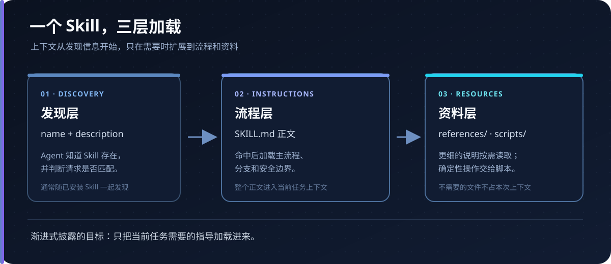
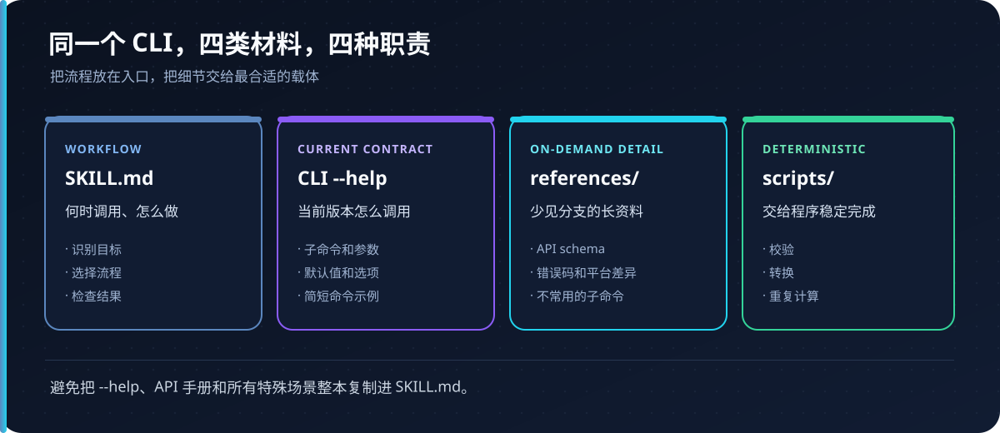
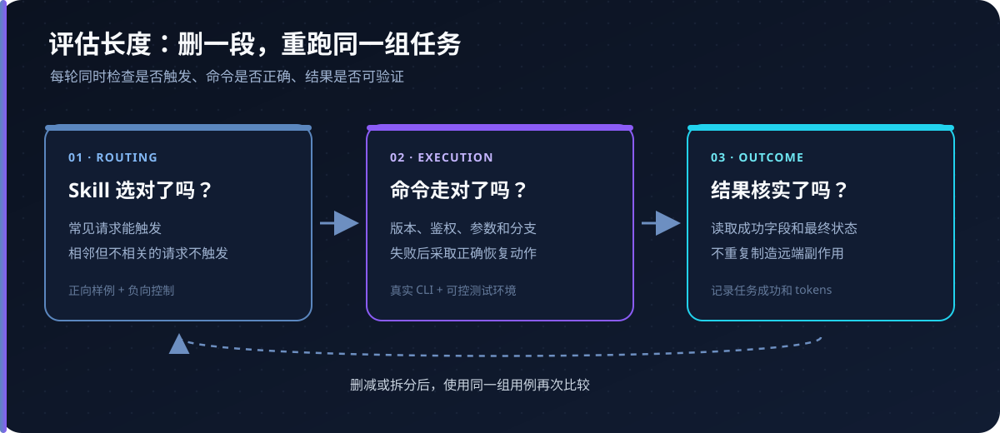

给 CLI 随包写一个 `SKILL.md`，常见的疑问是：要不要把 `--help` 的全部参数、所有子命令和使用示例都复制进去？

查了开放规范、几家 Agent 平台的写作指南，以及几项公开研究之后，结论是：**行业没有统一的正文推荐字数；较一致的实践是缩小 Skill 的任务范围、只写有用内容、按需加载，再用实际任务验证。** 对一个只有一两条常用流程的 CLI，正文可以从几百个汉字起步；带鉴权、写操作和失败分支的常见工具，先按 800～2000 个汉字组织，再按实际 token 数和任务表现调整。这是工程上的起稿建议，开放规范并未规定正文长度。

## 一、先把 Skill 和 CLI 文档分工

CLI 提供可执行的命令、参数和结果；Skill 告诉 Agent 什么时候用这些命令、怎么选流程、怎样判断结果。好的 Skill 会补上 `--help` 通常回答不了的内容：多个命令怎么组合、先做什么检查、遇到超时能否重试、结果要看哪个字段，以及什么操作不能擅自继续。



*▲ 常见的渐进式披露路径。宿主实现略有差别，但入口负责路由、正文负责流程、引用文件按需加载，是各家指南反复采用的结构。*

开放的 [Agent Skills 规范](https://agentskills.io/specification)把一个 Skill 定义为包含 `SKILL.md` 的目录，也允许附带 `scripts/`、`references/` 和 `assets/`。Agent 先看到 `name` 和 `description`，判断匹配后才加载完整正文；更细的资料可以从正文链接出去。

所以，随 CLI 一起分发 Skill，不代表要把 CLI 手册再抄一遍。Skill 应写清**如何完成一件常见任务**；CLI 自己的帮助信息继续作为参数和选项的事实来源；长篇 schema、错误码表、不同子命令的专属细节再放到引用文档。



*▲ 用 `SKILL.md` 编排流程，用 CLI 帮助确认当前版本的参数，用 references 承载按场景读取的长资料，用 scripts 执行确定性操作。*

## 二、规范与厂商建议：没有一个共同的字数上限

### 开放规范只限制元数据，不限制正文篇幅

规范要求 `name` 最多 64 个字符，`description` 最多 1024 个字符；description 要说明能力和适用场景。正文是 Markdown，没有规定字数、token 数或行数，只建议提供步骤、输入输出示例和常见边界，并提醒长内容考虑拆分。

“正文最多 5000 tokens”属于特定平台或文档提供的建议；Agent Skills 开放规范没有规定正文的硬性长度限制，也没有把这条建议设为所有宿主的兼容性要求。

### 平台建议是软上限，单位也不同

[Anthropic 的 Skill 写作指南](https://platform.claude.com/docs/en/agents-and-tools/agent-skills/best-practices)强调精简，并建议 `SKILL.md` 正文保持在 500 行以内；接近这个范围时，把特定场景的细节移到独立文件。[Microsoft Agent Framework 文档](https://learn.microsoft.com/en-us/agent-framework/agents/skills)则建议已激活的 Skill 正文低于 5000 tokens。OpenAI 的写作指导更强调让入口文件尽可能短，对多流程 Skill 使用简短路由，再把详细指令放进需要时才读取的文件。[OpenAI skill 构建指南](https://developers.openai.com/plugins/build/skills) · [Codex 关于精简 Skill 的说明](https://developers.openai.com/blog/rethinking-skills-and-prompts-for-gpt-6-astra)

500 行和 5000 tokens 不能互换：行长、代码块、中文和表格都会改变 token 数。两者适合作为拆分提醒，不宜设为写作目标。不同宿主的 Skill 加载方式、允许的元数据和工具权限也有差异；例如 GitHub Copilot CLI 支持在 Skill 目录附加脚本和资源，而 `allowed-tools` 可以预先批准 Shell，官方因此提醒发布前审查对应内容。[GitHub Copilot CLI 的 Skill 文档](https://docs.github.com/en/copilot/how-tos/copilot-cli/customize-copilot/add-skills)

### 公开 Skill 的篇幅不能直接当作推荐范围

一项 2026 年的研究收集了 20,556 个公开仓库中的 138,133 份 `SKILL.md`，报告的正文中位数约为 169 行、687 个英文词。它衡量的是公开生态当前的写作长度，无法说明哪种篇幅在任务评估中胜出。

同一研究用静态检测器发现 91.8% 的样本至少命中一项“可复用性缺陷”；其中 52.3% 缺少有效的触发说明，32.1% 被检测为行内示例过多。作者还专门提醒，静态检测的缺陷率不等于这些 Skill 在真实任务里有同等比例的失败；样本来自公开 GitHub 和技能目录，也不能代表企业内网的私有 Skill。[研究论文：138K 份 SKILL.md 的复用性分析](https://arxiv.org/abs/2608.08453)

这组数字提醒我们：正文有几百行本身不能证明内容有效；短文件也可能因为 description 太模糊而从来没有被调用。研究中的路由压力测试发现，description 清晰的样本在 BM25 检索下更容易排到第一位。作者说明，这项测试不能直接代表生产环境里的 LLM 路由成功率。

另一项 2026 年研究在 84 个任务和 7 种 Agent／模型组合上测试精心整理的 Skill，平均通过率比不提供 Skill 高 16.2 个百分点，但 84 个任务里仍有 16 个表现下降；模型临时自写的 Skill 平均没有带来收益。研究还发现聚焦在两到三个模块的 Skill 优于全面铺开的文档。这些结果说明，相关且经过整理的流程知识能提高总体表现，收益仍会因任务而变。[SkillsBench 论文](https://arxiv.org/abs/2602.12670)

还有一项压缩研究在 600 个样本上把 Skill 正文 token 平均减少约 39%；压缩后 86% 的样本在任务评估中保持或提高原有得分。作者采用分类、拆分和反馈恢复流程来压缩内容，并保留 Agent 会用到的条件、约束和例外。[SkillReducer 论文](https://arxiv.org/abs/2603.29919)

## 三、CLI 随包 Skill 的篇幅怎么定

下面给一个起稿预算。表里的中文字符数只用于编辑时估算正文体量，不含 front matter；代码块、表格和中文分词会让 token 数变化。如果要估算上下文成本，应使用目标宿主的 tokenizer。

| CLI 工作流 | 中文正文起步范围 | 适合写入的内容 |
|---|---:|---|
| 一个简单任务 | 约 300～800 字 | 何时调用、命令骨架、成功信号 |
| 常见产品 CLI | 约 800～2000 字 | 前置检查、鉴权来源、两三条流程、失败和结果验证 |
| 多个独立领域或大量分支 | 入口约 500～1000 字，再拆引用文档 | 路由到不同工作流；按当前请求读取对应流程 |

对多数随 CLI 分发的 Skill，我会先用第二行作为草稿预算；如果正文在 2000 字内已经覆盖关键流程，就没有必要为了达到某个长度继续补充。如果超出不少，逐段检查它是不是在复述帮助文本、加入不会触发的特殊场景，或将几个不同意图硬塞进一个 Skill。

当写操作涉及覆盖、发布、删除、费用或权限变化时，正文可以合理变长。关键是把“调用前确认什么、什么情况下需要用户决定、如何避免重复执行、如何核验最终状态”写清楚。对这一类操作，少写几百字省下的 tokens 不值得换来不安全的重试或误操作。

### 一个实际分发案例

ShipStatic 的 `publish-online` Skill 是一个具体参照。它随工具的 CLI 和 MCP 能力一起分发，正文约 175 行，覆盖构建目录选择、CLI 与 MCP 的调用条件、账号与无账号发布、认证失败、超时后的重复发布风险，以及结果链接和有效期怎么告诉用户。[完整 SKILL.md](https://www.shipstatic.com/SKILL.md)

这个案例不宜直接作为所有 CLI 的模板，因为它还要处理公开发布、账号归属和密码保护等分支。它说明篇幅应随实际决策数量和失败成本变化；命令参数数量本身不足以决定篇幅。

## 四、Skill 本体应该写什么

### 1. 把触发条件写进 description

不要只写 `Use the Acme CLI.`。它说明了工具名，却没有说 Agent 什么时候应该加载 Skill。

可以写成：`Deploy an Acme project and verify its release. Use when the user asks to publish a build, roll out a release, or check a deployment result.`

description 承担的是发现和路由职责，不应该藏在正文中。格式规范允许最多 1024 个字符，但不要因为空间允许，就把流程、所有参数和故障排查都塞进 description。保持一两句话，包含动作、对象和典型触发场景。

### 2. 正文按决策顺序组织

CLI Skill 的正文一般要解决以下问题，按工作流组织，不必机械地为每一项开一个标题：

- **环境检查**：需要哪个可执行文件、最低版本、网络或登录状态；版本不满足时怎么处理。
- **流程选择**：用户说的是创建、查询、更新还是删除；哪些子命令分别对应这些目标。
- **关键调用**：给常用路径的命令骨架和必要选项，避免列出所有旗标。
- **安全边界**：哪些操作会改变远端状态，是否需要确认，怎样避免将 token 写入命令、日志或回答。
- **结果判断**：如何判断成功，输出中的哪个字段是资源 ID、URL 或状态；如果 CLI 支持 JSON，优先说明如何按结构化字段读取。
- **失败处理**：把鉴权失败、权限不足、参数无效、请求超时等不同情况映射到下一步动作；不确定写操作是否成功时，先查询状态再重试。

### 3. 按加载方式分配长资料

正文应该告诉 Agent 在什么情况下去哪里读；只列文件树无法说明 Agent 何时应该使用每份资料。

- **`SKILL.md`**：入口、触发后的主流程、必须遵守的边界和引用指引。
- **`references/`**：较长的子命令说明、API schema、少用的参数、错误码、不同 provider 的配置细节。
- **`scripts/`**：确定性强的检查、文件转换、结果校验和重复计算；写清楚执行方式、输入和输出。

假设 CLI 有 `deploy`、`domains`、`projects` 三个互不相关的子系统，不必在 `SKILL.md` 贴上三份完整手册。入口可以说明每个子系统的用途，并只链接当前任务对应的参考文件。如果 Skill 只有一个动作、一条命令且没有分支，单文件就足够，不必为了形式而加目录。

### 4. 兼顾版本和宿主差异

随包分发最大的维护风险是 CLI 升级了，Skill 里的命令仍留在旧版本。能让 CLI 自报版本和 `--help` 时，在流程中说明何时读取；如果需要准确参数且帮助输出不稳定，就在版本化引用文档里维护，并让它跟着 CLI 版本更新。

跨宿主分发时，尽量把主流程保持在开放规范支持的范围内。宿主专用的调用开关、权限元数据或特殊工具名应放在各自的适配层；不要假设一种平台的 front matter 扩展会在其他平台生效。预先批准 Shell 权限会扩大执行边界，发布前应审查 Skill 和脚本。

## 五、用任务验证长度，再决定删改

字数只能提示文件可能太长，不能告诉你删掉的内容有没有用。可以为每个 CLI Skill 建立一小组评估用例：

1. **正向触发**：写三种常见说法，确认目标任务会命中 Skill。
2. **负向触发**：写一个邻近但不该用它的请求，检查 Skill 不会误触发或接管错误任务。
3. **主流程**：用真实 CLI 完成一次只读任务和一次允许范围内的写任务，确认参数、输出解释和最终状态正确。
4. **失败路径**：覆盖未登录、权限不足、参数错误和超时等真实返回；看 Agent 是否选择了正确恢复动作，是否避免重复副作用。
5. **删减对照**：把候选段落移出正文或移到 reference，重复运行同一组任务。路由、成功率和安全性没变时，保留较小的入口；有退化时，把必要信息放回对应层级。

Anthropic 的官方指南也建议创建至少三个真实使用评估，并在计划支持的模型上测试；OpenAI 的 Skill 评估文章建议同时检验触发、环境假设和不应该触发的负向控制。[Anthropic 评估建议](https://platform.claude.com/docs/en/agents-and-tools/agent-skills/best-practices) · [OpenAI：系统评估 Agent Skills](https://developers.openai.com/blog/eval-skills)



## 六、一份够用的起步骨架

```markdown
---
name: acme-deploy
description: Deploy an Acme project and verify its release. Use when the user asks to publish a build, roll out a release, or check deployment status.
compatibility: Requires the Acme CLI and access to the target account.
---

## Workflow
1. Check `acme --version` and confirm the target project and environment.
2. For a build folder, run `acme deploy <folder> --json`.
3. Read the JSON result; do not infer success from the process starting.
4. Verify the release with `acme deployment get <id> --json`.

## Failure handling
- If authentication is missing, explain how to log in; never ask for or print the token.
- If the command times out, query the deployment before retrying.
- For other flags and options, consult `acme deploy --help` or `references/deploy.md`.
```

这只是骨架，不代表每个 CLI 都需要 `compatibility`、JSON 输出或相同的重试策略。保留与 CLI 行为相符的步骤，删除不存在的能力。

## 结论：先保证流程完整，再控制篇幅

不同平台的单位、加载方式和建议上限并不统一，难以给所有 Skill 设定一个适用字数。对于通常包含两三条常见流程的 CLI Skill，可以用 800～2000 个中文字符作为首稿范围；简单场景可以更短，多工作流和高风险操作可以拆出按需加载的引用文档。正式发布前再用目标宿主的 tokenizer 和真实任务评估。

**Skill 的篇幅应够说明那些 `--help` 不会替 Agent 做的决定，并在重复运行中证明这些说明确实提高了任务成功率。**

## 资料来源

- [Agent Skills 开放规范](https://agentskills.io/specification)
- [Anthropic Skill 写作指南](https://platform.claude.com/docs/en/agents-and-tools/agent-skills/best-practices)
- [Microsoft Agent Framework：Skills](https://learn.microsoft.com/en-us/agent-framework/agents/skills)
- [OpenAI：Build skills](https://developers.openai.com/plugins/build/skills)
- [OpenAI：评估 Agent Skills](https://developers.openai.com/blog/eval-skills)
- [Codex：重新思考面向 Agent 的 Skills 与提示词](https://developers.openai.com/blog/rethinking-skills-and-prompts-for-gpt-6-astra)
- [GitHub Copilot CLI：添加 Agent Skills](https://docs.github.com/en/copilot/how-tos/copilot-cli/customize-copilot/add-skills)
- [Agent Skills 复用性研究（138K 样本）](https://arxiv.org/abs/2608.08453)
- [SkillsBench：Agent Skill 效果基准](https://arxiv.org/abs/2602.12670)
- [SkillReducer：Agent Skill token 优化研究](https://arxiv.org/abs/2603.29919)
- [ShipStatic `publish-online` Skill](https://www.shipstatic.com/SKILL.md)
