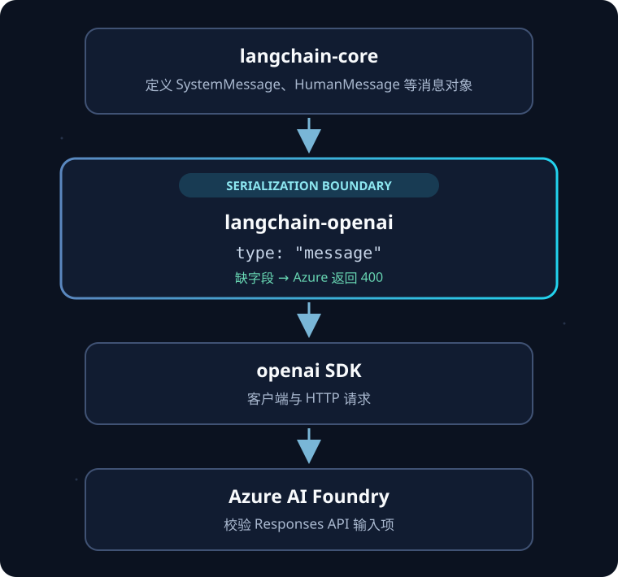

# Azure Responses API 的 400：langchain-openai 少了一个 type

GPT-6 Luna 接入 Azure AI Foundry 后，LangChain 请求返回 400：`Invalid value: ''`。第一次看起来像 Azure 不支持 Responses API，或模型路由错了。沿着代码和依赖版本追下去，问题其实是：**仓库把 GPT-6 工具调用切到了 Responses API，但锁文件里的 `langchain-openai` 还停在一个会漏掉消息类型字段的版本。**

这篇按代码库更新来追：先看 Agent 由哪些依赖组成，再对照应用仓库提交、上游 GitHub 修复和锁文件变化。范围是 `release/cost-rate-0921` 从 2026-09-23 的 `5e8d8f6` 到 2026-10-10 的 `bddfbbc`，以及同日随后创建的依赖修复 PR。版本状态以 2026-10-10 的记录为准。

## 先把 Agent 调用链画清楚

应用里的 `DeepAgentsRunner` 用 `deepagents.create_deep_agent` 组装模型、工具、技能和 backend；Deep Agents 在 LangGraph runtime 上执行有状态的 Agent 循环。MCP adapter 把 MCP server 暴露的工具转换为 LangChain 工具，交给 Agent 调用。模型请求则沿着另一条边界往下走：`langchain-core` 的消息对象交给 `langchain-openai`，由它序列化为 Responses API 请求，再交给 `openai` SDK 发送到 Azure。



*图只画模型请求路径。Deep Agents、LangGraph 和 MCP adapter 负责组装 Agent、驱动工具循环或接入工具；缺少 `type` 的序列化发生在 `langchain-openai`。*

| 依赖 | 在这个项目里的工作 | 此次故障是否在它这里 |
|---|---|---|
| `deepagents` | 用 `create_deep_agent` 组装带工具、技能、backend 和 checkpoint 的 Agent；项目代码把模型和 MCP 工具交给它。 | 否，属于 Agent 外层装配。 |
| `langgraph` | 提供长运行、有状态的图运行时，包括流式输出、持久化和 checkpoint。 | 否，负责执行循环，不写 OpenAI 请求体。 |
| `langchain-mcp-adapters` | 连接 MCP server、发现工具，并把工具包装成 LangChain 可调用工具。 | 否，它提供工具，不序列化模型消息。 |
| `langchain-core` | 定义 `SystemMessage`、`HumanMessage`、工具和模型等通用抽象。 | 否，它提供消息对象；字段映射由 provider 集成实现。 |
| `langchain-openai` | 提供 `ChatOpenAI`，把 LangChain 消息转换为 OpenAI 的 Chat Completions 或 Responses 请求。 | **是。旧版 Responses 序列化器漏了 `type: "message"`。** |
| `openai` | OpenAI 官方 Python SDK，提供请求/响应类型以及同步、异步 API 客户端；在项目中由 `langchain-openai` 传递引入。 | 否，SDK 接到的是已经组装好的请求。 |

这些职责在各自的 GitHub 仓库里也分得很清楚：[`deepagents`](https://github.com/langchain-ai/deepagents/tree/main/libs/deepagents) 是 Agent harness；[`LangGraph`](https://github.com/langchain-ai/langgraph/blob/main/libs/langgraph/README.md) 是状态化运行时；[`langchain-core`](https://github.com/langchain-ai/langchain/blob/master/libs/core/README.md) 是通用抽象；[`langchain-openai`](https://github.com/langchain-ai/langchain/blob/master/libs/partners/openai/README.md) 是 OpenAI 集成；[`openai-python`](https://github.com/openai/openai-python) 是 API 客户端。`langchain-mcp-adapters` 则负责 MCP 工具桥接。

## 这次错误是怎样被新提交触发的

先看应用仓库中实际发生的变化：

| 日期 / 提交 | 仓库变化 | 对模型调用的影响 |
|---|---|---|
| 2026-09-23，`5e8d8f6` | 追踪基线；当时锁定 `langchain-openai 1.1.7`。 | GPT-6 尚未由这两笔后续提交统一切到 Responses。 |
| 2026-10-10，`7bd5fee` / PR #74 | 不再默认传 `temperature=0`，允许模型端点使用自己的默认值；显式配置仍可覆盖。 | 避免拒绝自定义 temperature 的模型报错。这是同一轮 GPT-6 兼容工作，但不是本次缺少 type 的直接原因。 |
| 2026-10-10，`bddfbbc` / PR #75 | 对 GPT-6 模型显式设置 `use_responses_api=True`，因为带函数工具的 Chat Completions 调用会失败。 | 请求现在走 Responses API，进入旧版适配器的 Responses 序列化代码。 |

在 `langchain-openai 1.1.7` 下，显式启用 Responses API 后，旧序列化器为普通消息生成了类似这样的条目：

```json
{
  "role": "user",
  "content": "Summarize this email"
}
```

Responses 输入要求普通对话项带 `type: "message"`：

```json
{
  "type": "message",
  "role": "user",
  "content": "Summarize this email"
}
```

LangChain 的 [issue #35688](https://github.com/langchain-ai/langchain/issues/35688) 记录了同类错误；[PR #35693](https://github.com/langchain-ai/langchain/pull/35693) 给 user、system 和 developer 输入补上 `type` 并加入回归测试。修复随 [`langchain-openai 1.1.12`](https://github.com/langchain-ai/langchain/releases/tag/langchain-openai%3D%3D1.1.12) 于 2026-03-23 发布。OpenAI 端点可以根据角色推断类型，Azure AI Foundry 对输入项校验更严格，所以同一份缺字段请求会出现一边接受、一边返回 400 的结果。

微软的模型说明列出 GPT-6 Luna 可使用 Responses API，也列出 Chat Completions API；所以“Azure 完全不支持 Responses”不是这条错误的解释。具体模型仍受区域和部署配置影响，需按 Azure 的[模型说明](https://learn.microsoft.com/en-us/azure/ai-services/openai/concepts/models?tabs=global-standard%2Cstandard-chat-completions)核对。

## 第一次排查为什么会错

错在证据版本，不在 Azure 的错误文本：第一次分析只读了本地缓存的远程跟踪引用 `5e8d8f6`，没有先 `git fetch`。所以当时看不到远程分支已经前进到 `bddfbbc`，也就把“最近提交没有改模型协议”说成了结论，并猜测请求可能还是 Chat Completions 或端点配置不匹配。

你问“是不是没有拉取最新远程内容”是对的。fetch 后看到的 PR #75 明确为 GPT-6 设置 `use_responses_api=True`。此前在 `1.1.7` 上测到“默认走 Chat Completions”本身没有错，但它只描述没有显式设置参数时的行为；不能覆盖新代码显式切换到 Responses API 的事实。

修正后的因果链是：仓库提交 #75 改了协议路径 → 旧锁文件中的适配器负责构造 Responses payload → 该版本遗漏消息类型 → Azure 校验拒绝。此前把排查停在协议和 endpoint，是因为没有先确认分支与锁文件是否对应同一份代码。

## 依赖版本是怎样滞后的

`pyproject.toml` 写的是最低版本范围，`uv.lock` 写的是部署实际解析出的版本。基线配置把 `langchain-openai` 下限写成 `>=0.1.0`，但锁文件仍是 `1.1.7`；`langchain-core` 的下限是 `>=0.2.0`，实际锁定 `1.5.3`。只要安装流程按锁文件同步，仓库就会持续使用锁定版本，不会因为上游已经发布修复而自动换新。

这里不是“整个 LangChain 都坏了”，也不是单独升级 `openai` SDK 就会补字段。请求体是在 `langchain-openai` 构造的，SDK 负责发出它。准确修复点是提高适配器版本下限，并刷新、提交锁文件。

| 依赖 | `bddfbbc` 时的锁版本 | PR #76 合并时 | PR #77 提议的锁版本 |
|---|---:|---:|---:|
| `deepagents` | `0.7.5` | 未变 | `0.7.5` |
| `langgraph` | `1.2.10` | 未变 | `1.2.10` |
| `langchain-mcp-adapters` | `0.3.2` | 未变 | `0.3.2` |
| `langchain-core` | `1.5.3` | `1.5.3` | `1.6.9` |
| `langchain-openai` | `1.1.7` | `1.1.12` | `1.7.0` |
| `openai` | `2.15.0` | `2.26.0` | `2.54.0` |

这张表也能说明“哪些依赖碰到了”和“哪些依赖真的动了”不是一回事。Agent 外层的 `deepagents`、LangGraph 和 MCP adapter 都在工具调用路径里，但 PR #76/#77 没有升级它们；修复与后续刷新主要改变消息抽象、OpenAI 集成和 SDK 这三层。

## 上游在这段版本区间更新了什么

- **`langchain-openai`：** `1.1.12` 补 Responses 消息类型；`1.1.14` 随后修复图片 token 计数中 DNS rebinding 导致的 SSRF 风险；`1.7.0` 于 2026-10-08 发布，release notes 还列出 Decisions API 支持。此次错误由第一项修复；后两项解释了为什么下限后来变成 `1.1.14`，以及为什么锁文件解析到 `1.7.0`。[`1.1.14` 发布记录](https://github.com/langchain-ai/langchain/releases/tag/langchain-openai%3D%3D1.1.14)、[`1.7.0` 发布记录](https://github.com/langchain-ai/langchain/releases/tag/langchain-openai%3D%3D1.7.0)。
- **`langchain-core`：** 项目锁从 `1.5.3` 到 `1.6.9`，不是因为它修了 `type`；`langchain-openai 1.7.0` 的[版本元数据](https://github.com/langchain-ai/langchain/blob/langchain-openai%3D%3D1.7.0/libs/partners/openai/pyproject.toml)要求 `langchain-core >=1.6.8`。`1.6.9` 自身 release notes 列出的变化之一是 `with_retry` 接受 callable。
- **`openai` SDK：** 锁从 `2.15.0` 到 `2.54.0`。`2.15.0` 增加 Responses 返回对象的 `completed_at` 字段；`2.54.0` 增加新的 Responses 模型标识。它们扩展 SDK 对 API 的类型覆盖，但没有改写上游适配器组装的 JSON。[2.15.0](https://github.com/openai/openai-python/releases/tag/v2.15.0)、[2.54.0](https://github.com/openai/openai-python/releases/tag/v2.54.0)。
- **Agent 和工具外围包：** 这三项依赖在项目修复中没有升级，但它们对应的上游版本也有具体变化：`deepagents 0.7.5` 修正了对支持文件的 SDK provider 类型识别；`langgraph 1.2.10` 增加了 v3 流事件类型和 `trace_policy` 能力；`langchain-mcp-adapters 0.3.2` 限制 MCP 依赖低于 2.0，以避免导入失败。[Deep Agents 0.7.5](https://github.com/langchain-ai/deepagents/releases/tag/deepagents%3D%3D0.7.5)、[LangGraph 1.2.10](https://github.com/langchain-ai/langgraph/releases/tag/1.2.10)、[MCP adapter 0.3.2](https://github.com/langchain-ai/langchain-mcp-adapters/releases/tag/langchain-mcp-adapters%3D%3D0.3.2)。另一个独立维护信号是，MCP adapter 的[上游仓库已标记为不再维护](https://github.com/langchain-ai/langchain-mcp-adapters)，并说明 MCP 支持已迁到 `langchain.mcp`。这不导致当前 400，但未来应单独评估迁移。

版本 `1.7.0` 的依赖元数据要求 `langchain-core >=1.6.8` 和 `openai >=2.45.0`。因此 PR #77 重新运行 `uv lock` 后得到 `langchain-core 1.6.9`、`openai 2.54.0`；它们是兼容约束下的解析结果，不代表这两个包也修了同一个 bug。

## 修复进度和读者该怎么做

项目 PR #76 提高了 `langchain-openai` 的最低版本，并加入消息类型回归断言；该 PR 已合并。安全复核发现功能修复版本仍低于 SSRF 公告的修复版本，因此后续 PR #77 又提高最低版本并刷新锁文件。

截至本文核对时，PR #77 仍未合并。候选锁版本见上表；CI 的 Frontend Build 通过，Validate Template 与 Playwright E2E 失败，所以还不能写成已部署。

PR #76 加入了针对消息类型的回归断言；前次会话记录显示该测试未在本地执行，也没有 Azure 实际请求成功的证据。当前可确认的是：上游修复已发布，项目功能修复已合并，安全下限和锁文件刷新仍在后续 PR 中。若要确认生产环境，仍需用最终锁文件同步依赖，并检查 Azure 实际收到的 Responses 输入项都带有 `type: "message"`。

对使用相同调用方式的项目，升级顺序应是：把 `langchain-openai` 提到安全下限 `>=1.1.14`，刷新并提交 lockfile，再验证适配器输出。`openai` SDK 更新、Azure endpoint 更换或 LangGraph 升级都不是这处字段遗漏的替代修复。

## 参考资料

- [LangChain issue #35688：Responses 消息项缺少 type](https://github.com/langchain-ai/langchain/issues/35688)；[修复 PR #35693](https://github.com/langchain-ai/langchain/pull/35693)
- [langchain-openai 1.1.12 发布记录](https://github.com/langchain-ai/langchain/releases/tag/langchain-openai%3D%3D1.1.12)；[1.1.14 安全修复记录](https://github.com/langchain-ai/langchain/releases/tag/langchain-openai%3D%3D1.1.14)；[1.7.0 发布记录](https://github.com/langchain-ai/langchain/releases/tag/langchain-openai%3D%3D1.7.0)
- [GHSA-r7w7-9xr2-qq2r 安全公告](https://github.com/langchain-ai/langchain/security/advisories/GHSA-r7w7-9xr2-qq2r)
- [Deep Agents 0.7.5](https://github.com/langchain-ai/deepagents/releases/tag/deepagents%3D%3D0.7.5)；[LangGraph 1.2.10](https://github.com/langchain-ai/langgraph/releases/tag/1.2.10)；[MCP adapter 0.3.2](https://github.com/langchain-ai/langchain-mcp-adapters/releases/tag/langchain-mcp-adapters%3D%3D0.3.2)
- [langchain-core 1.6.9 发布记录](https://github.com/langchain-ai/langchain/releases/tag/langchain-core%3D%3D1.6.9)
- [OpenAI Python SDK 2.15.0](https://github.com/openai/openai-python/releases/tag/v2.15.0)；[2.54.0](https://github.com/openai/openai-python/releases/tag/v2.54.0)
- [Azure OpenAI / Foundry 模型与 API 能力](https://learn.microsoft.com/en-us/azure/ai-services/openai/concepts/models?tabs=global-standard%2Cstandard-chat-completions)
