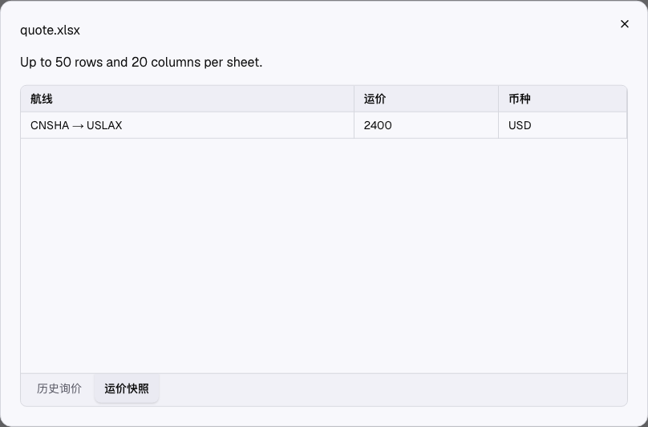

在 FreshAI 的聊天输入框里粘贴截图，最初只会出现一个叫 `image.png` 的附件条。它能确认文件进了列表。连续截两次图，就很难判断哪张才是要发的。Excel 也有类似的问题，尤其是同一份文件里同时有「历史询价」和「运价快照」两张表时。

这次迭代最后落在三个操作上：粘贴后立即看到内容，点击卡片可以看清细节，预览底部可以切换工作表。三个操作分别回答「贴进来了什么」「内容对不对」「我看的是哪一页」。

## 先在输入框里认出附件

输入框只在浏览器的粘贴事件提供文件时接管操作。文件进入回形针按钮使用的同一条校验和待发送队列。粘贴纯文本时让浏览器照常处理，预览则从队列里的本地 `File` 读取。用户点发送时才上传。

图片用圆角缩略图，表格卡片显示第一张工作表的前四行、前三列，下面留一行文件名。缩略图的职责是快速辨认。图片在卡片里允许裁切，放大后用完整比例显示。表格卡片露出附近几格，足以核对日期、起运港和目的港是否出自同一份数据。

浏览器能否拿到从文件管理器复制的文件，取决于系统和浏览器如何提供剪贴板内容。回形针入口仍能直接选择文件。

## 把工作表标签放到表格下方

放大预览最初只读第一张工作表。后来加了多表切换，先用了下拉框。最终把工作表名称放在表格下方，点击标签时，上方表格更新。标签栏始终留在表格区域外，工作表短到只剩一行或长到需要滚动时，切换入口都在同一个位置。

底部标签能同时展示多个工作表名。用户一眼就能看到「历史询价」旁边还有「运价快照」，不需要先展开菜单确认文件里有什么。标签较多时独立横向滚动，表格区域自己处理上下和左右滚动。当前标签高亮。第一张表为空时，仍然可以打开预览并切到有内容的表。

模板组件预览截图，使用合成工作簿。表格显示当前选中的「运价快照」。

## 预览只读取用户正在看的数据

图片用对象 URL 指向本地文件，附件移除或组件卸载时释放。表格使用 SheetJS 读取当前选中的工作表，弹窗每张表最多显示前 50 行和前 20 列。缩略图继续展示第一张表。行列上限约束展示范围，解析压缩工作簿本身仍有开销。 [SheetJS 读取选项](https://docs.sheetjs.com/docs/api/parse-options/)

把这套交互移进另一个应用时，可以先接好 `File → 预览卡片 → 放大弹窗`，再将粘贴入口接到项目已有的附件队列。这样文件类型、大小、上传失败重试和发送时机都由原有流程管。模板仓库中的 `LocalAttachmentPreview` 和 `takePastedFiles` 提供了这两个接入点。

FreshAI 的 Chromium 组件验证覆盖了图片预览、多工作表切换、窄屏滚动和键盘操作。完整聊天页端到端测试在测试账号注册阶段收到 HTTP 410。组件验证确认了发送前的交互，上传和消息发送仍需在实际页面单独验证。
