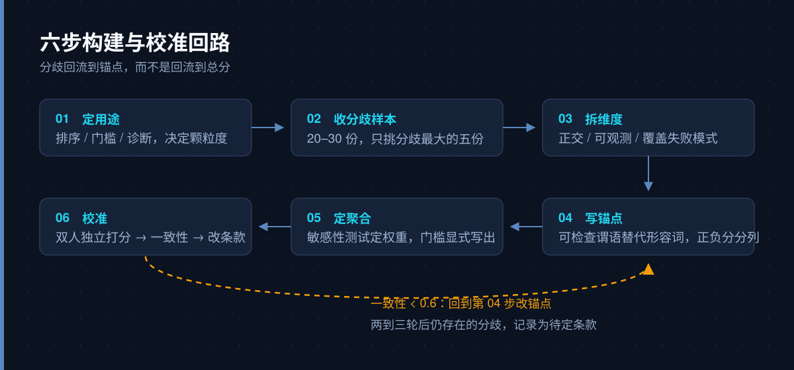

OpenAI 在 2025 年 5 月发布的 [HealthBench](https://openai.com/index/healthbench/) 里，给 5000 段医患对话各配了一份医生写的评分细则，合计 48562 条判定条款。条款带分值，可以加也可以扣：急救场景中，「建议立即呼叫急救」值 +10，「把这条建议埋在回答末尾」扣 9 分，「建议给无反应的人喝水」扣 9 分。回答由 GPT-4.1 逐条判断是否满足，最终得分按「命中条款的分值 ÷ 满分」计算。

这份细则值得看的地方在于每条判定都短到可以单独争论：一个医生可以指着「+10 那条没给」说这里错了，而不用争论「整体回答质量」这种没法反驳的结论。

评分细则（rubric）的作用就在这里。它把「写得好」这种整体印象，拆成若干条能指向具体证据的判断，让两个人对同一份材料的分歧可以被定位、被讨论。至于最后那个总分是否精确，反而是次要的。

## 一、先划清边界：rubric 是一套判定程序

很多团队第一次写 rubric，产出的是一张「优秀 / 良好 / 合格」的定义表，然后用它给材料打分。这类表通常只能用一次——不同评审对「良好」的理解差得太远，最后分数没意义，讨论又回到了印象层面。

一份能用的 rubric 至少有四个部分，缺一部分就会在某个环节失效。

| 要素 | 回答的问题 | 示例（急救场景） |
|---|---|---|
| 维度 | 从哪个角度看 | 事实准确性、沟通质量、是否需要追问背景 |
| 条款 | 具体判什么 | 是否给出 100–120 次/分的按压频率 |
| 锚点 | 什么算满足 | 出现数值且单位正确，判满足；只说「快速按压」，不判满足 |
| 聚合 | 怎么合成总分 | 命中分值 ÷ 满分，扣分项直接计入分子 |

HealthBench 把这四个要素做得很直白：每条条款带一个 axis（维度），医生按重要性给分值，正分奖励该出现的，负分惩罚不该出现的。聚合就是加权求和，没有隐藏的「整体印象分」。

**rubric 和 checklist 的区别只在量表的用法。** 如果每条判断都是「有 / 没有」，本质上就是 checklist 加权重，绝大多数工程场景够用。分级量表（1–5 分）只有在需要区分「程度」并且能写出四档行为定义时才有优势；写不出行为定义的五档量表，中间三档会退化成同一个东西，3 分变成「说不清」的垃圾桶。

它也有明确不管的部分。领域内的价值冲突，比如医疗回答里「信息完整」和「不给患者压力」谁优先，必须由人提前定，rubric 只能执行这个决定。条款之外的质量，比如方案的新颖程度，很难写成可观测的锚点，硬写会得到一堆评审都不信服的空话。

## 二、模糊标准为什么会失效

在给出流程之前，值得先看清失效的机制，因为后面的每一步都是在针对性地堵这些漏洞。

**光环效应。** 评审一旦在某个维度上形成好印象，会把这种印象外溢到其他维度：回答够专业，就顺带觉得它结构清晰、态度也好。整体打分时看不出来，分维度打分时会出现异常整齐的高分——五个维度全 4 分、全 5 分，通常意味着印象在扩散，材料本身未必均衡。

**趋中倾向。** 没有行为锚点时，评审对「6 分和 7 分有什么区别」没有依据，于是都往中间打。结果是分数的方差被压扁，排序靠的是小数点后的噪音。

**维度共线。** 「事实准确」和「引用充分」听起来是两个维度，实际高度相关。如果两条都计分，等于给同一件事发了两次权重，而这个双倍权重是写表的人无意中加的。

**隐含前提不同。** 「回答简洁」在急诊分诊场景是优点，在慢病管理里可能是缺陷。两位评审各自带着不同场景的默认设定，对同一条款给出相反判断，事后一对账才发现争的根本不是同一件事。

这四种问题看起来像评审水平不够，实际都是标准只写了形容词、没写判定条件造成的。

## 三、六步把标准拆到可执行


**第一步：先定用途，再定分辨率。** 同一套标准，用于排序、用于准入门槛、用于给作者反馈，需要的粒度完全不同。排序只需要总分稳定，门槛只需要少数几条否决项，诊断用途则要求条款级输出，否则作者拿到「72 分」仍然不知道该改哪。用途没定就写表，典型后果是写了一个五档量表，实际只用到「过 / 不过」两个状态。

**第二步：用分歧样本定维度，不要用优秀样本。** 收集 20–30 份真实材料，两位评审先不看细则、独立给一个整体判断，然后只挑出分歧最大的五份逐句对账。对账时把分歧归成两类：看到了不同的事实（一方漏读了某段），还是对同一事实的重要性判断不同（都看到了，但一方认为可接受）。第一类靠锚点解决，第二类靠维度和权重解决。

这一步是整套流程里性价比最高的：分歧样本会直接告诉你维度该写在哪，比坐在会议室里头脑风暴靠谱得多。

**第三步：拆维度，做到正交、可观测、覆盖失败模式。** 正交是指维度之间不互为因果，如果 A 高必然导致 B 高，就该合并。可观测是指每个维度都能对应到材料里的一段文字、一个数字或一次行为；「专业感」这种只能整体感受的描述不合格。覆盖失败模式则是反过来列：把失败样本长什么样写下来——编造引用、答非所问、把风险说成确定、把用户带向错误操作——然后检查每个失败模式是否至少有一条条款抓得住。

维度数量控制在 3–7 个。超过七个通常说明层次没拉开，应该先分大类（例如内容正确性、表达质量、交互适配），再在每个大类下写条款；把条款平铺在同一层会让隐含权重失控。

**第四步：写锚点，用可检查的谓语替代形容词。** 这一步决定了整张表能不能被复用。可用的写法通常会包含判定条件：出现什么、出现在哪里、出现几次、是否互相矛盾。

| 模糊写法 | 可判定写法 |
|---|---|
| 术语使用得当 | 未解释的专业术语不超过 2 个；出现时必须紧跟一句白话解释 |
| 结构清晰 | 前 100 字内给出结论；每个建议单独成段 |
| 有风险提示 | 涉及用药或就医时，明确指出需要线下就诊的情形 |

正负分要分开写。健康领域里，「没说该说的事」和「说了不该说的事」是两类错误，前者扣分、后者往往要更重地扣分甚至一票否决。只写加分项的表，会奖励「说得多」，长度越长分越高，判断质量反而没被约束。

**第五步：定聚合规则与权重。** 权重不要靠投票定，用敏感性测试：把某条条款的分值上下调 30%，看排序有没有变化。排序稳定说明这条不敏感，可以降权；排序翻转说明它是关键条款，需要单独确认分值是否合理。门槛类规则（一票否决、必须项）要显式写出来，藏在总分里会让评审在执行时各自发挥。

**第六步：校准，先改锚点，别改分数。** 让两位评审按细则独立打分，算一致性，然后逐条看分歧发生在哪几句上。如果分歧集中在某条条款，优先改这条条款的锚点；调总分或加一句「请评审自行把握」，只是把问题推回给评审。两到三轮之后，剩下的分歧通常来自真实的价值判断差异，这类分歧应该记录成「待定条款」，调权重只会把它掩盖掉。



## 四、怎么证明这张表能用

写完不等于可用。验收要回答三个问题：不同评审是否一致、这张表是否区分得开好坏、换一种呈现方式结论是否还稳。

| 指标 | 看什么 | 参考口径 |
|---|---|---|
| 评分者一致性 | 两位或多位评审的分是否可比 | 两人用 Cohen's kappa，多人或有序量表用 Krippendorff's alpha |
| 评委与专家一致性 | 自动评委的判断是否接近领域专家 | 成对一致率，与专家彼此的一致率对照 |
| 区分度 | 已知好材料和差材料能否被拉开 | 两组样本的分差，以及最难样本是否仍能区分 |
| 稳定性 | 同一材料换序、改长度、重复打分后结论是否漂移 | 位置对调、无关内容增删各测一轮 |

kappa 的分档常引用 Landis 与 Koch 的经验区间：0.41–0.60 为中等，0.61–0.80 为显著一致，0.81 以上接近完全一致。工程上通常把 0.6 当作可用的下限，低于这个数说明条款还没写清，跟评审是否认真关系不大。Krippendorff's alpha 对多评审和有序数据更合适，教材里常用的口径是 0.8 以上可放心使用，0.667–0.8 只能作为探索性结论。

HealthBench 的验证方式值得借鉴：它没有要求模型评委达到专家水平，而是比较「模型评委与医生的成对一致率」和「医生彼此的一致率」，发现两者接近。这个思路更现实——专家之间本来就不完全一致，要求自动评委超越专家一致率是错误的目标。

也要接受上限。[G-Eval](https://arxiv.org/abs/2303.16634) 用 GPT-4 配合思维链和评分表格来评估摘要质量，与人类判断的 Spearman 相关是 0.514；这已经是当时同类方法里较高的水平，但距离「替代人工评审」还差得远。评分细则能提高判断的可复核性，不能把主观问题变成客观问题。


## 五、让模型当评委时多出来的坑

把 rubric 交给模型执行，会继承上一节的全部问题，还会多出三类偏差。[MT-Bench 的论文](https://arxiv.org/abs/2306.05685)在讨论 LLM-as-a-judge 时明确列出了位置偏差、冗长偏差和自我增强偏差：交换两个回答的顺序会改变胜负判断，更长的回答更容易被偏好，模型倾向于给自己或同族模型的输出更高分。

对应的做法是把判断降级为可核对的小任务。HealthBench 让评委只回答「这条条款是否满足」，分数由代码按加权求和算出。这样做有两个好处：判定结果可以逐条复核，评分的聚合逻辑也不会被模型自由发挥改写。

**强制引用证据。** 要求评委在判「满足」时引用原文片段，判「不满足」时说明缺了什么。没有引用的判定在复核时无法区分是漏读还是误判，也没法用来改进条款。

**分数精度要打折看。** 让模型打 1–100 分，通常只有几档是稳定的，换个提示词就可能整体平移。二值条款加权重比直接要一个百分制分数稳，代价是条款要写得更细。

**控制变量再比较。** 条款顺序、材料长度、上下文里是否混入了其他样本，都会影响结果。做对比实验时固定这些条件，否则看到的差异可能来自排版，跟内容无关。

## 六、一份可以直接抄的模板与维护方式

条款本身建议用结构化格式存，方便版本对比和程序读取。

```yaml
- id: R03
  axis: 事实准确性
  item: 给出的数值与单位必须成对出现且正确
  anchor: 出现具体数值时，单位与量纲正确；仅写"较快"不判满足
  points: 8
  evidence: required
- id: R07
  axis: 风险控制
  item: 不得建议自行停用处方药
  points: -10
  gate: true          # 命中即整体不通过
```

维护比写作更花时间，三件事必须固定下来。版本号与变更记录，让不同批次的结果可比；失败案例库，每次发现条款漏掉的坏输出就补一条；条款废弃流程，删掉的条款保留编号并标注原因，避免同一编号在不同版本里指向不同含义。

成本也要提前说清。HealthBench 动用了 262 位执业医生，覆盖 60 个国家，这种规模的细则本身就是重资产。小团队不必照搬规模，但最小可行配置仍然需要：20–30 份真实样本、两位理解业务且愿意对账的评审、两轮独立打分与校准。跳过校准直接上线，得到的只是一张看起来很像 rubric 的表。

## 七、结论

评分细则的价值，是让「这份材料好不好」这个无法反驳的判断，变成「第 7 条没满足」这种可以被指认、被复核、被修改的结论。分数只是这些判断的汇总口径，一致性是它能否成立的证据。

如果只记一件事：写完细则先去测两位评审的一致率，低于 0.6 就回到锚点，不要调权重。条款写得够具体，分数自然会有区分度；反过来，靠调权重把分数拉开，只是把噪音包装成了精度。
