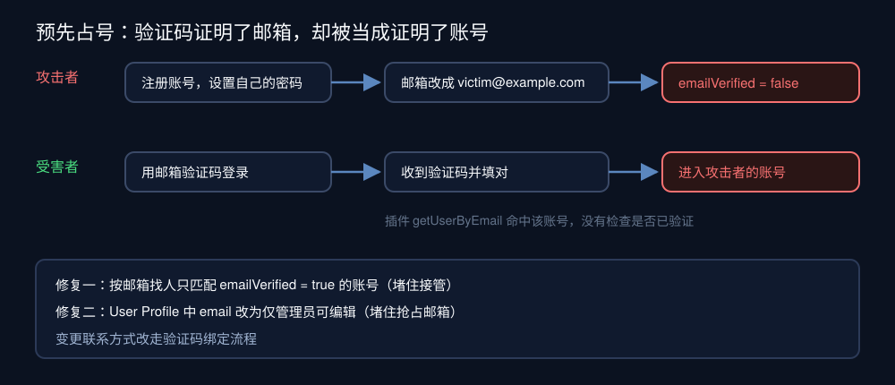
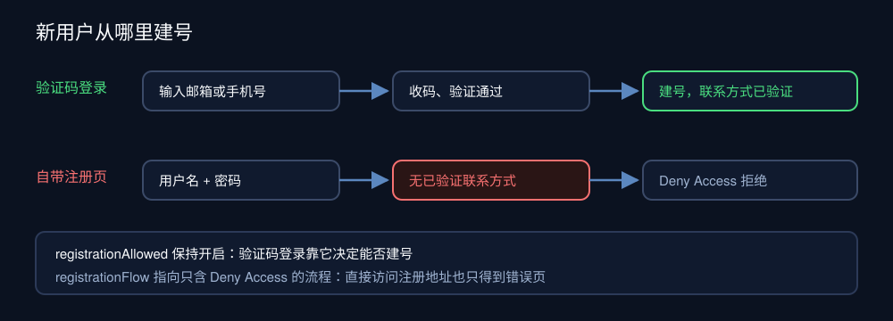
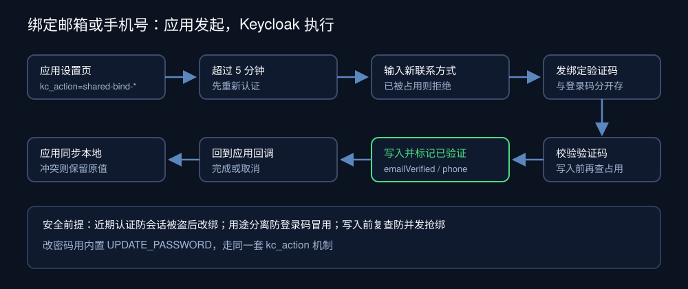

需求本身很普通：手机号注册的用户想补绑一个邮箱，邮箱注册的用户想补绑手机号，所有人都要能改密码。我们的 Keycloak 已经用自定义 Authenticator 提供了密码、邮箱验证码、短信验证码三种登录，账号中心也能打开，看起来只差几个按钮。

动手前先核对现状：改密码有现成的内置操作；改邮箱，账号中心允许用户直接编辑；绑手机号，什么都没有。查到改邮箱那一项时，问题冒了出来：用户能把邮箱改成任意地址，不需要验证。再结合我们自己写的邮箱验证码登录，这就成了一个能进入别人账号的漏洞。

顺着这条线又查出第二个口子：登录页的「注册」链接通向 Keycloak 自带的注册页，它能建出一个没有任何已验证联系方式的账号。**这几处问题都出在我们给 Keycloak 加上去的部分，原版 Keycloak 的默认行为并不构成漏洞。** 下面按发现顺序拆开，最后给出绑定联系方式的做法。文中的地址和号码都是虚构示例，版本为 Keycloak 26.8.2。

## 一、未验证邮箱加上验证码登录，等于允许预先占号

先看两件各自都不算错的事：

- **用户可以自己改邮箱。** User Profile 把 `email` 的编辑权限给了 `user`，realm 又没开「验证邮箱」，于是用户在账号中心把邮箱改成任意地址，Keycloak 只把 `emailVerified` 置为 `false`，不发验证邮件。
- **邮箱验证码登录按邮箱找人。** 我们的 Authenticator 收到「给这个邮箱发码」的请求，用 `getUserByEmail` 找到账号，验证码对了就登录进去。

两件事叠在一起，就是一条完整的攻击路径：



攻击者注册一个账号，设好密码，再把邮箱改成受害者的地址。之后受害者第一次用邮箱验证码登录，收得到验证码，也填对了，插件却按邮箱把他放进了攻击者的账号。受害者在这个账号里留下的一切，攻击者都能用自己的密码登录后看到。这类问题通常叫「预先占号」（pre-account takeover）。

原版 Keycloak 没有这个问题，因为它的登录方式是密码：攻击者把邮箱改成你的，你不知道他的密码，进不去。我们加的「收到码就能登录」，把「证明你拥有这个邮箱」偷换成了「证明你拥有这个账号」。验证码能证明前者，后者要求这个账号的邮箱本身是验证过的。

修复分两层，缺一层都不完整：

```java
UserModel emailUser = session.users().getUserByEmail(realm, recipient);
return emailUser != null && emailUser.isEmailVerified() ? emailUser : null;
```

- **插件只匹配已验证邮箱。** 未验证的邮箱可能是别人填的，不能借它登录那个账号。这一层堵住了接管。
- **邮箱改为仅管理员可编辑。** 只做第一层还留着一个尾巴：攻击者仍能把邮箱填成你的地址，你用验证码登录时插件会尝试新建账号，而 Keycloak 不允许两个账号共用一个邮箱，新建失败，你就用不了自己的邮箱。这不泄露数据，但能让人抢占邮箱。把 User Profile 里 `email` 的 `edit` 改成 `["admin"]` 就没有这条路了，联系方式的变更改走下文第三节的验证码绑定。

修复前我们查了一遍线上：没有任何「填了邮箱但未验证」的账号，说明这条路还没被利用过。如果你也有类似的自定义登录方式，这是最值得先跑的一条查询。

## 二、自带注册页会建出没有联系方式的账号

邮箱改成仅管理员可编辑之后，登录页的「注册」链接打开的页面只剩用户名、密码、名、姓。这是 Keycloak 自带的注册页：它根据 User Profile 渲染字段，`email` 用户不能编辑了，注册页也就不再显示；手机号是我们的自定义属性，它本来就不认识。

用户名加密码就能建号，意味着这个账号没有任何验证过的联系方式，绕开了整套验证码流程。下游应用按已验证的邮箱或手机号关联本地账号，这种账号连进应用都进不去。

其实我们根本不需要单独的注册页。验证码登录在找不到账号时会直接建号，验证码本身已经证明了联系方式归属：



所以要关掉的是自带注册页。只去掉登录页上的链接不够，注册地址可以直接访问。也不能简单关掉 realm 的 `registrationAllowed`，我们的 Authenticator 正是靠这个开关决定验证码登录时能不能建号。做法是给 realm 的注册流程绑定一个只含 Deny Access 步骤的流程：

```json
{
  "alias": "shared-registration-disabled",
  "providerId": "basic-flow",
  "topLevel": true,
  "builtIn": false,
  "authenticationExecutions": [
    { "authenticator": "deny-access-authenticator", "requirement": "REQUIRED", "priority": 10 }
  ]
}
```

realm 的 `registrationFlow` 指向它，`registrationAllowed` 保持开启。改完后访问注册地址只得到一个错误页，验证码登录建号照常。登录页上原来的注册链接换成一句提示：「新用户？使用邮箱或手机验证码登录即可自动创建账号。」

## 三、绑定联系方式：做成应用发起的账号操作

剩下的是正事：给用户一条经过验证码确认的路径来绑定或更换邮箱、手机号。Keycloak 有一套现成的机制叫 Required Action，应用在授权地址上带 `kc_action=<别名>`，用户就会被带到这个操作的页面，完成或取消后回到应用的回调地址。改密码用的就是内置的 `UPDATE_PASSWORD`。

我们在同一个插件里加了两个操作 `shared-bind-email` 和 `shared-bind-phone`，流程是：



几个设计点决定了它是否安全：

- **超过时限先重新认证。** `RequiredActionProvider` 的 `getMaxAuthAge` 默认 300 秒，距上次登录超过 5 分钟就先要求重新登录。没有这一步，偷到会话的人能给受害者绑上自己的邮箱，再用验证码登录，等于把账号接管了。
- **只能由应用发起。** `initiatedActionSupport()` 默认 `NOT_SUPPORTED`，要显式返回 `SUPPORTED`，`kc_action` 才认这个操作。
- **绑定码和登录码分开存。** 验证码的存储键里加上用途字段，登录收到的码不能拿来完成绑定，反过来也不行。两条流程共用同一套发码、限流、冷却锁和校验代码，差别只在这个字段。
- **被占用就拒绝，写入前再查一次。** 新联系方式已经属于任何别的账号，无论是否验证过，都拒绝并提示。验证码校验通过、真正写入之前再查一次，防止发码到填码这几分钟里被别人抢先绑定。合并账号太复杂，这次不做。
- **写入时同时标记已验证。** 邮箱写入后 `emailVerified=true`，手机号写入后 `phone_number_verified=true`。这正是第一节修复依赖的前提。

还有一个部署细节：插件提供的 Required Action 不会随 realm 导入自动出现，部署镜像后要在每个 realm 注册一次（`kcadm.sh create authentication/register-required-action`）。也不要为此在 `realm.json` 里写 `requiredActions`：一旦写了这个字段，导入时只会创建列出的那几项，`UPDATE_PASSWORD` 等内置操作反而没了。

应用这一侧也要跟着改，否则联系方式会有两个来源：

- **入口换成跳转。** 应用原来的「短信绑定手机号」卡片只改应用自己的用户表，Keycloak 和其他应用都不知道。我们把它换成「账号与安全」卡片，三个按钮分别跳到 `shared-bind-email`、`shared-bind-phone`、`UPDATE_PASSWORD`，后端只接受这三个白名单值。
- **回调时同步。** 应用原先在首次绑定后只按 issuer 加 subject 找人，之后不再看令牌里的联系方式。现在每次回调都把 Keycloak 已验证且有变化的邮箱、手机号写回本地；新值在应用里已经属于另一个本地账号时保留原值，不改绑，也不阻断这次登录。

我们在本地用同一个镜像加一个假邮件服务，走真实浏览器把整条链路跑了一遍：验证码登录、改绑邮箱、绑定已被占用的邮箱被拒、取消返回、用新邮箱登录进入同一账号、修改密码，结果都符合预期。手机号绑定的发送环节依赖短信服务商，本地没法测，它和邮箱绑定共用其余全部代码。

## 四、部署改的是代码，账号规则在数据库里

整个过程中最容易误判的一件事：「我已经部署了，为什么还要改线上？」

| 改什么 | 存在哪 | 怎么生效 |
|---|---|---|
| 插件代码、登录主题 | 镜像 | 部署后生效 |
| User Profile、注册流程、SMTP、Client 设置、已注册的 Required Action | Keycloak 数据库 | 后台或 `kcadm.sh` 修改，立即生效 |

`realm.json` 这类导入文件只在 realm 不存在时导入一次，之后每次启动都跳过，否则后台的改动每次部署都会被冲掉。所以这次的修复几乎都分成两半：代码随部署走，账号规则要单独改线上，再同步回仓库里的模板，让下次全新部署也带上。顺序上，数据库里的规则可以先改、立即止血；代码修复跟着下一次部署走。

## 五、结论

给身份平台加一种登录方式，问题不只是「能不能登进来」，还有「能不能登进不属于自己的账号」。这次三处问题的共同点是，Keycloak 原有的假设被我们新加的能力打破了：邮箱可以不验证，在只有密码登录时无害；自带注册页只收用户名，在联系方式不重要时也无害。

如果你也在 Keycloak 上加了验证码或其他「凭联系方式登录」的方式，上线前逐项核对：

- 按联系方式找人时，是否只匹配已验证的联系方式；用户能否自己改联系方式而不经验证。
- 线上有没有「填了联系方式但未验证」的账号。
- 自带注册页还能不能访问，它会不会建出没有已验证联系方式的账号。
- 绑定或更换联系方式，是否要求近期认证、验证码确认、写入前复查占用。
- 应用是否以身份平台的已验证联系方式为准，有没有自己另存一份可以单独修改的副本。

验证码证明的是「你能收到这条消息」，至于这个账号是不是你的，要靠账号上已经验证过的联系方式来证明。
