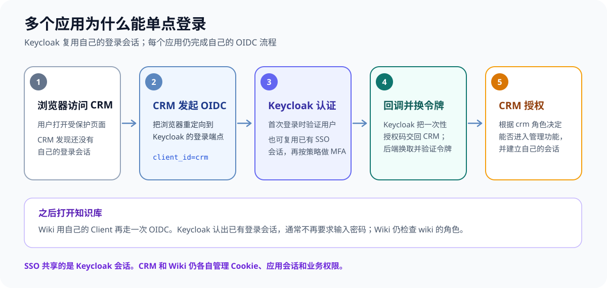
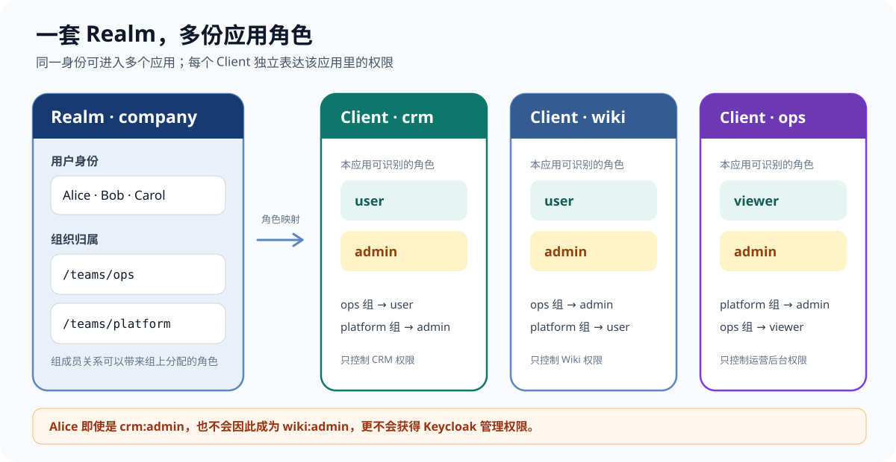
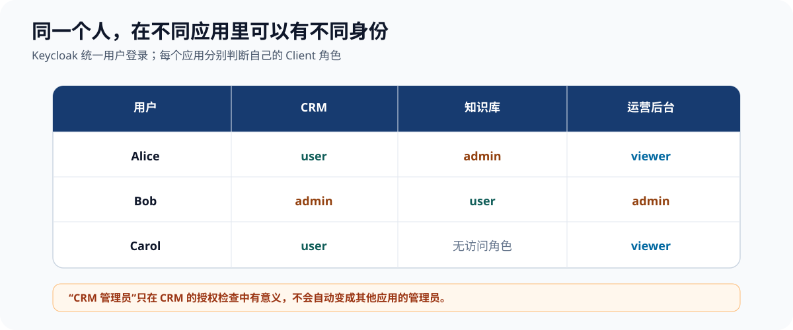

把 Keycloak 接进三个应用之后，常见的第一个疑问不是“登录按钮怎么写”，而是：同一个人进 CRM 是普通用户，进运营后台却是管理员，这个身份和权限到底放在哪？

可以先记住一条分工：**一个 Realm 管一批共同登录的用户；每个应用登记为一个 Client；用户身份可以共用，应用角色分别授予；应用管理员不等于 Keycloak 管理员。** OIDC 负责把登录结果安全地交给应用，Keycloak 不会因为用户登录成功就自动替应用做完业务授权。

本文用公司内部的 CRM、知识库和运营后台作例子，说明多应用怎么共享账号、又怎么保留各自的管理员边界。想先看 IdP、OIDC 和 SSO 的通用架构，可以读[《多个团队维护多个项目，登录怎么统一？》]()；想看 Keycloak 部署、试点迁移和模板代码，可以继续读[《自建 Keycloak 打通多应用单点登录》]()。

## 先分清登录和应用权限

用户访问 CRM 时，CRM 把浏览器跳转到 Keycloak。Keycloak 确认用户身份后，把登录结果交还 CRM。用户再访问知识库时，知识库也会向 Keycloak 发起登录请求；因为浏览器已经有 Keycloak 登录会话，Keycloak 通常可以直接确认身份，不必再问一次密码。

在这层关系里，Keycloak 是 IdP（Identity Provider，身份提供方），CRM 和知识库是使用 OIDC 的应用客户端。OIDC 是沟通协议，IdP 是提供身份认证的服务。如果 Keycloak 再把用户转交给 Entra ID 或 Google 登录，那么那个服务是 Keycloak 的上游 IdP；应用仍然通过 Keycloak 完成这次 OIDC 接入。

这就是单点登录（SSO）。它复用的是 Keycloak 的登录会话，不是把 CRM 的 Cookie 复制给知识库。每个应用仍然有自己的会话和数据访问规则。

还要把两个问题分开：

- 认证（Authentication）：这个人是谁？由 Keycloak 验证密码、Passkey、多因素认证，或把用户转给企业身份服务验证。
- 授权（Authorization）：这个人在 CRM 里能看客户资料还是能管理账号？由应用根据该应用的角色和业务规则判断。

OIDC 的授权码流程会把浏览器带到 Keycloak 登录，成功后再回到应用；应用用授权码换取令牌。[Keycloak 的 OIDC 接入指南](https://www.keycloak.org/securing-apps/oidc-layers)介绍了这条流程。登录证明身份，应用仍须在服务端执行权限检查。



*▲ 每个应用都单独完成 OIDC 流程；共享的是 Keycloak 登录会话，而不是应用 Cookie。*

## Keycloak 里的对象分别是什么

可以把 Keycloak 想成一个身份中心，它管理用户、应用登记和角色，并通过 OIDC 把登录结果给应用。几个核心对象的分工如下：

| 对象 | 可以怎么理解 | 多应用场景中的用法 |
|---|---|---|
| Realm | 一组相互隔离的用户、应用和登录配置 | 同一批公司用户使用多个内部应用，通常共用一个 Realm |
| Client | 在 Realm 中登记的一套应用身份和协议配置 | CRM、知识库、运营后台分别登记成 Client |
| User | 登录的人，也就是身份记录 | 一个人在同一个 Realm 里登录多个 Client |
| Group | 用户的组织或团队归属 | 把团队成员放进组，再向组授予应用角色 |
| Role | 应用或 Realm 可识别的一种权限标签 | `crm:admin` 只表示 CRM 管理权限；`wiki:admin` 是另一项权限 |

Keycloak 官方把 Realm 定义为管理用户、应用、角色和组的空间；创建 Realm 时，应按需要的用户和应用隔离边界来考虑。[Realm 配置文档](https://www.keycloak.org/docs/latest/server_admin/)

### 一个应用登记一个 Client

如果 CRM、知识库和运营后台都使用同一批公司账号，常见配置是一个公司 Realm，下面登记三个应用 Client：

```text
Realm: company
├── Client: crm
├── Client: wiki
└── Client: ops-console
```

Client 是 Keycloak 和应用之间的“登记关系”：它记着应用的 Client ID、协议、允许的回调地址、登录方式，以及角色如何进入令牌。它不是用户组，也不是某个具体用户。

若一个应用的 SPA 和后端 API 有不同的安全边界，也可以给登录客户端和 API 分别配置身份及受众；是否拆成多个 Client，应由令牌面向谁、谁持有密钥等安全边界决定，不必为了前后端代码分目录就机械地增加 Client。

生产环境通常给每个应用的每个环境各自登记 Client，例如 `crm-dev`、`crm-prod`，并为每个环境设置精确的回调 URI。浏览器里的 SPA 没有安全位置保存客户端密钥，应作为公开 Client 并使用 PKCE；能把密钥留在服务端的应用才使用机密 Client。[Keycloak 对应用接入和回调地址的说明](https://www.keycloak.org/securing-apps/overview)

多个应用不一定要建多个 Realm。Realm 是较大的身份隔离边界：如果员工和外部客户需要不同的账号目录、登录策略或管理边界，可以分 Realm；如果只是应用功能不同，通常用同一 Realm 下不同 Client 和角色来区分会更直接。每多一个 Realm，就多一份用户、登录会话和配置边界要管理。



*▲ 共用 Realm 统一身份；Client 角色把权限限定在相应应用里。*

### 用户组回答“属于谁”，角色回答“能做什么”

以 `/teams/ops`、`/teams/platform` 为例：

- 用户 Alice 属于运营组，可能有 `crm:user`、`wiki:admin` 和 `ops-console:viewer`。
- 用户 Bob 属于平台组，可能有 `crm:admin`、`wiki:user` 和 `ops-console:admin`。
- 用户 Carol 也可以直接获得 `crm:user` 和 `ops-console:viewer`，但没有知识库访问角色。

把角色授予组后，再通过用户的组成员关系生效；特殊个例也可以直接给用户分配角色。Keycloak 会把组继承到的角色纳入用户的有效角色。组适合表达团队成员，应用角色适合表达该团队在一个具体系统里能做什么。[Keycloak 的组与角色映射文档](https://www.keycloak.org/docs/latest/server_admin/)



*▲ 同一个用户在不同 Client 下可以分别是管理员、普通用户或没有访问权限。*

## 管理员要分成三种

“管理员”这个词最容易造成越权误配。至少要区分以下三种权限：

| 管理员身份 | 典型权限 | 应该由谁使用 |
|---|---|---|
| Keycloak 服务器管理员 | `master` Realm 的 `admin` 角色；管理所有 Realm | 少数负责身份平台的运维人员 |
| Realm 管理员 | 指定 Realm 的 `realm-management:realm-admin` 等管理角色 | 身份平台管理员；可按需只授予 `manage-users` 等小权限 |
| 应用管理员 | 管理 CRM、知识库等某个应用的业务功能 | 应用负责人或被授权的业务用户 |

例如，给 Alice 分配 `crm` Client 下的 `admin` 角色，只表示 CRM 可以把她当作 CRM 管理员。它**不会**赋予她进入 Keycloak Admin Console 或修改用户、Client 配置的权限。Keycloak 自身的管理角色属于另一套权限系统；官方文档区分服务器管理员、Realm 管理员和受限委派管理员。[Keycloak 管理员角色说明](https://www.keycloak.org/docs/latest/server_admin/)

同理，不要为了让一个人能在应用后台操作，就给他 `master` Realm 的 `admin` 或目标 Realm 的 `realm-admin`。应用后台要检查应用自己的客户端角色；管理 Keycloak 才授予 Keycloak 管理角色。

## 角色怎样到达应用

OIDC 会返回不同用途的令牌。简单理解：

- **ID Token** 主要回答“用户是谁”，用于客户端确认本次登录身份。
- **Access Token** 用于请求受保护的 API；API 可以从中读取该调用者被授予的角色。

Keycloak 默认的角色映射器会把 Realm 角色放在 `realm_access.roles`，把 Client 角色放在 `resource_access.<client-id>.roles`；默认进入 Access Token。具体角色还受用户的角色分配和 Client 的 role scope mappings 共同限制，也可以改映射配置。[Keycloak 角色令牌映射说明](https://www.keycloak.org/docs/latest/server_admin/)

下面是示意结构，具体内容取决于 Client、角色映射和令牌配置：

```json
{
  "sub": "不透明的用户标识",
  "resource_access": {
    "crm": { "roles": ["admin"] },
    "wiki": { "roles": ["user"] }
  }
}
```

CRM 的服务端只看 `resource_access.crm.roles`，知识库只看 `resource_access.wiki.roles`。即使同一份令牌里包含多个 Client 的角色，每个应用也应校验属于自己的角色；不要把 `admin` 当成跨应用通用超级权限。

如果是传统服务端网页，应用可以在完成 OIDC 登录后建立自己的安全会话，并把需要的用户身份和角色放进会话。若是 SPA 调用独立 API，则 API 必须验证 Access Token 的签名、签发者、有效期和受众，再按相应 API 的角色执行授权。只在前端隐藏“管理”按钮不够，因为用户可以绕过页面直接请求后端。

## 新接一个应用时怎么做

可以按下面顺序落地：

1. **确定 Realm。** 若新应用服务同一批员工、采用同一身份治理，先复用现有 Realm。
2. **创建 Client。** 填写 Client ID、协议、回调 URI 和 Web Origin。回调地址按环境精确设置；不要为了省事配成任意地址。
3. **区分公开和机密 Client。** 浏览器、移动端无法保密客户端密钥，使用公开 Client 和 PKCE；服务端应用可保管密钥，使用机密 Client。
4. **创建应用角色。** 例如在 `crm` Client 下建 `user` 和 `admin`；在 `wiki` Client 下独立建自己的 `user` 和 `admin`。
5. **把角色授给组或用户。** 先给测试账号授予 `crm:user`，确认它只能进入 CRM 普通用户功能；再给另一个测试账号加 `crm:admin`，确认只有 CRM 管理能力提升。
6. **配置应用的 OIDC 客户端。** 通常配置 Realm 的 Issuer URL、Client ID、回调地址；若是机密 Client，再在后端配置 Client Secret。Issuer URL 形如 `https://sso.example.com/realms/company`，服务发现地址为它后面加 `/.well-known/openid-configuration`。
7. **在后端做授权检查。** 登录成功只说明身份已验证。每个应用仍须对管理接口检查自己的 `admin` 角色，并对业务数据执行自己的权限规则。

接入后的验收不只测“能不能登录”，还要用不同权限的账号验证边界：

- CRM 普通用户不能调用 CRM 管理接口。
- CRM 管理员在知识库里不会自动成为知识库管理员。
- 未分配该应用角色的用户即使能通过 Keycloak 登录，也不能进入该应用的受保护功能。
- 令牌签发者、有效期、受众不符合时，API 拒绝请求。

## 账号共享不等于数据共享

许多应用仍有各自的本地用户表，用来保存头像、偏好设置、订单归属或业务数据。这些信息可以继续由应用管理；只要登录后把 OIDC 身份映射到本地用户即可。映射时优先使用 `(issuer, subject)`（也就是签发方与 `sub` 的组合），不要把可变的邮箱地址当永久身份主键。邮箱可以用于联系或提示绑定，但老账号合并要验证用户确实控制两边账号。

Keycloak 角色适合表达“能不能进入应用”“是不是这个应用的管理员”这类粗粒度权限。比如 Alice 能否查看某一条客户记录、是否属于某个项目，这通常需要 CRM 自己根据数据库关系判断。SSO 不会让应用之间共享 Cookie，也不会自动把一套业务数据权限复制到别的应用。

禁用 Keycloak 用户会阻止后续认证，但已签发的令牌和应用已经建立的本地会话不是同一件事。若停用账号必须快速影响所有应用，还要规划令牌有效期、应用会话过期及登出传播；只改一个用户状态并不能自动清掉每个应用的本地会话。[OIDC Back-Channel Logout 规范](https://openid.net/specs/openid-connect-backchannel-1_0.html)定义了身份服务通知应用清理会话的机制。

## 一张图记住接入方式

```text
同一个 Realm
  ├── 统一用户和登录会话
  ├── CRM Client：user / admin
  ├── Wiki Client：user / admin
  └── Ops Client：viewer / admin

用户访问应用 → 应用走 OIDC → Keycloak 验证身份
                         → 应用检查自己的角色
                         → 应用执行自己的数据权限
```

所以，多应用接入时，先把 Realm 当成身份边界，再为每个应用登记独立 Client，并在每个 Client 下管理自己的角色。用户在多个应用中共享同一个身份，但可以有不同权限；应用管理员只管理本应用，Keycloak 管理员才管理身份平台。按照这个模型增加应用时，登录方式可以复用，授权边界仍然清楚。

完整的部署和迁移路线见[《自建 Keycloak 打通多应用单点登录》]()。
