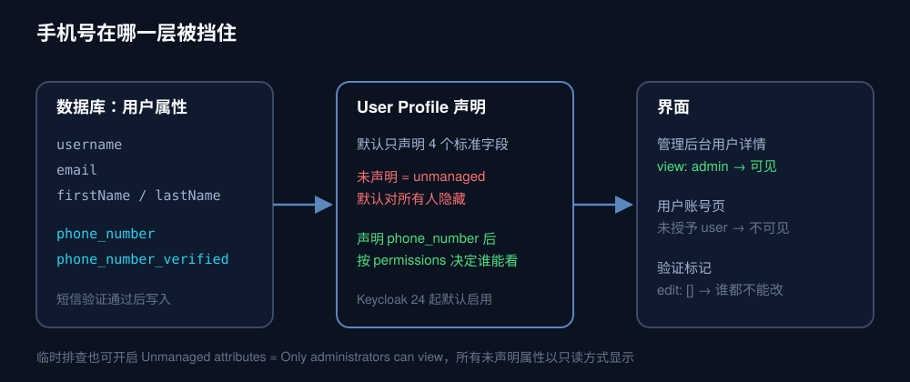
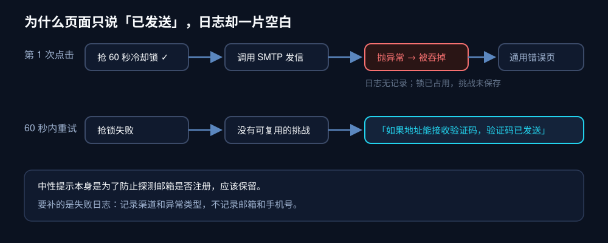
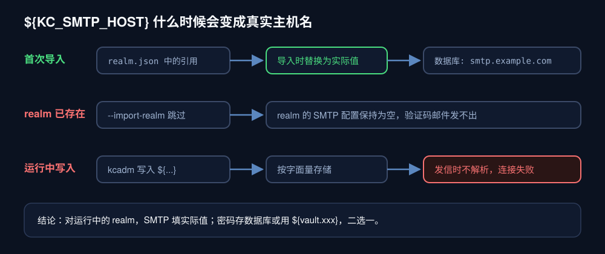

自建 Keycloak 跑起来以后，我们用一个自定义 Authenticator 给登录页加了三种入口：密码、邮箱验证码、短信验证码。验证码登录能用，新用户也能自动注册。接着在同一个下午，管理后台连着暴露了三个问题：

- 用手机号注册的用户，打开详情页只有一个 `phone_<随机串>` 的用户名，手机号一栏也没有。
- 在用户列表按属性搜索，输入号码前 7 位，结果为空。
- 登录页点「发送邮箱验证码」，只出现一句「如果地址能接收验证码，验证码已发送」，邮箱里什么也没有。

三个问题的根源是同一个：**Keycloak 以用户名和邮箱为中心设计，手机号、验证码这类扩展能力要自己接进它的每个子系统，而 realm 导入文件只在首次创建时生效。** 下面按出现顺序拆开，每个都给出原因、改法和代价。文中的号码、地址都是虚构示例，版本为 Keycloak 26.8.2。

## 一、手机号明明存了，详情页却不显示

自定义 Authenticator 在短信验证通过后创建用户，手机号写进了用户属性：

```java
user.setSingleAttribute("phone_number", recipient);          // +8613800000000
user.setSingleAttribute("phone_number_verified", "true");
```

数据在库里，界面不显示，原因在 Keycloak 24 起默认启用的声明式 User Profile。管理后台和账号页只渲染 User Profile 里**声明过**的属性；没声明的叫 unmanaged attribute，默认谁也看不到。我们的 User Profile 只声明了 `username`、`email`、`firstName`、`lastName` 四项，`phone_number` 自然被藏起来。



有两种改法：

- **开关式**：Realm settings → General → Unmanaged attributes 选「Only administrators can view」。详情页多出一个只读的 Attributes 标签页，能看到所有未声明属性。改动零代码，适合临时排查。
- **声明式**：把手机号写进 User Profile，配置随仓库走，重建 realm 也不会丢。长期使用选这个。

声明时要想清楚权限。手机号是个人敏感信息，查看限定管理员；验证标记 `phone_number_verified` 连管理员也不该能改，否则改个标记就绕过了短信验证。号码加格式校验，免得管理员手误存成不带国家码的写法，导致按号码登录时查不到人：

```json
{
  "name": "phone_number",
  "displayName": "Phone number",
  "validations": {
    "pattern": {
      "pattern": "^\\+861[3-9][0-9]{9}$",
      "error-message": "Use +86 followed by an 11-digit mainland mobile number."
    }
  },
  "permissions": { "view": ["admin"], "edit": ["admin"] },
  "multivalued": false
},
{
  "name": "phone_number_verified",
  "displayName": "Phone number verified",
  "permissions": { "view": ["admin"], "edit": [] },
  "multivalued": false
}
```

推上线时有个细节：`kcadm.sh update users/profile` 会整体替换配置，不做合并。我们先导出线上配置比对，发现线上多了一项仓库里没有的 `unmanagedAttributePolicy: ADMIN_VIEW`，是之前有人在后台点开的开关。直接用仓库文件覆盖，这个开关会被悄悄关掉。最后的做法是以线上配置为底，只追加两个新属性，再回读确认结果与预期完全一致。

## 二、属性搜索只认完整值，号码片段搜不到

详情页能看到手机号了，下一个需求是「客服报来半个号码，后台要能找到人」。用户列表的 Attribute search 填 `phone_number` 和号码前 7 位，结果为空。

Keycloak 的属性搜索是精确匹配，值要和库里存的字符串完全一致，连 `+86` 前缀都不能少。能模糊搜的是列表顶部的默认搜索框，按 Admin REST API 的说明，它在用户名、邮箱和姓名上做匹配：默认按前缀，`*foo*` 做包含匹配，`"foo"` 做精确匹配。它不搜自定义属性。

列表页本身也只有用户名、邮箱、姓、名四列，不支持加自定义列。想在列表里看到号码、又能按片段搜，唯一不改前端的路是让手机号进入这四个字段之一。三个候选的代价不一样：

| 放在哪 | 搜索与显示 | 代价 |
|---|---|---|
| 姓名字段 | 能搜能显示 | 语义错乱，`name` 类声明会把号码当姓名发给应用 |
| 自定义后台主题 | 想怎么显示都行 | 要维护一套前端，每次升级 Keycloak 都可能要改 |
| 用户名 | 能搜能显示 | 号码进入令牌的 `preferred_username`，所有接入应用都拿得到 |

我们选了用户名。邮箱注册的用户本来就以邮箱为用户名，手机号用户向它对齐，规则统一。隐私代价要算清楚：示例应用的 Client 早已通过映射器把 `phone_number` 放进 ID Token，随机用户名挡住的只是其他 Client。对一个所有应用都由同一团队维护的内部身份中心，这个代价可以接受；如果接入方里有第三方应用，就该重新权衡。

格式上用带国家码的 E.164，也就是 `+8613800000000`，为以后接入其他国家号码留余地。这里我们差点踩了一个凭印象判断的坑：起初以为 Keycloak 用户名不允许 `+`，打算存成去掉加号的 `8613800000000`。动手前从 26.8.2 的 `UsernameProhibitedCharactersValidator` 里读出实际规则，它禁止的是空白、`<>&"'$%!#?,;:*~/\|^=[]{}()` 等字符，`+` 不在其中。用户名与 `phone_number` 属性一字不差，后台搜 `*13800*` 就能按号码中段命中。

代码改动只有一行，用户名直接取验证过的联系方式：

```java
UserModel user = session.users().addUser(realm, recipient);
```

两个配套检查别漏：realm 不能开启「用户可修改用户名」，否则用户能把用户名改成别人的号码；已有的 `phone_` 用户要在后台手动改名，改名后应用收到的 `preferred_username` 会变，如果哪个应用拿它关联本地账号，要先确认关联键用的是 `sub`。

## 三、邮箱验证码提示已发送，邮箱里什么都没有

这个问题最绕，因为页面没有报错。

先说那句提示。为了防止通过登录页探测哪些邮箱已注册，Authenticator 在「邮箱未注册且不允许注册」等情况下，都只返回一句中性的「如果地址能接收验证码，验证码已发送」。另一个分支是冷却锁：发送前先抢一个 60 秒的锁，再调用发信。发信抛异常时，代码进入通用错误分支，异常被吞掉，日志里一行都没有；锁却已经占上，用户 60 秒内再点，看到的就是那句中性提示。



所以日志里找不到原因，只能去查配置。查下来，realm 的 SMTP 配置是空的。原因是部署方式：

- 仓库的 `realm.json` 里，SMTP 各项都写成 `${KC_SMTP_HOST}` 这样的环境变量引用，Compose 也给容器注入了这些变量。
- 但 Keycloak 的 `--import-realm` 遇到已存在的 realm 会跳过导入。线上 realm 在加入 SMTP 配置之前就建好了，这一段从未生效。

最直接的修法看起来是：用 `kcadm.sh` 把同样的 `${...}` 引用写进运行中的 realm，让 Keycloak 发信时读环境变量。这条路依次撞了四堵墙：

1. **发件地址被拒**。管理接口保存前校验 `from` 必须是合法邮箱，字面上的 `${KC_SMTP_FROM}` 通不过。
2. **显示名格式被拒**。换成环境变量的实际值后又被拒，因为它写成了 `Name <noreply@example.com>`。`from` 只收纯地址，显示名属于 `fromDisplayName`。`replyTo` 有同样的校验。
3. **认证信息被丢**。`auth` 写成 `${KC_SMTP_AUTH}` 时，保存后的配置里 `user` 和 `password` 两项消失了。`auth` 改成字面量 `true` 才保留下来。
4. **引用根本不会被解析**。配置终于存进去，验证码照样发不出。回到 26.8.2 的代码查：发信的 `DefaultEmailSenderProvider` 里没有任何占位符替换；整个 Keycloak 里引用 `KC_SPI_ADMIN__ALLOWED_SYSTEM_VARIABLES` 白名单的，只有主题文案的处理逻辑。运行期的 SMTP 配置不会读环境变量，Keycloak 拿着字面上的 `${KC_SMTP_HOST}` 去连主机，必然失败。



第 4 条推翻了前面的思路。这类 `${...}` 写法，能指望的只有导入那一刻的替换。我们在本地用同一个镜像和同一份 `realm.json` 起了一个全新实例验证：变量都设置时，导入后数据库里存的是实际值；只要漏设 `KC_SMTP_FROM`，引用会原样留下，发件地址校验不过，Keycloak 直接启动失败。所以我们最后把 SMTP 从导入文件和容器环境变量里整个拿掉，部署后在后台配置一次。对已经在运行的 realm，SMTP 必须填实际值。

主机、端口、用户名不是机密，直接填。密码有两个选择：

| 方案 | 密码在哪 | 代价 |
|---|---|---|
| 存进 Keycloak 数据库 | realm 配置表，管理接口回显 `**********` | 数据库和备份里有这份密码 |
| Keycloak vault | 服务器上只读挂载的文件，realm 里只写 `${vault.xxx}` | 要改 Compose、重新部署，多一个要维护的文件 |

我们选了数据库。这个库本来就存着所有用户的密码哈希和各 Client 的密钥，已经按最高敏感级别备份和隔离，多一份 SMTP 密码不改变它的保护等级。写入时在服务器上直接从容器环境变量组装 JSON，经标准输入交给 `kcadm.sh`，密码不离开服务器，也不出现在任何命令参数里。改完重试，验证码到了。

还有一个后续：环境变量从此不再是 SMTP 的配置来源。以后在部署平台改 `KC_SMTP_*`，realm 不会跟着变，要去后台 Realm settings → Email 同步修改。这条要写进运维文档，否则下次换邮箱又会重演一遍。

## 四、操作线上 Keycloak 时的几条习惯

这次排查都通过容器里的 `kcadm.sh` 完成，过程中积累了几条值得固定下来的做法。

- **密码不进命令行**：`kcadm.sh config credentials` 会读取环境变量 `KC_CLI_PASSWORD`。本机把管理员密码注入子进程，经 SSH 的标准输入传到远端 shell 变量，再用不带值的 `docker exec -e KC_CLI_PASSWORD` 传进容器。整条链上，密码不出现在任何进程参数里。
- **替换前先导出**：`update users/profile` 这类接口是整体替换。先 `get` 一份存为快照，比对差异后再写，写完回读确认，快照留作回滚依据。
- **别信 `--fields` 的嵌套输出**：`kcadm.sh get realms/<realm> --fields smtpServer` 在我们的环境里始终显示空对象，让人误以为写入失败；读取完整 realm 再解析，才看到配置早已写进去。
- **测试发信有前提**：后台的 Test connection 会给当前登录的管理员发一封测试邮件。管理员账号没设邮箱时，它在连接邮件服务器之前就失败了，测不出 SMTP 本身的问题。
- **临时凭据用完即删**：`kcadm.sh` 登录后会在容器里留下带管理会话令牌的配置文件，每次操作结束都删掉。

## 五、结论

三个问题指向同一条规律：Keycloak 的账号模型以用户名和邮箱为中心，给它加手机号和验证码登录，等于逐个子系统地补接入。User Profile 要声明属性，用户名要承担搜索和显示，SMTP 要在运行中的 realm 里单独配置。realm 导入文件管得了第一次，管不了之后。

如果你在做类似的接入，上线前逐项过一遍：

- 自定义属性是否已在 User Profile 声明，权限是否只给管理员，验证标记是否禁止编辑。
- 手机号用户的用户名能不能直接被后台搜到，以及这个号码会经由令牌发给哪些应用。
- 运行中 realm 的 SMTP 是否有实际值，而不是 `${...}` 引用；用一个真实邮箱走一遍验证码登录。
- 验证码发送失败时，日志里有没有一行不含邮箱和手机号的错误记录，冷却锁有没有随之释放。我们后来给 Authenticator 补上了这两点：日志只记渠道和异常类名，异常消息可能带地址，不记。

用户以国内手机号为主、后台运营操作又多的团队，也可以评估 Casdoor 这类把手机号当标准字段的身份平台。它们在手机号体验上省事，但安全记录和流程编排能力需要单独核实，迁移还要重做每个应用的对接。我们的选择是留在 Keycloak，把这几处缺口补上。

给 Keycloak 接手机号，代码只占一小部分，大部分工作是把这个号码登记进它的每一个子系统。
