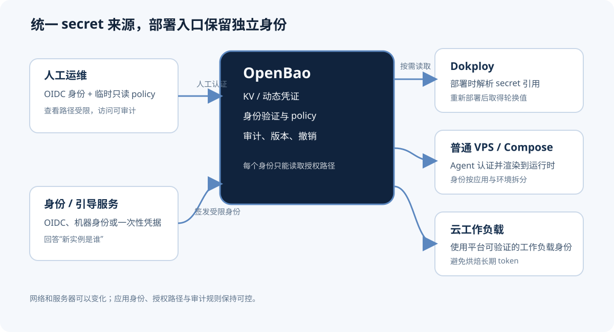
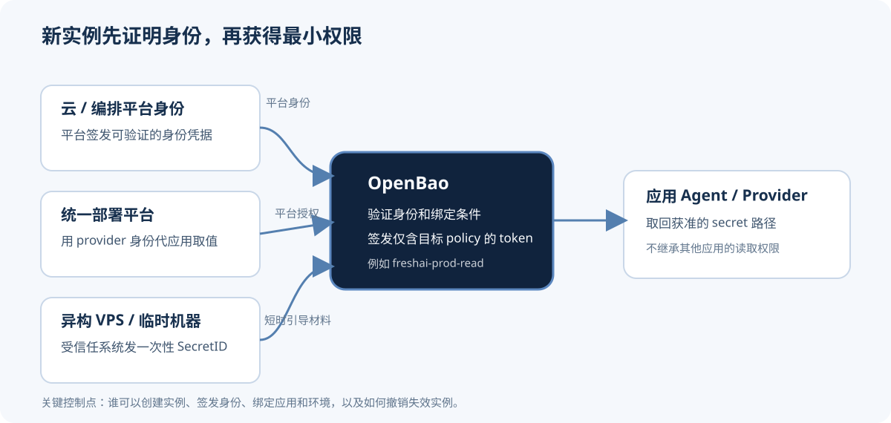
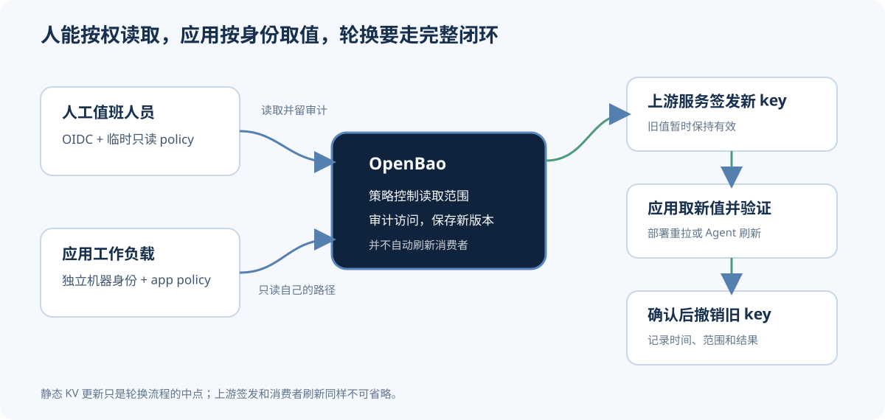

数据库密码、支付 API Key、邮件服务 Token、对象存储密钥……应用一多，密钥就会散在部署平台、服务器目录、CI 变量和本地 `.env` 里。机器还会临时换、扩、缩容，这时“把同一个 `.env` 复制到每台服务器”很快就会变成无法盘点、无法收回、也不敢轮换的状态。

先给结论：**把 OpenBao（或同类 Vault 服务）作为 secret 的唯一来源；给每个应用和环境分配独立身份与只读策略；由部署平台或 OpenBao Agent 把它能读的那部分 secret 注入运行时。** 新机器加入时，关键不是先拿到所有密码，而是先证明“我是谁、我属于哪个应用、我能拿哪些 secret”。

这篇文章按 2026 年 11 月查阅的 OpenBao、Nacos 和 Dokploy 官方文档整理一套适合多应用、异构部署的方案。它是架构与落地路径说明，不冒充某个生产环境的实测记录；具体命令和部署参数仍要按所选版本验证。

## 一、先把四件事分开

经常被混为一谈的有四个动作：保存 secret、识别应用、决定权限、把值交给进程。一个系统可以负责其中一部分，不代表它天然覆盖全部。

| 角色 | 主要职责 | 不应顺手承担的事 |
| --- | --- | --- |
| Nacos | 普通动态配置、开关、阈值、环境参数和发布管理 | 不作为密钥生命周期的唯一治理系统 |
| OpenBao | 保存 secret、签发受策略限制的 token、版本管理、审计和部分动态凭证 | 不负责替所有部署平台自动识别新机器 |
| Dokploy 等部署平台 | 在部署时解析外部 secret 引用并注入应用环境 | 不应持有一个能读取所有应用 secret 的共享凭据 |
| OpenBao Agent | 在主机或工作负载上自动认证、续期、渲染文件或启动子进程 | 不会消除第一次认证所需的信任来源 |

Nacos 官方把配置管理定义为配置资源的发布、查询、监听、历史和回滚生命周期，并明确说明它不是 secret 生命周期系统。Nacos 的配置加密插件可以加密特定配置在存储和部分传输路径上的内容，但官方也强调它不能替代认证、网络隔离、TLS 或企业密钥管理系统。[Nacos 配置管理边界](https://www.nacos.io/en/docs/v3.2/manual/user/config/overview/)，[Nacos 配置加密插件](https://www.nacos.io/en/docs/v3.2/plugin/config-encryption-plugin/)

这不是说 Nacos 不能出现任何敏感字段，而是先决定系统边界：普通配置放 Nacos；高价值 API Key、数据库密码、私钥交给 OpenBao 或云 Secret Manager；Nacos 如需引用 secret，只保存引用或非敏感标识，不保存一份长期有效的明文副本。

*图 1：同一个 secret 来源可以服务多个部署入口；每个入口使用自己的身份，只读取对应应用和环境的路径。*

## 二、应用很多时，先规划 secret 路径和权限

不要把所有值塞进一个名为 `production` 的大对象，再给所有机器发同一个只读 token。这样虽然集中存储了，授权边界仍然是“谁拿到共享 token，谁就能读全部”。

可以按环境、应用、用途来组织路径，例如：

    kv/prod/freshai/runtime
    kv/prod/freshai/database
    kv/prod/blog/runtime
    kv/staging/freshai/runtime

路径不是安全边界本身；最终授权由绑定在身份上的 policy 决定。以 KV v2 为例，给 `freshai-prod` 的运行身份只允许读取一条生产路径：

    path "kv/data/prod/freshai/runtime" {
      capabilities = ["read"]
    }

这里的 policy path 使用 KV v2 的 API 路径 `kv/data/...`。OpenBao CLI 的 `-mount` 写法把 mount 和 secret 名分开，例如 `bao kv get -mount=kv prod/freshai/runtime`；它比把 KV v2 API 路径误写成普通文件路径更清楚。[OpenBao KV CLI](https://openbao.org/docs/commands/kv/get/)，[KV v2 文档](https://openbao.org/docs/secrets/kv/kv-v2/)

建议一开始就把以下规则定下来：

- 每个应用、每个环境使用不同身份：`freshai-prod`、`freshai-staging`、`blog-prod`。
- 应用身份只有 `read` 权限；写入、删除和 policy 管理由单独的人工或自动化角色完成。
- 不给运行时身份 `list` 整个 mount 的权限，避免应用发现其他项目有哪些 secret。
- 测试和生产分开授权；不要因为同一台机器上跑两个容器，就让它们共用一个身份。
- 应用删掉或迁移后，撤销它的 token、认证材料和第三方旧 key。

OpenBao 的 AppRole 面向机器和服务，role 将 policy 与登录约束绑定在一起；可以为一台机器、一个机器上的某个用户，或跨多台机器的同一服务定义角色。具体授权范围由你配置，不是 AppRole 自动替你隔离。[OpenBao AppRole](https://openbao.org/docs/auth/approle/)

## 三、扩容前先解决 Bootstrap

OpenBao 可以成为所有 secret 的集中来源，但它仍需要知道新进程是否可信。**没有固定部署机器，不等于机器可以无凭据地自动获得身份。** 每次新增实例，都要有一个可信的“引导凭据”或机器身份把它接入。

比较常见的引导方式有三类：

| 运行环境 | 身份从哪里来 | 适合条件 |
| --- | --- | --- |
| 云主机或编排平台 | 云工作负载身份、平台签发的短期 JWT 等，再由 OpenBao 验证 | 平台有可验证的实例或工作负载身份 |
| 统一部署平台 | 部署平台通过自己的外部 Secret Provider 身份读取 secret | 应用主要通过同一个平台发布 |
| 多云、VPS、临时主机 | AppRole 加短期 SecretID，由受信任的 provisioning 流程送到新实例 | 机器来源混杂，没有共同的云身份体系 |

第三类有一种常见错误做法：“把同一个 AppRole SecretID 放进所有镜像”。那只是在集中存储之外，又造了一个能开所有门的共享密码。

正确的 AppRole 引导大致是这样：

1. 先创建只绑定某一个应用、某一个环境 policy 的 AppRole。
2. 可信的部署或 provisioning 系统为这次部署签发短时、有限使用次数的 SecretID。
3. 用 response wrapping 等方式把一次性凭据交给目标实例；不要把可长期复用的 SecretID 烘焙进镜像、Git 或通用 cloud-init 模板。
4. OpenBao Agent 读取凭据并完成登录。AppRole Agent 方法默认读取后删除 SecretID 文件，适合减少引导凭据在磁盘上的停留时间。
5. Agent 拿到受限 token 后，只为当前工作负载取回它需要的 secret。

OpenBao 文档将 AppRole 的 SecretID 标为敏感凭据，并支持 TTL、使用次数等约束；Pull 模式加 response wrapping 可以让中间的分发者不必看到最终 SecretID。Agent 的 AppRole 方法支持读取 wrapping token，并默认在读取后删除 SecretID 文件。[AppRole SecretID 模式](https://openbao.org/docs/auth/approle/)，[Agent AppRole Auto-Auth](https://openbao.org/docs/agent-and-proxy/autoauth/methods/approle/)

*图 2：扩容流程的信任链从平台身份或受控 provisioning 开始；只把一份共享 token 发给每台新机器，不算完成身份治理。*

如果现在没有 provisioning 服务，先不要假设 AppRole 会自动解决分发问题。可以先由当前部署平台提供短期身份或外部 Secret Provider；如果平台不支持，再设计一个很小的 enrollment 流程：谁有权创建新实例、怎样绑定应用和环境、如何签发一次性材料、材料是否过期、失败后怎样撤销。

## 四、按部署形态接入，不要求所有应用同一种方式

只要认证和 policy 统一，secret 的读取入口可以有几种。它们之间有不同的操作成本和运行时特性。

### 方案 A：部署平台在发布时注入

如果应用都通过 Dokploy 部署，可以考虑先用它的 Secrets Providers：环境变量填外部 secret 引用，由 Dokploy 在部署时从 OpenBao 拉取并注入准备好的环境。官方文档说明这些值不会写入 Dokploy 数据库，成员在环境变量编辑器看到的是引用；secret 轮换后需要重新部署才会生效。[Dokploy Secrets Providers](https://docs.dokploy.com/docs/core/secrets-providers)

这种方案操作简单，适合“部署时取一次、进程启动后使用”的静态 API Key 和密码。需要注意：Dokploy 的 provider token 本身也要最小授权；能编辑环境变量并触发部署的人，实际上能够让应用读取 provider token 可达的 secret。给每个项目或环境配置受限凭据，不要配置一个全局管理员 token。

### 方案 B：OpenBao Agent 在主机或工作负载上取值

对于不经过 Dokploy 的 Docker Compose、systemd 服务或临时主机，可以运行 OpenBao Agent。Agent 的 Auto-Auth 负责登录和续期，模板功能可以把指定 secret 渲染为应用可读文件；Agent 也有 Process Supervisor 模式，可以把 secret 注入它启动的子进程。[OpenBao Agent](https://openbao.org/docs/agent-and-proxy/agent/)，[Auto-Auth](https://openbao.org/docs/agent-and-proxy/autoauth/)

部署时要确保凭据只交给对应服务：

- 每个应用单独配置 Agent 身份与 policy；不要在共享主机上把一个能读所有应用的 token 放在通用目录。
- secret 文件权限只允许对应服务用户读取；在支持的环境中使用短生命周期目录或内存文件系统。
- 进程读取 secret 后，仍可能在内存、进程环境或诊断转储中暴露；secret manager 不会把已授权应用变成“看不见密码”。
- 如果应用只在启动时读取环境变量，secret 更新后通常要重启/重新部署；支持动态重载的应用可以设计安全的刷新流程。

### 方案 C：应用直接调用 OpenBao API

应用也可以使用 OpenBao SDK/API 取值，适用于已经具备认证、token 更新、失败重试和 secret 刷新能力的服务。代价是要在每个语言客户端里正确实现这些行为。若目前多是 Rust、Python 或小型服务，先由 Agent 或部署平台注入，通常更容易统一运行方式。

无论选哪种方式，都要回答三个具体问题：应用拿什么身份登录？它能读哪几条路径？secret 更新后应用怎样切换到新值？答不清楚之前，不要把“已接入 OpenBao”当作已经完成密钥治理。

## 五、临时想看密码，可以，但要把它当作一次受控读取

答案是可以。OpenBao 不会让授权管理员永远看不到 secret；它能做的是要求用户先认证、按 policy 判断能否读、把请求写进审计日志。应避免大家长期共用 root token，或者通过聊天记录、工单和截图复制密码。

一个实际的人工访问设计可以是：

1. 人使用公司统一身份提供方通过 OIDC 登录 OpenBao；机器使用 AppRole、云工作负载身份等机器认证方式，不共用人的登录凭据。
2. 建立单独的 `secret-operator-read` policy，只允许读取指定应用与环境的 secret，不允许写入、删除或改权限。
3. 给人工 token 设置较短 TTL；需要更高敏感度时，配合外部审批流程临时授予所需 policy。
4. 通过受信任网络访问 OpenBao UI，或在受控终端登录后读取。OpenBao UI 默认未启用，启用后仍应限制网络访问并使用 TLS。[OpenBao UI](https://openbao.org/docs/configuration/ui/)，[OpenBao OIDC 登录](https://openbao.org/docs/auth/jwt/)
5. 读取结束后不要把值贴进工单、聊天或截图；在共享终端上清理 CLI 登录状态和终端历史，并确认凭据是否需要轮换。

假设 policy 允许读取，CLI 形式可以是：

    bao login -method=oidc role=secret-operator-read
    bao kv get -mount=kv prod/freshai/runtime

这条命令会把返回值显示在终端；它不会自动替你遮住屏幕、录屏、终端回滚区或复制板。所以要在有访问控制的终端上执行，避免把输出重定向到日志文件。OpenBao CLI 默认会在本机缓存登录 token，也要按设备是否共享来保护本地会话。[OpenBao CLI 登录](https://openbao.org/docs/commands/login/)，[KV get](https://openbao.org/docs/commands/kv/get/)

审计也不是“任何地方都不会留下痕迹”。OpenBao audit log 会记录请求和响应；默认会对大部分敏感字符串做 HMAC 处理，但仍需要保护审计日志，并确认 secret 类型和配置没有启用原始明文日志。审计设备故障还可能影响服务请求，因此日志目标、冗余和告警要一起设计。[OpenBao Audit Devices](https://openbao.org/docs/next/audit/)

*图 3：人工读取与应用读取使用不同身份；读取可以审计，轮换则需要让新值到达应用并验证旧值撤销。*

## 六、轮换不是在 OpenBao 点一下“更新”就结束

OpenBao 的 KV 存储负责保存和版本化静态 secret，但不会替你去第三方控制台生成一个新 API Key，也不能保证每个运行中的进程都自动切换。完整轮换至少需要协调 secret 的签发方、OpenBao 和所有消费者：

1. 在上游服务创建新的 API Key 或密码，暂时保留旧值。
2. 把新值更新到 OpenBao 对应路径。
3. 让消费者通过部署重新拉取，或由 Agent 更新文件并触发应用重载。
4. 检查新实例是否完成认证、任务是否正常，再撤销旧值。
5. 记录轮换时间、影响范围和回滚方案；轮换失败时优先回到仍有效的上一版本。

如果是数据库账号，可以作为第二阶段评估 OpenBao Database Secrets Engine：它可按角色动态生成唯一数据库用户，并为凭据设置 lease，到期或撤销时回收。它减少长期共享密码，但也要求数据库允许创建/撤销用户，应用能够处理凭据续期或重连；并不是把现有连接字符串换个地方保存就完成了。[OpenBao Database Secrets Engine](https://openbao.org/docs/secrets/databases/)，[Lease、Renew 与 Revoke](https://openbao.org/docs/concepts/lease/)

扩容时，新实例按自己的身份重复登录与取值，不需要人工复制整份 `.env`。缩容时则撤销该实例的认证材料和 token；如果它拿到过上游静态凭据，且无法确认是否泄露，就轮换那条共享 key。**“实例下线”不等于它过去读到的 secret 自动失效。**

## 七、可用性与维护成本要按重要性逐步增加

把 OpenBao 放到所有应用的启动链路里，意味着它的可用性会影响新部署、重启和凭据刷新。如果 secret 在启动时只读取一次，OpenBao 暂时不可用时，现有进程可能仍能用内存里的旧值运行；但新实例无法启动或拿不到新值。如果运行时依赖动态凭证续期，OpenBao 或网络故障的影响就更直接。

因此至少准备：

- 持久存储和加密/解封材料的备份恢复方案，并定期实际演练恢复。
- 生产环境是否需要高可用的判断；OpenBao Integrated Storage 使用 Raft 复制数据，支持 HA。单节点适合验证流程，但它仍是单点。[OpenBao Raft Storage](https://openbao.org/docs/configuration/storage/raft/)，[Integrated Storage 概览](https://openbao.org/docs/internals/integrated-storage/)
- OpenBao 地址、TLS 证书、网络 ACL 和客户端超时/重试策略。
- 审计日志集中存储、访问隔离、容量监控和故障告警。
- break-glass 恢复流程：谁能在身份服务或网络故障时恢复管理员访问，恢复后怎样轮换相关凭据。

不要为了“机器很多”一开始就部署一套复杂的多区域控制面。先问清楚 OpenBao 不可用时，当前在运行的服务是否继续、扩容是否允许、多久必须恢复；再根据 RTO 和故障域决定单节点、Raft 集群或云厂商托管服务。高可用增加成本，但没有备份恢复和访问策略时，多节点也不会自动变成可靠的密钥治理。

## 八、适合逐步落地的顺序

对“应用多、部署位置变化、机器不固定”的环境，可以按下面顺序推进：

1. **先盘点**：按应用、环境和负责人登记 secret，标注当前放在 Git、`.env`、部署平台还是机器文件中；找出重复共享的 key。
2. **先建少量路径**：选一个低风险应用作为试点，用 `kv/prod/&lt;app&gt;/...` 这样的路径拆分开发、测试和生产。
3. **分开人工与机器身份**：人工接 OIDC 只读策略；应用先接一个受限角色；不要马上把所有旧凭据搬完。
4. **选两种部署形态试接**：例如一个 Dokploy 项目使用 Secret Provider，另一个非 Dokploy 服务使用 Agent 或短期 AppRole，验证架构确实覆盖异构环境。
5. **验证扩容和撤销**：新实例上线是否能自动取得正确身份；它能否被拒绝读取别的应用 secret；实例删除后 token、SecretID、第三方 key 如何回收。
6. **再迁移生产密钥**：先接入能安全轮换的 API Key，再安排数据库密码；保留短期回滚窗口，迁移后撤销旧来源。
7. **最后补动态凭证和自动轮换**：仅对确实需要、应用能配合续期的数据库和服务启用，不要把“支持动态 secret”当作第一阶段硬目标。

成本最低的起点取决于部署边界：如果绝大多数服务都经 Dokploy 发布，先把 Dokploy 的 OpenBao Provider 配好并为每个应用设置独立凭据；如果部署平台很多或常有临时主机，就值得统一引入 OpenBao Agent 和机器引导流程。**统一的是 secret 存储、路径和 policy；每种部署方式保留一个薄的身份/注入适配层。**

## 总结

机器不固定、应用又多时，OpenBao 解决的是 secret 的集中存储、权限控制和访问审计；它不会凭空知道一个新容器属于哪个项目。可扩容的做法是：每个工作负载有独立身份，identity 只拿对应路径，部署平台或 Agent 负责注入，人工临时读取通过单独身份授权和审计，轮换时明确更新所有消费者。

把 Nacos 留给普通配置，把 OpenBao/Vault 这类系统留给 secret，再逐步把 `.env` 中的生产凭据迁出。先打通一个应用和两种部署形态，再扩到其他项目；不要先把所有机器塞进同一个共享 token。

## 参考资料

- [Nacos 配置管理概览](https://www.nacos.io/en/docs/v3.2/manual/user/config/overview/)
- [Nacos 配置加密插件](https://www.nacos.io/en/docs/v3.2/plugin/config-encryption-plugin/)
- [OpenBao AppRole](https://openbao.org/docs/auth/approle/)
- [OpenBao Agent Auto-Auth](https://openbao.org/docs/agent-and-proxy/autoauth/)
- [OpenBao Agent AppRole 方法](https://openbao.org/docs/agent-and-proxy/autoauth/methods/approle/)
- [OpenBao UI](https://openbao.org/docs/configuration/ui/)
- [OpenBao Audit Devices](https://openbao.org/docs/next/audit/)
- [OpenBao Database Secrets Engine](https://openbao.org/docs/secrets/databases/)
- [Dokploy Secrets Providers](https://docs.dokploy.com/docs/core/secrets-providers)
