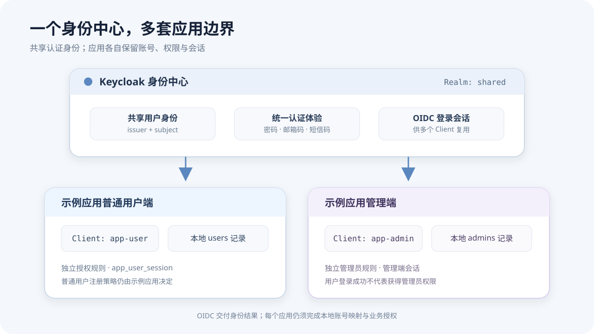
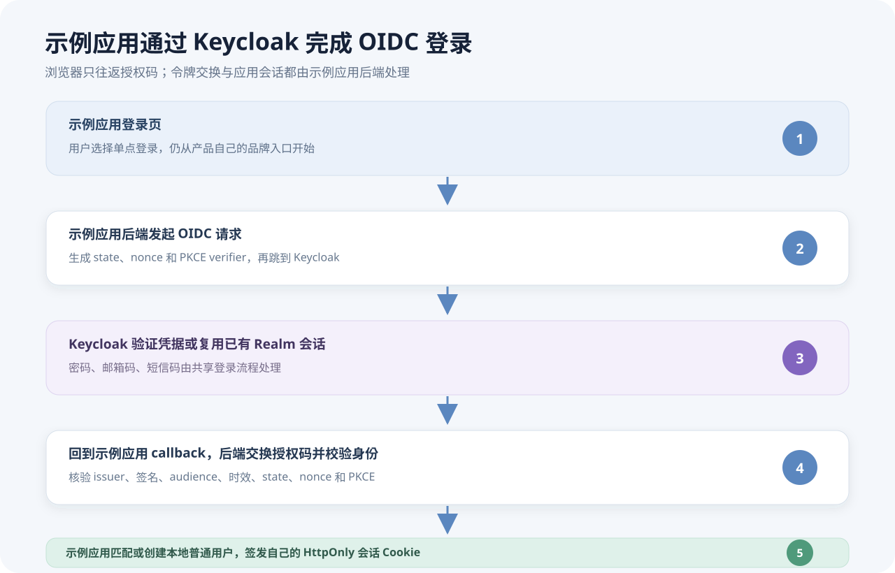
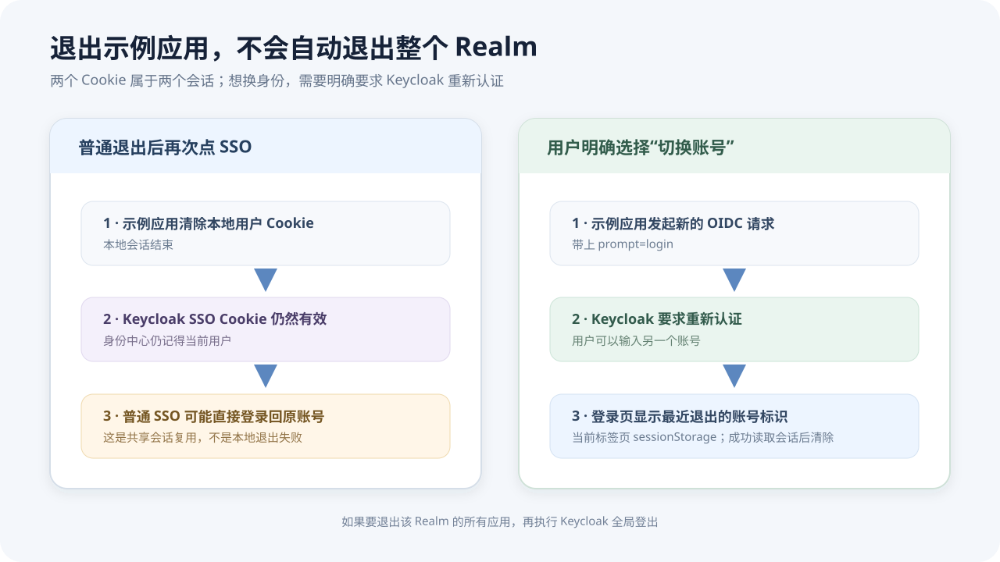

浏览器里有两张图很能说明这次接入遇到的问题。

第一张是 Keycloak 的错误页：`Invalid parameter: redirect_uri`。示例应用已经把浏览器带到了身份中心，身份中心却不肯继续。第二张更像“成功之后的故障”：在示例应用点退出，再点单点登录，页面立刻又登录回刚才那个账号。用户想换人，系统却像没听见一样。

这两件事看起来分别是回调配置和退出按钮的问题，往下追才发现，它们都和一个常见误解有关：**接入单点登录，不等于把应用的登录、注册、会话和账号政策都搬进 Keycloak。**

本文记录示例应用普通用户接入 Keycloak 的实际边界。管理员端和普通用户端使用不同的 Client 与本地账号规则；本文重点讲普通用户跨应用登录、邮箱和短信验证码、应用会话，以及退出后切换账号的行为。Keycloak 的 OIDC 授权码流程可以参考[官方 OIDC 接入文档](https://www.keycloak.org/securing-apps/oidc-layers)，Realm、Client、角色和管理员权限则另见[多应用权限设计]()。

## 登录入口可以留在示例应用，凭据验证仍由 Keycloak 完成

一开始我们最关心的是：如果多个应用要共享一套登录，用户是不是每次都得面对 Keycloak 的页面？示例应用已经有自己的登录页，也已经支持邮箱验证码、短信验证码和密码，这些东西为什么不能继续留在示例应用？

可以保留示例应用的品牌入口，但要区分“从哪里开始登录”和“谁来验证凭据”。用户在示例应用登录页点“使用单点登录”，浏览器才跳到 Keycloak。Keycloak 展示共享的登录主题，负责验证密码、邮箱验证码、短信验证码，或复用已有的身份中心会话。认证成功后再把浏览器送回示例应用。

这次的邮件和短信登录不是 Keycloak 新建一个 Client 后就会自动出现的功能。运维仓库中的 Keycloak 部署包含自定义 OTP Provider、共享主题和 Realm 登录流程；邮件发送由 SMTP 配置支持，短信由 Keycloak 容器里的短信服务配置支持。示例应用不持有这些投递凭据，也不在每个应用里复制一套验证码发送页面。

因此，职责拆成两段：示例应用提供产品自己的登录入口和本地业务规则；Keycloak 提供多个应用共同使用的身份验证体验。用户看到的是一套共享登录，维护者要运营的是一套中心化的登录能力。



*▲ 同一个 Realm 可以服务多个应用 Client；共享用户身份不意味着共享业务角色、数据库记录或应用 Cookie。*

## SSO 共享的是身份中心会话，不是示例应用用户表

多应用设计里，Realm 是一组身份与登录配置的隔离边界，Client 是某个应用接入身份中心的登记关系。示例应用普通用户端使用 `app-user` Client，管理员端使用单独的 `app-admin` Client。两个入口可以位于同一个 Realm，但不能因此把管理员账号和普通用户账号混成一套业务权限。

同样，用户在 Keycloak 里登录成功，也不代表示例应用就能直接拿 Keycloak 账号当自己的用户记录。示例应用仍然要做本地账号匹配、注册策略判断、业务权限校验，并最终签发自己的 HttpOnly 会话 Cookie。Keycloak 令牌留在后端处理，不发给浏览器作为示例应用会话使用。

在示例应用里，已绑定账号通过 `(issuer, subject)` 识别；首次登录才使用已验证的邮箱或手机号匹配本地账号。如果允许注册，示例应用再按自己的邮箱/手机号渠道、域名限制和注册开关决定要不要创建本地普通用户。新建的是示例应用用户记录，不是“Keycloak 登录成功就自动变成本地用户管理员”。



*▲ 授权码和 PKCE 在浏览器与后端之间往返；示例应用后端校验结果后才签发本地会话。*

## 一次登录经过哪些边界

示例应用使用 OIDC Authorization Code Flow 和 PKCE S256。浏览器从示例应用请求开始登录，后端生成短时事务状态并跳转 Keycloak；用户完成认证后，Keycloak 返回授权码，示例应用后端在服务端交换令牌、校验发行者、签名、受众、时效、state、nonce 和 PKCE，然后才绑定或创建本地账号。

| 环节 | 谁负责 | 这次要守住的边界 |
|---|---|---|
| 登录入口 | 示例应用 | 保留产品登录页；SSO 只是其中一种登录方式 |
| 密码、邮箱码、短信码 | Keycloak 共享登录流程 | Provider、主题和 Realm Flow 需要在 Keycloak 环境部署与绑定 |
| OIDC 回调与令牌校验 | 示例应用后端 | client secret 和授权码交换只在后端；浏览器不接收令牌 |
| 本地用户映射与自动注册 | 示例应用 | 按 verified email/phone 和示例应用注册策略执行，不越权创建管理员 |
| 登录后的业务 Cookie | 示例应用 | 每个应用保留自己的会话和注销范围 |

官方 OIDC 文档描述了浏览器重定向、授权码交换和应用验证身份声明的边界；Keycloak 还需要为每个应用登记允许回调的 URI，详见[Keycloak 管理员指南](https://www.keycloak.org/docs/latest/server_admin/index.html)。落地时我们把示例应用普通用户回调固定为 `/api/auth/user/oidc/callback`，管理员回调则是另一条路径。生产环境的 Client allowlist 和后端 `USER_OIDC_CALLBACK_URI` 必须逐字符相同。

每个应用环境有自己的 OIDC 配置和 secret。比如示例应用后端使用下面这些变量，真实 secret 只放受保护的后端环境变量：

```dotenv
USER_OIDC_ENABLED=true
USER_OIDC_ISSUER=https://sso.example.com/realms/company
USER_OIDC_CLIENT_ID=app-user
USER_OIDC_CLIENT_SECRET=<server-only-secret>
USER_OIDC_CALLBACK_URI=https://app.example.com/api/auth/user/oidc/callback
```

对应的 Keycloak Client 应开启 confidential client 和 Standard Flow，关闭 Implicit Flow 与 Direct Access Grants，使用 PKCE S256，登记精确的 callback URI，并按需要提供已验证的邮箱或手机号声明。浏览器代码不保存 `client_secret`。不同应用和环境各自使用 Client、secret 与 callback；Keycloak 用户目录与登录主题可以共享。

这也是 `Invalid parameter: redirect_uri` 最直接的排查方向：先不要改密码，也不要重建账号，比较 scheme、域名、路径和末尾斜线。把通用教程里的 `/auth/oidc/callback` 照抄进示例应用配置，或者误用管理员回调，都不会匹配普通用户 Client 的实际请求。

## 注册页面没有验证码，通常不是示例应用按钮坏了

创建 `app-user` Client 只是让示例应用能向 Keycloak 发起 OIDC 登录。它不会自动给 Realm 安装短信发送器，也不会自动把注册流程、邮件服务或登录主题配置好。

这个部署要按顺序看几层：

1. Keycloak 自定义 Provider 是否已打进当前镜像并安装。
2. Realm 是否绑定了共享 Browser Flow 和登录主题。
3. 自助注册是否开启，邮箱、名字等资料字段是否允许手机号用户留空。
4. SMTP 与短信服务是否配置在 Keycloak 环境中。
5. 每个应用环境是否创建了自己的 Client、密钥和精确回调地址。
6. 示例应用后端是否启用了 `USER_OIDC_*` 配置，并执行对应的用户身份迁移。
7. `GET https://app.example.com/api/auth/user/oidc/status` 是否返回 `{"enabled":true}`；这个状态只证明示例应用读到了完整配置，不代表 Realm Flow 或真实验证码投递已经验证。

`deploy/keycloak/README.md` 里维护了 Provider、主题、Realm Flow 和配置步骤。对于已经存在的 Realm，修改初始导入 JSON 通常不等于线上设置已更新；这次通过升级脚本有计划地应用共享登录流程，并先保留恢复快照。修改绑定到整个 Realm 的 Browser Flow 会影响 Realm 下所有 Client，所以发布前要审查变更，并保留可用的管理员会话。

这里还有两个容易混在一起的“注册”。Keycloak Realm 自助注册加共享 OTP 流程，负责验证联系方式并创建身份中心用户；邮箱或短信验证成功之后，示例应用 callback 再按示例应用自己的注册渠道和域名策略创建本地普通用户。前一层允许注册，不会绕过后一层的业务限制。手机号用户只通过短信注册时，Realm User Profile 还要允许邮箱、名字和姓氏留空，否则用户可能在验证码通过后又被资料补全页卡住。

邮件与短信验证码是否能发出去，取决于 Keycloak 的 SMTP 和短信服务配置。Keycloak 的邮件服务器配置位于 Realm 设置中，官方说明见[管理员指南的邮件配置章节](https://www.keycloak.org/docs/latest/server_admin/index.html)。应用只接收 Keycloak 已验证的 `email_verified`、`phone_number_verified` 等身份声明，再按自己的策略处理。把短信密钥写进示例应用 `.env` 并不能让 Keycloak 发出短信；把 Keycloak 密钥放进前端则会扩大凭据暴露面。

## 退出示例应用后，为什么单点登录又自动回来了

示例应用的“退出”清除了示例应用自己的用户 Cookie。它没有销毁 Keycloak 的 Realm 会话，也不应该擅自把用户从同一浏览器的其他应用中登出。于是再点普通 SSO 时，Keycloak 看见浏览器里已有有效会话，就可以不再询问账号密码，直接把同一个身份送回示例应用。

这不是示例应用退出失败，而是两个服务的会话生命周期不同：

- 示例应用 session：决定当前浏览器是否持有示例应用的本地登录状态。
- Keycloak SSO session：决定身份中心是否还能确认刚才登录过的用户。

我们在登录页加了明确的“切换账号”入口。它在启动 OIDC 时发送 `prompt=login`，要求身份提供方重新认证；OpenID Connect Core 规定了这一参数的重新认证语义，见[规范的认证请求章节](https://openid.net/specs/openid-connect-core-1_0.html#AuthRequest)。如果用户只想换示例应用账号，这比全局退出 Keycloak 更合适；如果要结束所有共享 Realm 应用的身份中心会话，再走 Keycloak 全局登出。

另一个小细节是：用户退出后，如果登录页只显示一个“继续登录”按钮，用户看不到刚才退出的是哪个账号。示例应用现在会显示“最近退出账号：邮箱或手机号”。这个提示只存储在当前标签页的 `sessionStorage`，首次成功读取示例应用当前会话后清除；它是页面提示，不是认证凭据，也不跨标签页同步。



*▲ 本地注销保留其他应用的单点登录体验；显式切换账号才要求身份中心重新认证。*

## 验证时不要把模拟环境说成线上验证

应用侧的 fake OIDC issuer 能验证示例应用生成授权请求、处理 callback、校验身份、映射或创建本地用户、签发 Cookie 等行为。它适合快速覆盖应用代码，但不会替我们证明 Keycloak 自定义 Provider 已经部署，也不会发送真实邮件或短信。

要验证完整链路，至少需要在真实 Keycloak Realm 中从示例应用入口完成一次邮箱或短信验证，确认浏览器回到正确 callback、示例应用接受验证声明、应用按注册策略创建或匹配本地账号，并成功访问站内页面。对于短信送达、邮箱投递这类外部服务边界，fake issuer 没法代替真实验证。

这次代码侧的全量测试和示例应用 OIDC 模拟端到端测试通过；线上邮箱和短信投递、Keycloak Provider 在生产镜像中的状态，需要在部署环境单独验证。把验证层级讲清楚，能避免“应用测试全绿”被误读成“身份平台配置已经全部正确”。

## 几点收获

1. **先画会话边界，再讨论登录页面。** 用户看到的是一条流程，系统里却至少有示例应用本地会话和 Keycloak SSO 会话两份状态。
2. **把验证码能力作为身份平台能力部署。** 多个应用共用认证体验，Provider、主题和投递凭据由 Keycloak 运维；每个应用保留自己的 callback、Client 与注册规则。
3. **共享身份不等于共享账号数据库。** `issuer + subject` 解决稳定身份识别，应用仍需完成本地账号映射、授权和会话签发。
4. **回调地址应当是配置契约。** 精确 URI 能让错误更早暴露，也能把授权码只送回预期应用。
5. **本地退出与全局退出要分开命名。** 用户希望换示例应用账号时，明确的重新认证入口比隐藏的身份提供方行为更好理解。
6. **验证说明要写出边界。** mock OIDC 测试能证明应用代码，不会替 SMTP、短信供应商或生产 Realm 作证。

如果你正在规划多应用身份中心，可以先读[统一登录与单点登录的概念]()，再看[自建 Keycloak 的部署与试点方案]()。本文补的是应用真正接入之后才暴露出来的边界：谁展示登录、谁验证验证码、谁创建本地账号，以及点退出之后到底退出了哪一个会话。
