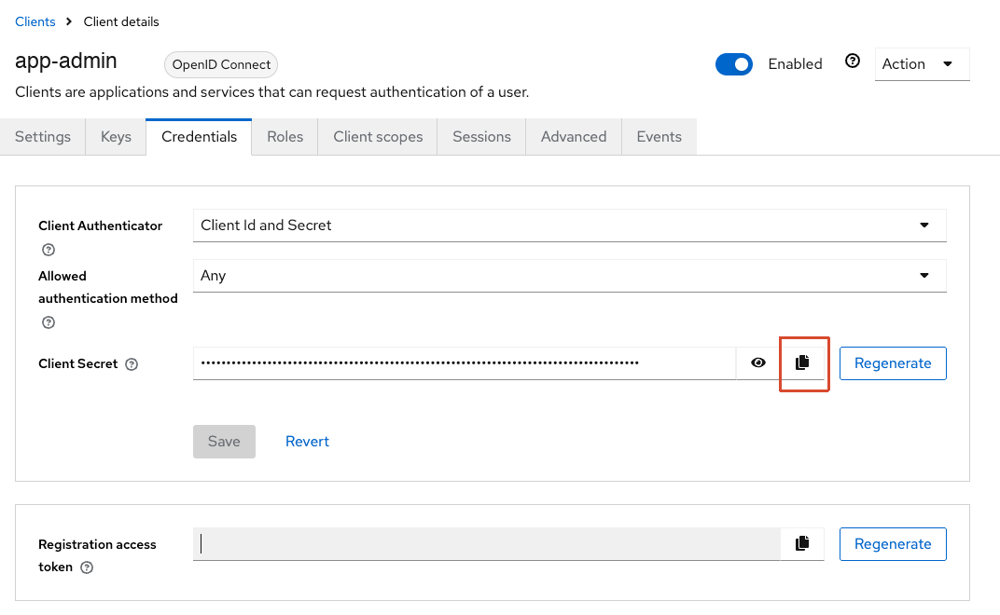

示例应用的普通用户早就通过 Keycloak 登录了，管理后台却还是账号密码。一查才发现，后台的单点登录代码其实已经写好，只是两边都没配：Keycloak 里没有管理后台用的 Client，应用里的开关也还关着。

这篇记录把它接上的过程。重点不在点哪几个按钮，那部分在[《Keycloak 多应用权限怎么设计》](/p/keycloak-multi-app-access/)里已经逐项讲过，这里讲三件更容易出错的事：管理员权限放在哪、Keycloak 账号怎么对上应用里的管理员、为什么要先在测试 Realm 试。文中的域名、邮箱都是虚构示例，版本为 Keycloak 26.8.2。

## 先确认到底缺了什么

不用登录任何后台，几条只读请求就能看清现状：

```bash
# 应用：管理后台 SSO 是否启用
curl -s https://admin.example.com/api/auth/admin/oidc/status
# {"enabled":false}

# Keycloak：这个 Client 存不存在
curl -s "https://auth.example.com/realms/company/protocol/openid-connect/auth?client_id=app-admin&response_type=code&scope=openid&redirect_uri=https://x.invalid/cb"
```

第二条请求故意带一个不存在的回调地址。Client 存在时，Keycloak 报「无效的参数 : redirect_uri」；Client 不存在时，报「客户端未找到」，和随便编一个 `client_id` 的结果一样。普通用户的 Client 是前一种，管理后台的是后一种，缺口就确定了。

## 管理后台的 Client 只认身份

最先要定的是：谁是管理员，由谁说了算。

直觉上会想在 Client 下建个 `admin` 角色，把管理员放进对应的组。但这个 Realm 是多个应用共用的，组和角色有人改错一次，就可能让好几个应用同时多出管理员。所以这次的约定是：**管理后台的 Client 不带任何角色，Keycloak 只负责证明「这个人是谁」，是不是管理员、管什么，仍由应用自己的管理员表决定。** 这也对应前一篇里「Keycloak 服务器管理员、Realm 管理员、应用管理员要分开」的结论。

如果以后有组织管理员、平台管理员之分，这个分层同样成立：登录方式不用变，登录后查应用自己的授权记录，决定看到哪个视图。

## Keycloak 账号怎么对上应用里的管理员

应用登录回调拿到 ID Token 后，按下面的规则找管理员：

1. 用 `(iss, sub)` 找已经绑定的管理员，找到就登录。
2. 没找到时只做一次首次绑定，要求同时满足：`email_verified=true`，邮箱（不区分大小写）**恰好匹配一个** active 且还没绑定的管理员。
3. 其他情况一律拒绝：没有匹配、匹配到多个、管理员已停用、已经绑定了别的身份。应用从不因为 Keycloak 登录而新建、启用或改绑管理员，页面上也只给通用失败提示，不暴露账号是否存在。

按邮箱首次绑定之所以可以接受，前提在 Keycloak 这一侧：邮箱只有 Realm 管理员能改，用户自己改不了；只有走完邮箱验证码，邮箱才会被标为已验证。如果用户能自己把邮箱改成别人的地址，这条规则就会变成接管管理员账号的入口，这个坑在[《给 Keycloak 加了验证码登录之后》](/p/keycloak-otp-account-security/)里专门拆过。

绑定之后只认 `(iss, sub)`，Keycloak 里的邮箱再怎么变都不影响。

## 先在测试 Realm 试

同一个 Keycloak 实例上另有一个测试 Realm，测试环境的应用接它。管理后台 SSO 先在这里跑通，有一个容易忽略的原因：**一个管理员只能绑定一次，而 `iss` 里带着 Realm 名。** 真实管理员要是在测试 Realm 先绑了，以后切到正式 Realm，新的 `iss` 对不上，又不满足「未绑定」，就再也登不进去，只能去数据库手工解绑。

所以测试时用一个单独的测试管理员和测试邮箱。示例应用没有新建管理员的界面，管理员只在启动时按环境变量写入，于是在测试环境的部署配置里把初始管理员换成测试邮箱、重新部署，就多了一个可以随便试的账号，原来的管理员不受影响。

## 建 Client 时管理后台要注意的值

创建向导的三页按前一篇的说明填，管理后台只需要注意这几项：

| 页 | 设置 |
|---|---|
| General settings | Client ID 单独起，例如 `app-admin`，不要复用普通用户的 Client |
| Capability config | Client authentication 开；只勾 Standard flow；Require PKCE 开，方法 `S256` |
| Login settings | Valid redirect URIs 只填应用回调地址原文，例如 `https://admin.example.com/api/auth/admin/oidc/callback`；Web origins、退出回跳都留空 |

保存后再看两个页签：Client scopes 里 `email` 要是 Default，应用靠它拿到 `email` 和 `email_verified`；Credentials 里复制 Client secret，直接粘贴到应用的部署环境，不要经过聊天记录或代码仓库。



应用这边配置签发者地址（`https://auth.example.com/realms/<realm>`）、Client ID、secret 和同一个回调地址，打开开关，重新部署。

## 不登录也能验证的几项

真正走一次登录之前，先用只读请求把配置对一遍：

- 应用的 `oidc/status` 返回 `{"enabled":true}`。
- 应用的 `oidc/start` 302 跳到正确的 Realm，`client_id` 和 `redirect_uri` 都对。
- 直接请求 Keycloak：用错误回调地址被拒；用正确地址但不带 PKCE，回跳里带 `Missing parameter: code_challenge_method`；带上 PKCE 才出现登录页。

最后用无痕窗口打开管理后台，点企业账号登录，用测试邮箱收验证码。Keycloak 发现这个邮箱还没有账号，会自动建号并标为已验证；回到应用时正好满足首次绑定条件。应用日志里出现 `outcome=success binding=first_linked`，就说明绑定成功了。

## 这次踩到的坑

- **把生产域名当成了测试域名。** 运维清单里的记录已经过时，照着填，回调地址指向了生产后台。测试环境的开关已经打开，生产却没反应，查服务器上的路由标签才发现同一台机器上有两套部署。域名以服务器上的实际路由为准，清单只当线索。
- **登录页路径不对。** 管理后台的登录页是 `/sign-in`，手动打开 `/login` 只会得到前端的 404，看起来像是 SSO 出了错。
- **初始管理员的标识不是邮箱。** 默认的初始管理员用户名是 `admin`，没有邮箱，永远满足不了按已验证邮箱首次绑定的条件，要另建一个用真实邮箱的管理员。
- **测试 Realm 的发信和注册要单独确认。** 每个 Realm 的 SMTP 和「允许注册」都是各自的设置，正式 Realm 能用不代表测试 Realm 也能用；没配好时，收不到验证码，或者收到了也不会自动建号。

## 几点收获

- 管理后台接 SSO，Keycloak 只证明身份，管理员名单留在应用里。共享 Realm 的组和角色不应该直接给应用授予管理权限。
- 首次绑定可以用已验证邮箱，但前提是邮箱真的验证过、用户自己改不了；之后只认 `(iss, sub)`。
- 绑定和 Realm 有关，所以先在测试 Realm 用测试管理员试，正式切换时再让真实管理员绑定。
- 动手前后都用只读请求核对状态，比登录一次看结果更快，也更容易定位是哪一边的问题。
