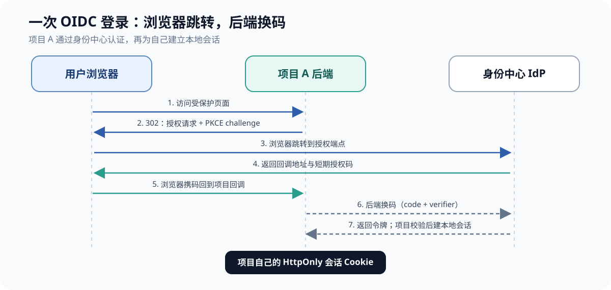
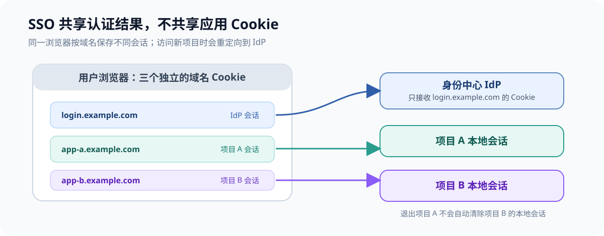
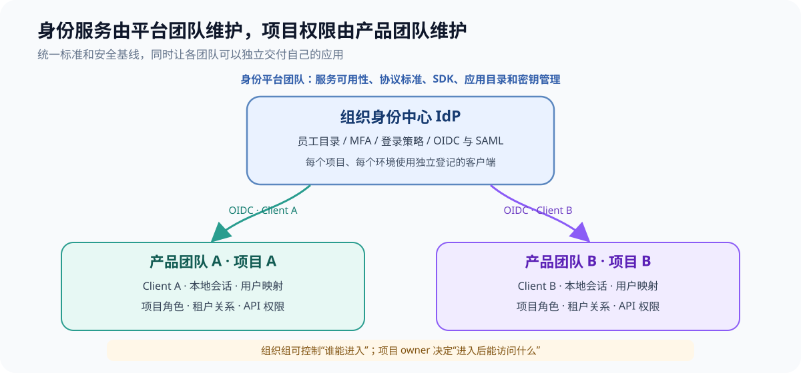
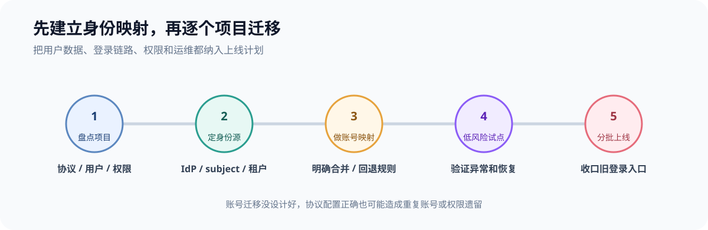

如果每个项目都有自己的登录页、用户表、密码重置和权限配置，项目越多，重复维护就越多。新项目要再做一遍登录；员工离职后要逐个系统收回账号；一个用户在两个项目里还可能变成两份互不相认的资料。

成熟做法是把“验证你是谁”交给独立的身份中心（Identity Provider，IdP），各项目通过标准协议向它发起登录。现代 Web 和移动应用通常用 OpenID Connect（OIDC）；它建立在 OAuth 2.0 之上，专门补上了可验证的用户身份信息。各应用仍保留自己的会话和业务权限。

当项目由多个团队共同维护时，关键是把**认证平台集中治理、项目权限分散负责**。员工身份优先复用组织已有的 Entra ID、Okta 等目录；身份平台团队维护 IdP、接入标准和自动化，产品团队各自维护应用客户端、用户映射和业务权限。若项目服务的是外部客户，则单独规划客户身份（CIAM），不要把员工目录和客户账号混成一套权限边界。

下文讨论的是你管理的多个应用或项目。如果你的问题是要把互不相关的第三方网站也强行接成一个登录，那需要这些网站支持并配置联合登录；你无法单方面改变它们的认证系统。个人使用场景下，密码管理器更适合解决这类问题。

## 统一登录到底统一什么

先把几件经常被混在一起的事拆开：

- **身份认证**：确认当前用户是谁。身份中心负责验证密码、通行密钥、多因素认证，或把用户转交给企业已有的身份服务。
- **单点登录（SSO）**：用户在身份中心完成一次认证后，访问其他接入的应用时不必再次输入凭据。它靠身份中心的登录会话和标准协议协作，不是把同一个密码复制到每个项目。
- **授权**：判断这个用户在当前应用里能做什么。项目 A 的管理员身份不应该因为同一用户登录了项目 B 就自动生效。
- **账号生命周期**：用户何时被创建、更新、停用，以及这些变化如何同步到各个项目。SSO 本身不负责自动清理每个应用中的账号。

OAuth 2.0 主要解决“一个应用能否代表用户访问某个资源”的授权问题。OIDC 在 OAuth 2.0 流程上增加身份层，让应用可以验证用户身份，并读取标准化的身份声明。旧企业系统和大量 SaaS 的登录仍广泛使用 SAML 2.0；如果你正在从头建设现代应用，通常先考虑 OIDC，需要对接客户现有企业身份系统时再按对方能力兼容 SAML。[OpenID Connect Core](https://openid.net/specs/openid-connect-core-1_0.html) 定义了 OIDC 身份层，[Microsoft Entra 的 SSO 文档](https://learn.microsoft.com/en-us/entra/identity/enterprise-apps/what-is-single-sign-on)也将 OIDC 定位为现代应用常用协议、将 SAML 作为企业兼容方案之一。

## 一次登录是怎样传到其他项目的

可以把身份中心想成一个只负责认证的独立服务，例如 `login.example.com`。每个应用都在身份中心登记为一个客户端（OIDC Client），并登记自己的回调地址。

一次典型登录会经过这些步骤：

1. 用户打开项目 A。项目发现本地没有有效会话，将浏览器重定向到身份中心的授权端点。
2. 身份中心检查自己域名下的登录会话。用户尚未登录时，才显示登录页；已有有效会话时可以直接继续。
3. 身份中心把浏览器带回项目 A 的预先登记回调地址，并附上一段短期、一次性的授权码。
4. 项目 A 的后端用授权码和一次性随机校验值（PKCE verifier）向身份中心换取令牌，然后验证签名、签发方、接收方和有效期。
5. 项目 A 建立自己的应用会话。之后用户访问项目 B，B 再走一遍自己的 OIDC 流程；身份中心识别到浏览器已有登录会话，就不用再让用户输入密码。

现代应用通常使用 **Authorization Code Flow + PKCE**。PKCE 把登录请求和后续换码绑定起来，降低授权码被截获后被他人兑换的风险。请求中还应使用 `state` 防止跨站请求伪造，并使用 `nonce` 将响应里的 ID Token 绑定到这次登录请求。IETF 的 [RFC 9700 OAuth 2.0 安全最佳实践](https://www.rfc-editor.org/rfc/rfc9700.html)建议使用安全的授权码流程和 PKCE，并明确不应使用资源所有者密码凭据模式；不要让每个项目直接收集并保存同一份用户密码。

几个令牌的职责要分清：`ID Token` 用来向客户端说明认证结果；`Access Token` 用来访问特定 API。不要把 ID Token 当 API 凭证，也不要把发给项目 A 的 Access Token 随手拿给项目 B 使用。令牌应该限制接收方（audience）和权限范围，降低泄露后的影响。

## SSO 不是所有项目共用一张 Cookie

浏览器里通常至少有两层登录状态：身份中心的会话，以及每个应用自己的本地会话。身份中心的 Cookie 只发给身份中心的域名；访问另一个项目时，浏览器通过重定向回到身份中心，由身份中心读取自己的会话，再为那个项目完成一次新的协议交互。[Auth0 对 SSO 会话的说明](https://auth0.com/docs/authenticate/single-sign-on)也区分了应用本地会话、授权服务器会话和上游身份提供方会话。

这一区分会影响登出行为：用户退出项目 A，默认只会清掉 A 的本地会话；身份中心的会话和项目 B 的会话可能仍然有效。如果产品要求“退出一个项目，所有项目立即退出”，需要设计并验证 OIDC 登出传播，例如 RP-Initiated Logout 或 Back-Channel Logout；协议与产品的支持程度各有差异，已签发但尚未过期的访问令牌也不会因为浏览器 Cookie 被删除而自动消失。[OIDC Back-Channel Logout 规范](https://openid.net/specs/openid-connect-backchannel-1_0.html)定义了身份中心通知各应用清理本地会话的机制。

## 市面上有哪些成熟路线

没有脱离场景的“最佳 IdP”。先看用户是谁、谁控制账号，再选产品类别。下面列的是常见路线，不是功能排名；价格、托管区域和计划限制要按当前官方方案核对。

| 场景 | 可选路线 | 主要取舍 |
|---|---|---|
| 公司员工访问内部项目，已有 Entra ID 或 Okta | 直接把现有企业身份服务当 IdP，通过 OIDC 或 SAML 接入 | 沿用组织现有账号、MFA 和离职停权流程；应用仍需逐个接入和授权 |
| 自己控制多个项目，需要自托管身份中心 | Keycloak；偏轻量或家庭实验环境也可评估 authentik | 控制数据和部署节奏；同时要自己负责升级、备份、可用性、监控和安全响应 |
| 面向公众的应用，希望少维护认证基础设施 | Auth0、ZITADEL 等托管身份平台 | 托管服务减少自建运维；需要评估持续费用、数据区域、服务依赖和迁移成本 |
| B2B 产品要接入每家客户自己的企业 IdP | WorkOS 等企业 SSO 集成服务，或自行实现 SAML/OIDC 联邦 | 能减少逐家适配企业 IdP 的工作；仍需维护组织、域名验证、账号映射和权限规则 |

[Keycloak 官方指南](https://www.keycloak.org/docs/latest/server_admin/)列出 OIDC、SAML、身份代理和 LDAP/Active Directory 用户联邦等能力，适合希望控制自有身份中心、也愿意承担运维的团队。[authentik 的 OIDC 提供方文档](https://docs.goauthentik.io/add-secure-apps/providers/oauth2)可以作为另一种自托管路线的评估入口。托管服务方面，[ZITADEL 的授权流程指南](https://zitadel.com/docs/guides/integrate/login/oidc/oauth-recommended-flows)说明它面向不同应用类型提供 OIDC/OAuth 流程；[Auth0 的 SSO 文档](https://auth0.com/docs/authenticate/single-sign-on)展示了集中登录域和跨应用会话的实现方式。

如果你的“多个项目”是公司自己用的后台，先找现有 Entra ID/Okta 管理员确认能否接入。再搭一个自管 IdP，等于又多维护一套员工账号和离职流程。[WorkOS 的 SSO 文档](https://workos.com/docs/authkit/sso)则面向要把客户现有 SAML/OIDC 身份系统接入 SaaS 的场景；它可以作为协议集成层，不等于必须把它选作你所有用户的主身份中心。

## 多团队协作，统一认证底座由平台团队维护

多个团队可以共同使用一个身份平台，但不能因此把所有项目的配置和业务权限都塞进一个“超级管理员”或一张全局角色表。平台团队负责共同的认证基础设施和标准；各项目团队仍要对自己的用户权限、数据范围和登出行为负责。

| 责任方 | 负责内容 | 建议的协作机制 |
|---|---|---|
| 身份平台团队 | IdP/租户、协议策略、登录 SDK、应用登记目录、密钥轮换、审计和可用性 | 提供标准模板和自助接入流程；设置服务负责人、支持渠道和变更记录 |
| 项目团队 | 本项目的 OIDC Client、回调地址、用户映射、本地会话、角色与资源授权 | 每个应用指定业务和技术负责人；对访问控制、登出和权限测试负责 |
| IT、安全与资源负责人 | 权威员工目录、MFA 策略、入职转岗离职流程、项目访问审批和高权限复核 | 用组织目录组管理粗粒度访问；业务负责人定期确认项目成员和管理员名单 |

新项目应该走可重复的接入流程：团队登记应用负责人、环境、域名、用户群和所需 API；平台目录为每个应用、每个环境创建独立客户端和精确回调白名单；项目团队通过维护中的 SDK 接入，并完成权限映射和安全测试；生产启用前由资源负责人确认谁可以进入、可以做什么。应用下线时，同一目录也要能停用客户端、撤销密钥并清理组映射。

这样能让多个团队独立发版，同时保留统一的安全基线。一个项目的回调地址、客户端凭据或错误配置不应扩大成所有应用的共用凭据；身份平台故障和维护窗口则由平台团队统一沟通和演练。

环境和用户群按信任边界划分。**同一组织的员工应用**通常可以共用一个身份租户或 Realm，每个应用在其中单独登记客户端，开发、测试、生产至少使用独立客户端和凭据。员工和外部客户应使用清楚分开的身份边界；生产与测试若有不同管理员、数据或认证策略，也应考虑分开身份租户/Realm。[Keycloak 关于 Realm 的文档](https://www.keycloak.org/docs/latest/server_admin/#configuring-realms)把隔离需求作为划分 Realm 的依据，并举例区分员工和客户。一般不必为了每个项目都新建一套 IdP；需要硬隔离时再增加边界。

项目权限按业务归属分配。组织目录组可以表达“谁能进入项目 A”或“谁是项目 A 的维护人员”这类粗粒度规则；项目自身再检查用户对某个租户、数据集、环境或操作的权限。每个项目的组到角色映射应由该项目 owner 审批，并纳入代码审查或权限变更审计。一个同事在 A 项目是维护者，在 B 项目仍可以是只读用户。

员工加入、转岗、离职的权威状态应来自组织目录或 HR 流程。OIDC 登录可以确认当前是谁，却不会自动保证每个项目的本地账号、组关系和业务权限已创建或回收。支持时可通过 SCIM 自动同步应用成员和群组；例如 [Microsoft Entra 的应用配置说明](https://learn.microsoft.com/en-us/entra/identity/app-provisioning/how-provisioning-works)介绍了通过 SCIM 对应用账号进行创建、更新、移除和群组同步。团队仍需要监控同步失败，并为高风险权限设置人工复核。

平台接入目录至少记录应用 owner、环境、issuer、回调和登出地址、申请的 API audience/scopes、密钥负责人、用户群、数据等级和最后一次权限复核时间。用配置即代码管理这些信息，可以在代码审查里发现回调范围过宽、客户端无人负责和旧应用未下线等问题。

## 多项目共用登录，我会怎样设计

如果多个应用属于同一个组织、使用同一批员工身份，一个企业 IdP 加每应用单独注册的 OIDC Client 是直接的起点。示例：身份中心是 `login.example.com`，项目分别为 `console.example.com` 和 `reports.example.com`。两个项目共用认证服务，但分别登记客户端、环境回调地址和自己的会话策略，并由对应项目团队管理本地业务权限。

每个项目的用户表保留自己的内部主键，并增加“外部身份到本地用户”的映射。映射通常包含 `issuer`、`subject` 和本地 `user_id`。不要直接用邮箱作为永久主键：邮箱可能变更，也可能被不同身份服务重复使用。OIDC 规范指出，`iss` 与 `sub` 的组合是客户端可依赖的稳定用户标识；但规范也允许 **pairwise subject**，即身份服务针对不同客户端返回不同的 `sub`，以减少应用之间关联用户行为的可能。因此，项目之间如果确实要识别同一个人，需要在 IdP 侧明确选择合适的 subject 策略，或通过受控的不可变外部 ID 建立映射，不能默认各应用看到的 `sub` 一定相同。[OIDC Core 的 Subject Identifier 章节](https://openid.net/specs/openid-connect-core-1_0.html#SubjectIDTypes)对此有明确说明。

认证统一之后，授权仍由各应用负责。可以把基础身份声明（稳定用户 ID、邮箱验证状态、姓名）作为登录数据；项目角色、租户关系、数据权限继续由应用自身判断，或由明确的授权服务提供。一个用户的组织身份可以相同，项目成员身份和业务角色可以不同。用于 API 的 Access Token 应针对具体 API 签发，并只带该 API 需要的权限。[RFC 9700](https://www.rfc-editor.org/rfc/rfc9700.html)建议按具体应用或资源限制令牌权限，并将令牌 audience 限定到特定资源服务器。

浏览器应用优先使用有维护的 OIDC SDK。带后端的 Web 应用可由后端处理授权码交换，并通过 `HttpOnly`、`Secure` 等属性的 Cookie 维护本地会话；纯 SPA 使用公开客户端流程和 PKCE，不能把客户端密钥放进前端代码。不要自行实现 JWT 验签、发现文档、密钥轮换和协议状态校验。

## 安全和账号迁移的关键检查点

- **校验回调和令牌**：回调地址使用精确白名单，不允许从请求参数拼接任意跳转地址。按库的要求验证签名、`iss`、`aud`、`exp`、`nonce`，并且为每个 API 限定令牌接收方和权限。
- **每个客户端独立配置**：每个项目、每个环境登记对应的 Client 和回调地址。生产密钥只保存在服务端密钥管理或部署环境里，按计划轮换；前端、移动客户端都属于公开客户端，不能依靠内置密钥保密。
- **把多因素认证和恢复流程一起设计**：集中登录也集中了承担账号被盗和 IdP 故障的风险。启用适合用户群的 MFA/通行密钥，保留安全的账号恢复、管理员紧急访问、备份恢复和身份中心不可用时的处置方案。
- **谨慎合并旧账号**：用户首次从 IdP 回来时，按可信身份映射已存在账号。不要仅凭相同邮箱自动合并两个来源的账户；需要验证邮箱归属、身份提供方可信度和已有账户控制权。更改邮箱、离职和第三方账号解绑都要有可审计流程。
- **把用户生命周期单独建模**：员工登录成功不代表所有项目已经完成用户开通、组映射或权限回收。企业 SaaS 场景可评估 SCIM，用标准接口同步用户与群组的创建、更新和停用；[RFC 7644](https://www.rfc-editor.org/rfc/rfc7644)定义了 SCIM 协议。登录认证、账号配置和业务授权是相邻但不同的工作。
- **单独处理机器身份**：定时任务、部署机器人和服务到服务调用没有浏览器用户会话。给它们设计单独的工作负载身份或 OAuth 客户端凭据，不要借用某个员工账号来“统一登录”。

## 一条可执行的多团队落地路线

1. **盘点应用和 owner**：由平台团队收集项目、用户群、域名、协议、权限来源和机器账号；每个应用必须有业务负责人和技术负责人。
2. **确定身份源和边界**：内部员工优先接现有组织 IdP；外部客户使用单独的 CIAM 规划；决定测试与生产是否需要独立租户/Realm。
3. **发布接入契约**：明确标准 SDK、OIDC 流程、回调规则、令牌 audience、客户端命名、环境隔离、日志字段、密钥轮换和登出行为，并把应用登记目录纳入自动化。
4. **设计账号与权限映射**：选定 issuer、subject 策略和本地用户主键；为每个项目定义组到角色的映射、审批人和定期复核人。为已有账号准备显式迁移映射，处理重复邮箱、账号合并、用户停用和租户关系。
5. **选一组团队试点**：覆盖一个常见 Web 应用和一个不同技术栈或不同权限模型的项目，验证首次登录、MFA、离职停权、错误回调、IdP 不可用、登出和回退。
6. **按团队分波上线**：每个项目团队对集成和本地授权测试签收；平台团队观察登录成功率、回调错误、SCIM 同步失败和 IdP 可用性。回退设负责人和截止条件，避免长期保留两套并行密码入口。
7. **运营和退役**：为入职、转岗、离职、管理员复核、密钥轮换、IdP 升级和故障恢复设定运行手册；应用下线时停用客户端、撤销凭据、移除目录组映射并保留审计记录。

如果项目只是内部管理页面、且应用本身没有 OIDC，可以用反向代理或认证网关先挡住页面访问；但这不等于应用内部 API 已获得用户级授权。网关必须隔离外部直连入口，后端也要明确校验可信的身份头。面向公众的 API、移动端和多租户产品，通常应让应用直接通过 OIDC/Access Token 建立自己的安全边界。

## 结论

多团队维护多个项目时，成熟做法是让**平台团队统一认证标准和身份服务，各项目团队负责本项目的会话、授权与用户映射**。内部员工优先接已有企业 IdP；同一信任边界内每个项目独立登记 OIDC Client；只有身份人群、环境或安全策略不同，才拆分身份租户/Realm。面向客户的产品再单独规划 CIAM、客户 IdP 联邦和 SCIM。

落地前先明确权威用户目录、项目 owner、组到项目角色的审批链，以及 IdP 停摆或员工离职时的应用响应。把这些规则写进接入模板和运行手册，新团队接入时就不用重新发明登录，也不必牺牲各项目自己的权限边界。
