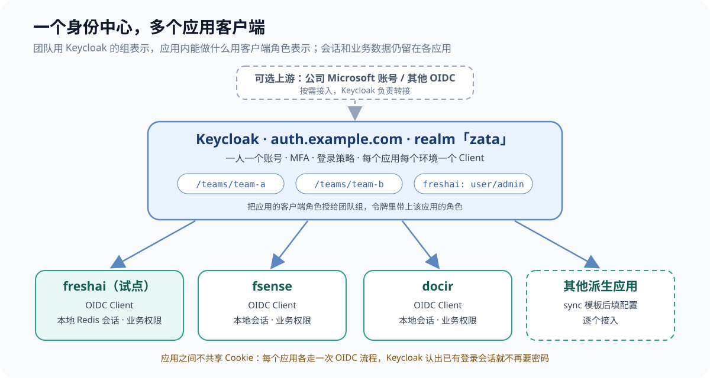
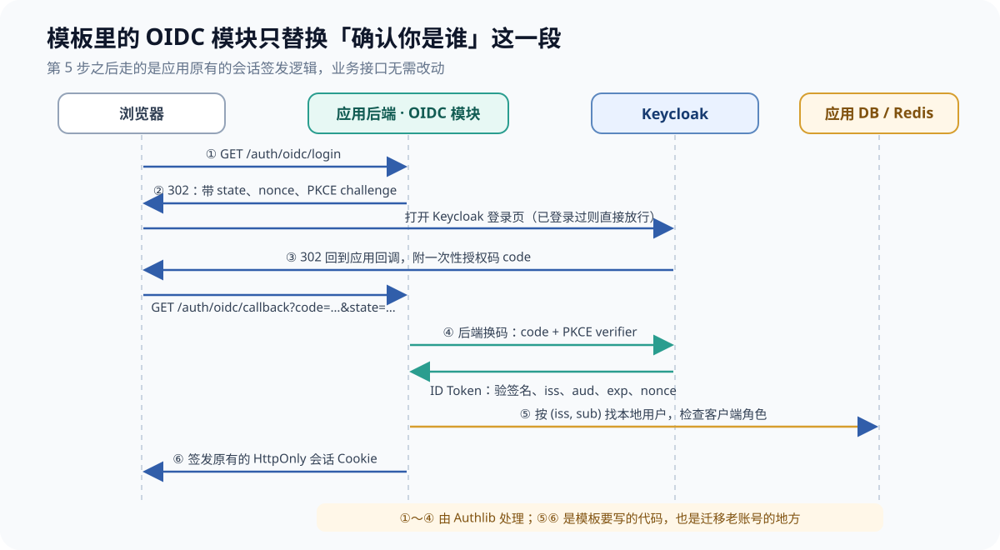
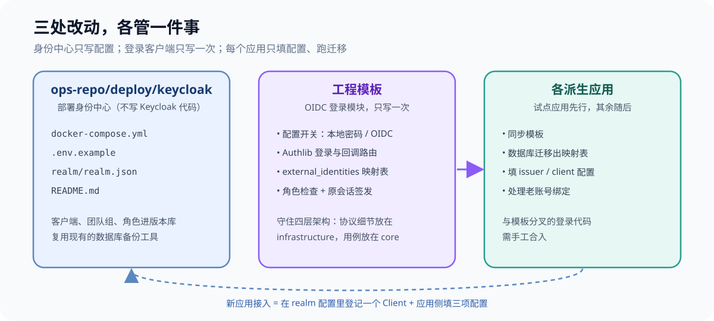
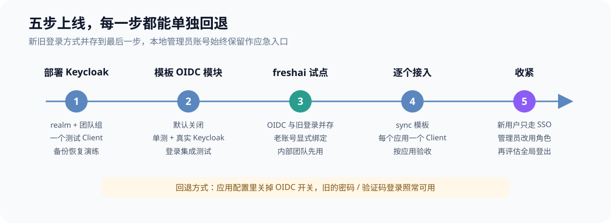

设想这样一个场景：一个人或一个小组维护着十来个应用，它们都从同一个工程模板派生出来，有 AI 平台、文档处理，也有业务系统和内部工具。登录全部来自模板：邮箱或用户名加密码，服务端把会话存进 Redis，再通过 HttpOnly Cookie 下发。每个应用各有一张用户表。

单个应用这样做没问题，应用多了就开始重复。功能齐全一些的应用里，认证相关的接口能有十几个，覆盖注册、密码登录、邮箱验证码、短信验证码、找回密码和管理员登录。等到其他团队也提出要用这些应用，问题就暴露出来了：一个同事要用三个应用就得注册三次，离职时还得在三个后台分别停用。

我的结论是：**自建一个 Keycloak 当身份中心，每个应用登记成它的一个 OIDC 客户端；应用这一侧的登录代码在模板里写一次，再同步给所有应用。** 各应用继续保留自己的会话、用户表和业务权限，只把"确认你是谁"这件事交出去。

这篇文章是落地方案，不是上线复盘。OIDC 和单点登录的原理在[《多个团队维护多个项目，登录怎么统一？》]()里讲过，这里只讲具体怎么做：身份中心选哪个、放在哪、模板改什么、第一个应用怎么迁、团队权限怎么分。下文用应用 A、B、C 指代具体应用，其中应用 A 是试点。

## 一、先把问题收窄

"其他团队也要用"很容易被理解成另外两件事：把系统交给对方各自部署一份，或者在每个应用里做团队隔离。这次要的是一套部署、一个账号，所有应用通用。所以先写清楚这次要做什么、不做什么。

- **要做：一人一个账号。** 在身份中心登录一次后，进其他应用不用再输密码。
- **要做：按团队控制谁能进哪个应用。** 开号、停号、换团队都只在一个地方操作。
- **不做：应用内部的团队数据隔离。** 比如某个应用的知识库要不要按团队隔开，这属于应用自己的业务模型，与登录无关。
- **不做：把系统交给其他团队各自部署。** 每份独立部署天然有自己的用户表，也就没有打通的问题。

需求收窄后，要动的东西只剩三块：身份中心，应用的登录入口，以及老账号怎么迁过来。

## 二、身份中心为什么选自建 Keycloak

我比较了四条路线。判断标准有三条：能不能给多个团队的人用；会不会和某个业务应用绑死；一个人维护得过来。

| 路线 | 能覆盖的用户 | 主要问题 | 结论 |
|---|---|---|---|
| 公司现有的企业账号（如 Entra ID、Okta） | 只限本公司员工 | 每登记一个应用都要找 IT；外部合作方进不来 | 以后作为上游接进 Keycloak |
| 自建 Keycloak | 员工和外部用户都行 | 要自己维护一个服务和一个数据库 | 采用 |
| 托管服务（Auth0、ZITADEL Cloud 等） | 都行 | 持续付费，数据放在第三方 | 暂不考虑 |
| 让某个现有应用兼任身份中心 | 都行 | 它一发版或出故障，所有应用都登录不了 | 排除 |

最后一条值得多说一句，因为它看起来改动最小：功能齐全的应用往往已经有完整的账号体系，可能还给命令行工具做过设备授权。但设备授权和 OIDC 服务端是两回事。OIDC 服务端要处理发现文档、签名密钥轮换、授权码、PKCE、各种令牌校验，自己实现很容易在安全细节上出错。更麻烦的是，身份中心的可用性和发版节奏会被这个应用绑住，它的每次重启都会影响所有应用的登录。

Keycloak 是 Red Hat 发起的开源身份服务，现在是 CNCF 项目。它对 OIDC、SAML、转接外部身份源的支持都比较成熟。写这篇文章时官方文档的版本是 26.8.x；从 [26.0 开始，Organizations 功能转为正式支持](https://www.keycloak.org/2024/10/keycloak-2600-released)，以后要接外部合作方时可以直接用。代价是 Java 服务的资源占用比轻量方案高，而且升级、备份都要自己负责。



整体结构就是上图：一个 realm（Keycloak 里的隔离单元，相当于一套独立的用户和配置），每个应用的每个环境登记一个 Client。团队用组（group）表示，应用内能做什么用客户端角色（client role）表示，再把角色授给组。应用之间不共享 Cookie：用户进应用 B 时会再走一次 OIDC 流程，Keycloak 认出浏览器已经登录，就直接放行。

## 三、Keycloak 部署在哪：不用新开项目

Keycloak 是现成产品，不需要改它的代码，只维护部署配置。如果已经有一个专门放基础设施部署配置的运维仓库（监控、配置中心、沙箱之类），Keycloak 和它们属于同一类，放进去即可：

```text
ops-repo/deploy/keycloak/
├── docker-compose.yml      # Keycloak + Postgres，接入现有 Traefik
├── .env.example            # 域名、数据库、初始管理员；真实值不进仓库
├── realm/
│   └── realm.json          # 客户端、团队组、角色、登录策略
└── README.md               # 部署、备份恢复、升级、新应用接入步骤
```

只有两种情况才值得单独开一个仓库：要定制登录页主题或开发 Keycloak 插件（SPI）；身份平台交给别的团队维护，需要独立的权限和发版节奏。一个人维护时，放在运维仓库里还能直接复用现成的数据库备份和日志查看工具。

compose 的核心部分如下。环境变量名都对照过[官方容器文档](https://www.keycloak.org/server/containers)和[反向代理文档](https://www.keycloak.org/server/reverseproxy)：

```yaml
services:
  keycloak:
    image: quay.io/keycloak/keycloak:26.8.2
    command: ["start", "--import-realm"]
    environment:
      KC_DB: postgres
      KC_DB_URL: jdbc:postgresql://keycloak-db:5432/keycloak
      KC_DB_USERNAME: ${KC_DB_USERNAME}
      KC_DB_PASSWORD: ${KC_DB_PASSWORD}
      KC_HOSTNAME: https://auth.example.com
      KC_HTTP_ENABLED: "true"          # TLS 在 Traefik 终止，Keycloak 内部走 HTTP 8080
      KC_PROXY_HEADERS: xforwarded     # 信任 Traefik 传来的 X-Forwarded-* 头
      KC_HEALTH_ENABLED: "true"        # 健康检查在管理端口 9000，不对外暴露
      KC_BOOTSTRAP_ADMIN_USERNAME: ${KC_BOOTSTRAP_ADMIN_USERNAME}
      KC_BOOTSTRAP_ADMIN_PASSWORD: ${KC_BOOTSTRAP_ADMIN_PASSWORD}
    volumes:
      - ./realm:/opt/keycloak/data/import:ro
```

官方生产建议先用 `kc.sh build` 构建镜像，再以 `start --optimized` 启动，这样可以缩短启动时间。起步阶段直接 `start` 也能跑，以后再优化。

部署上有三点要注意：

- **只暴露该暴露的路径。** 反向代理文档列得很清楚：`/realms/`、`/resources/`、`/.well-known/` 对外；`/admin/` 和 master realm 只给内部访问；管理端口 9000 上的 `/health`、`/metrics` 不要经过代理。Traefik 的路由规则按路径前缀写，管理后台走 SSH 隧道进入。
- **realm 导入只在第一次生效。** [官方导入导出文档](https://www.keycloak.org/server/importExport)写明：realm 已存在时，启动时的导入会被跳过。所以 `realm.json` 只能用来从零重建；之后新增 Client 或组，要么调用 Admin API 写成脚本，要么等 Client 多了改用 keycloak-config-cli 这类声明式工具。不管哪种方式，原则都是改动先进仓库，再应用到线上，不在后台手工点完就算。
- **Keycloak 的数据库是全系统的单点。** 这个库丢了，所有应用都登录不了。备份频率要比业务库高，恢复也要真正演练一次。

## 四、应用侧：OIDC 登录模块在模板里写一次

所有应用都从同一个工程模板派生，登录代码本来就同源。所以 OIDC 客户端只在模板里实现一次，各应用通过模板同步拿到。下图是一次登录的完整过程，模板要接管的只有中间"确认你是谁"这一段。



第 ①～④ 步交给 [Authlib](https://docs.authlib.org/)。以当前版本 1.9.5 的源码为准，Starlette 集成会把 `state`、`nonce` 和 PKCE 的 `code_verifier` 存进 `request.session`；回调时 `authorize_access_token()` 会校验 state、用授权码换取令牌、用 nonce 校验 ID Token，再把解析后的声明放进 `token["userinfo"]`。在 `client_kwargs` 里传 `code_challenge_method="S256"` 就会启用 PKCE。

```python
from authlib.integrations.starlette_client import OAuth
from starlette.middleware.sessions import SessionMiddleware

# 只用来在跳转往返之间暂存 state / nonce / verifier，与应用登录会话是两张不同的 Cookie
app.add_middleware(SessionMiddleware, secret_key=settings.oidc_state_secret,
                   https_only=True, same_site="lax")

oauth = OAuth()
oauth.register(
    "keycloak",
    client_id=settings.oidc_client_id,
    client_secret=settings.oidc_client_secret,
    server_metadata_url=f"{settings.oidc_issuer}/.well-known/openid-configuration",
    client_kwargs={"scope": "openid email profile", "code_challenge_method": "S256"},
)

@router.get("/auth/oidc/login")
async def oidc_login(request: Request):
    return await oauth.keycloak.authorize_redirect(request, request.url_for("oidc_callback"))

@router.get("/auth/oidc/callback")
async def oidc_callback(request: Request):
    token = await oauth.keycloak.authorize_access_token(request)
    claims = token["userinfo"]
    local_user = await oidc_login_use_case.resolve_user(claims)  # 找本地用户 + 检查角色
    return issue_session_cookie(local_user)   # 沿用模板原有的 Redis 会话签发
```

部署在反向代理后面时，`request.url_for` 生成的回调地址要是外部看到的 https 域名。uvicorn 需要开启 `--proxy-headers` 并设置可信来源，否则会生成 `http://` 或内网地址，Keycloak 会以回调地址不在白名单为由拒绝。

第 ⑤ 步是模板要自己写的部分，核心是一张身份映射表：

```sql
CREATE TABLE external_identities (
    id            uuid PRIMARY KEY,
    issuer        text NOT NULL,          -- https://auth.example.com/realms/example
    subject       text NOT NULL,          -- Keycloak 用户的 sub，稳定不变
    user_id       uuid NOT NULL REFERENCES users(id),
    linked_at     timestamptz NOT NULL,
    last_login_at timestamptz,
    UNIQUE (issuer, subject)
);
```

本地用户按 `(issuer, subject)` 查找，不按邮箱查。邮箱可能会变，也可能被不同账号重复使用；OIDC 规范里能当稳定标识的只有 issuer 加 subject 这个组合。有这张表还有一个好处：以后如果再接一个身份源，只需新增映射行，用户表不用动。

整个模块默认关闭，用配置开关启用。代码按分层架构放：Authlib 和 HTTP 细节放在基础设施层，"按身份找到本地用户、检查角色、签发会话"这个用例放在核心层，路由放在接入层。



模板同步有一个常见的例外：迭代时间长的应用，登录代码往往已经和模板分叉，表名、认证逻辑的位置都可能和模板不一样，同步一下并不能直接生效，模块要手工接进去。我会优先选这样的应用当试点：分叉最大的应用能接上，其他应用就不难了。

## 五、试点应用：老账号怎么办

试点应用通常有一个麻烦：用户表里邮箱和手机号都可以为空，因为有人只用手机号验证码注册。这意味着"按邮箱自动合并"根本覆盖不了所有人。我的做法分三档：

- **新用户：** 第一次从 Keycloak 登录、且在本地找不到映射时，直接创建本地用户和映射。
- **老用户，主动绑定：** 用户先用原来的方式登录，再在账号设置里点"绑定统一账号"，走一遍 OIDC 流程，回调时把这次的 `(issuer, subject)` 绑到当前登录的用户上。这样用户证明了自己同时控制两边的账号，误绑的风险很低。
- **老用户，按邮箱自动绑定：** 只在同时满足三个条件时才做：Keycloak 返回 `email_verified=true`，本地这个邮箱也验证过，并且本地账号还没有绑定过其他身份。只要有一条不满足，就引导用户走主动绑定。

试点期间两种登录并存，原有的认证接口一个都不删。管理员登录暂时保留本地账号，到最后一步再改成按 Keycloak 角色判断，本地管理员账号留作应急入口。

## 六、多团队权限：组管"谁"，角色管"能做什么"

Keycloak 里用两种对象，分工如下：

```text
组（谁）                       客户端角色（能做什么）
/teams/team-a        ──授予──>  app-a: user
/teams/team-b        ──授予──>  app-a: user, app-b: user
/teams/platform      ──授予──>  app-a: admin, app-b: admin
```

把客户端角色授给组之后，Keycloak 默认把它写进访问令牌的 `resource_access.app-a.roles`。应用登录时只看 ID Token，所以要在客户端角色映射器上打开"加入 ID Token"，回调里读到的 `claims` 就带上了角色。应用只需检查自己的角色：没有 `user` 角色就返回"无权访问"，有 `admin` 角色就进管理后台。一个同事从 A 团队调到 B 团队，只要在 Keycloak 里改一下组，所有应用下次登录时就会按新权限生效。

这里要分清边界。Keycloak 只决定"能不能进这个应用、是什么角色"；进去之后能看哪些数据，仍由应用自己判断。如果以后某个应用要按团队隔离数据，那是它自己的数据模型要做的事，组信息可以作为输入，但不能直接拿来当数据权限。

外部合作方要接入时，可以考虑 Keycloak 的 Organizations：每家合作方作为一个组织，挂自己的成员和身份源。内部团队用组就够了，暂时不引入。

## 七、风险、成本和暂缓的事

这个方案的主要成本是多维护一个基础服务。具体的风险和应对如下：

| 风险 | 影响 | 应对 |
|---|---|---|
| Keycloak 宕机 | 所有应用都无法新登录（已登录的会话不受影响） | 健康检查加告警；各应用保留本地管理员登录；故障恢复要演练 |
| Keycloak 数据库丢失 | 所有账号都没了 | 备份比业务库更频繁，并定期恢复演练 |
| 回调地址或密钥配错 | 某个应用登录失败，或回调被劫持 | 回调地址精确白名单；每个应用每个环境一个 Client、一个密钥 |
| 老账号绑错人 | 一个人登进了别人的账号 | 默认走主动绑定，自动绑定要同时满足三个条件 |

暂缓的事有三件，各自标明了什么时候再做：

- **全局登出**：退出一个应用、其他应用也同时退出。等真有用户提出需要时，再评估 Keycloak 的 back-channel logout。
- **SCIM 账号同步**：应用数量和停号频率还没高到要自动化的程度。
- **接入公司企业账号作为上游**：等内部团队的使用规模稳定后再接，接入时只需改 Keycloak 配置，应用侧不受影响。

## 八、上线路线和结论



每一步都可以单独回退：应用配置里关掉 OIDC 开关，原来的密码和验证码登录照常可用。

1. **部署 Keycloak**：建 realm、团队组和一个测试 Client，先做一次备份恢复演练再往下走。
2. **模板 OIDC 模块**：默认关闭；除了单元测试，还要对一个真实的 Keycloak 实例跑通完整登录流程，避免用伪造的令牌给自己开绿灯。
3. **应用 A 试点**：新旧登录并存，内部团队先用，老账号走主动绑定。
4. **逐个接入**：每个应用同步模板、跑迁移、登记 Client，按应用逐个验收。
5. **收紧**：新用户只走 SSO，管理员改为按角色判断，再看要不要做全局登出。

回头看这个问题，难点不在协议，而在边界：Keycloak 管身份和"能不能进"，模板管协议接入，每个应用管自己的会话和数据权限。三者分清之后，再加一个应用就是在 realm 配置里加一个 Client、在应用里填三项配置。

**应用越多，越不该让每个应用自己认识用户。**
