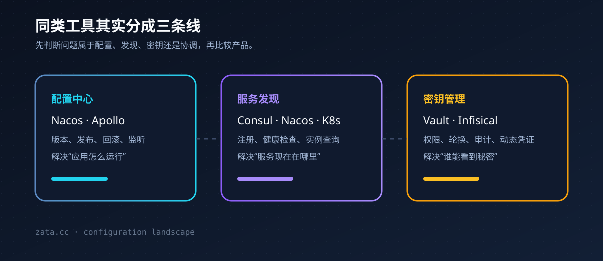
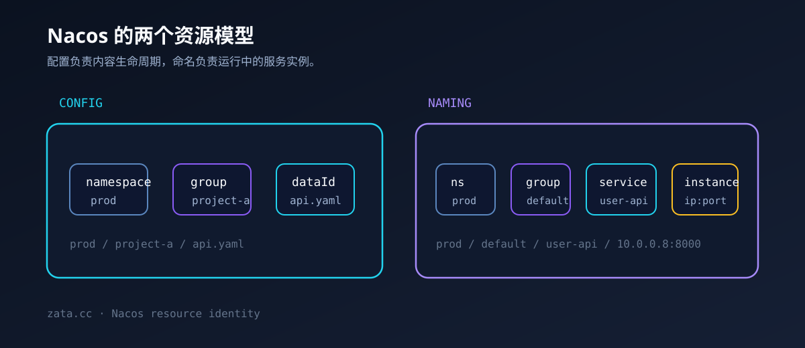
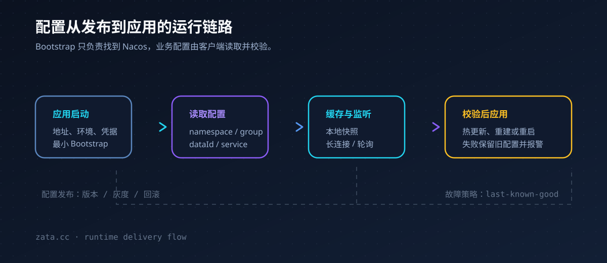

一个项目只有一个 `.env` 时，手工复制还能勉强接受。项目变成多个，环境变成开发、测试、预发布和生产，再分散到几台服务器上，问题就不再是“变量写在哪里”，而是：谁是配置的唯一来源，谁可以读取它，配置改动如何发布，旧版本如何恢复。

这也是配置中心存在的原因。它把散落在代码仓库、服务器目录和部署脚本里的配置集中起来，再通过环境隔离、权限、版本和客户端分发，把配置交给运行中的应用。

先给判断：**如果当前重点是多项目、多环境的配置管理，Nacos 比 Consul 更贴近问题；如果核心是跨机器的服务发现和网络治理，Consul 更合适。** Rust 与 Python 都可以接入 Nacos，但两种语言的 SDK 维护级别并不完全相同，生产环境需要锁定版本并验证断线重连、缓存和监听行为。



## 一、先区分：你需要的到底是哪一种工具

“配置中心”“注册中心”“密钥管理”和“分布式协调”经常被放在同一张产品对比表里，但它们解决的问题不同。选型前先把边界拆开，能避免拿一个工具去替代另一类系统。

| 类别 | 代表工具 | 主要解决的问题 | 典型边界 |
| --- | --- | --- | --- |
| 配置中心 | Nacos、Apollo、Spring Cloud Config | 集中存储、发布和分发应用配置 | 不等于密钥生命周期管理 |
| 服务发现 | Nacos、Consul、Kubernetes Service | 服务注册、健康检查和实例查询 | 不等于完整的流量治理平台 |
| 密钥管理 | Vault、Infisical、云厂商 Secret | 密码、API Key、证书、轮换和审计 | 通常不负责普通业务开关 |
| 分布式协调 | etcd、ZooKeeper | 强一致 KV、租约、监听、选主和锁 | 不一定提供好用的配置发布控制台 |
| 平台原生能力 | Kubernetes Service、ConfigMap、Secret | 集群内发现和配置注入 | 依赖 Kubernetes 运行环境 |

### 1. 配置中心

配置中心保存的是“应用应该如何运行”。数据库地址、日志级别、限流阈值、功能开关、第三方服务地址，都属于配置。好的配置中心还要处理发布、版本、回滚、灰度和监听；远程 KV 接口本身还不够。

### 2. 服务发现

服务发现保存的是“应用实例现在在哪里”。服务启动后注册自己的 IP、端口、健康状态和元数据；调用方按服务名查询健康实例。实例发生扩缩容或迁移时，调用方不需要把 IP 写死在配置文件里。

### 3. 密钥管理

数据库密码和 API Key 虽然也长得像环境变量，但它们的风险更高，需要访问策略、审计、轮换，甚至需要动态生成短期凭证。Nacos 的官方文档也明确把配置管理和密钥生命周期管理区分开；这类需求应该考虑 Vault 或专门的 Secret 管理平台。

### 4. 分布式协调

etcd 和 ZooKeeper 更像分布式系统的协调内核。它们擅长强一致数据、Watch、租约、选主和同步原语，适合构建控制面或基础设施；面向业务团队的完整配置发布流程需要另外建设。

## 二、同类工具各自适合什么场景

### Nacos：配置中心和服务发现的组合

Nacos 的名称来自 Dynamic Naming and Configuration Service。它把动态配置和服务发现放进同一个平台，配有控制台、命名空间、分组、配置监听、实例健康检查和服务元数据管理。[Nacos 官方概览](https://nacos.io/en/docs/latest/overview/)

它比较适合：

- 多项目、多环境，需要统一管理配置；
- 同时需要配置中心和服务注册发现；
- 希望通过控制台查看、发布、回滚配置；
- 团队使用 Java、Python、Go，或愿意通过 HTTP 接入其他语言。

它的代价是需要单独部署和维护 Nacos；如果项目只有一个服务和一台服务器，直接使用环境变量、部署平台变量或 Git 管理配置会更轻。

### Consul：服务发现和网络连接优先

Consul 的核心是服务目录、DNS/HTTP 服务发现、健康检查、多数据中心和服务网格。它也有 KV，但官方把 KV 定义为基础的配置参数和元数据存储，并明确说明它不是完整的数据存储或配置治理系统。[Consul KV](https://developer.hashicorp.com/consul/docs/automate/kv)

Consul 比较适合 Rust、Python、Go 等多语言服务混合部署，以及虚拟机、裸机、容器和混合云同时存在的环境。如果用 Consul 管理配置，通常还要配合 Consul Template 生成文件或重启应用；配置发布、审核、灰度和回滚仍要额外设计。

### Apollo：配置治理更完整

Apollo 是携程开源的配置中心，重点是配置发布流程、灰度发布、权限管理、审计和客户端状态观察。官方资料把配置编辑和配置发布分成两个动作，并提供发布历史和灰度能力。[Apollo 官方 Wiki](https://github.com/apolloconfig/apollo/wiki/)

Apollo 更适合配置治理要求高、以 Java 或 .NET 为主的团队。它的优势不在服务发现，因此如果目标只是让 Rust 和 Python 找到彼此，Apollo 不是优先选项。

### Spring Cloud Config：Git 驱动的配置服务

Spring Cloud Config 的典型模式是把配置放在 Git 仓库，由 Config Server 通过 HTTP 提供给应用。官方文档说明，它提供分布式系统的外部化配置，默认后端是 Git，并且可以跨环境管理配置。[Spring Cloud Config](https://docs.spring.io/spring-cloud-config/docs/current/reference/html/README.html)

它适合 Spring Boot 生态，尤其适合已经把 Git 作为配置变更审计来源的团队。Rust 和 Python 可以调用 HTTP 接口，但需要自己处理客户端缓存、监听和配置刷新。

### Vault 与 Infisical：更接近密钥和环境变量治理

Vault 主要管理静态密钥、动态数据库凭证、证书和加密能力。它可以保存带版本的 KV Secret，也能通过策略限制访问，并记录审计信息。[Vault 官方文档](https://developer.hashicorp.com/vault/docs/about-vault/what-is-vault)

Infisical 的产品边界更接近环境变量和密钥管理：按开发、测试、生产隔离，集中保存 Secret，并向开发者、CI 和工作负载分发。[Infisical Secrets Management](https://infisical.com/platform/secrets-management)

一个常见组合是：Nacos 保存普通配置，Vault 或 Infisical 保存数据库密码和 API Key。这样不会把所有信息都塞进同一个 `.env`。

### etcd、ZooKeeper 与 Kubernetes 原生能力

etcd 提供强一致、持久化的 KV、Watch、Lease 和事务能力，Kubernetes 也把它作为核心组件之一。[etcd API 保证](https://etcd.io/docs/v3.5/learning/api_guarantees/)

ZooKeeper 是高性能的分布式协调服务，提供命名、配置、同步、分组、选主和临时节点等原语。[ZooKeeper 官方概览](https://zookeeper.apache.org/doc/current/index.html)

两者更接近基础组件，除非你明确需要强一致协调，否则不建议仅为了管理 `.env` 而直接引入它们。Kubernetes 自己已经提供 Service、DNS、ConfigMap 和 Secret；如果所有服务都运行在 K8s 内，优先评估平台原生能力。Kubernetes Secret 默认可能以未加密形式存储在 API Server 使用的 etcd 中，生产环境需要配置静态加密和最小权限 RBAC。[Kubernetes Service DNS](https://kubernetes.io/docs/concepts/services-networking/dns-pod-service/)、[Kubernetes Secret](https://kubernetes.io/docs/concepts/configuration/secret/)

## 三、Nacos 到底是什么

Nacos 是一个面向云原生和微服务的动态命名、配置和服务管理平台。它的核心能力可以概括成四部分：

1. **动态配置管理**：集中保存配置，支持查询、监听、发布、历史、回滚、灰度和导入导出。
2. **服务注册与发现**：服务注册实例，调用方按服务名查询健康实例，并订阅实例变化。
3. **服务元数据管理**：保存服务、集群和实例的标签、权重、启停状态等信息。
4. **生态和 AI Registry 扩展**：Nacos 3.x 继续扩展 Kubernetes、CoreDNS、MCP、A2A、Skill 和 Prompt 等生态能力，但这些不是配置中心入门时的必需部分。

Nacos 官方把配置和命名拆成两个领域。配置领域负责配置内容及其生命周期；命名领域负责服务、集群、实例、健康状态和订阅关系。[Nacos Config 规范](https://github.com/alibaba/nacos/blob/develop/specs/en/config/config-spec.md)、[Nacos Naming 规范](https://github.com/alibaba/nacos/blob/develop/specs/en/naming/naming-spec.md)

### Nacos 能解决什么问题

假设有三个项目，每个项目都有开发、测试和生产环境。没有配置中心时，常见结构会变成：

```text
project-a/.env
project-a/.env.prod
server-1:/opt/project-a/.env
server-2:/opt/project-a/.env
ci-secret/project-a-prod.env
```

这些文件很容易发生漂移：服务器 A 改过，服务器 B 没改；发布脚本使用了一份旧变量；开发者为了启动项目，把生产值复制到了本地。

使用 Nacos 后，可以把配置抽象成一个带身份的资源：

```text
namespaceId = prod
groupName   = project-a
dataId      = api.yaml
```

应用只需要知道 Nacos 地址、环境、配置身份和访问凭据；具体的数据库地址、Redis 地址、日志级别和功能开关从中心读取。这样每台机器不再需要复制完整 `.env`，只需要保留少量启动所需的 Bootstrap 配置。

### Nacos 不负责什么

Nacos 保存和分发配置，但不会理解 YAML 内部每个字段的业务含义。一个 `dataId` 对应的是一份配置内容，应用如何解析、校验和应用这份内容，仍然由客户端负责。[Nacos 配置概览](https://nacos.io/docs/latest/manual/user/config/overview/)

Nacos 也不能直接修改已经启动进程的环境变量。配置更新之后，客户端可以收到通知，但应用必须选择重新加载配置、刷新某个组件，或者重启进程。

## 四、Nacos 的资源模型

### 配置资源：namespace、group、dataId

Nacos 用三个字段确定一份配置：`namespaceId -> groupName -> dataId`。[配置发布、查询与监听](https://nacos.io/docs/latest/manual/user/config/publish-query-listen/)

| 字段 | 建议用途 | 示例 |
| --- | --- | --- |
| `namespaceId` | 环境、租户或业务域隔离 | `dev`、`staging`、`prod` |
| `groupName` | 项目、应用或模块分组 | `project-a` |
| `dataId` | 具体配置文件或配置资源 | `api.yaml` |

一套容易维护的规划方式是：环境放在 Namespace，项目放在 Group，服务配置放在 Data ID。

```text
dev       / project-a / api.yaml
staging   / project-a / api.yaml
prod      / project-a / api.yaml

dev       / project-b / worker.yaml
prod      / project-b / worker.yaml
```

不要把每个机器名都设计成一个 Namespace。机器级差异更适合由实例元数据、少量覆盖配置或部署系统变量表达，否则配置数量会随着服务器数线性膨胀。



### 服务资源：service、cluster、instance

服务发现使用另一组层级：`namespaceId -> groupName -> serviceName -> clusterName -> instance`。

一个服务实例通常包含 IP、端口、健康状态、启用状态、权重、集群名和实例元数据。服务启动时注册实例并发送心跳；调用方查询或订阅服务实例列表。临时实例依赖客户端存活和心跳，适合普通微服务；持久实例的生命周期语义不同，使用前要确认客户端和服务端版本对它的支持。

### 配置格式：Nacos 保存内容，应用解释内容

Nacos 可以保存 Properties、YAML、JSON、文本等内容，但它不会替你理解配置之间的业务关系。建议为每个应用定义一个配置契约：

```yaml
server:
  port: 8000

logging:
  level: info

redis:
  url: redis://redis.internal:6379/0

feature:
  enable_new_flow: false
```

应用收到配置后，先完成格式解析、类型校验和必填项检查，再替换当前配置。不要在校验失败时直接把半份配置应用到线上。

## 五、Nacos 的运行链路

配置中心的核心价值，是建立一条可验证的配置分发链路，而不只是把文件放到远程服务器：

1. **Bootstrap 启动**：应用只携带 Nacos 地址、环境、配置身份和访问凭据。
2. **读取配置**：客户端根据 `namespaceId`、`groupName` 和 `dataId` 查询配置。
3. **本地缓存**：客户端通常会保存本地快照，用于 Nacos 暂时不可用时的降级策略。
4. **监听变化**：SDK 建立长连接或使用对应协议订阅配置变化。
5. **校验并应用**：应用解析新配置，校验通过后刷新可热更新的组件。
6. **失败回退**：连接失败、格式错误或业务校验失败时，保留上一份可用配置并报警。



Nacos 3.x 的 HTTP Client API 面向没有合适 gRPC 支持的语言，可以查询配置、注册实例和发现服务；但 HTTP 接口的能力边界比完整 SDK 小，不支持的客户端可能需要轮询并比较 MD5。Nacos 3.x 也不再兼容 Nacos 1.x OpenAPI 和 Nacos 2.x HTTP OpenAPI，升级时必须按版本迁移。[Nacos 3.x Client API](https://nacos.io/en/docs/latest/manual/user/open-api/)

### 直接用 HTTP 读取配置

在 Nacos 3.x 中，读取已知配置的请求可以写成下面这样：

```bash
curl -G 'http://nacos.internal:8848/nacos/v3/client/cs/config' \\
  --data-urlencode 'namespaceId=prod' \\
  --data-urlencode 'groupName=project-a' \\
  --data-urlencode 'dataId=api.yaml'
```

生产环境还需要按照 Nacos 的鉴权配置提供凭据。应用应该使用 Client API 读取自己已知的配置，发布、删除和批量管理则交给控制台、Admin API 或发布平台，不要给普通业务进程写权限。

## 六、Rust 和 Python 怎么接入

Nacos 官方 SDK 概览目前把 Python 列在官方维护的 Client SDK 中，把 Rust 列在社区 SDK 中。官方文档同时建议：如果没有合适的 SDK，可以使用 OpenAPI 和 Client API。[Nacos SDK 概览](https://nacos.io/docs/latest/manual/user/overview/other-language/)

### Python

当前 `nacos-sdk-python` v3 文档标注支持 Python 3.10+ 和 Nacos 3.x，提供配置读取、监听、服务注册、服务查询和订阅能力。[nacos-sdk-python](https://github.com/nacos-group/nacos-sdk-python)

```python
import asyncio
import os

from v2.nacos import ClientConfigBuilder, ConfigParam, NacosConfigService


async def main():
    client_config = (
        ClientConfigBuilder()
        .server_address(os.environ["NACOS_SERVER_ADDR"])
        .namespace_id(os.getenv("NACOS_NAMESPACE", "dev"))
        .username(os.environ["NACOS_USERNAME"])
        .password(os.environ["NACOS_PASSWORD"])
        .build()
    )
    config_client = await NacosConfigService.create_config_service(client_config)
    content = await config_client.get_config(
        ConfigParam(data_id="api.yaml", group="project-a")
    )
    print(content)


asyncio.run(main())
```

配置监听要配合应用自身的刷新逻辑。例如日志级别通常可以热更新，数据库连接池则应先确认连接替换和失败回退策略。

### Rust

Nacos 的 Rust 客户端仓库提供配置和命名 API，并给出了配置监听和服务订阅示例。[nacos-sdk-rust](https://github.com/nacos-group/nacos-sdk-rust)

```toml
[dependencies]
nacos-sdk = { version = "0.8", features = ["default"] }
```

核心接入思路是长期持有一个 Config Client 和一个 Naming Client，不要为每次请求重复建立连接：

```rust
let config_service = ConfigServiceBuilder::new(
    ClientProps::new()
        .server_addr("nacos.internal:8848")
        .namespace("prod")
        .auth_username("project_a")
        .auth_password("bootstrap-secret"),
)
.enable_auth_plugin_http()
.build()
.await?;

let config = config_service
    .get_config("api.yaml".to_string(), "project-a".to_string())
    .await?;
```

Rust SDK 的生产使用要重点验证 Nacos Server 版本、鉴权、TLS、配置缓存、断线恢复和服务实例订阅。官方 Nacos 文档也提醒，社区 SDK 的维护状态、协议支持和版本兼容性可能不同。

### 两种语言共用的工程边界

不要让业务模块到处出现 Nacos SDK 类型。建议在每种语言里封装一层小接口：

```text
ConfigProvider
├── get<T>(name)
├── watch(name, callback)
├── snapshot()
└── health()
```

业务代码只依赖 `ConfigProvider`。未来从 Nacos 迁移到 Kubernetes ConfigMap、Vault 或其他配置服务时，只替换适配层。

## 七、Nacos 怎么部署

### 本地和测试：Standalone

单机模式启动快，适合本地开发、功能验证和测试。Nacos 官方快速开始页面明确提示，快速启动得到的单机模式默认是测试用途，不适合直接承担高可用生产流量。[Nacos 快速开始](https://nacos.io/en/docs/latest/quickstart/quick-start/)

```bash
sh startup.sh -m standalone
```

截至本文查阅时，官方 Quick Start 标注的生产推荐稳定版本为 `3.2.3`；版本会持续变化，正式部署时应以 Nacos Release 和对应版本文档为准。

### 生产：Cluster

生产环境通常使用多个 Nacos 节点、外部数据库、统一域名或 VIP。官方集群文档建议使用 MySQL 数据源，并让客户端通过域名或内部负载均衡访问集群；默认 HTTP 服务端口是 `8848`，还要根据版本和部署方式配置 gRPC 端口。[Nacos 集群部署](https://nacos.io/en/docs/latest/manual/admin/deployment/deployment-cluster/)

生产部署至少要关注：节点数量、数据持久化、内部访问入口、鉴权和最小权限、HTTP/gRPC 端口、监控告警以及备份恢复。Nacos 官方把它定义为内部 IDC 组件，并不建议直接部署到公共网络环境。

## 八、如何把“很多 `.env`”迁移到 Nacos

### 第一步：把配置分成三类

```text
普通配置：日志级别、端口、超时时间、功能开关
连接配置：数据库地址、Redis 地址、外部 API 地址
敏感配置：密码、Token、私钥、证书
```

普通配置和连接配置可以先放 Nacos。敏感配置优先放 Vault、Infisical 或云厂商 Secret；如果阶段性仍放 Nacos，至少启用配置加密、最小权限和审计，不要把明文密钥提交进 Git。

### 第二步：建立命名约定

```text
namespace: dev | staging | prod
group:     project-a | project-b
dataId:    api.yaml | worker.yaml | web.yaml
```

同一个项目在不同环境中尽量复用 `group` 和 `dataId`，通过 Namespace 做环境切换。这样发布脚本只需要切换环境，不需要复制一套新的变量名。

### 第三步：只保留最小 Bootstrap

应用仍然需要知道 Nacos 在哪里，也需要身份凭据。每台机器或每个部署单元只保留下面几项即可：

```env
NACOS_SERVER_ADDR=https://nacos.internal.example
NACOS_NAMESPACE=prod
NACOS_GROUP=project-a
NACOS_USERNAME=project-a-reader
NACOS_PASSWORD=<由部署系统注入>
```

这里保留的是最小 Bootstrap，而不是另一份完整 `.env`。它只包含连接配置和身份；更进一步，可以由 CI/CD、机器身份或云工作负载身份提供凭据，让密码不落盘。

### 第四步：给配置加版本和验证

配置发布流程至少应包含格式校验、类型校验、必填字段检查、灰度范围、发布记录和失败回退。Nacos 支持配置历史和灰度发布，但应用仍然需要对配置内容负责；配置中心不会替你发现业务层面的错误。

### 第五步：确定动态更新策略

| 配置类型 | 例子 | 推荐更新方式 |
| --- | --- | --- |
| 可热更新 | 日志级别、功能开关、限流阈值 | 监听后校验并刷新 |
| 需重建对象 | Redis 连接池、HTTP 客户端 | 校验后替换对象 |
| 需重启 | 监听端口、进程级启动参数 | 发布后重启实例 |
| 不应动态改 | 数据库迁移策略、加密根密钥 | 走发布流程和人工确认 |

## 九、针对 Rust + Python 的选择建议

如果当前优先要解决多个项目和服务器之间的 `.env` 混乱，我会按这个顺序落地：

1. 先使用 Nacos Config：只启用配置管理，不急着启用服务发现。
2. Rust 使用 SDK 前先做兼容性测试，或者先用 HTTP Client API 封装一个稳定的读取层。
3. Python 直接使用官方维护的 SDK，配置读取、监听和本地缓存能力更完整。
4. 服务数量增加后再启用 Naming，出现动态扩缩容、实例地址变化或多服务调用时再引入注册发现。
5. 敏感信息单独治理：Nacos 管普通配置，Vault/Infisical 管密钥，CI/CD 管发布动作。
6. 未来上 Kubernetes 时保留抽象层：服务发现可以迁移到 Kubernetes Service DNS，配置可以继续使用 Nacos，也可以迁移到 ConfigMap/Secret。

| 主要需求 | 优先考虑 |
| --- | --- |
| 多项目、多环境、集中管理 `.env` | Nacos、Infisical |
| 配置发布、灰度、回滚和审计 | Nacos、Apollo |
| Rust/Python 跨机器服务发现 | Consul、Nacos |
| 密钥轮换、动态凭证和审计 | Vault |
| 只在 Kubernetes 集群内运行 | Service、ConfigMap、Secret |
| 选主、租约、强一致协调 | etcd、ZooKeeper |

配置中心的价值在于让配置有明确的身份、权限、版本和发布路径。对你现在的 Rust + Python 组合，**先把 Nacos 当配置中心用起来，再按实际的服务数量决定是否启用服务发现，成本可控，也能保留未来迁移的余地。**

## 参考资料

- [Nacos 官方概览](https://nacos.io/en/docs/latest/overview/)
- [Nacos 配置管理概览](https://nacos.io/docs/latest/manual/user/config/overview/)
- [Nacos SDK 概览](https://nacos.io/docs/latest/manual/user/overview/other-language/)
- [Nacos 3.x Client API](https://nacos.io/en/docs/latest/manual/user/open-api/)
- [Consul 官方文档](https://developer.hashicorp.com/consul/docs)
- [Apollo 官方 Wiki](https://github.com/apolloconfig/apollo/wiki/)
- [Spring Cloud Config](https://docs.spring.io/spring-cloud-config/docs/current/reference/html/README.html)
- [Vault 官方文档](https://developer.hashicorp.com/vault/docs)
- [Kubernetes Service 与 DNS](https://kubernetes.io/docs/concepts/services-networking/dns-pod-service/)
