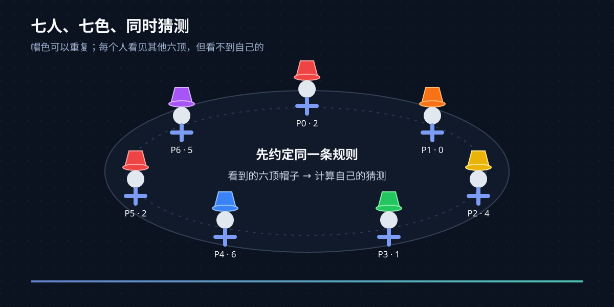
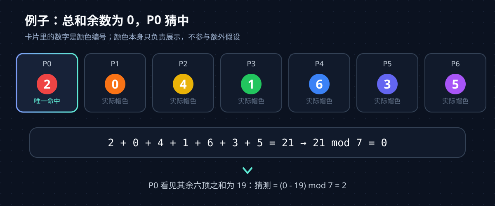
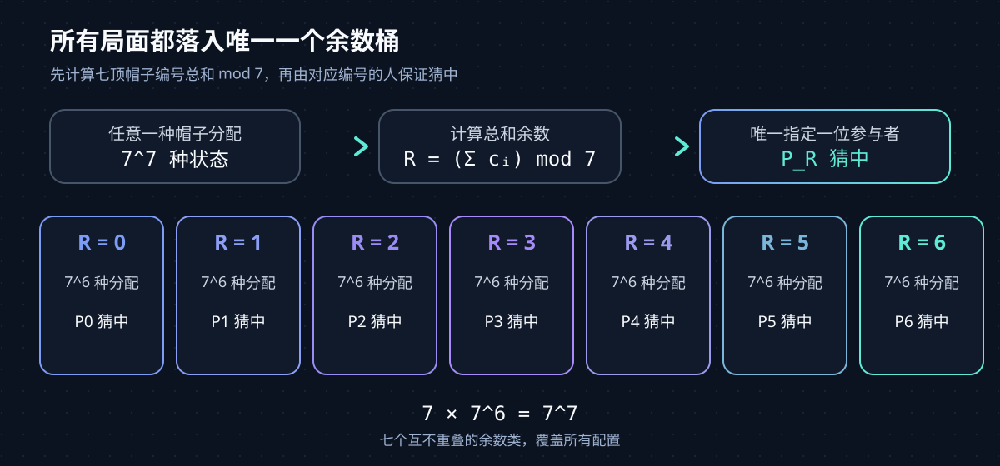
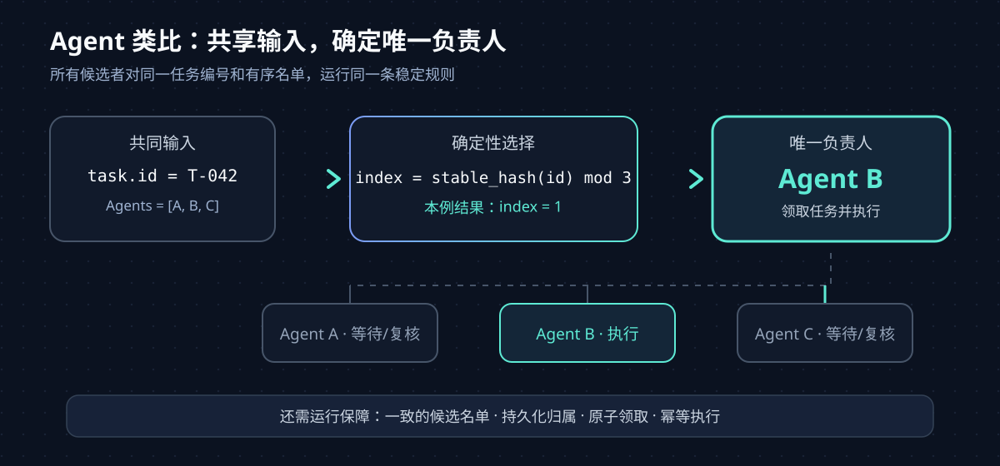

七个人同时猜自己帽子的颜色。每个人能看到另外六顶帽子，却看不到自己的；每顶帽子可能是七种颜色中的任意一种，颜色可以重复。七个人可以事先商量一套规则，但帽子戴上后不能交流。有没有一种策略，能保证无论帽子怎么分配，至少有一个人猜中？

有，而且这套策略能保证**恰好有一个人猜中**。关键是把颜色编号为 0 到 6，让每个人把自己看到的颜色加起来，再用模 7 规则决定自己的猜测。它把一个看似随机的谜题变成了一个确定性的组合问题。

## 一、先把题目边界说清楚

题目里有几个条件，少一个，问题就可能变成另一道题：

- **帽色可重复**：七个人都可能戴同一种颜色。若七顶帽子恰好各不相同，看到其他六顶的人会直接知道自己戴着剩下的颜色，谜题就失去关键难点。
- **只能看见别人**：每个人看见其他六人的帽子，但无法观察自己的帽子。
- **规则提前约定**：大家可以在帽子分配前制定策略；开始猜测后，每个人只能根据自己看见的信息行动。
- **同时猜测**：没有人能先猜一次，再把结果传给其他人。
- **成功条件**：帽子可以由出题者任意分配，目标是每一种分配至少有人猜中。

*图 1：谜题依靠的是有限视野和事先约定，不依赖任何人临场传话。*

这和“大家各自随机猜一次”不是同一个目标。随机猜测时，每个人猜中的概率为 1/7，七个人的期望正确人数是 1。

与此同时，七个人全部猜错的概率是 (6/7)^7，所以至少一人猜中的概率约为 66%。这仍是概率上的机会，不是对每一种帽子分配都成立的保证。

## 二、用余数给每个人分配一类局面

把七种颜色和七个人都依次编号为 0 到 6。模 7 运算就是把一个整数除以 7 后取余数。例如 19 除以 7 余 5；负数也按同一个余数类表示，所以 -19 mod 7 = 2。

现在给每个帽子编号一个变量：第 j 个人的帽色记作 c_j。编号为 i 的人能看到其余六个数，于是先算出可见帽色总和，再这样猜：

~~~text
第 i 个人的猜测 = (i - 其余六顶帽子的编号之和) mod 7
~~~

这条规则可以这样理解：编号为 i 的人假定“七顶帽子总和的余数应该是 i”，然后从这个目标里减去自己看见的六顶帽子，剩下的就是自己要猜的编号。每个人都采用同一条规则，只是各自的目标余数不同。

来看一组具体编号：

~~~text
P0  P1  P2  P3  P4  P5  P6
 2   0   4   1   6   3   5
~~~

七顶帽子的总和是 21，所以总和除以 7 的余数是 0。P0 看见其他六顶帽子的编号之和为 19，计算 (0 - 19) mod 7 = 2，正好猜中自己的帽子。图里的具体颜色只是编号示例，帽色重复时规则也照样成立。

*图 2：总和余数为 0 的这一局，由编号为 0 的参与者猜中。*

## 三、为什么任何分配都至少有一人猜中

把实际七顶帽子的总和除以 7 后的余数记作 R。R 只能是 0 到 6 中的一个数，因此七个人里一定有一位编号正好是 R 的参与者。

对编号为 i 的人来说，他猜中当且仅当：

~~~text
(i - 其余六顶帽子的和) mod 7 = 自己帽子的编号
~~~

把“其余六顶帽子的和”和“自己的帽子编号”合并，条件就等价于：

~~~text
i = (七顶帽子的实际总和) mod 7
~~~

因此，只有编号等于 R 的那个人会猜中；其他人的目标余数都不同，猜测也就不会命中。这个证明没有假设帽子随机、颜色均匀或帽子颜色互不相同，所以它覆盖了题目允许的所有分配。**不是“平均来说能赢”，而是每一种摆法都恰好产生一个正确猜测。**

还可以从“所有可能的局面如何被覆盖”来看这件事。七顶帽子每顶有七种颜色，共有 7^7 种分配。按总和的余数分类，每种余数恰好对应 7^6 种分配：任意固定前六顶帽子后，最后一顶的编号唯一决定总和余数。七个余数类正好覆盖全部局面：

~~~text
7 个余数 × 每个余数对应 7^6 种分配 = 7^7 种全部分配
~~~

余数 0 的局面交给 P0，余数 1 的局面交给 P1，以此类推。每一种配置只会落入一个余数类，也就只会指定一位必中的参与者。

*图 3：模 7 把整个状态空间分成七个互不重叠的成功区域。*

这个策略也解释了随机猜测里一个容易忽略的现象：随机猜时，期望正确人数同样是 1；模 7 策略没有增加期望值，而是把结果波动压到了零——无论帽子怎么放，正确人数始终是 1。它追求的是对所有帽子分配成立的保证。

## 四、七个人和七种颜色不是巧合

这个构造可以直接推广到 n 个人、n 种颜色。把颜色和人都编号为 0 到 n-1，编号为 i 的人猜：

~~~text
第 i 个人的猜测 = (i - 其余 n-1 顶帽子的编号之和) mod n
~~~

实际帽子总和模 n 后是唯一一个 r；编号为 r 的人必定猜中，其他人不会同时猜中。这里不要求 n 是素数，因为推导只用加法、减法和取余，没有除法，也不需要乘法逆元。

但这个公式有明确边界：人数和颜色数相同，而且每个人都能看到其他所有人的帽子。若只有部分人互相可见、帽子颜色数和人数不同，模 n 这套规则就不能直接套用。数学研究会把“谁能看见谁”表示成图，再研究不同图结构下能保证猜中的最大颜色数。图论、组合数学和编码理论都出现在这类帽子猜测问题的研究中；[Butler 等人的论文](https://www.cs.cornell.edu/~rdk/papers/Hats.pdf)讨论了确定性策略、局部可见信息以及它们与编码理论和去中心化计算模型的联系，[图上的帽子猜测研究](https://arxiv.org/abs/2107.05995)则把可见关系形式化为图。

## 五、它能给多 Agent 设计什么启发

帽子题能迁移到 Agent 系统里的核心思路，是一种协调方式：参与者先共享规则，再各自依据可见信息决策，使局部行为合起来满足全局目标。它可以启发“多个 Agent 如何选出一个任务负责人”，尤其适用于希望避免多个 Agent 重复执行同一操作的流程。

一种工程化做法是让所有 Agent 对同一个任务编号和候选列表运行稳定的选择规则：

~~~python
eligible = sorted(capable_agents(task))
if not eligible:
    return handoff_or_retry(task)

owner_index = stable_hash(task.id) % len(eligible)
owner = eligible[owner_index]
~~~

候选列表必须按固定规则排序，stable_hash 也必须在不同进程和运行时中得到相同结果。这样只要 Agent 共享相同的名单和任务编号，就会得到同一个负责人。负责人执行，其他 Agent 可以等待结果或承担复核。

*图 4：Agent 场景借用的是“共享规则产生协调结果”，具体路由算法与帽子题的猜测策略不同。*

这个例子是受帽子题启发的工程类比，不是把模 7 公式直接搬进 Agent。帽子题里的每个人看不见自己的帽子，却看得见其他人的；任务路由则通常依靠所有 Agent 共同读取任务编号和候选名单。两者的信息结构不同。多智能体系统研究中确实有人用编码和预先协调策略分析受限帽子猜测问题，例如 AAMAS 2019 的[《Cooperation via codes in restricted hat guessing games》](https://researchportal.hkust.edu.hk/en/publications/cooperation-via-codes-in-restricted-hat-guessing-games-2/)；这类工作提供的是理论模型，不等同于一套现成的生产调度方案。

接入系统时，还需要处理成员列表变化、负责人离线和任务重试。如果两个 Agent 看到的候选名单不同，它们可能各自选出负责人；如果负责人执行到一半崩溃，任务也可能卡住或被重复执行。通常要把负责人写入持久化状态，用原子领取或租约处理并发，并让有副作用的工具支持幂等调用。稳定规则能减少重复选择，可靠执行还要靠这些运行机制。

## 结语

七色帽子问题是一道组合数学谜题，也是一堂关于“保证”和“平均值”区别的短课。模 7 规则把每一种局面映射到唯一的成功者；迁移到 Agent 时，能带走的是先约定规则、再协调局部决策的设计思路，而具体系统仍要为状态变化和执行失败补上可靠性保障。
