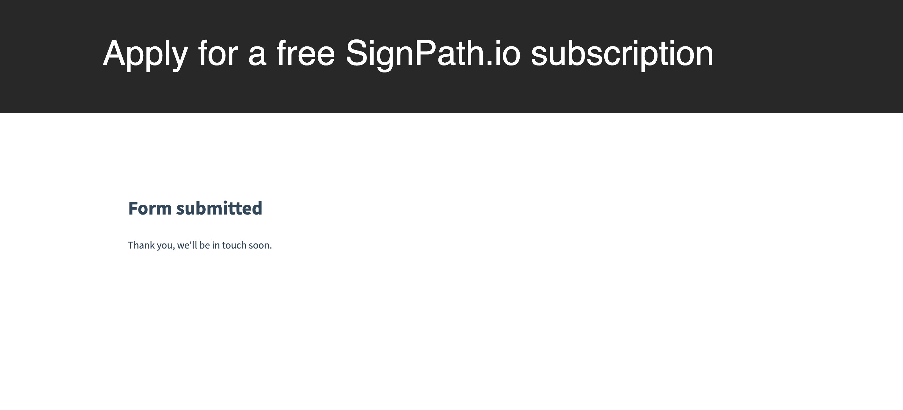

安装 KedaCode 的 Windows 版本时，屏幕上跳出一句「Windows 已保护你的电脑」。同一台电脑上装 Clash，却没有见到这个提示。两份安装包在 Windows 眼里有什么差别？这次从安装包本身查起，也给 KedaCode 提交了免费的签名申请。[KedaCode #396](https://github.com/ZataZhang/keda/issues/396)

## 两份未签名的安装包，为什么表现不同

检查 Clash Verge Rev 官方发布的 `Clash.Verge_2.5.10_x64-setup.exe` 时，发现它的 PE 证书表为空。这个结果只覆盖检查过的 x64 安装包。Release 旁边的 `.sig` 供 Tauri 应用内更新器验证更新包，Windows 查看发布者时用的是安装包上的 Authenticode 签名。[Clash Verge Rev 发布页](https://github.com/clash-verge-rev/clash-verge-rev/releases/tag/v2.5.10) · [项目签名讨论](https://github.com/clash-verge-rev/clash-verge-rev/issues/8471)

SmartScreen 会参考发布者信誉和具体文件哈希的信誉。未签名的安装包也可能随着下载记录积累获得信誉，重新构建后，新的文件哈希要重新积累。对同一台电脑上观察到的差异，文件信誉是一种可能的解释，具体判定依据无法从弹窗还原。「Windows 已保护你的电脑」这类提示也不足以判定文件感染了病毒。[微软 SmartScreen 信誉说明](https://learn.microsoft.com/windows/apps/package-and-deploy/smartscreen-reputation)

想确认手上的安装包有没有签名，可以直接用 PowerShell 检查原始文件。结果为 `Valid` 时，可以继续查看签名证书里的发布者。结果为 `NotSigned` 时，文件没有 Authenticode 签名。

```powershell
Get-AuthenticodeSignature .\kedacode-desktop-windows-x64-setup.exe
```

KedaCode 已为 Windows 安装包提供 GitHub 构建来源证明。它能把安装包关联到发布工作流和版本标签。Authenticode 能给 Windows 提供可验证的发布者身份，签完的首个版本仍可能遇到 SmartScreen 提示。另一个问题是部分 Windows 机器在下载安装包前就遇到 TLS 证书链错误，给 EXE 签名不会改变这段 HTTPS 下载过程。[KedaCode #396](https://github.com/ZataZhang/keda/issues/396) · [微软代码签名选项](https://learn.microsoft.com/en-us/windows/apps/package-and-deploy/code-signing-options)

## 为什么选 SignPath Foundation

KedaCode 已经用 GitHub Release 分发 Windows x64 NSIS 安装包，`kc desktop install` 也依赖这些发布资产。选方案时，我希望沿用现有的 EXE 下载入口，尽量少增加固定费用，同时让 GitHub Actions 负责构建和取回签好的文件。用户看到的弹窗是 SmartScreen 信誉提示，付费签名后的第一版依然可能弹窗，这也影响了我愿意为自动化花多少钱。[微软代码签名选项](https://learn.microsoft.com/en-us/windows/apps/package-and-deploy/code-signing-options)

| 方案 | 费用和日常操作 | 对 KedaCode 的影响 |
| --- | --- | --- |
| SignPath Foundation | 符合条件的开源项目可免费申请。每次 Windows 发布需要维护者批准签名 | 沿用 GitHub Release 和 NSIS，接受一次人工审批 |
| Azure Artifact Signing | 查询时 Basic 为每月 9.99 美元，约 120 美元一年。可接入 GitHub Actions 自动签名 | 省掉逐次审批，但有固定费用。Public Trust 个人申请目前限美国和加拿大 |
| Certum SimplySign 开源云签名 | 查询时官网标价 €49 起，需要身份验证 | 仍可发布 EXE。购买前要确认这个套餐能否在 GitHub 托管 runner 上无人值守签名 |
| Microsoft Store 的 MSIX 渠道 | MSIX 通过商店审核后由微软签名 | 需要新增打包和商店发布流程，收益覆盖从商店安装的用户 |

价格和资格以各家页面为准。[SignPath 条款](https://signpath.org/terms) · [Azure 定价](https://azure.microsoft.com/en-in/products/artifact-signing) · [Azure 申请资格](https://learn.microsoft.com/en-us/azure/artifact-signing/quickstart) · [Certum 价格](https://shop.certum.eu/buy-a-code-signing-certyficate) · [微软商店签名说明](https://learn.microsoft.com/en-us/windows/apps/package-and-deploy/code-signing-options)

最终选 SignPath，是因为当前愿意用每次点一次批准换掉固定订阅费，同时保留用户已经在用的下载路径。Azure 多花的钱主要买发布自动化，等 Windows 发版频率高到审批经常卡住发布，再重新算这笔账。Certum 的疑点在于买到证书之后还要怎么签，官方标价本身无法回答是否能全自动。商店方案则涉及分发渠道的变化，GitHub 上的 EXE 仍需单独解决发布者签名。

SignPath 的签名证书在基金会名下，审批也分两步。第一次是基金会审核项目资格。获批之后，每次新的 Windows 构建产物提交签名，指定维护者再批准这一批文件。GitHub 上公开 Release 是后续的发布操作。[SignPath Foundation 条款](https://signpath.org/terms)

## 申请表实际怎么填

这次在 Edge 打开 SignPath Foundation 的免费订阅申请页，用 Computer Use 预填公开资料。表单问的是一个已经发布的开源项目，所以我先准备了仓库、已有安装包的发布页和公开 issue 记录。申请的目标是 KedaCode 的 Windows x64 NSIS 安装包 `kedacode-desktop-windows-x64-setup.exe`。[申请表](https://signpath.org/apply.html) · [KedaCode 发布页](https://github.com/ZataZhang/keda/releases)

1. **填写项目身份。** Project Name 填 `KedaCode`。Repository URL 和 Homepage URL 都用公开 GitHub 仓库，表单接受仓库页作为项目首页。Download URL 在这版表单里是选填，提示所填页面应说明 SignPath 签名。我们预填时把已有发布页放在 Reputation 里，作为已分发 Windows 安装包的证据。[KedaCode 仓库](https://github.com/ZataZhang/keda)
2. **填写项目简介和信誉材料。** Tagline 用一句英文说明用途，`An open-source tool for managing AI coding agents and their work on GitHub issues.` Description 再补充如何围绕 GitHub issue 组织工作、跟踪 Agent 运行和查看结果。Reputation 提供公开 Releases 和 issue tracker，让审核者能查到发行产物和公开反馈。审核是否认可这些材料，要等基金会回复。[KedaCode Releases](https://github.com/ZataZhang/keda/releases) · [公开 issue](https://github.com/ZataZhang/keda/issues)
3. **补齐表单分类和构建信息。** Category 是必填，按项目主要用途选择。Build System 选 GitHub Actions，对应现有 Windows 发布工作流。Primary Discovery Channel 也是必填，按实际发现渠道填写，具体来源链接是选填。这次讨论 SignPath 的起点是 KedaCode 的 Windows 安装问题单。[发布工作流](https://github.com/ZataZhang/keda/blob/main/.github/workflows/release.yml) · [KedaCode #396](https://github.com/ZataZhang/keda/issues/396)
4. **填维护者联系方式并确认条款。** First Name、Last Name 和 Email 都是必填。邮箱用于账户和申请通知。提交前要确认接受基金会行为准则，以及允许 SignPath 处理申请所需的个人信息。额外推广邮件是独立选项。[基金会行为准则](https://signpath.org/terms) · [SignPath 隐私政策](https://signpath.io/privacy-policy)
5. **确认提交回执。** 页面显示 `Form submitted` 后，流程进入等待项目审核的阶段。下面是这次实际提交后的页面。



基金会还要求项目在首页和下载或发布页面列出或链接到代码签名政策，并说明团队角色和隐私政策。如果软件收集用户数据，申请表也要求提供隐私政策链接。准备这些材料时应以产品实际行为为准。[基金会项目要求](https://signpath.org/terms)

截至 2026 年 11 月 19 日，申请已提交，正在等待审核。获批后，发布流水线需要先完成 Authenticode 签名，再为最终分发的文件生成来源证明和 SHA256 校验值。这样用户下载到的文件才能与两份验证材料对应。
