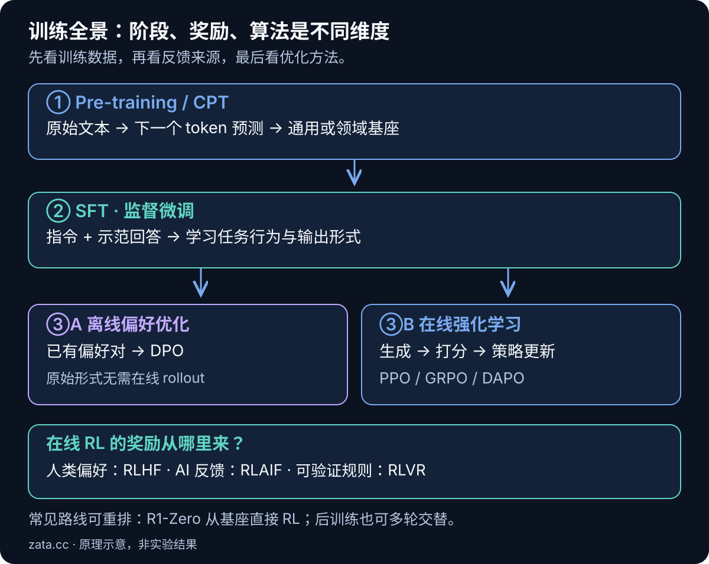
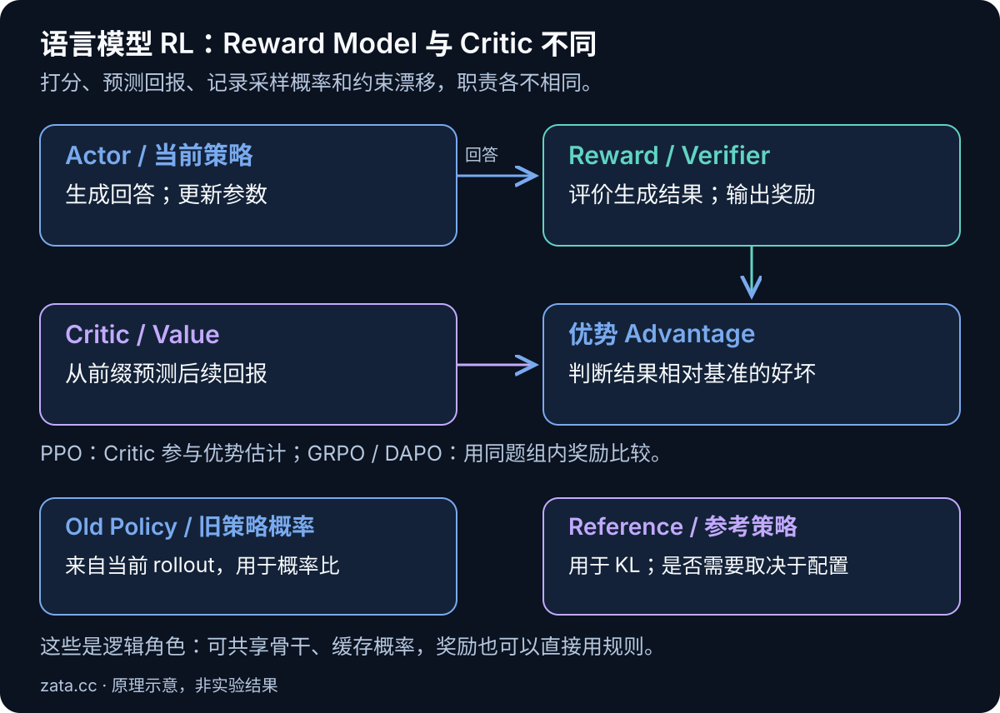
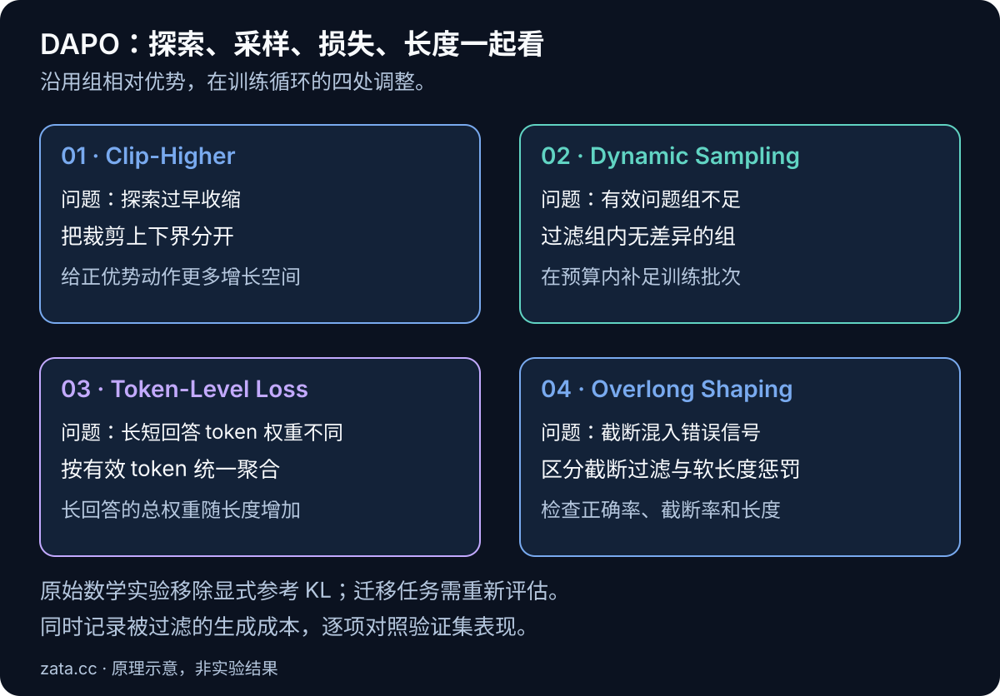

同一道题「17 × 23 等于多少」，可以用三种方式训练模型：给它看包含计算过程的文本，让它预测后面的 token；提供一份标准回答，让它学习如何回答；让它自己生成多份解答，再根据对错调整生成概率。这三种方式，分别对应预训练、监督微调，以及基于奖励的强化学习。

它们都能改变模型参数，区别在于训练数据如何产生、监督信号来自哪里、优化目标是什么。把这条线理清，再看 RLHF、PPO、GRPO、DAPO，就能知道每个名词在训练系统里负责哪一部分。

本文面向理解 Transformer 基本概念、希望建立大模型训练知识体系的读者。先讲直觉，再给公式和工程细节；公式中的示例数据均为教学构造，不代表真实模型实验结果。讨论以自回归语言模型为主，算法解释对应文末列出的原始论文版本，不把某个框架的默认配置当成算法的唯一定义。

## 一、先把训练阶段、奖励来源和优化算法分开

### 1.1 一条常见路线：预训练 → SFT → 偏好或奖励优化

预训练（Pre-training）通过大规模文本建立语言、知识和模式识别能力，产出通常称为 Base Model 的基座模型。监督微调（Supervised Fine-tuning，SFT）使用指令与示范回答，让模型适应问答、代码生成、工具调用等任务。后续可以用偏好数据或可验证奖励继续优化行为。

后训练（Post-training）通常包含 SFT、偏好优化和强化学习等环节；Fine-tuning 的广义含义是在已有模型上继续训练，因此 RL fine-tuning 也属于微调。日常说「做一次微调」时，人们常特指 SFT，阅读资料时需要看上下文。



*图 1：SFT、DPO、在线 RL 是后训练中的不同训练方式。RLHF/RLVR 描述奖励来源，PPO/GRPO/DAPO 描述策略更新方式。*

这条路线可以有分支、循环或阶段重排。比如 DeepSeek-R1-Zero 从预训练基座直接开始 RL；DeepSeek-R1 则引入冷启动 SFT，并在后续结合 RL、拒绝采样和 SFT。它们说明「先做 SFT」是常见工程选择，不能当作所有 RL 训练的必要条件。[DeepSeek-R1 技术报告 §2](https://arxiv.org/html/2501.12948v1#S2)

### 1.2 这些词回答的是不同问题

| 维度 | 名词 | 回答的问题 |
| --- | --- | --- |
| 训练阶段与方式 | Pre-training、SFT、Post-training | 现在用什么数据和目标训练？ |
| 反馈来源 | RLHF、RLAIF、RLVR | 谁来判断输出好不好？ |
| 优化方法 | PPO、GRPO、DAPO、DPO | 怎样把监督信号转成参数更新？ |
| 参数更新范围 | 全参数微调、LoRA、QLoRA | 哪些参数参与更新，怎样节省内存？ |

RLHF 是 Reinforcement Learning from Human Feedback，奖励建立在人类反馈之上；RLAIF 使用 AI 反馈；RLVR 通常指 Reinforcement Learning with Verifiable Rewards，使用答案校验器、单元测试等可验证信号。

GRPO 可以接人类偏好训练出的奖励模型，也可以接数学答案校验器。前者可用于 RLHF，后者通常归入 RLVR。**算法叫 GRPO 或 DAPO，并不能单独说明奖励来自人类。**

## 二、Pre-train：从预测下一个 token 学到什么

### 2.1 数据里的后一个 token 就是标签

Token 是分词器处理文本后的基本单元，可能是一部分单词、一个汉字、符号或其他片段。自回归语言模型根据已有前缀预测下一个 token，再依次生成整段文本。GPT-3 是这一训练范式的代表性工作。[GPT-3 论文 §2](https://arxiv.org/html/2005.14165v4#S2)

把一段文本记为 \(x_1,\ldots,x_T\)，简化的预训练损失为：

$$
\mathcal{L}_{\mathrm{PT}}(\theta)
=-\mathbb{E}_{x\sim\mathcal{D}_{\mathrm{PT}}}
\left[\sum_{t=1}^{T}\log p_\theta(x_t\mid x_{\lt t})\right].
$$

\(\theta\) 是模型参数；\(p_\theta\) 是预测概率；\(x_{\lt t}\) 是当前位置之前的上下文。负对数概率越小，说明模型对真实下一个 token 给出的概率越高。实际实现还要处理有效位置的平均、padding、文档边界等问题。

例如语料里出现：

```text
17 × 23 = 17 × (20 + 3) = 340 + 51 = 391。
```

模型在不同位置分别学习接下来更可能出现什么。这里用完整字符展示含义，真实 token 边界由 tokenizer 决定。标签从文本本身构造，所以预训练属于自监督学习；「没有人工逐条标答案」不等于「没有监督信号」。

训练时通常使用 teacher forcing：每个位置看到的前缀来自真实训练文本。借助因果注意力掩码，一次前向传播可以计算多个位置的损失；推理时则逐步接上模型自己生成的 token。这种上下文来源的差异会影响误差如何累积。

### 2.2 为什么一个预测任务能产生广泛能力

要在大量不同上下文中准确预测后文，模型需要利用词法、语法、事实关联、代码结构和推理模式。预测目标提供了学习这些模式的压力，但目标本身没有规定「事实一定正确」「必须服从用户」「回答要简洁」。训练文本中的错误、偏见和不良模式也可能被学习。

因此，预训练模型可能知道问答是什么，也能在合适提示下完成任务，但输出风格未必稳定。输入「请解释梯度下降」，它可能回答，也可能继续写出一份试卷里的下一道题：两种续写都可能符合某些训练文本。

### 2.3 预训练的难点在数据与系统

- **数据质量。** 去重、过滤低质量文本、处理敏感信息、控制来源混合比例，都影响模型学到什么；评测题泄漏会让能力估计失真。
- **训练规模。** 参数量、训练 token 数和计算预算需要共同规划，不能只看模型有多少 B 参数。
- **计算组织。** 大模型训练通常涉及混合精度、梯度检查点以及数据、张量或流水线并行，重点是让显存、通信和计算配合起来。
- **持续评测。** 验证损失下降说明更能拟合对应文本分布，仍需单独测数学、代码、事实性和其他目标能力。

已有基座上继续用领域原始文本训练，常称继续预训练（Continued Pre-training，CPT）或领域自适应预训练。它适合补充领域语言和模式，但需要防止遗忘其他能力。DeepSeekMath 就包含从已有代码基座继续进行数学相关预训练的阶段。[DeepSeekMath §2](https://arxiv.org/html/2402.03300v3#S2)

## 三、Fine-tune：SFT 如何让模型学会按要求回答

### 3.1 从一般文本换成任务示范

SFT 数据通常包含输入 \(q\) 和期望回答 \(y^*\)。同一道题可以写成：

```json
{
  "messages": [
    {"role": "user", "content": "计算 17 × 23，并说明步骤。"},
    {"role": "assistant", "content": "17 × 23 = 17 × (20 + 3) = 340 + 51 = 391。"}
  ]
}
```

模型依然在预测 token，只是训练分布变成了「收到这类指令时，应当给出这类回答」。对话模板中的角色边界和结束符也需要正确编码。[InstructGPT 的 SFT 阶段](https://arxiv.org/html/2203.02155v1#S3.SS1)

简化的回答区损失是：

$$
\mathcal{L}_{\mathrm{SFT}}(\theta)
=-\mathbb{E}_{(q,y^*)\sim\mathcal{D}_{\mathrm{SFT}}}
\left[\sum_{t=1}^{|y^*|}\log\pi_\theta(y_t^*\mid q,y_{\lt t}^*)\right].
$$

这里将语言模型写成 \(\pi_\theta\)，为后面的策略表示做准备。很多对话 SFT 实现只对 assistant 回答区计算损失，用 loss mask 排除用户输入和 padding；也有配置会训练整段序列。训练前应检查实际 mask，避免输入模板与训练目标不一致。

### 3.2 SFT 的能力和边界

SFT 直接鼓励模型复现示范回答中的模式，适合学习固定 JSON 结构、任务流程、工具调用格式、领域术语和回答风格。示范中包含可靠的新知识与解题过程时，也可以改变相应知识和能力表现。

不过，单个示范不能覆盖所有合理回答。对一道题，直接乘法、拆分计算、编写程序可能都正确，而训练样本只展示了一种。模型照着写得很像，仍不代表它在新题上能独立求解，也不代表生成结果一定有效。

整理训练集时，要把「文字风格是否相似」和「任务是否成功」分开评估。训练 loss 变低但新题准确率下降，可能意味着过拟合、数据泄漏或任务分布不匹配。

### 3.3 全参数微调、LoRA 和 QLoRA 是另一条轴

全参数微调更新模型的全部或大部分参数。LoRA 冻结原权重，在选定层加入可训练的低秩增量，例如：

$$
W'=W_0+\Delta W,\qquad \Delta W=BA,
$$

其中 \(W_0\in\mathbb{R}^{d_{out}\times d_{in}}\)、\(B\in\mathbb{R}^{d_{out}\times r}\)、\(A\in\mathbb{R}^{r\times d_{in}}\)，且 \(r\) 远小于输入、输出维度。为突出结构，这里省略常见的缩放系数。[LoRA 原论文](https://arxiv.org/abs/2106.09685)

QLoRA 在冻结的量化基座上训练 LoRA 适配器，原论文使用 4-bit 基座存储等技术降低内存开销。反向传播仍需要计算，不能理解为所有训练运算都用 4-bit 完成。[QLoRA 原论文](https://arxiv.org/abs/2305.14314)

SFT 决定训练目标，LoRA 决定参数化方式，两者可以组合；LoRA 也可以用于适配的偏好优化或 RL 训练。它能减少可训练参数、梯度和优化器状态，但基座前向、激活、RL 的生成与 KV cache 等成本仍然存在。

## 四、RLHF：用人类偏好训练一个可优化的目标

### 4.1 为什么有示范以后还需要偏好数据

对于开放问答，人们往往能判断两份回答谁更有帮助，却难以写出唯一标准答案。比如两份回答都算出 391，但其中一份解释清楚，另一份重复多段无关内容；对更复杂任务，还涉及相关性、诚实性、可读性等维度。

经典 RLHF 用人类比较数据学习这些偏好，再利用奖励信号优化语言模型。InstructGPT 的代表性流程为 SFT、比较数据与奖励模型训练、PPO 策略优化。[InstructGPT §3](https://arxiv.org/html/2203.02155v1#S3)

### 4.2 训练奖励模型：学习哪份回答更受偏好

偏好数据常写成 \((q,y_w,y_l)\)：同一个问题，\(y_w\) 是被选中的回答，\(y_l\) 是另一份回答。奖励模型 \(r_\phi(q,y)\) 接收问题和回答，输出一个分数。常见的成对偏好损失为：

$$
\mathcal{L}_{\mathrm{RM}}(\phi)
=-\mathbb{E}_{(q,y_w,y_l)}
\left[\log\sigma\big(r_\phi(q,y_w)-r_\phi(q,y_l)\big)\right],
$$

其中 \(\sigma\) 是 sigmoid 函数。优化会让被偏好的回答比分较高；训练信号主要约束分数差，不能直接把单个分数解释成「真实质量的百分比」。[InstructGPT §3.5](https://arxiv.org/html/2203.02155v1#S3.SS5)

人类通常在离线阶段提供示范、比较与抽检，后续大量 rollout 可以由奖励模型自动打分。RLHF 并不要求每次参数更新都等待人类实时评分。

### 4.3 用奖励优化策略，并控制分布漂移

给定问题，模型生成回答，奖励模型评分，然后训练算法更新语言模型。一个常见的抽象目标是：

$$
J(\theta)=\mathbb{E}_{q}
\left[
\mathbb{E}_{y\sim\pi_\theta(\cdot\mid q)}r_\phi(q,y)
-\beta D_{\mathrm{KL}}\big(\pi_\theta(\cdot\mid q)\Vert\pi_{ref}(\cdot\mid q)\big)
\right].
$$

KL 散度衡量两个概率分布的差异；\(\pi_{ref}\) 通常来自后训练起点的一份冻结参考策略。\(\beta\) 控制奖励与偏离代价之间的权衡。上式按完整回答分布书写，工程里经常使用 token 级估计来计算。[InstructGPT 的 RL 阶段](https://arxiv.org/html/2203.02155v1#S3.SS5)

KL 惩罚可以抑制过度偏离，但无法保证回答事实正确或行为安全。奖励模型也可能把「显得很自信」「写得更长」当作质量线索，模型随后放大这些模式，形成 reward hacking，即利用评分器缺陷获取高分。

### 4.4 RLHF、RLAIF 与 RLVR 怎样选奖励

| 反馈形式 | 典型信号 | 需要检查的局限 |
| --- | --- | --- |
| 人类偏好 | 人工比较回答，再训练奖励模型 | 标注一致性、专业性与价值取向 |
| AI 反馈 | 模型裁判打分或生成偏好 | 裁判偏差、同源偏差、评分提示依赖 |
| 可验证奖励 | 数学等价性、代码测试、环境成功条件 | 校验器覆盖率、解析错误、可被利用的漏洞 |

这些信号可以混合。代码通过几个公开测试，只能证明通过这些测试；数学最终答案正确，也不能保证每一步推理都成立。奖励设计必须明确：它验证的是结果、过程，还是表达偏好。

## 五、PPO：先理解策略、优势和裁剪

### 5.1 把文本生成看作连续决策

在语言模型 RL 中，状态 \(s_t\) 可以表示为问题加上已生成前缀，动作 \(a_t\) 是下一个 token，策略 \(\pi_\theta(a_t\mid s_t)\) 是词表上的概率分布。一份完整回答对应一条轨迹；采样轨迹的过程通常叫 rollout。

很多任务在回答结束时才给一个结果奖励。问题随之出现：整段回答拿到一分，该怎样调整中间每个 token 的概率？策略梯度通过对采样动作的对数概率求导，把奖励信号转成更新方向。一个帮助理解的基本形式是：

$$
\nabla_\theta J
\approx\mathbb{E}\left[\sum_t\hat A_t\nabla_\theta\log\pi_\theta(a_t\mid s_t)\right].
$$

优势 \(\hat A_t\) 表示相对基准的好坏。它为正时，更新倾向于提高对应采样动作的概率；为负时，倾向于降低。神经网络参数共享、softmax 归一化和优化约束会共同影响结果，不能据此断言每个 token 概率都严格单调变化。

### 5.2 Reward Model 与 Critic 的职责不同

经典 PPO 的 actor-critic 实现通常训练价值函数 \(V_\psi(s_t)\)，估计从当前状态继续生成的预期回报，再结合奖励计算优势；GAE（广义优势估计）是常见方法。



*图 2：奖励模型判断已经产生的回答，Critic 预测前缀之后的回报；旧策略提供采样概率，参考策略用于衡量漂移。*

| 组件 | 职责 | 典型状态 |
| --- | --- | --- |
| Actor / Policy | 生成回答，学习策略 | 更新参数 |
| Reward Model / Verifier | 给回答打分或验证结果 | RL 阶段通常固定，也可按阶段更新 |
| Critic / Value | 从前缀估计后续回报 | PPO 中常训练；GRPO 不需要独立 Critic |
| Reference Policy | 提供 KL 约束的参照 | 一个训练阶段内通常冻结 |

另有 \(\pi_{old}\)，它对应生成当前这批样本的策略；优化期间保留它的采样 log-prob。它与参考模型作用不同：旧策略随 rollout 批次刷新，参考模型可以在更长时间内保持不变。

这里描述的是逻辑角色。实现可以共享骨干、使用不同大小的模型、缓存 log-prob，或者通过规则打分省去神经奖励模型。不能把「PPO 必须同时加载四个完整大模型」当作算法定义。

### 5.3 裁剪目标怎样限制过度更新

PPO 比较当前策略与采样旧策略对同一个 token 的概率，得到比值：

$$
\rho_t(\theta)=\frac{\pi_\theta(a_t\mid s_t)}{\pi_{old}(a_t\mid s_t)}.
$$

典型的 PPO-Clip 最大化目标是：

$$
J_{\mathrm{clip}}(\theta)=
\mathbb{E}\left[
\min\left(
\rho_t\hat A_t,
\operatorname{clip}(\rho_t,1-\epsilon,1+\epsilon)\hat A_t
\right)\right].
$$

对于正优势动作，概率涨过上界后，目标不再继续奖励同一方向的增加；对于负优势动作，概率降过下界后，同一方向的下降也不再得到更多收益。这允许对一批 rollout 做多次小批量优化，同时减少过激更新的动机。[PPO 原论文](https://arxiv.org/abs/1707.06347)

裁剪不是给模型概率装了一个硬限位器。其他 token 的梯度、共享参数和优化器状态仍可能让概率越界；它也不提供严格的全局 KL 上限。PPO clipping 主要比较当前与旧策略，参考模型 KL 比较当前与参考策略，二者不能互相替代。

## 六、GRPO：用同题多份回答代替独立 Critic

### 6.1 组内比较怎样产生优势

GRPO（Group Relative Policy Optimization，组相对策略优化）由 DeepSeekMath 提出。它对同一个问题采样一组回答，用组内奖励估计基准，省去独立价值模型。[DeepSeekMath §4.1](https://arxiv.org/html/2402.03300v3#S4.SS1)

设同一题生成 \(G\) 份回答，奖励为 \(R_1,\ldots,R_G\)，结果奖励版本的优势可以写为：

$$
\bar R=\frac{1}{G}\sum_iR_i,\qquad
\hat A_i=\frac{R_i-\bar R}{\operatorname{std}(R_1,\ldots,R_G)+\delta}.
$$

\(\delta\) 是实现中常用的数值稳定小量，避免除零。本文用总体标准差演示；某些实现使用样本标准差，优势的具体数值会随约定变化。

仍然使用「17 × 23」，假设四份回答分别算出 391、381、391、401。按对错给奖励：

```text
奖励 R       = [1, 0, 1, 0]
组内均值     = 0.5
总体标准差   = 0.5
优势 A       ≈ [+1, -1, +1, -1]
```

两份正确回答得到正优势，错误回答得到负优势。对于这种结果监督，常把同一回答的 \(\hat A_i\) 赋给其有效生成位置，写成 \(\hat A_{i,t}=\hat A_i\)。这提供了序列层面的信用信号，不能精确指出哪一步算式导致成功；过程监督版本可以采用不同的 token 或步骤优势。

### 6.2 原始 GRPO 的更新目标

把裁剪项缩写为：

$$
\ell_{i,t}=\min\left(
\rho_{i,t}\hat A_i,
\operatorname{clip}(\rho_{i,t},1-\epsilon,1+\epsilon)\hat A_i
\right).
$$

用 \(T_i\) 表示第 \(i\) 份回答的有效 token 数，原始 GRPO 的单组目标可概括为：

$$
J_{\mathrm{GRPO}}=
\frac{1}{G}\sum_{i=1}^{G}\frac{1}{T_i}
\sum_{t=1}^{T_i}\left(\ell_{i,t}-\beta K_{i,t}\right).
$$

这里省略对问题与采样回答的外层期望，\(K_{i,t}\) 表示对应位置的参考策略 KL 惩罚估计。原始方案先在每份回答内平均，再对回答平均，且将 KL 正则直接加入目标。[DeepSeekMath 公式 3–6](https://arxiv.org/html/2402.03300v3#S4.SS1)

GRPO 去掉的是独立 Critic，奖励来源依然需要存在。若采用可验证规则奖励，可以没有独立神经奖励模型；若 \(\beta=0\) 且没有其他参考约束，也可能不需要参考模型前向。具体资源由训练方案决定。

### 6.3 全对、全错为什么都可能没有学习信号

如果奖励分别为 `[1, 1, 1, 1]` 或 `[0, 0, 0, 0]`，每个回答减去组均值后都是零，加入稳定小量后优势仍为零。这时来自该组优势的策略梯度为零；如果还有 KL、熵奖励或其他辅助项，整体梯度未必为零。

这意味着题目难度要与当前模型匹配。题太简单，组内全对；题太难，采样预算内全错，都可能得不到有区分度的相对信号。增加组大小有机会找到不同结果，也会增加生成成本，且不能保证解决所有困难问题。

此外，按组标准差归一化会改变不同问题对训练的相对影响。组大小、奖励尺度、难度分布、长度归一化方式都需要一起观察。GRPO 省去 Critic 后，仍然需要多回答 rollout，不能直接推出整体训练一定更便宜或更稳定。

## 七、DAPO：围绕长推理训练修补四类问题

DAPO 的全称是 Decoupled Clip and Dynamic sAmpling Policy Optimization，可理解为解耦裁剪与动态采样策略优化。它沿用组相对优势思路，围绕长推理 RL 中的探索、有效样本、损失权重和截断噪声进行调整。[DAPO 原论文](https://arxiv.org/html/2503.14476v1)



*图 3：DAPO 的几项改动作用于训练循环的不同位置，复现时要同时核对采样、目标函数和奖励处理。*

### 7.1 Clip-Higher：把裁剪上下界分开

对称裁剪使用 \([1-\epsilon,1+\epsilon]\)。DAPO 改为：

$$
[1-\epsilon_{low},\;1+\epsilon_{high}],
\qquad\epsilon_{high}\gt \epsilon_{low}.
$$

例如论文设置 \(\epsilon_{low}=0.2\)、\(\epsilon_{high}=0.28\)，对应比值区间 `[0.8, 1.28]`。扩大上侧范围，为正优势、低概率的采样动作留下更多提升空间。[DAPO §3.1](https://arxiv.org/html/2503.14476v1#S3.SS1)

用一个教学例子理解：旧概率为 0.05 的动作，在上侧比值 1.2 处对应新概率 0.06，在 1.28 处对应 0.064。单次绝对变化仍然很小，但目标继续鼓励增长的范围变大。这里说的是裁剪收益开始饱和的位置，不是概率绝不能超过的上限。

它旨在缓解策略过早变得单一的现象。熵衡量分布的不确定性，下降过快时可生成的回答可能越来越相似；但提高熵本身也不是任务目标，仍要检查准确率、重复率和输出长度。

### 7.2 Dynamic Sampling：补足有区分度的问题组

对于二值正确性奖励，原始 DAPO 保留组内有对有错的问题，即：

$$
0\lt \sum_{i=1}^{G}\mathbf{1}[y_i\text{ 正确}]\lt G.
$$

全对、全错的组在这一设置下不提供相对优势信号，因此先过滤，再继续生成其他组，直到凑足目标训练批次。verl 的配方允许按指定指标过滤组内指标完全相同的组，并设置最大生成批次数。[verl DAPO 动态采样说明](https://verl.readthedocs.io/en/v0.4.0/algo/dapo.html#dynamic-sampling-with-group-filtering)

这会消耗额外采样预算，也会改变被选中问题的分布。若绝大多数题都全错，模型可能基础不足、题目过难、答案解析有误，继续无限重采样并不能解决原因。应设置生成预算，并记录过滤比例、有效组数与实际采样 token 数。

采用连续奖励或混合长度惩罚时，「准确率相同」与「总奖励相同」可能不同，过滤依据需要与实现一致，不能直接套用二值奖励的解释。

### 7.3 Token-Level Loss：改变长短回答的相对权重

原始 GRPO 的聚合可简写为「回答内平均，再对回答平均」：

$$
J_{seq}=\frac{1}{G}\sum_i\frac{1}{T_i}\sum_t\ell_{i,t}.
$$

DAPO 改为按有效 token 统一平均：

$$
J_{token}=\frac{\sum_i\sum_t\ell_{i,t}}{\sum_i T_i}.
$$

设同组两份回答分别有 100 和 900 个有效 token。前一种聚合下，每份回答的总权重都是一半，短回答中每个 token 的系数是长回答的九倍；后一种聚合下，每个 token 系数相同，两份回答的总权重分别为 10% 和 90%。这是损失聚合系数的比较，实际梯度还取决于优势与概率导数。

所以差别在 token 损失怎样汇总，原始 GRPO 本来就在 token 位置计算概率比。长回答得到更多总权重，也可能放大长而差的样本影响，效果仍依赖奖励与数据。[DAPO §3.3](https://arxiv.org/html/2503.14476v1#S3.SS3)

在实际 minibatch 中，token-mean 一般对整个小批量的有效生成 token 聚合；分布式与梯度累积时也要保持分母一致。分别求多个不等长 microbatch 的平均再平均，未必等于全局 token 平均。[verl 的损失聚合实现](https://verl.readthedocs.io/en/v0.4.0/algo/dapo.html#flexible-loss-aggregation-mode-token-level-loss)

### 7.4 Overlong Reward Shaping：减少长度上限带来的错误信号

模型可能正在做有效推理，却因为碰到生成长度上限而被截断。若把所有截断一律当作数学解答错误，会混入「推理方向不好」与「预算不够」两类信号。

DAPO 研究过屏蔽截断回答损失的 Overlong Filtering，也提出靠近长度上限时逐渐扣分的 Soft Overlong Punishment。两种处理应区分；官方 verl 配方说明，很多实验使用软长度惩罚，并没有同时实施截断过滤。[DAPO §3.4](https://arxiv.org/html/2503.14476v1#S3.SS4)、[verl 配方说明](https://verl.readthedocs.io/en/v0.4.0/algo/dapo.html#configuration)

设 \(L_{max}\) 是硬生成上限，\(L_{cache}\) 是软惩罚区间长度，在可生成范围内可写为：

$$
R_{length}(y)=
\begin{cases}
0,&|y|\le L_{max}-L_{cache},\\
-\dfrac{|y|-(L_{max}-L_{cache})}{L_{cache}},
&L_{max}-L_{cache}\lt |y|\le L_{max}.
\end{cases}
$$

例如硬上限为 1,000 token，最后 200 token 作为软惩罚区：长度 800 时不扣分，900 时扣 0.5，1,000 时扣 1。该教学设置只说明连续惩罚的形状，实际还要设置系数，并明确如何与正确性奖励相加。

长度惩罚也会改变模型行为，过强可能压制必要的长推理。应同时观察截断率、正确率与长度分布，不能单凭平均长度下降判断训练改善。

### 7.5 把 DAPO 的目标连起来看

省略外层期望，用单组回答展示其核心目标：

$$
J_{\mathrm{DAPO}}=
\frac{1}{\sum_iT_i}
\sum_i\sum_{t=1}^{T_i}
\min\left(
\rho_{i,t}\hat A_i,
\operatorname{clip}(\rho_{i,t},1-\epsilon_{low},1+\epsilon_{high})\hat A_i
\right).
$$

组优势基于实际训练奖励计算；动态采样决定哪些组进入更新，长度处理决定部分奖励与有效损失位置。原始 DAPO 在其数学推理实验中移除了显式参考模型 KL 项；迁移到需要保持对话风格或其他行为约束的任务时，仍需重新评估是否保留 KL。[DAPO §2.3 与 §3](https://arxiv.org/html/2503.14476v1#S2.SS3)

论文报告在 Qwen2.5-32B 上取得 AIME 2024 的 50 分，指标为重复采样后的 avg@32；这与「32 次中至少一次做对」的 pass@32 不同。它是特定数据、系统与训练配方下的作者实验，不能据此断言 DAPO 在所有任务上都优于 GRPO，或把减少训练步数直接换算成相同比例的 GPU 成本节省。[DAPO §4](https://arxiv.org/html/2503.14476v1#S4)

## 八、DPO 放在哪里：直接用偏好对优化策略

DPO（Direct Preference Optimization，直接偏好优化）与 DAPO 名称相近，训练方式有明显区别。原始 DPO 使用已有的 \((q,y_w,y_l)\) 数据，直接训练策略，不单独拟合显式奖励模型，也不在每个训练批次里在线生成 rollout。[DPO 原论文](https://arxiv.org/html/2305.18290v2)

其典型损失为：

$$
\mathcal{L}_{\mathrm{DPO}}=
-\mathbb{E}\log\sigma\left[
\beta\left(
\log\frac{\pi_\theta(y_w\mid q)}{\pi_{ref}(y_w\mid q)}
-\log\frac{\pi_\theta(y_l\mid q)}{\pi_{ref}(y_l\mid q)}
\right)\right].
$$

这里的序列 log-prob 通常是回答各 token 条件 log-prob 之和。DPO 提高被偏好回答相对落选回答的、经参考策略校正的概率优势；不能保证每对样本中好回答的绝对概率都上涨、坏回答都下降。

它是偏好优化方法，与经典在线 RLHF 共享相关的目标建模思路，但没有 PPO/GRPO 式的在线采样—打分—策略更新循环。原始离线 DPO 所用回答可以提前由模型生成，后续也可通过迭代采样刷新数据；这与原始 DPO 单次训练流程要分开讨论。

| 方法 | 训练主要输入 | 优化特点与代价 |
| --- | --- | --- |
| SFT | 输入与示范回答 | 学习示范，成本主要在前后向训练 |
| DPO | 同题偏好回答对 | 原始形式离线训练，依赖偏好数据覆盖 |
| PPO | 问题、在线回答与奖励 | 常训练价值函数，配合裁剪更新 |
| GRPO | 同题多回答及其奖励 | 用组内比较替代独立 Critic |
| DAPO | 同题多回答及其奖励 | 调整裁剪、组筛选、聚合与长度处理 |

PPO、GRPO、DAPO 都能根据当前策略产生新样本，DPO 则通常更容易从固定偏好集起步。哪种方法更合适，取决于奖励是否可靠、现有数据、采样成本、目标任务与训练系统，不能仅凭算法名字排出统一优劣。

## 九、把完整训练循环走一遍

### 9.1 同一道题在不同阶段提供什么信号

| 阶段 | 「17 × 23」的数据形式 | 直接监督什么 |
| --- | --- | --- |
| 预训练 / CPT | 含计算内容的原始文本 | 文本中下一个 token 的概率 |
| SFT | 问题与完整示范回答 | 示范回答的 token 概率 |
| 奖励模型训练 | 同题回答 A 优于 B | 偏好排序对应的分数差 |
| GRPO / DAPO | 在线生成多份回答，再评分 | 相对奖励指导下的生成概率 |

SFT 数据里可以直接展示 391；RLVR 的训练器也可以持有标准答案 391，但通常由校验器使用，不作为模型生成时可见的上下文。奖励信号最终通过优化器改变模型参数。

如果把答案意外拼进 prompt，模型可能学会抄答案；如果训练集与验证集出现大量近重复题，验证成绩也会失真。数据流是否正确，应该先于大规模训练确认。

### 9.2 一个 GRPO / DAPO 风格的循环

```text
从可用基座或 SFT 模型初始化 policy

循环：
    用当前 policy 产生一批 rollout，保存采样时的 token log-prob
    每个问题生成 G 份回答，保存结束原因与有效 token mask
    由 reward model、verifier 或环境计算奖励
    如使用动态采样：按组过滤，预算内补足有效问题组
    按问题组计算优势，优势与旧 log-prob 均停止梯度

    对 rollout 做有限次 minibatch 更新：
        用当前 policy 重算采样 token 的 log-prob
        ratio = exp(current_log_prob - old_log_prob)
        计算裁剪策略目标
        按选定规则聚合有效 token
        按配置加入参考 KL 等辅助项
        loss = -目标，反向传播并更新 policy

    评测独立验证集，记录实际生成量与训练耗时
    下一轮使用更新后的 policy 生成新 rollout
```

旧 log-prob 必须与产生这些样本的行为策略匹配。推理引擎、温度、截断采样、异步策略版本和训练端的概率计算口径可能引入偏差，实际系统需要明确这些约定；上面的伪代码只展示主循环，不是完整训练器。

### 9.3 用十几行代码验证组优势

下面的 Python 代码只依赖标准库，用于核对前面的数学例子，不涉及模型训练：

```python
from statistics import fmean, pstdev


def group_advantages(rewards, eps=1e-8):
    mean = fmean(rewards)
    std = pstdev(rewards)  # 本文采用总体标准差
    return [(reward - mean) / (std + eps) for reward in rewards]


for rewards in ([1, 0, 1, 0], [1, 1, 1, 1], [0, 0, 0, 0]):
    advantages = group_advantages(rewards)
    print(rewards, "->", [round(value, 3) for value in advantages])
```

预期输出为：

```text
[1, 0, 1, 0] -> [1.0, -1.0, 1.0, -1.0]
[1, 1, 1, 1] -> [0.0, 0.0, 0.0, 0.0]
[0, 0, 0, 0] -> [0.0, 0.0, 0.0, 0.0]
```

真实实现中还要按 prompt 正确分组，处理 padding、截断、分布式归约和数值稳定性。把不同问题的回答混在一起计算组均值，会改变算法含义。

## 十、实际动手时，先判断数据和奖励是否够用

### 10.1 按目标选择起点

- **固定任务与格式。** 如果目标是输出结构化结果、遵守稳定流程或使用指定工具，先收集可靠示范，建立 SFT 与任务成功率基线；显存有限时再评估 LoRA 或 QLoRA。
- **主观偏好改进。** 已有足够的同题偏好对时，可评估 DPO；需要在当前策略产生的新回答上持续优化时，再考虑奖励模型与在线 RL 的成本。
- **数学与代码推理。** 有可靠答案或可重复测试、基座在采样预算内能产生部分成功轨迹时，可建立 GRPO/RLVR 实验；长推理训练出现相关问题后，再逐项评估 DAPO 的改动。
- **领域适应。** 大量领域原文可能适合 CPT，再结合任务 SFT。需要持续更新、可追溯的外部知识时，也要评估检索方案，避免把所有知识更新都交给权重训练。

这些是实验起点，不能替代对任务的验证。尤其当校验器不可靠时，更强的优化器可能更快利用错误评分规则。

### 10.2 不只看 reward，要同时看泛化与成本

| 观察项 | 能帮助发现什么 | 联动检查 |
| --- | --- | --- |
| 训练奖励与独立验证准确率 | 过拟合或奖励漏洞 | 奖励涨、验证不涨时检查样本 |
| 组内奖励方差、全对/全错比例 | 相对优势是否有效 | 题目难度、采样温度、解析器 |
| 生成长度分布与截断率 | 推理预算、重复或超长问题 | 正确率、结束原因与长度惩罚 |
| 熵、重复率、裁剪比例、KL | 探索与更新状态 | 与验证表现一起判断 |
| 生成 token、有效组率、GPU 时间 | 真实训练成本 | 计入被过滤的 rollout |

avg@k 是多次独立回答准确率的平均口径，pass@k 衡量 k 个候选中至少一个成功的机会，majority vote 则按多个候选的投票结果判断。单次部署、批量候选加选择器的部署，成本和成功条件不同，评测时应使用相同生成预算。

对算法做公平比较，还要尽可能控制基座、训练数据、评测集、采样参数、最大长度与总体预算。DAPO 减少无效梯度，并不意味着被过滤回答的生成是免费的。

### 10.3 一个适合学习的最小实验顺序

1. **固定任务。** 准备可核验的问题，按题目来源或模板划分训练与验证集，避免只做随机切分留下近重复泄漏。
2. **验证打分器。** 手工检查正确、错误、空答案、格式异常、超时和截断等情况，确保模型不能靠输出标准答案之外的文本钻空子。
3. **测量起点。** 记录基座或 SFT 模型的单次准确率、多次采样成功情况、长度和生成成本，确认奖励并非几乎全零。
4. **建立简单 RL 基线。** 用有限组大小与长度预算跑通 rollout、分组、优势和参数更新；先确认验证表现与成本，再放大规模。
5. **逐项改变配方。** 对裁剪、动态采样、聚合与长度奖励做对照，保存配置、模型快照、样本与实际开销，避免多处同时改变后无法解释效果。

可以从 [verl 官方 DAPO 配方](https://github.com/verl-project/verl-recipe/blob/main/dapo/README.md) 阅读完整工程实现，并锁定实际使用的代码版本。不同版本的默认损失聚合、KL 设置和数据过滤选项可能变化，不能只记住一个 `grpo` 配置名称。

## 十一、回到最初的问题：到底该记住什么

面对一份训练方案，可以依次检查四件事：训练样本从哪里来，谁提供监督或奖励，怎样估计优势与更新策略，哪些参数实际参与训练。这样就能识别「LoRA + SFT」「人类偏好奖励 + PPO」「规则奖励 + GRPO」「长推理 RLVR + DAPO」各自描述了什么。

预训练建立广泛的预测能力，SFT 利用示范塑造任务行为，偏好优化与 RL 利用比较或奖励继续改变输出分布。效果取决于数据、评分器、探索空间和计算预算共同构成的训练系统。开始实践时，先把一份回答为何得分解释清楚，再选择怎样把这个分数转成梯度。

## 参考资料

以下均为原始论文或项目官方材料；文中的手算、权重比较与教学代码用于解释机制，论文成绩保留其特定实验口径。

1. [Language Models are Few-Shot Learners（GPT-3，2020）](https://arxiv.org/abs/2005.14165)：自回归预训练与上下文学习。
2. [Training language models to follow instructions with human feedback（InstructGPT，2022）](https://arxiv.org/abs/2203.02155)：SFT、奖励模型与 PPO 的经典 RLHF 流程。
3. [Proximal Policy Optimization Algorithms（2017）](https://arxiv.org/abs/1707.06347)：PPO 的裁剪目标。
4. [DeepSeekMath（2024，v3）](https://arxiv.org/html/2402.03300v3)：继续预训练、SFT 与原始 GRPO。
5. [DeepSeek-R1（2025，v1）](https://arxiv.org/html/2501.12948v1)：R1-Zero 与 R1 的训练阶段差异。
6. [DAPO（2025，v1）](https://arxiv.org/html/2503.14476v1)：四项训练改动与数学推理实验。
7. [verl DAPO 文档（v0.4.0）](https://verl.readthedocs.io/en/v0.4.0/algo/dapo.html)、[官方配方仓库](https://github.com/verl-project/verl-recipe/blob/main/dapo/README.md)：损失聚合、组过滤与长度惩罚的实现。
8. [Direct Preference Optimization（2023，v2）](https://arxiv.org/html/2305.18290v2)：离线偏好优化目标。
9. [LoRA（2021）](https://arxiv.org/abs/2106.09685)、[QLoRA（2023）](https://arxiv.org/abs/2305.14314)：参数高效微调与量化基座适配。

延伸阅读：[PPO、DPO、GRPO 与 DAPO 对比速查]()。
