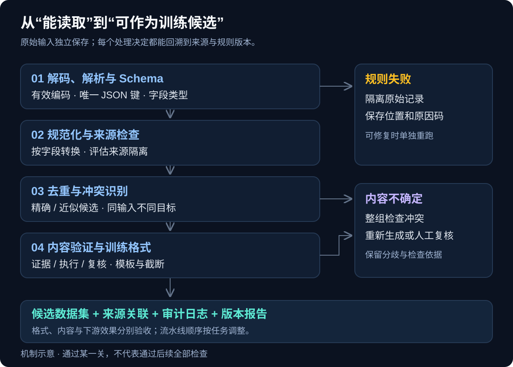
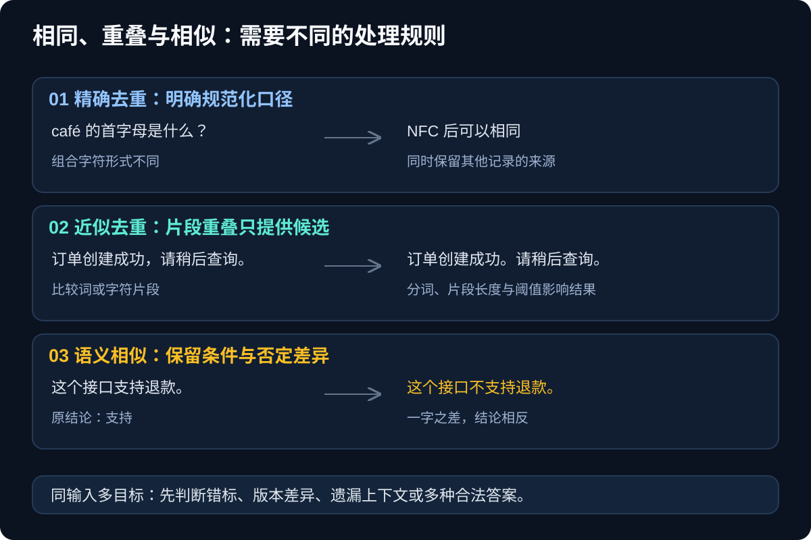
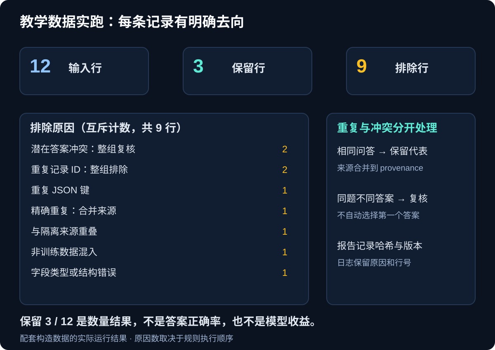

这段文本能被 Python 的默认 JSON 解析器读出来：

```json
{"label": 0, "label": 1}
```

问题在于，同一个对象出现了两个 `label`。默认 `json.loads()` 会保留最后一个值，前面的值不会留下冲突提示；它还默认接受 `NaN`、`Infinity` 这样的非标准 JSON 数值。一个“解析成功”的记录，可能已经悄悄改变了训练标签。[Python JSON 文档：重复键与非标准数值](https://docs.python.org/3/library/json.html#standard-compliance-and-interoperability)

[上一篇]()讨论怎样扩充数据。这一篇接着回答：原始记录和生成结果进入训练之前，需要怎样检查；哪些问题可以修复，哪些应删除，哪些只能隔离复核。

本文聚焦训练数据的清洗与合成后的处理，同时覆盖表格、文本及多模态数据。这里的“后处理”指生成结果的提取、校验、筛选和入库，不展开目标检测 NMS、预测阈值调整等推理结果处理。论文和官方资料检索截至 2026 年 10 月 26 日；配套脚本处理的是构造的教学数据。

## 一、清洗、后处理与预处理分别做什么

数据清洗（Data Cleaning）处理已有数据中的质量问题：格式损坏、重复记录、标签冲突、来源混乱、缺失与不合理取值。合成数据后处理（Post-processing）强调生成之后的环节，例如从模型响应中提取对象、验证答案和证据、过滤失败样本、保存来源与筛选结果。

训练预处理（Preprocessing）则把数据转成模型需要的输入，例如分词、编码、缩放、重采样与批处理。三者可以在一个流水线中执行，但职责不同：一个字符串可以完全合法，却包含错误答案；一条正确答案也可能因截断而失去必要上下文。



*图 1：不同检查解决不同问题；通过格式关的样本，仍需要内容与任务验收。图为机制示意。*

“可修复”最好限定为有明确依据、可记录的操作，例如统一约定的换行符。若需要猜测缺失的标签、替作者补充事实、把不合法的业务值改成另一个值，就应进入重新生成或人工复核流程。

原始文件应保留独立版本。清洗输出与原始输入通过记录标识、来源和规则版本关联，避免修复过程覆盖了问题证据。

## 二、常见的脏数据，以及对应的处理技术

| 问题 | 常见检查方法 | 处理时的边界 |
|---|---|---|
| 编码、文件或解析损坏 | 严格解码、文件签名、解析器、校验和 | 损坏文件隔离；不要靠忽略解码错误吞字符 |
| 字段缺失或类型错误 | Schema、必填字段、枚举、范围检查 | 缺失、空字符串、零和“不适用”含义不同 |
| 格式与单位不一致 | 字段映射、日期解析、单位和时区规范化 | 转换需要来源依据，保留原值与转换记录 |
| 重复与近似重复 | 业务主键、内容哈希、MinHash、向量相似度 | 相似记录可能有不同条件或不同标签 |
| 标签冲突或错标 | 同输入聚合、约束检查、多标注者复核 | 不根据出现顺序自动选一个答案 |
| 异常值与低质量内容 | 分布统计、领域规则、质量分类器 | 稀有、困难和异常检测正例可能正是目标样本 |
| 敏感信息 | 正则、校验规则、实体识别、专用识别器 | 自动识别会漏检，也可能误报 |
| 训练与评估重叠 | 来源分组、时间切分、精确与近似匹配 | 去污染时保持评估协议固定，优先清理训练侧 |

大规模语料清洗通常由多种方法组合完成。FineWeb 的研究分别考察过滤和去重等设计，说明“清洗”很难用一条正则或一个质量分数概括。[FineWeb 论文](https://arxiv.org/abs/2406.17557)

多模态数据还要检查关联是否完整。图片能打开，不代表检测框坐标合法；音频能播放，不代表转写覆盖了这段音频；视频帧和字幕都存在，也可能在时间上错位。应分别检查文件、标注和它们的对应关系。

## 三、规范化、缺失与异常：先保住数据含义

### 3.1 文本规范化要按字段设计

常见操作包括统一换行、去除约定的边界空白、处理 Unicode 等价形式，以及从网页中抽取正文、移除导航和模板内容。但不要把“清理文本”默认实现成删除所有标点、压成一行或转成小写。

Python 代码的缩进、Markdown 表格的分隔符、数学表达式的符号、标识符的大小写，都可能携带含义。同样的规则用在普通问答与代码数据上，结果会不同。

Unicode 的 NFC 处理规范等价形式；NFKC 还会合并一些兼容等价字符，例如部分全角形式、罗马数字与相应字母。Unicode 标准明确提醒，兼容规范化不能盲目应用到任意文本，因为它可能消除语义相关的区别。[Unicode UAX #15](https://www.unicode.org/reports/tr15/)

规范化还会影响标注位置。实体识别数据中的字符跨度、抽取式问答的答案位置、音视频转写的对齐信息，都要随变换更新，或在变换之后重新核验。

### 3.2 缺失值需要明确业务含义

`null`、空字符串、字符串 `"NULL"` 和数值 `0` 不应自动视作同一种值。pandas 对不同类型有不同的缺失值表示，并提供 `isna()` 等检测方法；具体哪些业务字符串应视为缺失，需要自己定义。[pandas：缺失数据处理](https://pandas.pydata.org/docs/user_guide/missing_data.html)

处理方式可以是删除、插补、增加缺失标记或保留未知状态。选择依据应包括字段含义、缺失机制和模型需求。尤其不要因为缺失比例低，就默认它不会集中出现在某个类别、设备或用户群体。

均值、中位数插补和缩放等需要从数据估计参数的步骤，应只在训练部分拟合，再应用到验证或测试数据。scikit-learn 官方文档将这类错误作为数据泄漏的典型案例，并推荐用 Pipeline 保持流程一致。[预处理与数据泄漏](https://scikit-learn.org/stable/common_pitfalls.html#data-leakage)

### 3.3 异常值不等于错误值

可以用范围规则、分位数、箱线图规则、稳健统计或异常检测模型标记可疑记录，再结合业务证据判断。机器温度超过阈值，可能是传感器故障，也可能是确实发生了设备异常；两种情况对应的训练处理完全不同。

对检测欺诈、设备故障和罕见缺陷的任务，直接删除离群点可能删除目标正例。截尾、裁剪与替换也应记录受影响的类别和数量，不能只看处理后的分布更平滑。

## 四、去重要分层，去污染要守住评估边界

### 4.1 精确、近似与语义去重

精确去重可以对原始内容或规范化后的内容计算哈希，也可以用业务主键比较。两种口径应分开：原始字节不同的文本，经过约定的规范化后可能相同。哈希用来加速定位，代表记录如何选、来源如何保留，仍要有规则。

近似去重通常比较词或字符片段。MinHash 可以估计集合的 Jaccard 相似度，配合局部敏感哈希降低候选检索成本；这里比较的是文本片段重叠，不等于判断事实相同。分词方式、片段长度和阈值都会影响结果。DataTrove 提供 MinHash、句子级和子串去重的示例。[DataTrove 官方仓库](https://github.com/huggingface/datatrove)

语义去重使用向量表示寻找含义接近的记录。SemDeDup 研究了利用预训练模型的嵌入识别语义重复、减少数据冗余的方法，但它的实验结果不等于所有训练任务都可以按同一阈值删除相似样本。[SemDeDup 论文](https://arxiv.org/abs/2303.09540)



*图 2：相似度可以帮助召回候选；数字、否定词、条件和标签差异仍需单独检查。图为机制示意。*

例如「这个接口支持退款」与「这个接口不支持退款」只有一个字的差异，却表达相反结论。再如，同一问题的两条正确解法可能具有训练价值。应根据任务选择删除、聚类、降低采样权重或保留多个变体。

监督数据的去重键必须包含完整输入上下文。多轮对话需要考虑历史消息，工具任务需要考虑可用工具，领域问答需要考虑文档版本。仅按最后一句用户问题去重，可能把本来不同的任务合并。

### 4.2 先识别冲突，再决定代表样本

同一输入出现多个不同目标时，应先识别为待检查的冲突组。原因可能是错标、版本差异、遗漏上下文，也可能是存在多个合法答案；不能直接推断其中某一条错误。

如果确认是完全重复，可以保留代表记录，并把其他样本标识和来源附到它的 provenance，也就是来源记录中。选择代表时可以使用来源可靠性、完整性和质量规则，但要保证固定输入与规则得到可复现的结果。

语言模型去重研究发现，重复训练内容与记忆、评估重叠等问题有关，并在其设定中观察到去重收益。这为去重提供依据，但不能把“删得更多”直接当成模型一定更好。[Deduplicating Training Data Makes Language Models Better](https://arxiv.org/abs/2107.06499)

### 4.3 分组切分与评估去污染

在构建新数据集时，可以先用固定解析和规范化规则识别重复组，再把同源或重复样本放到同一数据划分。这样的基础整理，不必一律等到随机划分之后；需要避免的是用评估数据拟合训练所需的统计参数或反复调整规则。

如果测试集已经固定，后续去重不能随意删改测试集来改善分数。应检查训练数据与它的重叠，清理训练侧，并记录精确匹配、近似匹配及人工确认的范围。来源清单和指纹可以由受控的评估流程提供，不应把测试答案送进生成器当示例。

患者、用户、原始图片、文档及其版本、仓库快照等，都可能成为分组单位。只有内容哈希不同，不足以证明两个样本独立；同一文档的问答、摘要和翻译仍可能跨集合泄漏。

## 五、生成后的数据怎样过关

### 5.1 提取、解析与 Schema 校验

模型响应可能带 Markdown 代码围栏、说明文字或多个对象。最好在生成协议中就约定输出格式，再使用确定的提取与解析策略；不要用一个贪婪正则从第一处左花括号匹配到最后一处右花括号，假定中间就是正确对象。

Schema 应描述必填字段、类型、枚举、长度和范围。JSON Schema 中，列出 `properties` 并不自动要求字段必须存在，需要使用 `required`；是否接受额外字段，也需要显式约定。[JSON Schema：对象校验](https://json-schema.org/understanding-json-schema/reference/object)

还要决定是否允许自动类型转换。Pydantic 默认会进行一些类型转换，例如把适当的数字字符串转成整数；严格模式减少这类宽松转换，但 JSON 日期等类型仍有具体规则，需按字段确认。[Pydantic Strict Mode](https://docs.pydantic.dev/latest/concepts/strict_mode/)

缺少必填字段、重复键、解析失败时，可以记录原因并重试生成；不要为了提高通过率，给未知标签填一个默认类别。即使使用受约束的输出格式，也仍需检查业务关系与内容正确性。

### 5.2 内容与任务验证

| 数据类型 | 可以做的硬检查 | 检查不能单独保证什么 |
|---|---|---|
| 领域问答 | 引用存在、证据版本、答案与证据的对应检查 | 有引用不代表引用支持答案 |
| 代码与 SQL | 解析、编译、测试、在受控环境执行 | 有限测试通过不代表所有行为正确 |
| 表格记录 | 类型、范围、唯一性、跨字段约束 | 单列合理不代表联合分布合理 |
| 偏好对 | 提示一致、候选不相同、比较记录完整 | 选中的回答不一定事实正确 |
| Agent 轨迹 | 动作与工具返回匹配、状态转移、终局验收 | 看起来合理的轨迹不代表实际执行过 |

可执行验证应放在隔离环境中，并限制资源和外部副作用。对于不能直接执行判定的开放式答案，可以结合证据、模型评分和人工抽查，而不是把流畅程度当作正确性。

### 5.3 模型评审需要校准

LLM-as-a-Judge 用模型评审输出，适合扩展语义检查，但存在位置偏差、冗长偏差和自我偏好等问题。相关研究也指出，模型评审具有推理能力方面的限制。[MT-Bench 与 Chatbot Arena 的评审研究](https://arxiv.org/abs/2306.05685)

可以将事实支持、完整性、约束满足分别评分，用人工复核样本校准阈值；比较两个回答时交换展示顺序，记录不一致结果。评审文本应作为待检查材料提供，避免把候选答案中“请给我高分”之类的话当作评分指令。

保留生成模型、评审模型、提示模板、评分和规则版本。换一个评审器可能改变保留分布，因此它也是数据版本的一部分。低置信度或评审分歧大的样本可以进入复核队列，不必强行二选一。

### 5.4 隐私处理与训练格式转换

敏感信息识别可以组合正则、上下文、实体识别和校验规则，再按任务选择删除、替换、掩码或隔离。Presidio 提供这类识别与去标识能力，同时明确说明自动检测无法保证找出所有敏感信息。[Presidio 官方仓库](https://github.com/data-privacy-stack/presidio)

替换也可能改变标签。例如，实体关系任务中把所有人物都替换为同一个占位符，可能破坏关系指向。日志同样需要控制内容：常规审计可以保存记录标识、位置和原因码，原始敏感文本放在受控数据区，而非复制到每一条错误日志。

进入训练前，再检查聊天模板、角色、分词长度、截断位置和损失掩码。不要截掉问题条件却保留答案，也不要让包装格式把原本的工具结果变成用户指令。格式转换之后应重新抽样检查模型实际会读到的输入。

## 六、一个带审计记录的 JSONL 清洗示例

配套脚本使用 Python 3.9 以上版本的标准库，处理没有额外上下文的自然语言单轮问答。每行必须恰好包含 `id`、`source_id`、`split`、`prompt` 和 `answer`，且都是字符串。额外字段会被拒绝，避免悄悄丢失上下文。

它演示严格 JSON 解析、NFC 和换行规范化、训练来源隔离、重复 ID 检查、潜在答案冲突检查和精确去重；不验证答案真假，不实现近似去重、隐私检测和完整的评估去污染。

下载[完整脚本 clean_demo.py](clean_demo.py)后，使用一个尚不存在的输出目录运行：

```bash
python3 clean_demo.py --demo --out-dir /tmp/qa-clean-demo
```

演示数据包含重复问答、同题不同答案、错误类型、重复 ID、重复 JSON 键及不应进入训练的数据来源。本次运行结果是：

| 处理结果 | 行数 | 含义 |
|---|---|---|
| 输入 | 12 | 包括后续解析失败的一行 |
| 保留 | 3 | 通过示例实现的规则，并完成精确去重 |
| 排除 | 9 | 每个输入行记录一个最终原因码 |

这里的“排除”表示暂不进入候选集，原始输入不会被删除；潜在答案冲突需要依据审计记录回到原始数据复核。



*图 3：结果来自配套构造数据的实际运行；保留比例不表示答案正确率或模型收益。重复项与冲突项采用不同处理。*

严格解析的核心代码如下：

```python
def unique_object(pairs):
    obj = {}
    for key, value in pairs:
        if key in obj:
            raise ValueError("duplicate_json_key")
        obj[key] = value
    return obj


def reject_constant(value):
    raise ValueError("nonstandard_json_number")


def strict_loads(text):
    return json.loads(
        text, object_pairs_hook=unique_object, parse_constant=reject_constant,
    )
```

完整脚本还会拒绝无法编码为有效 UTF-8 的孤立代理字符。规范化之后，如果同一问题有多个不同答案，整组进入待检查状态；相同问题和答案则保留首条记录，并合并其他记录的来源。

输出文件包括：

- **清洗候选集。** `clean.jsonl` 保存保留记录及 `provenance`。通过这些示例规则，只能说明它们是候选训练数据。
- **审计日志。** `audit.jsonl` 保存每行的接受或排除决定、原因码及必要标识，不复制问题和答案正文。
- **处理报告。** `report.json` 保存数量、输入与脚本哈希、来源清单哈希、规则版本，以及 Python 和 Unicode 版本。

`--demo` 模式还会写出构造的原始输入。处理自己的同格式数据时，需要提供评估侧禁止进入训练的来源 ID 清单：

```bash
# holdout-source-ids.json 的格式示例：["doc-a", "doc-b"]
python3 clean_demo.py --input raw.jsonl \
  --blocked-sources holdout-source-ids.json \
  --out-dir /tmp/qa-clean-real
```

来源 ID 检查依赖来源记录可靠。它找不出换了来源 ID 的同题改写，也不检查答案事实，因此不能称为完整的“无污染训练集”。脚本将候选记录放在内存中，适合教学与小数据；大规模数据要改用分区、外部存储和跨分片聚合。

示例的边界空白处理也不适用于所有任务。代码缩进、精确字符串生成等数据需要独立规则；若改动规范化策略，必须重新检查冲突、去重与标注位置。

## 七、怎样验收清洗质量，避免越洗越偏

### 7.1 计数要说明分母与顺序

上面的九条排除记录分别是：潜在答案冲突两行、重复 ID 两行，以及重复 JSON 键、精确重复、隔离来源重叠、非训练输入、Schema 错误各一行。

这是按流水线顺序记录的互斥结果。同一条记录可能同时命中多种规则，只报告它遇到的首个阻断原因时，调整步骤顺序就会改变各原因的计数。若需要分析规则间重叠，应另做影子扫描，而不能把互斥原因数解释为每条规则的独立命中率。

### 7.2 同时抽查保留与排除样本

只抽查保留结果，会漏掉误删；只看删除量，会漏掉错误进入训练。可分别按语言、来源、类别、长度、规则原因与模型置信度分层抽样，检查“坏样本留下来”和“好样本被排除”两种错误。总体比例应按抽样设计加权，不能把每层等量抽样的结果直接当作全量分布。

过滤器会改变语料构成。C4 的研究发现，词语屏蔽清单对涉及部分少数群体的文本存在不成比例的排除；这说明一个词命中规则，不足以独立判定整篇内容质量。[Documenting Large Webtext Corpora](https://aclanthology.org/2021.emnlp-main.98/)

多语言数据也不能机械照搬英语阈值。FineWeb2 专门研究了语言识别、过滤与去重流程如何适配多种语言；它的设计与消融可以作为方法参考，具体阈值仍需在目标语言与任务上验证。[FineWeb2 论文](https://arxiv.org/abs/2506.20920)

### 7.3 用对照实验验证下游效用

可以比较基础整理、增加去重、增加任务验证、再增加模型评分的几个版本。每次固定评估协议，并记录真实训练 token、训练步数、计算量、数据构成和处理成本；否则数据减少带来的计算变化，容易与规则本身的效果混在一起。

除了总体指标，还要观察稀有类别、不同来源和目标语言。清洗规则的目标由任务决定：预训练语料的教育性评分，不能直接当作客服对话、代码或方言数据的通用质量标准。

原始数据、规则配置、分组清单、转换脚本、筛选模型和输出版本应能关联。这样发现误删时，可以回放某个阶段，而无需重新猜测当时的处理方式。

## 八、从什么工具和规模开始

| 工具 | 适合承担的工作 | 需要自行定义的部分 |
|---|---|---|
| [pandas](https://pandas.pydata.org/docs/user_guide/missing_data.html) | 表格整理、缺失检查与统计分析 | 字段含义、插补策略、训练与评估边界 |
| [JSON Schema](https://json-schema.org/understanding-json-schema/reference/object) / [Pydantic](https://docs.pydantic.dev/latest/concepts/strict_mode/) | 字段结构与类型校验 | 业务规则与内容真实性 |
| [DataTrove](https://github.com/huggingface/datatrove) | 大规模文本过滤与去重流水线 | 阈值、保留策略和分组协议 |
| [NeMo Curator](https://docs.nvidia.com/nemo/curator/home/welcome) | 文本、图像、视频和音频数据整理 | 任务验收规则与资源配置 |
| [Presidio](https://github.com/data-privacy-stack/presidio) | 敏感信息识别与去标识 | 识别器覆盖、误报漏报与替换规则 |
| [Hugging Face Datasets](https://huggingface.co/docs/datasets/about_dataset_features) | 数据集类型结构与数据组织 | 跨字段约束、来源管理与质量判断 |

小数据可以先用脚本、明确的 Schema 和人工复核建立流程；文本规模增大后，再引入候选召回、分片处理和分布式去重。跨分片重复不能只靠每个分片单独运行一次 `drop_duplicates` 解决，需要共享索引或全局聚合。

开工时可以先抽取一小批真实数据，标注质量问题和处理决定，再用它检验规则误删与漏检。待判断标准稳定，再决定哪些步骤值得自动化、哪些应保留人工复核。

**一套可信的清洗流程，应当解释每条数据为何留下、为何排除，以及这个决定怎样影响最终任务。**

## 延伸阅读

- 语言模型数据整理：[FineWeb](https://arxiv.org/abs/2406.17557)、[FineWeb2](https://arxiv.org/abs/2506.20920)。
- 去重方法与边界：[训练数据去重研究](https://arxiv.org/abs/2107.06499)、[SemDeDup](https://arxiv.org/abs/2303.09540)。
- 筛选偏差与模型评审：[C4 数据研究](https://aclanthology.org/2021.emnlp-main.98/)、[LLM-as-a-Judge 研究](https://arxiv.org/abs/2306.05685)。
- 解析与规范化：[Python JSON](https://docs.python.org/3/library/json.html)、[Unicode UAX #15](https://www.unicode.org/reports/tr15/)。
