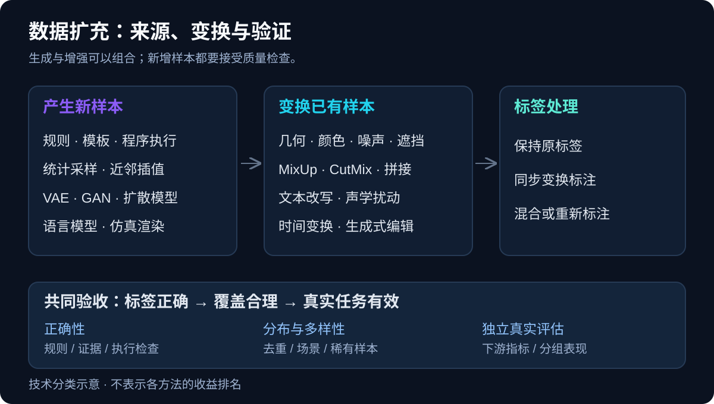
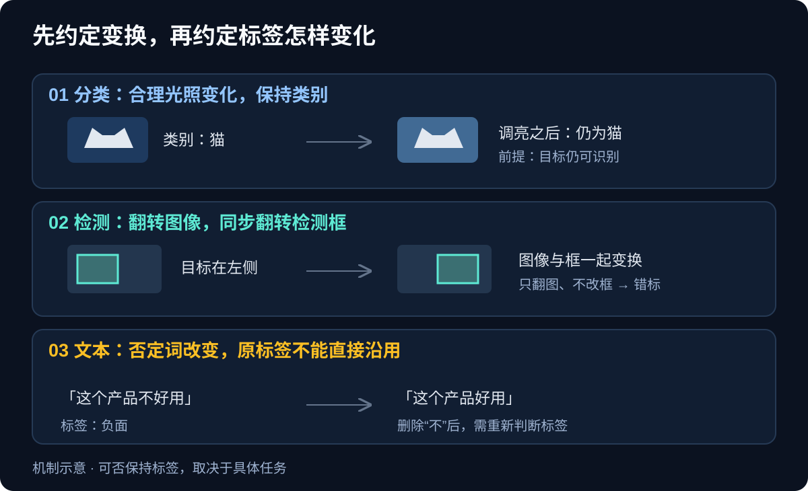
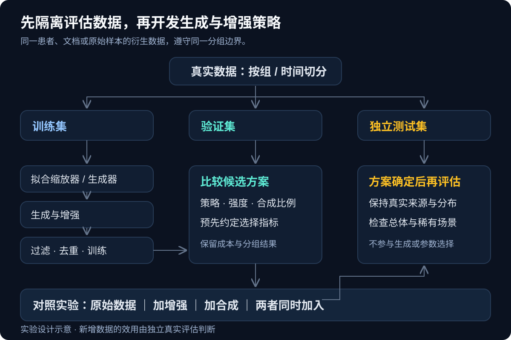

把数字「6」旋转半圈，可能得到「9」；把「这个产品不好用」里的「不」删掉，情感标签就反了。同样是增加训练样本，有些操作让模型学到合理变化，有些操作却在批量制造错标。

数据生成与数据增强的共同目标，是补充训练信号。但要判断一条技术路线是否合适，需要同时回答：新增了什么变化、标签从哪里来、这些变化是否接近真实任务，以及如何证明它对模型有帮助。

本文面向需要构建训练数据的开发者，先建立跨模态的技术地图，再展开大模型数据合成，最后给出能动手执行的实验流程。论文与官方文档检索截至 2026 年 10 月 26 日；文中的示意图和业务案例用于解释机制，代码实测使用程序构造的数据，均不能代替真实业务评估。

## 一、先区分生成、增强与标注

数据生成（Data Generation）强调新样本的产生过程，例如根据订单规则构造记录、通过扩散模型生成图像、让语言模型生成问答。生成可以依赖已有数据，也可以来自程序、模拟器或外部知识。

数据增强（Data Augmentation）强调对训练样本或训练视图的扩充，例如裁剪图片、改写句子、混合两个样本。它既可以离线保存成新文件，也可以在每次训练读取数据时在线执行；后者未必增加磁盘上的数据量。

合成数据（Synthetic Data）描述数据的来源，通常指通过算法、模型或仿真产生的数据。因此，生成与增强存在交集：用扩散模型修改已有图片的背景，既是生成式编辑，也可以服务于数据增强。



*图 1：生成和增强可以组合使用；二者都需要验证标签、覆盖范围与下游效果。图为技术分类示意。*

这里还要区分三种标签处理方式：

- **标签保持。** 图片轻微调亮之后，类别仍然是猫；文本改写后，原有意图仍成立。成立前提是变换没有破坏任务语义。
- **标签同步变换。** 目标检测图片翻转时，检测框坐标也要翻转；分割图像裁剪时，掩码必须使用相同的几何变换。Torchvision 的 v2 接口支持对图像、框和掩码等对象联合处理。[Torchvision 官方文档](https://docs.pytorch.org/vision/stable/transforms.html)
- **标签重新构造。** 混合两张分类图片时，可以同时混合它们的标签；如果把肯定句改成否定句，也可能需要重新标注，而不能沿用旧标签。

伪标签、自训练和主动学习也常出现在数据工程中。伪标签主要给已有无标签样本补监督信号，主动学习主要决定哪些样本值得人工标注；它们可以与生成、增强结合，但不能直接当成同一种操作。

## 二、数据生成：从可控规则到学习数据分布

### 2.1 规则、模板与程序生成

如果任务的正确性可以通过规则判断，程序生成通常值得先做。例如生成日期解析样本时，可以先随机构造一个合法日期，再渲染成不同格式；生成 SQL 问答时，可以先构造数据库和查询，再通过执行得到结果。

这种路线的优势是标签容易追溯，边界情况也能定向覆盖。限制是模板会留下明显的表达模式：把同一段话换十万个名字，主要增加了表面组合，未必增加问题类型。

工程上可以把随机因素拆成独立维度：字段取值、缺失情况、格式、输入长度、约束组合。业务上不可能出现的组合要通过约束排除。像「结束时间早于开始时间」这样的样本，可以用于训练错误检测器，但不能混入“合法记录”标签下。

### 2.2 统计采样与插值生成

统计生成可以从已知分布采样，也可以先拟合真实数据的分布。常见方法包括高斯混合模型、贝叶斯网络，以及用 Copula 描述变量依赖关系的方法。对于表格数据，逐列采样很容易保住单列的直方图，却丢失字段之间的关系，因此还要检查联合分布和业务约束。[Copulas 官方项目：多变量分布建模](https://github.com/sdv-dev/Copulas)

SMOTE（Synthetic Minority Over-sampling Technique）针对类别不平衡：从少数类样本出发，在它和少数类近邻之间插值，构造新样本。直观公式是：

```text
x_new = x_i + λ × (x_neighbor − x_i)，其中 λ ∈ [0, 1]
```

它的目标是补充少数类训练样本。普通随机过采样则主要重复抽取已有样本；两者不能等同。ADASYN 会依据局部学习难度分配生成数量，Borderline-SMOTE 关注分类边界附近的样本。[imbalanced-learn：过采样方法与生成机制](https://imbalanced-learn.org/stable/over_sampling.html)

SMOTE 依赖距离和近邻有意义。量纲差异大时要考虑缩放；类别字段不能直接按数字插值。混合数值与类别字段可研究 SMOTENC，全类别数据可研究 SMOTEN。高维稀疏数据、极少数样本或类别严重重叠时，需要额外谨慎，不能把插值点自动当成合理样本。[imbalanced-learn：异构数据与不合理样本](https://imbalanced-learn.org/stable/over_sampling.html)

### 2.3 学习分布的生成模型

| 技术路线 | 如何产生样本 | 使用时要核对什么 |
|---|---|---|
| VAE，变分自编码器 | 学习潜在变量分布，再通过解码器生成样本 | 潜在空间和重建质量是否保留任务所需信息 |
| GAN，生成对抗网络 | 生成器与判别器对抗训练，学习产生接近真实分布的样本 | 训练稳定性，以及是否只覆盖了少数样本模式 |
| 扩散模型 | 学习逐步去噪，由噪声恢复出样本 | 条件控制是否准确，采样成本是否可接受 |
| 自回归模型 | 根据已生成的部分，依次预测后续元素 | 长程约束、重复和错误累积是否受控 |

前三条路线分别可从 [VAE 原始论文](https://arxiv.org/abs/1312.6114)、[GAN 原始论文](https://arxiv.org/abs/1406.2661)和 [DDPM 论文](https://arxiv.org/abs/2006.11239)入手。它们描述的是建模方式，不是互斥的产品类别；实际系统可能组合多个模型。

生成模型也不限于图片。CTGAN 面向包含连续列和离散列的表格数据；TabDDPM 则把扩散建模用于异构表格特征。两者都需要在目标数据上验证，论文中的结果不能直接当作所有业务表格的选型结论。[CTGAN 论文](https://arxiv.org/abs/1907.00503)、[TabDDPM 论文](https://proceedings.mlr.press/v202/kotelnikov23a.html)

### 2.4 仿真、渲染与领域随机化

机器人、自动驾驶和工业视觉还可以通过模拟器生成场景，并从场景状态获得位置、深度或分割标签。领域随机化（Domain Randomization）会改变纹理、光照、相机位置等条件，让模型接触更多变化；经典研究用随机渲染的模拟图像研究向真实机器人视觉任务的迁移。[Domain Randomization 原始论文](https://arxiv.org/abs/1703.06907)

这条路线的成本集中在环境建设、资产、参数分布和真实数据验证。模拟画面看起来逼真，不能单独证明训练有效；还要检查模拟器是否覆盖了真实传感器误差、遮挡与目标场景。

## 三、图像增强：输入变了，监督信号也要跟上

### 3.1 单样本变换

常见操作可以按它们想模拟的变化分类：

- **几何变化。** 翻转、裁剪、缩放、平移、旋转和透视变换，模拟位置、尺度与视角差异。
- **成像变化。** 亮度、对比度、颜色、模糊、噪声与压缩扰动，模拟光照、设备和传输差异。
- **局部缺失。** Cutout、Random Erasing 等遮挡操作，减少模型对某个局部区域的依赖。
- **内容组合。** Copy-Paste、Mosaic 或生成式背景替换，改变目标与背景的组合，需要同步处理框、掩码或类别。

这些方法的总体分类可参考[图像数据增强综述](https://link.springer.com/article/10.1186/s40537-019-0197-0)。具体操作是否合理，取决于任务：花卉分类可能允许一定颜色扰动，按颜色判定缺陷的任务却可能因此丢失有效信号；OCR 和方向敏感任务也不能随意翻转。



*图 2：增强策略需要声明标签处理规则；同一种变换在不同任务中可能得到不同结论。图为机制示意。*

### 3.2 MixUp 与 CutMix

MixUp 同时对两个样本及其标签做凸组合：

```text
x_mix = λ × x_a + (1 − λ) × x_b
y_mix = λ × y_a + (1 − λ) × y_b
```

分类任务中的 `y_a` 和 `y_b` 通常是 one-hot 标签，即只有所属类别的位置为 1。混合之后得到软标签，例如「猫 0.7、狗 0.3」。这不表示画面里存在可精确解释的物体比例，而是训练时构造的监督目标。[MixUp 论文](https://arxiv.org/abs/1710.09412)

CutMix 则将一张图片的区域粘贴到另一张图片上，经典分类版本按区域面积混合标签。它与“把一块区域涂黑”的遮挡方法不同，因为粘贴区域仍包含另一张图片的信息。[CutMix 论文](https://arxiv.org/abs/1905.04899)

检测与分割任务不能照搬分类标签的混合方式。框如何裁切、目标是否仍可见、掩码怎样拼接，都需要任务对应的实现。Torchvision 也将 MixUp 和 CutMix 作为组合成批样本的特殊变换介绍。[Torchvision：CutMix 与 MixUp](https://docs.pytorch.org/vision/stable/transforms.html#cutmix-mixup)

### 3.3 自动增强与生成式增强

自动增强关注如何选择操作和强度。RandAugment 将搜索空间压缩为少量超参数，核心是每次使用的操作数量与共享的强度参数，降低了单独搜索复杂策略的负担。[RandAugment 论文](https://arxiv.org/html/1909.13719v2)

生成式增强可以改变背景、天气或局部内容，但“提示词要求保留目标”不等于目标真的被保留。需要检查目标形状、计数、位置和标注是否仍然正确。对于工业缺陷这样的细粒度任务，生成模型还可能把要识别的小缺陷修掉。

## 四、文本、语音、表格和时序各有什么方法

### 4.1 文本：要保留的是任务语义

EDA 的经典操作包括同义词替换、随机插入、随机交换和随机删除。原论文研究的是文本分类任务，不能据此推断随机删词也适合事实问答、实体识别或代码训练。[EDA 论文](https://aclanthology.org/D19-1670/)

语义级增强还包括释义改写、风格转换、拼写扰动、句式变化与回译。在文本增强语境中，回译常指「中文 → 另一种语言 → 中文」的往返改写；而机器翻译论文中的 back-translation 通常指将目标语言单语文本反向翻译成合成源语言，再组成平行训练语料。两种说法相关，但数据构造过程不完全相同。[Sennrich 等：用单语数据改进机器翻译](https://aclanthology.org/P16-1009.pdf)

一个可执行的文本增强约束是：允许改句式、语气和句长；保护实体、数字、单位、否定词、条件和答案依据。实体识别还要更新字符跨度，抽取式问答要检查答案位置，检索任务则要判断改写后是否仍指向同一份证据。

困难负例可以通过替换一个关键条件构造。例如，查询问的是某产品的企业版，负例内容介绍个人版。这个例子只有在个人版内容确实不能回答查询时才成立；语义相近本身不足以证明它是负例。

### 4.2 语音：波形增强与频谱增强

波形侧可以模拟环境噪声、混响、音量、速度和音高变化。自动语音识别关注说了什么，因此部分声学变化可以保留转写；说话人识别关注是谁在说，某些改变音色或音高的操作就需要重新判断。

SpecAugment 直接作用于语音特征：原始方法包括时间扭曲、频率遮挡和时间遮挡。它模拟特征局部缺失，不需要为每条样本重新合成语音。[SpecAugment 论文](https://arxiv.org/abs/1904.08779)

TTS 合成则属于数据生成。它能扩充文本内容和部分声学变化，但不能自然保证口音、噪声、设备与真实用户一致。语音任务仍需保留真实录音评估集。

### 4.3 表格：单列合理还不够

表格可以使用规则生成、统计建模、SMOTE 或 CTGAN、TabDDPM 等模型。其约束往往跨列存在，例如订单总额与明细应一致，时间字段要满足先后关系。只看每列的均值和分布，容易漏掉这些问题。

可以从三个层面验收：字段类型与范围、跨字段业务规则、合成数据用于训练后在真实数据上的效果。SDV 提供表格合成与统计质量评估工具，但具体能力需要按所选模型和版本核对。[SDV 官方文档](https://docs.sdv.dev/sdv)

### 4.4 时间序列：保住时间含义

常见方法包括抖动（加小幅噪声）、幅值缩放、窗口切片、时间扭曲、频域扰动，以及生成模型。时序分类、异常检测和预测对变换的要求不同，应按任务分别验证。[时间序列数据增强综述](https://arxiv.org/abs/2002.12478)

例如，适当缩放某些动作传感器信号可能仍保留动作类别；对带固定阈值的告警任务，同样操作却可能改变标签。预测任务还要避免窗口跨越训练与测试边界，以及用未来信息拟合归一化或生成器。多变量序列要检查通道间的关系，不能默认逐通道独立扰动合理。

## 五、大模型数据合成：生成的是哪一种监督信号

语言模型既可以生成文本样本，也可以协助生成标签、偏好比较和工具调用轨迹。选路线前，先说明训练目标：是学习领域知识、遵循指令、改进推理，还是学会在环境中完成操作。

### 5.1 基于文档生成：给答案一个可追溯的依据

领域问答可以从训练侧文档片段生成问题和答案，并保留文档标识、版本、证据片段。还可以根据同一片段构造信息抽取、摘要、条件比较和多轮澄清样本。

下面是一个格式示例，其中退款规则为虚构教学材料：

```json
{
  "source_id": "demo-policy-v1#section-2",
  "evidence": "未使用的月度套餐可在购买后七日内申请退款。",
  "instruction": "买了三天、还没用过的月度套餐能申请退款吗？",
  "response": "按该规则可以申请：购买未超过七日，且套餐尚未使用。",
  "generation_method": "document_grounded_qa",
  "checks": {"schema_valid": true, "evidence_review": "pending"}
}
```

引用了证据也要核对答案是否得到证据支持。文档没有说明的例外条件，不能由生成模型自由补齐；一份文档的改写、摘要与问答也应作为同源数据管理，避免被拆散到训练集和测试集。

### 5.2 从种子任务扩展：Self-Instruct 与 Evol-Instruct

Self-Instruct 从种子任务出发，让模型生成指令、输入和输出，过滤不合法或过于相似的样本，再用于指令微调。它提供的是一套数据自举流程，过滤本身就是方法的一部分。[Self-Instruct 论文](https://aclanthology.org/2023.acl-long.754/)

Evol-Instruct 则逐步重写已有指令，增加复杂度。例如从「给出排序代码」，扩展为「处理重复元素」「限制额外空间」「解释边界条件」。这些是机制示例；具体采用哪些演化规则，需要与任务目标匹配。[WizardLM / Evol-Instruct 论文](https://arxiv.org/abs/2304.12244)

这类方法容易扩展已有任务，也容易复制种子数据的偏差。只增加约束和文本长度，未必带来更多有用能力；生成后的答案还必须满足新增约束。

### 5.3 从聊天模板出发：Magpie

Magpie 利用对齐模型的自回归特性，只提供聊天模板中用户消息之前的前缀，让模型继续生成用户问题，再生成对应回答。论文中的“从零”指不必手工提供每一条任务种子，生成能力仍来自已有对齐模型。[Magpie 论文](https://arxiv.org/abs/2406.08464)

这条路线依赖模型的聊天模板与推理接口。一个只接受完整消息、自动包装模板的聊天 API，未必允许复现这种前缀补全；需要核对模板控制能力，不能把空用户消息直接当成等价实现。

### 5.4 用答案、执行或环境反馈筛选

有可验证反馈时，可以一次生成多个候选，再保留通过检查的样本。代码可以编译并运行测试，结构化输出可以检查 schema，数学题可以对照已知答案或使用适当的求解器。STaR 则展示了利用正确答案筛选推理过程、迭代训练的思路。[STaR 论文](https://arxiv.org/abs/2203.14465)

筛选范围要与验证能力一致。测试通过只能覆盖测试所检查的行为；最终答案正确，也不能单独证明中间每一步推理都正确。把模型评分与执行检查结合，通常比只看文字是否流畅更容易定位错误。

### 5.5 偏好对、困难负例与 Agent 轨迹

偏好训练可以为同一个提示构造多个回答，再通过人工、明确规则或模型评分形成比较。需要避免“长的自动更好”“语气自信就更好”这类评分捷径；如果两个回答都错，也不能仅因其中一个稍好就把它当成正确答案样本。

Agent 数据则要保存任务、环境状态、动作、工具结果和最终验收。例如让 Agent 修复一个小型仓库问题，再执行测试并记录轨迹。应同时保留成功、失败原因与恢复过程；只有成功终点、缺少真实工具反馈的轨迹，难以支持可复现的操作学习。

这些路线都可以借助流水线组织，但数据格式、验证器和训练目标仍需要自己定义。[Distilabel](https://huggingface.co/docs/hub/datasets-distilabel)提供合成数据与 AI 反馈流水线能力；工具能组织步骤，不能替代样本正确性判断。

## 六、如何选第一条路线，以及用什么工具

下面的优先顺序是工程起点，收益需要用自己的验证集确认。

| 当前问题 | 可以先验证的路线 | 主要成本或失败条件 |
|---|---|---|
| 样本少，合理变换明确 | 单样本增强、模板和规则生成 | 变换破坏标签，或模板覆盖过窄 |
| 少数类训练信号不足 | 类别权重、随机过采样，再比较 SMOTE | 类别重叠、近邻无意义、噪声被放大 |
| 图像存在设备或场景变化 | 成像扰动、背景变化、仿真随机化 | 训练扰动与真实差异不匹配 |
| 领域问答缺数据 | 基于文档的问答生成和证据审查 | 文档过时、答案脱离证据 |
| 指令类型或难度不足 | Self-Instruct、Evol-Instruct、Magpie | 指令同质化、复杂任务答案错误 |
| 代码或工具使用能力不足 | 执行反馈筛选、环境交互轨迹 | 验证器覆盖有限、环境难以复现 |

类别权重改变损失中的权重，属于值得比较的训练基线；它不会生成新数据。类不平衡也可能需要调整决策阈值，这应在验证集完成。

工具可以按职责选择：

| 工具 | 适合承担的工作 | 需要自行补齐的部分 |
|---|---|---|
| [Torchvision v2](https://docs.pytorch.org/vision/stable/transforms.html) | 图像、视频及标注的联合变换 | 任务允许的操作与强度 |
| [imbalanced-learn](https://imbalanced-learn.org/stable/over_sampling.html) | 过采样、欠采样与带采样步骤的训练流水线 | 数据切分、距离度量和业务约束 |
| [SDV](https://docs.sdv.dev/sdv) | 表格数据建模、合成与质量诊断 | 下游效用与具体字段规则 |
| [Distilabel](https://huggingface.co/docs/hub/datasets-distilabel) | LLM 数据生成、评审与反馈流程 | 任务设计、评分标准和证据检查 |
| [DataTrove](https://github.com/huggingface/datatrove) | 文本处理、过滤和去重等流水线 | 数据保留策略与质量验收 |

## 七、怎样证明新增数据有用

### 7.1 划分评估集，再开发生成策略

应先按独立单位划分训练、验证和测试数据，再在训练侧拟合采样器、缩放器与生成模型。同一患者、用户、原始图片、文档或仓库衍生出来的数据，需要根据任务选择分组切分；时序预测通常还要遵守时间顺序。

增强策略和合成比例可以通过验证集选择，测试集保留到最终评估。基准题目、参考答案及其改写，不应进入用于生产训练样本的提示或种子池。对转导学习等允许使用无标签目标数据的特殊设定，应明确说明协议，避免与常规独立测试混在一起。

先在全量数据上做 SMOTE，再随机分训练集和测试集，会把信息带入评估，而且可能改变测试集原本的类别分布。imbalanced-learn 官方文档专门展示了这个问题，并推荐使用流水线将重采样限制在训练步骤中。[数据泄漏与推荐实践](https://imbalanced-learn.org/stable/common_pitfalls.html)



*图 3：验证集用于选择方案，独立真实测试集用于最终评估；同源数据应遵守同一分组边界。图为实验设计示意。*

### 7.2 一个可运行的 SMOTE 对照示例

下面只演示连续特征的二分类：先隔离测试集，再在训练集上做交叉验证，比较原始基线、类别权重与 SMOTE。缩放和采样都放在流水线内部；每个交叉验证折只用自己的训练部分拟合这些步骤。[imbalanced-learn Pipeline 文档](https://imbalanced-learn.org/stable/references/generated/imblearn.pipeline.Pipeline.html)

示例使用 Python 3.12。保存为 `smote_demo.py`，或直接下载[配套脚本](smote_demo.py)，可用以下固定依赖复现。数据由本地程序构造，无需下载数据集。

```bash
uv run --python 3.12 --with numpy==1.26.4 --with scipy==1.13.1 \
  --with scikit-learn==1.7.2 --with imbalanced-learn==0.14.0 \
  python smote_demo.py
```

```python
from sklearn.datasets import make_classification
from sklearn.linear_model import LogisticRegression
from sklearn.metrics import average_precision_score, balanced_accuracy_score
from sklearn.model_selection import (
    StratifiedKFold, cross_validate, train_test_split,
)
from sklearn.preprocessing import StandardScaler
from imblearn.over_sampling import SMOTE
from imblearn.pipeline import Pipeline

X, y = make_classification(
    n_samples=4000, n_features=12, n_informative=6,
    n_redundant=2, weights=[0.95, 0.05], random_state=42,
)
X_train, X_test, y_train, y_test = train_test_split(
    X, y, test_size=0.25, stratify=y, random_state=42,
)

models = {
    "baseline": Pipeline([
        ("scale", StandardScaler()),
        ("model", LogisticRegression(
            solver="liblinear", max_iter=1000, random_state=42)),
    ]),
    "class_weight": Pipeline([
        ("scale", StandardScaler()),
        ("model", LogisticRegression(
            solver="liblinear", max_iter=1000, random_state=42,
            class_weight="balanced")),
    ]),
    "smote": Pipeline([
        ("scale", StandardScaler()),
        ("sample", SMOTE(random_state=42)),
        ("model", LogisticRegression(
            solver="liblinear", max_iter=1000, random_state=42)),
    ]),
}
cv = StratifiedKFold(n_splits=5, shuffle=True, random_state=42)
cv_scores = {}
for name, model in models.items():
    result = cross_validate(
        model, X_train, y_train, cv=cv,
        scoring=["average_precision", "balanced_accuracy"],
    )
    cv_scores[name] = result["test_average_precision"].mean()
    print(name, {
        metric: round(float(result[f"test_{metric}"].mean()), 3)
        for metric in ["average_precision", "balanced_accuracy"]
    })

# 预先约定按交叉验证 AP 选方案，测试集只评估选中的方案。
best_name = max(cv_scores, key=cv_scores.get)
best = models[best_name].fit(X_train, y_train)
print("selected:", best_name)
print("test AP:", round(average_precision_score(
    y_test, best.predict_proba(X_test)[:, 1]), 3))
print("test balanced accuracy:", round(balanced_accuracy_score(
    y_test, best.predict(X_test)), 3))
```

AP 是 Average Precision，用于概括精确率与召回率随阈值变化的表现；balanced accuracy 是各类别召回率的平均。这里用 AP 选择方案，只是预先设定的一种实验协议，不代表所有任务都该如此。业务还可以关注固定误报率下的召回、少数类 F1 或概率校准。

在上述固定依赖、数据参数和随机种子下，本次运行得到的五折交叉验证均值为：

| 方案 | AP | Balanced accuracy |
|---|---|---|
| 原始基线 | 0.706 | 0.744 |
| 类别权重 | 0.694 | 0.842 |
| SMOTE | 0.692 | 0.853 |

这组教学数据中，SMOTE 提高了 balanced accuracy，AP 却低于原始基线。按事先约定的 AP 指标，脚本选择原始基线；其隔离测试集 AP 为 0.603，balanced accuracy 为 0.677。这个结果只说明本次构造数据上的对照，不能推广成“SMOTE 无效”，也不能只挑改善的一项报告。

少数类数量很少时，还要降低近邻数或调整折数；多做几次随机划分也不能替代增加独立真实样本。真实任务中的阈值与超参数调整应留在验证阶段，不要根据这次测试分数反复改方案。

### 7.3 对生成数据做四组实验

可设置四个对照：原始数据、原始数据加简单增强、原始数据加合成数据、原始数据同时加增强与合成。每组固定评估协议，记录真实样本数、合成比例、训练步数、算力和筛选成本。数据更多通常也意味着训练计算更多，需要区分计算增加与数据策略带来的收益。

质量检查至少应覆盖：

- **正确性。** 标签是否匹配，引用是否支撑答案，程序是否通过相应检查。
- **多样性。** 精确重复与近似重复有多少，是否只是在换句式，困难与稀有场景是否得到覆盖。
- **分布。** 类别、长度、来源、场景与设备的比例是否合理，是否引入了生成器特有的模式。
- **真实效用。** 独立真实数据上的总体指标与分组指标是否改善，是否出现某些群体或场景退化。
- **可追溯性。** 保留来源、父样本标识、生成模型版本、模板版本、筛选规则和数据集版本。

对于使用真实敏感数据训练的生成器，也不能仅凭“输出是合成的”就认定不会复现训练记录或泄露训练数据的信息。是否可以共享，需要结合具体生成方法和泄露评估判断；合成这一来源标签本身不提供隐私保证。[USENIX Security 2022：合成数据的隐私与效用评估](https://www.usenix.org/conference/usenixsecurity22/presentation/stadler)

## 八、合成数据会不会导致模型坍塌

模型坍塌（Model Collapse）研究关注递归训练：一代模型生成数据，后续模型不断学习这些输出，原分布中的稀有模式可能逐渐丢失。Nature 的研究讨论了无差别使用模型生成内容带来的退化风险。[Shumailov 等，2024](https://www.nature.com/articles/s41586-024-07566-y)

但训练协议会改变结果。另一项研究比较了“每代用新合成数据替换旧数据”与“保留原始真实数据并逐步累积合成数据”，在其理论设定和实验中，累积方式避免了所观察到的坍塌。这不能扩展成任意任务的安全比例保证，也说明不能把所有合成数据训练归为同一种情况。[Gerstgrasser 等，2024](https://arxiv.org/abs/2404.01413)

据此，更稳妥的工程做法是保留真实数据与来源信息，定向补充缺失场景，用验证集选择混合方式，并持续检查真实测试集上的稀有类别表现。质量筛选可以减少部分错误，但不保证恢复生成器从未覆盖过的信息。

2026 年的预印本《Should I use Synthetic Data for That?》还把数据共享、模型训练增强、统计估计中的方差缩减分开讨论。它分析了各自成立的条件与限制，提醒我们：某种合成方法适合共享数据，并不自动说明它适合改善模型训练；这些用途需要分别验证。[论文预印本](https://arxiv.org/abs/2602.03791)

如果现在要启动一个数据扩充项目，可以先列出模型在真实验证集上失败的三类场景，为每类选择一项低成本策略，做一轮小规模对照。确认收益之后再扩大规模，通常比先批量生成大量样本更容易找清问题。

**数据扩充的价值，要由新增的有效训练信号与独立真实评估共同证明。**

## 延伸阅读

- 后续环节：[数据清洗与后处理：从原始样本到可训练数据]()。
- 图像增强全景：[Shorten 与 Khoshgoftaar 的综述](https://link.springer.com/article/10.1186/s40537-019-0197-0)。
- 样本混合机制：[MixUp](https://arxiv.org/abs/1710.09412)、[CutMix](https://arxiv.org/abs/1905.04899)。
- 跨模态方法：[EDA](https://aclanthology.org/D19-1670/)、[SpecAugment](https://arxiv.org/abs/1904.08779)、[时序增强综述](https://arxiv.org/abs/2002.12478)。
- 大模型数据构造：[Self-Instruct](https://aclanthology.org/2023.acl-long.754/)、[Evol-Instruct](https://arxiv.org/abs/2304.12244)、[Magpie](https://arxiv.org/abs/2406.08464)、[STaR](https://arxiv.org/abs/2203.14465)。
- 实验边界：[重采样中的数据泄漏](https://imbalanced-learn.org/stable/common_pitfalls.html)、[递归训练的坍塌风险](https://www.nature.com/articles/s41586-024-07566-y)、[累积真实与合成数据的研究](https://arxiv.org/abs/2404.01413)。
- 合成数据的用途与限制：[Should I use Synthetic Data for That?（2026，预印本）](https://arxiv.org/abs/2602.03791)。
