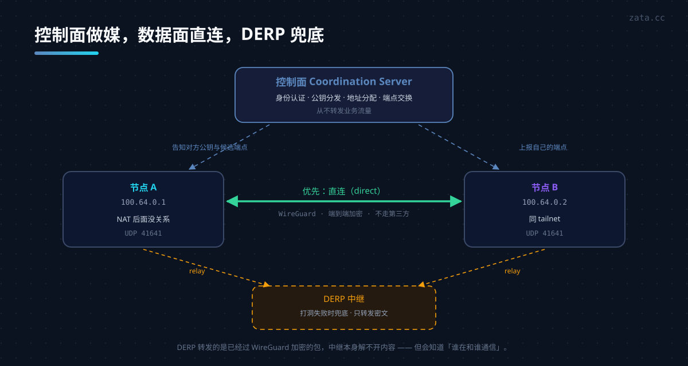

## 系列文章

| 篇 | 主题 |
|---|---|
| [一](../wireguard-guide/) | WireGuard 原理与跨 VPC 站点互联 |
| 二（本篇） | Tailscale：控制面、DERP 与自建 Headscale |

---

上一篇的结论是：WireGuard 只做数据面，配置文件是静态的，所以"两台机器很舒服，二十台机器很难受"。

Tailscale 就是来解决"难受"的。它一行加密代码都没自己写，**用的是同一套 WireGuard 数据面**，补上的是控制面。

| | 裸 WireGuard | Tailscale |
|---|---|---|
| 加密隧道 | 你配 | 自动 |
| 密钥交换 | 手工复制 | 控制面下发 |
| 找到对方 | 写死 `Endpoint` | 自动发现 + NAT 穿透 |
| 访问控制 | `AllowedIPs` | 策略文件（ACL） |
| 加一台机器 | 改所有对端配置 | 装完登录即可 |
| 依赖 | 无 | 一个控制面（可以是自建的） |

---

## 一、三个名词先对齐

刚接触 Tailscale 的人容易被它的术语绕住，其实只有三个：

- **tailnet**：一个虚拟私有网络，对应一个账号/组织。所有设备都在这个逻辑网络里。
- **node（设备）**：加入 tailnet 的一台机器，可以是服务器、笔记本、手机、容器。
- **coordination server（协调服务器）**：控制面。它知道所有节点的公钥、地址和当前可达端点，负责把它们互相介绍给对方。

关键认知：**协调服务器不转发业务流量**。它只做介绍人。数据永远在两端之间直连（打不通才走中继）。

---

## 二、架构：控制面、数据面、DERP



三条路径，按优先级：

1. **直连（direct）**：两端 NAT 打洞成功，UDP 点对点。延迟最低，走的是真实网络路径。
2. **DERP 中继（relayed）**：打洞失败时，流量经 Tailscale 的 DERP 服务器转发。**它转发的是已加密的 WireGuard 包**，DERP 自己也解不开内容。
3. **两者都不可用**：连不上。

DERP 是全网的兜底，所以它必须高可用。Tailscale 官方维护了一批节点，你也可以自建（`derper`）。

> 这一点常被误解：很多人以为 Tailscale 的流量"都过他们服务器"。默认不是——只有打洞失败的那部分才走 DERP，而且 DERP 看到的只是密文。

---

## 三、上手：五分钟能通

```bash
# Linux
curl -fsSL https://tailscale.com/install.sh | sh

# macOS
brew install --cask tailscale

# 登录并加入 tailnet
sudo tailscale up

# 看状态
tailscale status

# 测试到另一台设备
tailscale ping <hostname>
```

`tailscale status` 的输出里，每行末尾会标 `direct` 或 `relay "xxx"`：

```
100.64.0.1   node-a    zata@    linux    -
100.64.0.2   node-b    zata@    macOS    active; direct 203.0.113.10:41641, tx 1204 rx 980
100.64.0.3   node-c    zata@    android  idle, tx 0 rx 0; relay "hkg", tx 88 rx 0
```

第三行就是"打洞失败、走香港中继"的典型样子。

`tailscale ping` 比系统 `ping` 更有用：它走 Tailscale 自己的 disco 协议，会明确告诉你这一跳是直连还是中继，以及是否已经完成 WireGuard 握手。

```bash
tailscale ping node-b
# pong from node-b (100.64.0.2) via 203.0.113.10:41641 in 12ms
# 或者
# pong from node-b (100.64.0.2) via DERP(hkg) in 48ms
```

---

## 四、地址与命名

Tailscale 给每台设备分配一个 `100.64.0.0/10` 段内的地址——这是 **CGNAT 保留段**，选它是因为几乎不可能和你现有的内网冲突。

配套的是 **MagicDNS**：设备用主机名就能互访，不用记 IP。

```bash
ssh node-b            # 而不是 ssh 100.64.0.2
curl http://node-b:8000/health
```

主机名可以改，在管理后台或 `tailscale up --hostname=xxx`。重装系统后旧记录会保留，记得清理，否则 `tailscale status` 里会堆一堆离线设备。

---

## 五、NAT 穿透：什么时候会走 DERP

这是 Tailscale 最有价值、也最容易出问题的地方。

### 5.1 它试了什么

1. 向 STUN 服务器查询自己的公网映射（UDP 3478）
2. 尝试 UPnP / NAT-PMP / PCP 让网关开个口
3. 通过控制面交换双方的候选端点，同时向对方发包打洞
4. 成功 → 直连；失败 → DERP

打洞能否成功，取决于两端的 NAT 类型。**对称型 NAT（symmetric NAT）** 是最常见的失败原因——同一个内网地址访问不同目标时，映射端口不一样，导致对方拿到的候选端口无效。

### 5.2 怎么判断

```bash
tailscale netcheck
```

输出里重点看：

- `UDP: true` — UDP 出网是否可用（false 基本只能走 DERP）
- `MappingVariesByDestIP: true` — 就是对称型 NAT
- `PortMapping: UPnP / NAT-PMP / none`
- `Nearest DERP` — 最近的中继在哪，决定走中继时的延迟

### 5.3 什么情况下必然是"中继"

| 情况 | 结果 |
|---|---|
| 企业防火墙只放 TCP 443 | 走 DERP（DERP 就是 HTTPS） |
| 双侧对称 NAT | 大概率中继 |
| 云主机安全组只开特定端口 | 看是否放行 UDP 41641 |
| 蜂窝网络（部分运营商） | 常见中继 |

**云上部署的一个实操点**：安全组要放行入站 **UDP 41641**（或 Tailscale 随机选的端口），否则直连概率大幅下降。它不开放也能工作，只是全走中继——延迟和带宽都会变差，而且很多人不会注意到。

---

## 六、访问控制：策略文件

默认是"同一 tailnet 内全通"。生产环境一定要收紧，靠的是一份策略文件（HuJSON，允许注释的 JSON）。

```json
{
  "groups": {
    "group:ops": ["alice@example.com", "bob@example.com"]
  },
  "tagOwners": {
    "tag:prod": ["group:ops"]
  },
  "grants": [
    { "src": ["group:ops"], "dst": ["tag:prod"], "ip": ["tcp:22", "tcp:443"] },
    { "src": ["autogroup:member"], "dst": ["tag:prod"], "ip": ["tcp:443"] }
  ]
}
```

三个概念值得分清：

- **user**：登录的人，身份来自 SSO（Google / GitHub / 微软 / OIDC）。
- **tag**：给机器打标签，机器没有"人"的身份，用 tag 表达角色（`tag:prod`、`tag:db`）。
- **group**：人的集合，方便批量授权。

写 ACL 的两个常见错误：一是给 `tag:db` 放行了 `autogroup:member` 的 22 端口，等于全公司可登数据库；二是忘了机器换人后 tag 没回收。

> 还有一层可选防护叫 **tailnet lock**：用你自己保管的签名密钥验证节点公钥，防止控制面被攻破后偷偷塞一台机器进来。它的代价是每次加设备要手动签名，团队大了会嫌麻烦，但对安全敏感的部署值得开。

---

## 七、子网路由与出口节点

这两个功能把"点对点"扩展成"整网段接入"，也是和上一篇场景最能对应上的部分。

### 7.1 子网路由（subnet router）

把某个内网网段接进 tailnet。比如办公室里有个 `192.168.1.0/24`：

```bash
# 在能访问该网段的那台机器上
tailscale up --advertise-routes=192.168.1.0/24
# 然后去管理后台批准这条路由（默认不生效）

# 其他设备上
tailscale up --accept-routes
```

**默认必须后台批准**，这是刻意的：否则任何一台被入侵的机器都能宣称"我能到达 0.0.0.0/0"。

### 7.2 出口节点（exit node）

让设备的所有出网流量走某个节点：

```bash
# 提供出口的机器
tailscale up --advertise-exit-node

# 使用方
tailscale up --exit-node=node-a --exit-node-allow-lan-access
```

这正好对应上一篇"让 B 的流量从 A 出去"的需求——区别是：裸 wg 要自己写策略路由和 NAT，Tailscale 一条命令加一次后台点击。

**但代价不同**：裸 wg 的出口规则完全在自己手里；Tailscale 的出口节点、路由和 ACL 由控制面下发。出口 IP 仍然是 exit node 自己的公网 IP——即使客户端到 exit node 走的是 DERP 中继，DERP 也只转发密文，不改变出口。要确认的是 exit node 本身是否多出口或有 NAT 地址池，而不是它有没有走 DERP。

---

## 八、密钥与生命周期

| 项 | 说明 | 注意 |
|---|---|---|
| node key | 每台设备一把，自动轮换 | 设备被重置后旧 key 残留 |
| auth key | 用于无人值守加入 | 设过期时间，别用"永不过期" |
| ephemeral node | 标记为临时，离线后自动清理 | 适合容器、CI |
| key expiry | 默认 180 天过期，需要重新认证 | 服务器在管理后台 Machines → 设备菜单关闭 key expiry；CLI 没有这个开关 |
| pre-approved | 免后台批准（路由/出口） | 便利与风险并存 |

```bash
# 生成一次性 auth key（在管理后台或 CLI）
tailscale up --authkey=tskey-auth-xxxxx --hostname=ci-runner --ephemeral
```

一个血泪点：**服务器的 key 到期后会掉线**，而且不一定有明显的告警。生产机器记得关掉过期，或者把到期提醒接进监控。

---

## 九、和裸 WireGuard、ZeroTier 对比

| | 裸 WireGuard | Tailscale | ZeroTier |
|---|---|---|---|
| 数据面 | WireGuard | WireGuard | 自研协议 |
| 控制面 | 无 | 官方 SaaS / 可自建 | 官方 SaaS / 可自建 |
| 地址段 | 自己定 | 100.64.0.0/10 | 自定（默认 10.x） |
| NAT 穿透 | 靠一端有公网 | 自动，失败走 DERP | 自动，失败走中继 |
| ACL | `AllowedIPs` | 策略文件 | 规则表 |
| 客户端覆盖 | 全平台 | 全平台，体验最好 | 全平台 |
| 额外依赖 | 无 | 控制面 + DERP | 控制面 + 中继 |
| 适合 | 少量固定机器 | 团队、移动设备 | 团队、偏网络层 |

选型其实只有一句话：**你能列出所有 peer 的 IP 和密钥吗？** 能，裸 wg；不能，Tailscale 这类。

---

## 十、自建控制面：Headscale

Headscale 是控制面的开源实现，客户端仍然用 Tailscale 官方程序，只是把 `--login-server` 指向你自己的实例。

```bash
tailscale up --login-server=https://headscale.example.com
```

### 10.1 它能做什么

- 节点注册与密钥分发、MagicDNS、ACL 策略
- 子网路由、出口节点
- OIDC 登录（接自己的身份源）
- 可自建 DERP

### 10.2 它缺什么

- **tailnet lock 没有**，控制面被攻破就没有第二道防线
- 管理后台是 CLI，没有官方那种 Web UI（社区有第三方的）
- 部分新特性滞后，客户端升级可能带来兼容问题
- 官方移动端对第三方控制面的支持有限，安卓/iOS 上体验不如 SaaS

### 10.3 什么时候值得自建

- 合规要求流量与身份数据不出自己的边界
- 机器都在自己的云上，控制面顺手就部署了
- 能接受"出问题自己修"

如果只是想省事，官方 SaaS 的免费额度对个人和小团队够用；自建 Headscale 省的是钱和依赖，花的是运维时间。

---

## 十一、排障

| 症状 | 先看什么 |
|---|---|
| 能 ping 通但延迟高 | `tailscale ping` 看是否 `via DERP` |
| 突然全部走中继 | `tailscale netcheck` 的 UDP 与 MappingVariesByDestIP |
| 某台机器加入不了 | `tailscale status` 是否 `offline`，key 是否过期 |
| 子网路由不生效 | 后台是否批准；客户端是否 `--accept-routes` |
| 出口节点无效 | 是否 `--advertise-exit-node` 且已批准 |
| MagicDNS 解析失败 | `tailscale dns status`，或系统 DNS 被别的软件接管 |
| 容器里连不上 | 容器需要 `/dev/net/tun` 与 `NET_ADMIN`，或用 userspace 模式 |

常用命令：

```bash
tailscale status --json | jq '.Peer[] | {HostName, Relay, Online}'
tailscale netcheck
tailscale ping --verbose node-b
tailscale debug derp-map      # 看 DERP 拓扑
```

---

## 十二、什么时候不该用

- **两三台固定 IP 的服务器**：裸 wg 更直接，少一层依赖（就是上一篇的场景）。
- **要求出口 IP 绝对稳定**：确认 exit node 自身的公网出口和 NAT 行为；DERP 只影响路径，不影响出口 IP。
- **合规禁止第三方协调**：要么自建 Headscale，要么回到裸 wg。
- **只需要 HTTP 转发**：反向代理更简单。
- **内网本来就通**：同 VPC、已有专线，再加一层纯属自找麻烦。

---

## 小结

Tailscale 的价值不在加密，而在**把控制面自动化**：

1. **控制面不搬数据**。它只负责让两端认识彼此，数据面永远是端到端加密。
2. **DERP 是兜底不是常态**。看到 `relay` 就该查 NAT 和防火墙，而不是当成正常。
3. **它确实少了一层可控性**。出口节点选择、路径、密钥生命周期都受控制面影响，生产环境要逐条确认。
4. **自建 Headscale 能拿回控制权**，但要接受功能滞后和没有 tailnet lock。

上一篇的手工 wg 适合"我知道每一台机器在哪"；这一篇的 Tailscale 适合"机器会变、人会加、IP 会漂"。
