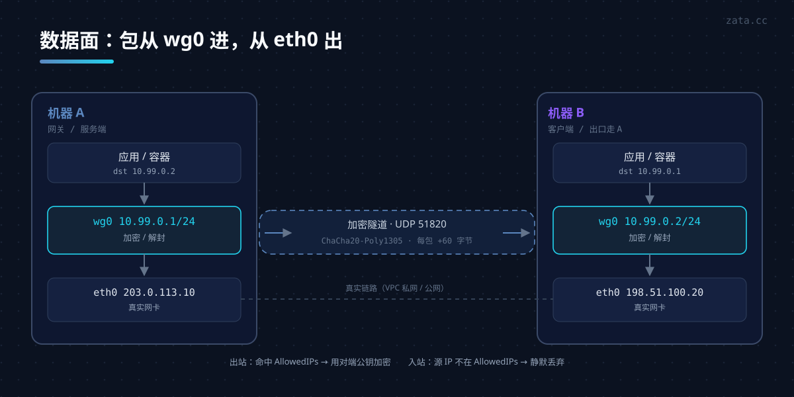
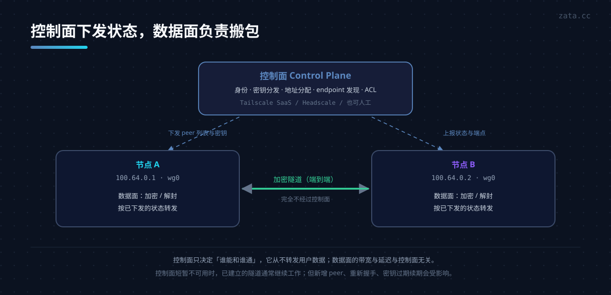
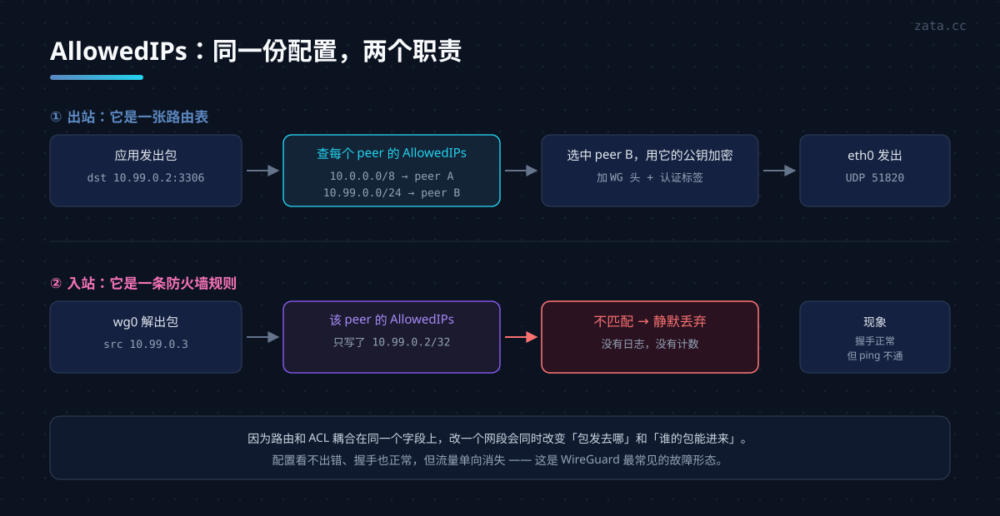
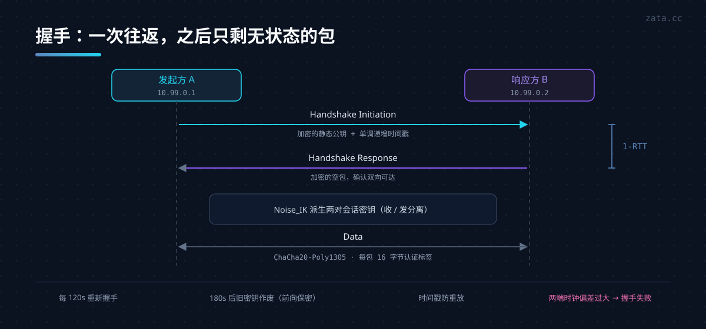
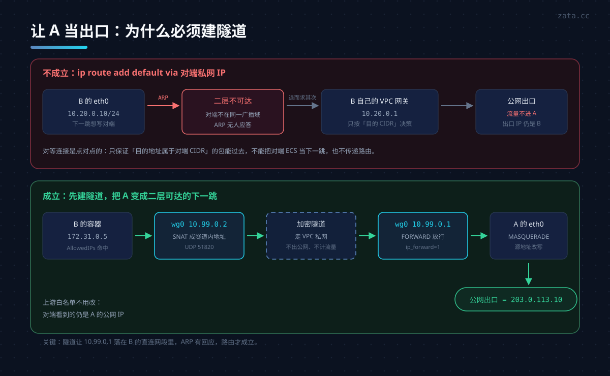
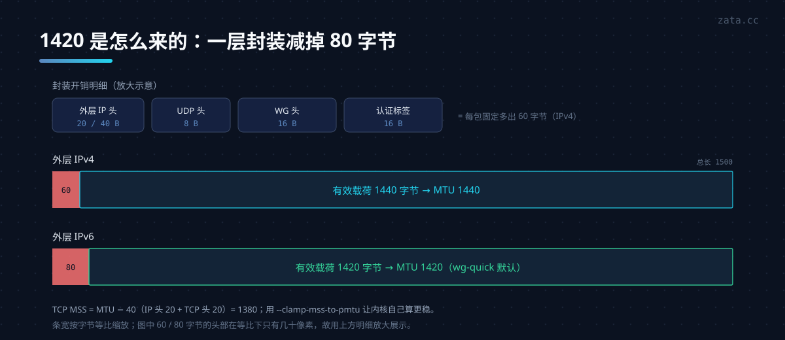

WireGuard 是一个跑在内核里的三层 VPN。它的配置只有一个接口、一对密钥和若干 peer，没有证书链、没有 IKE 协商、没有几百页的 RFC。

但它的"简单"是有代价的：**大部分坑都藏在语义里**——`AllowedIPs` 既是路由表又是访问控制表，`0.0.0.0/0` 会触发一套你看不到的策略路由，MTU 不对则表现为"能 ping 通但网页打不开"。这篇文章把这些语义拆开讲，最后用一次真实的跨 VPC 组网收尾。

| 你想做的事 | WireGuard 合适吗 |
|---|---|
| 两台机器/两个网段私网互通 | ✅ 首选 |
| 把自己电脑接进公司内网 | ✅ 首选 |
| 让 A 机房的机器从 B 机房的公网 IP 出去 | ✅ 本文场景二 |
| 按用户身份授权、审计谁访问了什么 | ❌ 它只有密钥，没有用户 |
| 突破网络限制访问外网 | ⚠️ 能用，但特征明显、易被识别 |
| 大规模中心化管控（几百台、动态策略） | ⚠️ 裸 wg 缺控制面，看 [Tailscale](../tailscale-guide/) / Headscale |

---

## 一、它是什么，不是什么

**是**：一个 L3（网络层）隧道。两端各有一个虚拟网卡 `wg0`，往里写的包会被加密封装，从真实网卡发出去；对端解开后还原成原始 IP 包。上层看到的就是两张网卡在同一个网段里。



**不是**：

- 不是代理。它不解析 HTTP，不区分应用，TCP/UDP/ICMP 同等对待。所以它能承载 MySQL、Redis 这类非 HTTP 流量，这是应用层代理做不到的。
- 不是认证系统。没有用户名、没有权限模型，**持有私钥就能进**。
- 不是动态路由协议。不会交换路由，两端看到什么网段完全由配置决定。
- 不是 zerotier / tailscale 那种"开箱即用的网状网"。那些是产品，WireGuard 是它们的底座之一。

---

## 二、为什么它快

快不是因为加密弱，而是因为**把所有决策都提前做完了**：

| 设计 | 效果 |
|---|---|
| 数据面在内核态 | 没有用户态/内核态拷贝，吞吐接近线速 |
| 密码学原语固定 | Curve25519 / ChaCha20-Poly1305 / BLAKE2s / HKDF，不做算法协商，不存在降级攻击面 |
| 无连接、无会话状态机 | 每个包独立处理，不需要维护连接表 |
| 一个包一个密钥索引 | 收包时靠 4 字节的 receiver index 直接找到 peer，不用遍历 |
| 代码量约 4000 行 | 可审计性是它最大的安全资产 |

对比常见方案：

| | WireGuard | OpenVPN | IPsec | Tailscale |
|---|---|---|---|---|
| 传输层 | UDP | UDP/TCP | ESP | UDP（wg） |
| 握手 | 1-RTT | TLS 多轮 | IKE 多轮 | 1-RTT + 控制面 |
| 配置复杂度 | 低 | 中 | 高 | 极低 |
| 内核实现 | ✅ | ❌（默认） | ✅ | ✅（复用 wg） |
| 需要额外控制面 | 否 | 否 | 否 | 是 |
| 移动端漫游 | 原生支持 | 一般 | 一般 | 好 |

---

## 三、控制面与数据面：Tailscale 补的是什么

前面讲的都是**数据面**：加密、封装、路由、MTU。但一个组网系统还有另一半——**控制面**：谁和谁能通、怎么找到对方、密钥从哪来。

WireGuard 故意不碰这一层。它只有一个配置文件，而配置文件是静态的。

| 控制面要做的事 | 裸 WireGuard 怎么做 | 规模化之后 |
|---|---|---|
| 身份 | 一把密钥 = 一个 peer | 100 台机器 = 100 把密钥手工交换 |
| 地址分配 | 自己在 `Address` 里写 | 网段冲突靠人脑记 |
| 密钥轮换 | `wg genkey` 重来一遍 | 换一把要通知所有对端 |
| 找到对方 | 手工写 `Endpoint` | IP 变了就得挨个改 |
| NAT 穿透 | 有一端必须有固定可达地址 | 两边都在 NAT 后面就没戏 |
| 访问控制 | `AllowedIPs` 手工维护 | N 台机器是 N² 条关系 |
| 审计 | 没有 | 只能抓包 |

这就是为什么"两台机器"用裸 wg 最舒服，"二十台机器 + 一堆笔记本"就该上控制面了。控制面不是为了加密更强，而是为了**把上面那张表从人工操作变成自动分发**。



分界线是这样的：

- **数据面**跑在两端机器上，负责"这个包怎么加密、发给谁"——WireGuard 的全部。
- **控制面**跑在别的地方（也可以是自己的另一台机器），负责"你该有哪些 peer、密钥是什么、它们现在在哪"——WireGuard 完全没有。

这个划分解释了一个常见困惑：Tailscale、Headscale、Netmaker 这些工具**没有发明新的加密协议**，用的还是 WireGuard 的包格式和内核模块，只是补上了控制面。所以它们的流量特征、MTU、性能表现和裸 wg 基本一致，差别全在"配置从哪来"。

> 判断要不要控制面，看一个指标就够：**你能否列出所有 peer 的 IP 和密钥。** 能，就继续手写；不能，就上控制面。这部分展开见下一篇 [Tailscale 详解](../tailscale-guide/)。

---

## 四、核心模型：Cryptokey Routing

这是理解 WireGuard 的**唯一关键**。

一个 peer 长这样：

```ini
[Peer]
PublicKey = <对端公钥>
AllowedIPs = 10.99.0.2/32, 172.17.0.0/16
Endpoint = 10.10.0.10:51820
```

`AllowedIPs` 同时承担两个方向的责任：

- **出站（发）**：查路由表，目标 IP 落在哪个 peer 的 `AllowedIPs` 里，就用哪个 peer 的公钥加密发出。**它等价于路由表。**
- **入站（收）**：解出来的包，源 IP 必须落在该 peer 的 `AllowedIPs` 里，否则**直接丢弃**。**它等价于防火墙。**

这个双向设计叫 **Cryptokey Routing**：用密码学身份来绑 IP，让"谁发的"和"从哪来"成为同一件事。好处是不需要额外的 ACL，坏处是两个语义耦合在一起，改一个地方会同时影响路由和过滤。

举个例子：如果你在 A 上写 `AllowedIPs = 10.99.0.2/32`，但 B 实际用 `10.99.0.3` 发过来，包会被静默丢弃，而 `wg show` 显示握手正常——这是最常见的"配置看不出错但就是不通"。



---

## 五、握手与密钥轮换

WireGuard 用 **Noise_IK** 握手（IK = 发起方已知对端静态公钥），一次往返完成：

```
发起方                                     响应方
  │  Handshake Initiation (encrypted static + timestamp)  │
  ├──────────────────────────────────────────────────────>│
  │<──────────────────────────────────────────────────────┤
  │  Handshake Response (encrypted empty)                 │
```



握手成功后双方各派生一对会话密钥（收发分离），随后所有数据包用 ChaCha20-Poly1305 加密。

几个值得知道的细节：

- **每 2 分钟重新握手**（`REKEY_AFTER_TIME`），3 分钟后旧密钥作废（`REJECT_AFTER_TIME`）。所以密钥是不断轮换的，具备前向保密。
- **握手是有状态的，数据是无状态的**。握手结果缓存在内核里，后面的包直接用。
- **有防 DoS 的 cookie 机制**：握手包过大或压力大时，服务端回一个 cookie，要求客户端证明自己收得到回包，避免伪造源 IP 的放大攻击。
- **时间戳单调递增**，防止重放握手包。所以**两端时钟差太多会握手失败**（容器里没同步时间是个经典坑）。

---

## 六、安装

```bash
# Debian / Ubuntu
apt install -y wireguard

# 内核 5.6 以上自带模块，5.6 以下需要 dkms
modprobe wireguard && lsmod | grep wireguard

# CentOS / Rocky
dnf install -y wireguard-tools

# macOS
brew install wireguard-tools

# Windows
# 官方客户端：https://www.wireguard.com/install/
```

工具主要是两个命令：`wg`（配置与状态）和 `wg-quick`（读配置文件建接口）；生成密钥用 `wg genkey` / `wg pubkey` 子命令。

---

## 七、最小可用配置：两台机器点对点

### 7.1 生成密钥

```bash
umask 077
wg genkey | tee privatekey | wg pubkey > publickey
cat privatekey publickey
```

`umask 077` 是必须的——私钥文件权限太宽 `wg-quick` 会直接拒绝加载。

### 7.2 两端配置

A（`10.99.0.1`，公网 `1.1.1.1`）：

```ini
# /etc/wireguard/wg0.conf
[Interface]
Address    = 10.99.0.1/24
ListenPort = 51820
PrivateKey = <A 的私钥>

[Peer]
PublicKey  = <B 的公钥>
AllowedIPs = 10.99.0.2/32
```

B（`10.99.0.2`，公网 `2.2.2.2`，主动连 A）：

```ini
# /etc/wireguard/wg0.conf
[Interface]
Address    = 10.99.0.2/24
PrivateKey = <B 的私钥>

[Peer]
PublicKey           = <A 的公钥>
AllowedIPs          = 10.99.0.1/32
Endpoint            = 1.1.1.1:51820
PersistentKeepalive = 25
```

### 7.3 启动

```bash
wg-quick up wg0            # 立即生效
systemctl enable --now wg-quick@wg0   # 开机自启
wg show                    # 看握手状态
```

`wg show` 的输出里，`latest handshake` 是判断链路的**第一指标**：

```
interface: wg0
  public key: <A 公钥>
  private key: (hidden)
  listening port: 51820

peer: <B 公钥>
  endpoint: 2.2.2.2:51820
  allowed ips: 10.99.0.2/32
  latest handshake: 12 seconds ago
  transfer: 1.24 KiB received, 2.31 KiB sent
```

---

## 八、配置逐行解释

| 字段 | 作用 | 常见错误 |
|---|---|---|
| `Address` | 本端隧道内 IP，**带掩码** | 写成 `10.99.0.1` 不带 `/24` 会导致对端不可达 |
| `ListenPort` | 本端 UDP 端口 | 只在一端写，另一端当客户端时不写也行 |
| `PrivateKey` | 本端私钥 | 权限必须 `600` |
| `PublicKey`（peer 内） | 对端公钥 | 与私钥搞混是最常见的复制错误 |
| `AllowedIPs` | 对端"拥有"的网段 | 写大段会抢走本地路由 |
| `Endpoint` | 对端可达地址 | 只在**主动发起**的一端写；有公网的一端可不写 |
| `PersistentKeepalive` | 保活间隔（秒） | NAT 后面的peer 必须写，推荐 25 |

关于 `Endpoint`：WireGuard 是"谁先说话谁定地址"。NAT 后面的那一端主动发起，NAT 网关就建立了一条映射；之后对端发的包能顺着这条映射回来。如果两边都在 NAT 后面，必须**至少一端**有固定可达地址，否则握手发不出去。

---

## 九、场景二：让一台机器成为出口网关

需求：B 在另一个机房，希望 B 上的流量从 A 的公网 IP 出去（为了过白名单、为了统一出口 IP）。

### 9.1 先弄清一件事：能不能直接"默认路由指过去"

单看网络常识，你可能会想：在 B 上 `ip route add default via <A 的私网 IP>` 不就行了？

**在同一二层网络里可以，跨 VPC / 跨机房不行。** 原因是路由的下一跳必须是**链路层可达**的：

- 内核要发往下一跳，得先 ARP 出它的 MAC。ARP 只在同一个广播域（同一 vSwitch / 同一子网）里有效。
- 如果 A 在另一个 VPC，B 的 eth0 上 ARP `A 的私网 IP` 没有人应答，包发不出去。
- 即使强行 `onlink`，包也只是被送到 B 自己的网关，而 B 的网关只会按"目的 IP 是否属于对端 VPC"来转发，**不会把 A 当路由器**。

这就是隧道存在的意义：**隧道把 A 变成了一个二层可达的下一跳**。`wg0` 建起来之后，`10.99.0.1` 就在 B 的直连网段里，ARP 有回应，路由成立。

> 这一点在云上尤其反直觉：VPC 对等连接能让 `ping` 通，但那只是"目的地属于对端 CIDR 的包能过去"，**不支持把对端机器当作下一跳，也不传递路由**。所以"能 ping 通"和"能当网关"是两件完全不同的事。



### 9.2 网关侧（A）要做的三件事

```ini
# A: /etc/wireguard/wg0.conf
[Interface]
Address    = 10.99.0.1/24
ListenPort = 51820
PrivateKey = <A 的私钥>
PostUp   = sysctl -w net.ipv4.ip_forward=1
PostUp   = iptables -A FORWARD -i wg0 -o eth0 -j ACCEPT
PostUp   = iptables -A FORWARD -i eth0 -o wg0 -m conntrack --ctstate RELATED,ESTABLISHED -j ACCEPT
PostUp   = iptables -t nat -A POSTROUTING -s 10.99.0.0/24 -o eth0 -j MASQUERADE
PostDown = iptables -D FORWARD -i wg0 -o eth0 -j ACCEPT
PostDown = iptables -D FORWARD -i eth0 -o wg0 -m conntrack --ctstate RELATED,ESTABLISHED -j ACCEPT
PostDown = iptables -t nat -D POSTROUTING -s 10.99.0.0/24 -o eth0 -j MASQUERADE

[Peer]
PublicKey  = <B 的公钥>
AllowedIPs = 10.99.0.2/32
```

三件事：

1. **开转发**：`net.ipv4.ip_forward=1`。没有它，包进来就被丢。
2. **放行 FORWARD**：很多系统默认 `FORWARD` 是 DROP。注意 Docker 会往 FORWARD 里插自己的链，如果你的规则顺序不对，会被 docker 的 DROP 吃掉。
3. **做源地址转换**：把 `10.99.0.0/24` 的源改成 A 的公网 IP，否则对端（比如数据库）回包不知道怎么回到 10.99.x.x。

云厂商的安全组也要放行：**入站 UDP 51820 只允许对端 IP**，不要 `0.0.0.0/0`。

### 9.3 客户端侧（B）：为什么要用策略路由

朴实做法是在 B 上写：

```ini
[Peer]
PublicKey  = <A 的公钥>
AllowedIPs = 0.0.0.0/0
Endpoint   = 1.1.1.1:51820
```

但 `AllowedIPs = 0.0.0.0/0` 会带来一个死循环风险：所有包都进隧道 → 隧道的外层包本身也要走默认路由 → 又进隧道。

`wg-quick` 已经处理了这个问题，它做的是这三步，而**不是**直接改默认路由：

```bash
ip route add default dev wg0 table 51820
ip rule  add not fwmark 51820 table 51820
ip rule  add table main suppress_prefixlength 0
```

逐条解释：

- 新建一张路由表 `51820`，默认路由指向 `wg0`。
- `not fwmark 51820`：带 fwmark 51820 的包（也就是 WireGuard 自己发出去的加密包）**不查这张表**，走主表正常出去，死循环解开。
- `suppress_prefixlength 0`：主表里比 `/0` 更具体的路由优先命中，所以局域网、内网路由不会被隧道抢走。

**这也是为什么"`AllowedIPs` 写大段"很危险**：它会静默地改变整台机器的路由判决，包括 Docker 的容器网段、云厂商的元数据地址。

如果只想让特定网段走隧道，就别用 `0.0.0.0/0`：

```ini
AllowedIPs = 172.16.0.0/12, 10.0.0.0/8
```

### 9.4 验证出口真的变了

```bash
curl -s https://ifconfig.me      # 应该返回 A 的公网 IP
wg show wg0 transfer             # 看字节数是否在涨
```

如果 `ifconfig.me` 返回的还是 B 自己的 IP，但 `curl` 能通，说明**路由没生效**（包走了主表的默认路由），不是隧道没建起来。

---

## 十、容器怎么走隧道

有两种思路，差别在"在哪一层做 NAT"。

### 10.1 宿主机 SNAT（推荐）

容器保持自己的网段不变，由宿主机把容器流量丢进隧道：

```bash
# B 上：容器网段 -> wg0
iptables -t nat -A POSTROUTING -s 172.31.0.0/24 -o wg0 -j MASQUERADE
```

同时在 B 的 `AllowedIPs` 里加上目标网段（比如数据库所在网段），A 侧的 `AllowedIPs` 要包含 B 的容器网段，否则 A 会把回包丢掉（Cryptokey Routing 的入站校验）。

### 10.2 让容器直接路由

把 `wg0` 的路由推给容器需要 `--cap-add=NET_ADMIN` 或直接共享宿主机网络，一般不值得。

### 10.3 Docker 的两个坑

**坑一：Docker 会改 FORWARD 链。** 它插入自己的 `DOCKER-USER` / `DOCKER-FORWARD`，并且把 `FORWARD` 策略设为 DROP。如果隧道流量被丢，先查：

```bash
iptables -L FORWARD -n -v --line-numbers | head -20
```

**坑二：`docker0` 的网段可能和对端 IP 撞车。** Docker 默认用 `172.17.0.0/16`，如果你的对端私网 IP 正好是 `172.17.x.x`，宿主机访问对端时会走 `docker0` 而不是 `eth0`，表现为"隧道是好的，但就是连不上那台机器"。

改掉就好，顺手也把 `bip` 统一一下：

```json
// /etc/docker/daemon.json
{
  "bip": "172.31.0.1/24"
}
```

改完 `systemctl restart docker`（会重建容器，挑窗口）。比打一条 `/32` 主机路由补丁干净得多。

---

## 十一、MTU 与 MSS：最隐蔽的坑

### 11.1 1420 是怎么来的

隧道要加壳。一个 1500 字节的物理帧，装进去的真实数据要减掉：

| 开销 | 字节 |
|---|---|
| 外层 IP 头（IPv4 / IPv6） | 20 / 40 |
| UDP 头 | 8 |
| WireGuard 头（type + receiver index + counter） | 16 |
| Poly1305 认证标签 | 16 |

IPv4 外层：`1500 - 60 = 1440`；IPv6 外层：`1500 - 80 = 1420`。

`wg-quick` 默认写 **1420**，是按最坏情况（IPv6 外层）预留的。如果你的外层确定是 IPv4，可以调到 1440 多拿 20 字节。



在 `[Interface]` 里显式写：

```ini
MTU = 1420
```

### 11.2 症状

MTU 不对的典型表现，**极其容易误判成"网络不稳定"**：

- `ping` 通、`ssh` 能登、小请求正常
- 一传大文件 / 打开复杂网页就卡死、超时
- TLS 握手偶尔失败（证书链包比较大）
- `curl` 小接口正常，返回 JSON 大了就断

根因是：路径 MTU 发现（PMTUD）依赖 ICMP `Fragmentation Needed`，而很多云环境和防火墙把这类 ICMP 丢了，发送方永远不知道要减小分片。

### 11.3 两种修法

**修一：MSS clamp（推荐，最省事）**

在网关的 FORWARD 链上直接把 TCP MSS 改小：

```bash
iptables -t mangle -A FORWARD -i wg0 -p tcp --tcp-flags SYN,RST SYN \
  -j TCPMSS --clamp-mss-to-pmtu

# 或者写死，1420 - 40 = 1380
iptables -t mangle -A FORWARD -i wg0 -p tcp --tcp-flags SYN,RST SYN \
  -j TCPMSS --set-mss 1380
```

放 `PostUp` 里自动化。注意它**只管 TCP**，UDP（比如 QUIC）不吃这套。

**修二：验证到底能过多大的包**

```bash
# -M do 禁止分片，-s 是 ICMP 载荷；1420 MTU 对应 1392
ping -M do -s 1392 10.99.0.1
```

如果 1392 不通但 1372 通，说明实际可用 MTU 还要低 20 字节，说明外层是 IPv6 或中间有额外封装（VXLAN、GRE 叠加时很常见）。

---

## 十二、AllowedIPs 的四个坑

1. **写太宽**：`0.0.0.0/0` 会把云厂商元数据地址（`100.100.100.200` / `169.254.169.254`）也吞进隧道，导致读不到实例元数据。要么加 `ip rule` 排除，要么别用全量。
2. **两端不对称**：A 的 `AllowedIPs` 必须包含 B 实际使用的**源 IP**，否则 B 发来的包在 A 侧被静默丢弃。`wg show` 里 transfer 只有 received 没有 sent，就是这个症状。
3. **同段重叠**：两个 peer 的 `AllowedIPs` 有交集时，只有更具体的条目优先，行为取决于插入顺序，非常难排查。
4. **改完不重启**：`wg-quick down && up` 才会重建路由规则；只 `systemctl restart` 有时不够。

---

## 十三、真实案例：跨 VPC 的两台阿里云 ECS

这是促使我写这篇文章的一次实际组网。

### 13.1 拓扑

| | A（网关） | B（容器出口走 A） |
|---|---|---|
| 公网 IP | 203.0.113.10 | 198.51.100.20 |
| 私网 IP | 10.10.0.10/24 | 10.20.0.10/24 |
| 私网网关 | 10.10.0.1 | 10.20.0.1 |
| VPC | vpc-aaa… | vpc-bbb… |
| 地域 | 上海 | 上海 |

两台在**不同 VPC**，靠 VPC 对等连接打通，`ping` 双向 3/3、0.46ms。

### 13.2 一个反直觉的现象

既然私网通，直觉上直接 `ip route add default via 10.10.0.10` 就行了。实测不行。

看两台的私网路由表就明白了：

```bash
# B 上
10.10.0.10 via 10.20.0.1 dev eth0    # 下一跳是 B 自己的 VPC 网关
# A 上
10.20.0.10 via 10.10.0.1 dev eth0     # 下一跳是 A 自己的 VPC 网关
```

两边都不是直连对端，而是**各自绕自己的 VPC 网关**。对等连接是点对点的：它只保证"目的地址属于对端 CIDR 的包能过去"，**不支持把对端 ECS 当作下一跳，也不传递路由**。

所以 `default via 10.10.0.10` 在链路层就不成立——ARP 到的是 VPC 网关，网关看目的地址是公网，直接送公网出口，根本不会进 A。

**结论：跨 VPC 想让 A 当出口，必须建隧道。** 在同一 VPC 内则可以走"路由表下一跳 = ECS 实例"（该实例需开启 IP 转发），不需要隧道——这是两者的本质区别，也是选型时最该先确认的一件事：

```bash
# 两台各跑一次，确认是不是同一个 VPC
curl -s http://100.100.100.200/latest/meta-data/vpc-id
curl -s http://100.100.100.200/latest/meta-data/vswitch-id
```

### 13.3 落地配置

这套配置只让 B 的容器网段走隧道，B 宿主机的默认出口保持不动。容器网桥以 `docker_gwbridge` 为例，实际名称按 `docker network inspect` 的结果替换。

B（容器出口客户端）：

```ini
[Interface]
Address    = 10.99.0.2/24
PrivateKey = <B>
MTU        = 1420
Table      = off
PostUp   = sysctl -w net.ipv4.ip_forward=1
PostUp   = iptables -t mangle -A PREROUTING -i docker_gwbridge -j MARK --set-mark 0x64
PostUp   = ip route add default dev wg0 table 100
PostUp   = ip rule add fwmark 0x64 table 100
PostUp   = iptables -t nat -A POSTROUTING -s 172.31.0.0/24 -o wg0 -j MASQUERADE
PostDown = iptables -t nat -D POSTROUTING -s 172.31.0.0/24 -o wg0 -j MASQUERADE
PostDown = ip rule del fwmark 0x64 table 100
PostDown = ip route del default dev wg0 table 100
PostDown = iptables -t mangle -D PREROUTING -i docker_gwbridge -j MARK --set-mark 0x64

[Peer]
PublicKey           = <A>
AllowedIPs          = 0.0.0.0/0
Endpoint            = 10.10.0.10:51820   # 走私网，不出公网
PersistentKeepalive = 25
```

A（网关）：

```ini
[Interface]
Address    = 10.99.0.1/24
ListenPort = 51820
PrivateKey = <A>
MTU        = 1420
PostUp   = sysctl -w net.ipv4.ip_forward=1
PostUp   = iptables -A FORWARD -i wg0 -o eth0 -j ACCEPT
PostUp   = iptables -A FORWARD -i eth0 -o wg0 -m conntrack --ctstate RELATED,ESTABLISHED -j ACCEPT
PostUp   = iptables -t nat -A POSTROUTING -s 10.99.0.0/24 -o eth0 -j MASQUERADE
PostUp   = iptables -t mangle -A FORWARD -i wg0 -p tcp --tcp-flags SYN,RST SYN -j TCPMSS --clamp-mss-to-pmtu
PostDown = iptables -D FORWARD -i wg0 -o eth0 -j ACCEPT
PostDown = iptables -D FORWARD -i eth0 -o wg0 -m conntrack --ctstate RELATED,ESTABLISHED -j ACCEPT
PostDown = iptables -t nat -D POSTROUTING -s 10.99.0.0/24 -o eth0 -j MASQUERADE

[Peer]
PublicKey  = <B>
AllowedIPs = 10.99.0.2/32   # B 的容器已在 B 上 SNAT 成 10.99.0.2
```

### 13.4 验证

```bash
# B 的宿主机：仍然是 B 自己的公网 IP
curl -s https://ifconfig.me            # -> 198.51.100.20
# B 的容器：应变成 A 的公网 IP
docker run --rm curlimages/curl -s https://ifconfig.me   # -> 203.0.113.10
# 确认宿主机的默认路由没有被 wg0 接管
ip route get 1.1.1.1                   # 应显示 dev eth0
```

第三条容易被忽略：如果 B 还对外提供别的服务，**必须确认只有该走隧道的流量走了隧道**，主机自身的默认出口不能变。上面用 `Table = off` + fwmark 只把标记过的容器流量送进 table 100，宿主机默认路由仍在 main 表；`ip route get` 看的是内核实际选路，比 `curl --interface` 更能证明默认出口没变。

### 13.5 这次组网的两个额外收获

- **走私网建隧道，带宽不计费**：外层是 `10.20.0.10 → 10.10.0.10`，全程不出公网，只多 60 字节头部。
- **上游白名单不用改**：如果 RDS / Nacos 的白名单里本来就有 A 的公网 IP，NAT 之后源 IP 仍是 A，白名单零改动。这是"让 A 当出口"相比"把 B 迁进 A 的 VPC"最大的成本优势。

---

## 十四、安全边界

WireGuard 很安全，但它的安全边界非常锐利：**私钥 = 完整身份**。

| 项 | 要求 |
|---|---|
| 私钥文件 | `600`，不进版本库，不进备份的明文快照 |
| 安全组 / 防火墙 | UDP 51820 只对**具体对端 IP** 开放，不要 `0.0.0.0/0` |
| `AllowedIPs` | 按最小必要写，它同时是防火墙规则 |
| 密钥轮换 | 员工离职 / 设备丢失要立即删 peer，**没有"改密码"这回事** |
| 审计 | wg 本身没有访问日志，需要审计只能靠网络层抓包或上层应用日志 |

几个常被忽略的点：

- **不要把服务端配置整份发出去排障**。`wg0.conf` 里的 `PrivateKey` 泄露等于把内网入口送人。发之前把 `PrivateKey` 行删掉，或者只发 `wg show` 的脱敏输出。
- **一台机器一把密钥**。共用一把密钥时，撤销一个人就得让所有人重配。
- **隧道不等于隔离**。能进隧道不代表能被信任，容器、数据库的访问控制还要在各自层面做。

---

## 十五、日常运维命令

```bash
wg show                        # 全部接口 + 握手 + 流量
wg show wg0 transfer           # 只看流量（判断是否真有数据）
wg show wg0 latest-handshakes  # 只看握手时间戳
wg show wg0 endpoints          # 看对端当前地址（NAT 后很有用）

wg-quick up wg0 / down wg0     # 起停
wg syncconf wg0 <(wg-quick strip wg0)   # 改配置后热加载，不断连

ip -4 rule show                # 确认策略路由是否生效
ip route show table 51820      # 看 wg-quick 建的那张表
tcpdump -ni wg0 -c 20          # 抓隧道内的明文包（已解密）
```

`wg syncconf` 值得记住：改 `AllowedIPs` 或加 peer 时用它，比 `down/up` 少一次断连。

---

## 十六、排障表

| 症状 | 大概率原因 | 查什么 |
|---|---|---|
| `latest handshake` 一直空 | 握手包没到 / 私钥配对错 / 时钟偏差大 | `tcpdump -ni eth0 udp port 51820` |
| 握手正常但 ping 不通 | `AllowedIPs` 不含对端实际源 IP | `wg show` 的 transfer 是否只有一半 |
| 单向通 | 一侧 FORWARD 或 MASQUERADE 缺 | `iptables -L FORWARD -n -v` |
| `ping` 通但 TCP 卡死 | MTU / MSS | `ping -M do -s 1392`、加 TCPMSS |
| 能连隧道内 IP，不能连隧道外 | 对端没开 `ip_forward` | `sysctl net.ipv4.ip_forward` |
| 容器不走隧道 | 容器网段没在 `AllowedIPs` / 没 SNAT | `iptables -t nat -L POSTROUTING -n -v` |
| 宿主机连不上某台内网机 | `docker0` 网段与目标重叠 | `ip route get <目标IP>` |
| 改动后行为不变 | 只改了文件没重载 | `wg syncconf` 或 `down/up` |

`ip route get 10.99.0.2` 是排查的第一条命令：它直接告诉你内核**实际**会从哪个接口、走哪个源地址发出去，比看配置文件可靠。

---

## 十七、什么时候不该用 WireGuard

- **需要按人授权、审计、动态策略**：你没有用户模型，得靠 [Tailscale](../tailscale-guide/) 这类带控制面的方案，或自建 Headscale。
- **只有 HTTP 流量要转发**：反向代理更简单，还省掉一层网络复杂度。
- **两端在同一 vSwitch**：直接内网互通，加隧道是自找麻烦。
- **云上已经有一个可用的私网路由方案**：比如同 VPC 下用"路由表下一跳 = ECS 实例"，或者云企业网已经打通，这时隧道是重复建设。
- **需要 TCP 模式穿透极严格防火墙**：wg 只走 UDP，被限 UDP 时只能上 wstunnel 之类的封装。

---

## 小结

WireGuard 的配置只有十几行，但要把它用对，需要记住三件事：

1. **`AllowedIPs` 是路由表 + 防火墙，改它等于同时改两个东西。**
2. **下一跳必须二层可达**，所以"跨 VPC 借道另一台机器"必须建隧道；能 ping 通不代表能当网关。
3. **MTU 不对的表现是"小包正常、大包卡死"**，别把它当成网络抖动。

剩下的都是工程细节：私钥像密码一样管、安全组只放对端、容器网段记得在两端 `AllowedIPs` 里对齐。
