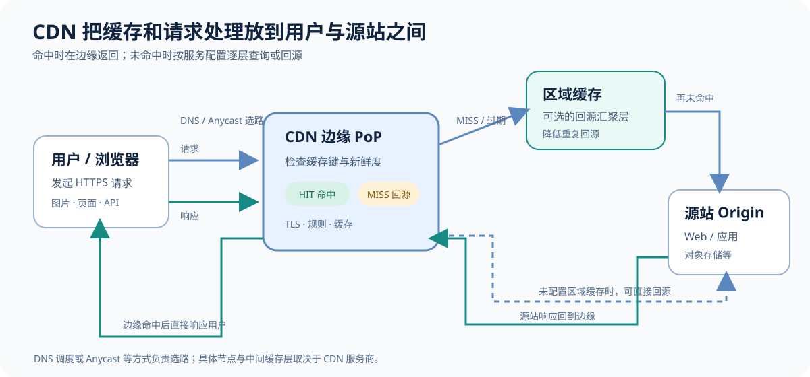
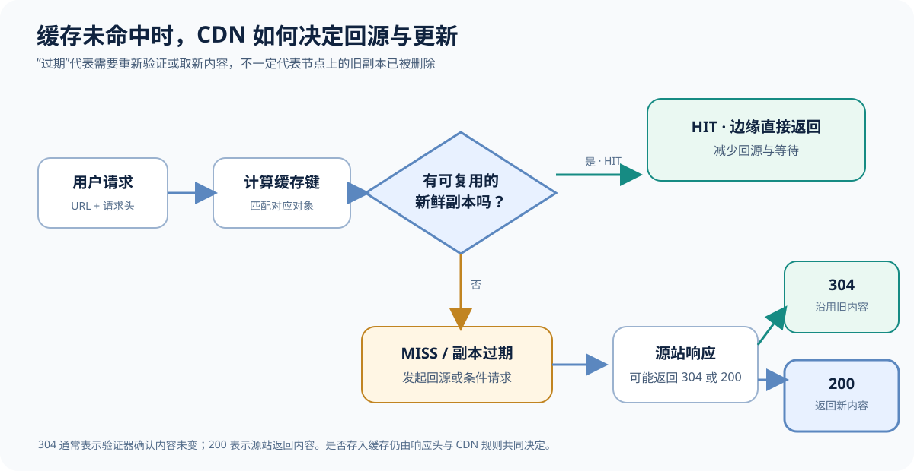
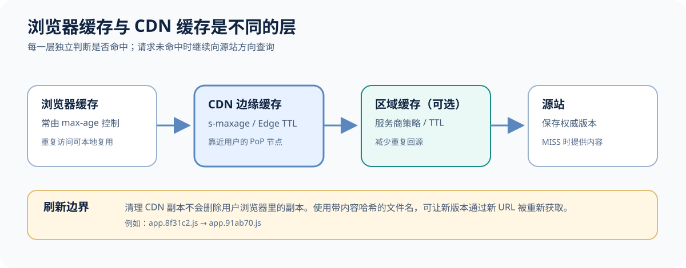
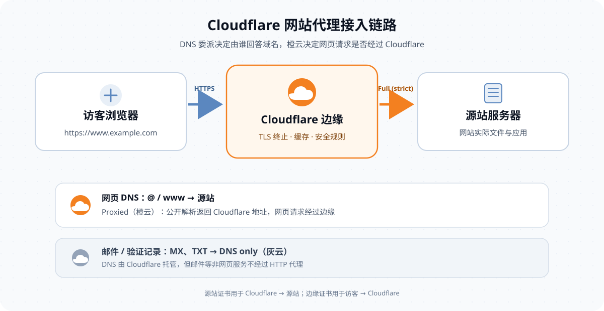

# CDN（内容分发网络）详解：原理、缓存与 Cloudflare Free 配置

当网站只有一台源站时，离服务器近的用户访问很快，跨洲或跨运营商的用户却可能要经过很多网络链路；流量一大，源站带宽、连接数和计算资源也会成为瓶颈。CDN（Content Delivery Network，内容分发网络）通过分布在不同地区的网络节点接收用户请求，在条件允许时直接返回缓存内容；需要回源时，再由 CDN 从源站取内容。

可以先把 CDN 理解成**位于用户和源站之间的一层分布式反向代理与缓存**。它常用于加速网站静态文件、图片、软件下载、视频点播和公开 API，也可能整合 TLS 终止、流量清洗、Web 应用防火墙和请求路由等能力。不同服务商的节点布局、选路方式和缓存规则并不相同，CDN 的行为需要结合具体产品配置理解。

## 一、CDN 由什么组成



*图 1：缓存命中在边缘返回；缓存未命中时，根据服务商架构直接回源或经过区域缓存。*

### 1. 源站（Origin）

源站保存内容的权威版本，可以是 Nginx、应用服务器、对象存储或其他 HTTP 服务。CDN 通常不取代源站，而是把它放在用户请求路径的后方。源站需要告诉 CDN 从哪里取内容，也要能承受缓存未命中、动态请求和缓存刷新带来的回源流量。

### 2. 边缘节点与 PoP

PoP（Point of Presence，网络接入点）是 CDN 在某个地区部署的一组网络和服务设施。用户请求通常会被路由到一个适合处理该请求的 PoP。节点可能缓存静态文件，也可能执行 TLS 握手、访问控制、压缩或其他边缘处理。

“最近节点”不一定等于地图上直线距离最近的机房。网络路径、运营商互联、当前负载和服务商的选路策略都会影响最终落点。部分 CDN 通过 DNS 返回合适节点的地址；部分 CDN 使用 Anycast，让多个地区宣告相同的 IP 地址，再由互联网路由选择可达路径。也有服务组合使用多种机制。Cloudflare 的参考架构介绍了 DNS 单播与 Anycast 等路由方式；具体选路行为仍应以所用 CDN 的说明为准。

### 3. 区域缓存与回源汇聚

一些 CDN 会在边缘节点和源站之间设置更高一层的区域缓存，或提供类似 Origin Shield 的回源汇聚功能。边缘节点没命中时，可以先向上层节点查询，减少同一对象从多个地区重复请求源站的次数。它们并非所有 CDN 都有，也不意味着每个请求都会经过完全相同的层级。

## 二、一次 CDN 请求是怎样完成的

假设用户访问 `https://static.example.com/app.8f31c2.js`：

1. **解析域名并选路**：客户端解析域名，按域名接入配置、DNS 调度或 Anycast 路由到一个 CDN 节点。
2. **建立连接**：客户端与 CDN 建立 TCP/TLS 或其他传输连接。若 TLS 在 CDN 终止，CDN 还可能再通过 HTTPS 与源站建立另一段连接。
3. **计算缓存键**：CDN 根据请求中的域名、路径，以及配置中选定的查询参数、请求头等信息，判断要查找哪个缓存对象。
4. **检查缓存**：如果有一个仍然新鲜、且适用于本次请求的副本，CDN 返回缓存内容，这称为缓存命中（hit）。
5. **回源取内容**：如果没有可用副本，CDN 根据回源配置向源站发请求。源站返回响应后，CDN 判断该响应是否可缓存、缓存多久，再将内容返回用户。
6. **后续复用**：在缓存规则允许且对象仍可用时，后来的请求可以复用这份副本，避免每次都访问源站。

AWS CloudFront 文档也以类似的请求过程说明边缘节点、区域缓存和源站之间的关系。一个容易忽略的细节是：**CDN 未命中时仍要访问源站**，因此第一次访问一个冷资源、缓存已过期或缓存键过于分散时，响应不一定比直连源站更快。

## 三、缓存命中的关键：缓存键与新鲜度

### 缓存键决定“哪些请求算同一个对象”

缓存键（Cache Key）是 CDN 用来区分缓存对象的标识。常见组成项包括主机名和 URL 路径，服务还可能把查询参数、请求头、Cookie 或其他字段纳入缓存键。例如：

```text
https://static.example.com/image.jpg?width=800
```

若 `width` 会改变图片内容，它通常需要参与缓存键；若 `utm_source` 只是统计参数，则可在确认业务语义后考虑忽略它，避免每种营销参数都创建一份相同缓存。忽略参数之前要确认源站确实不会根据该参数返回不同内容。

缓存键设置不完整会产生两类问题：

- **命中率下降**：大量无意义的 URL 差异都生成独立缓存对象，CDN 很难复用内容。
- **内容串用**：不同用户或语言本应看到不同响应，却被合并到同一个缓存对象，可能泄露个性化数据。

HTTP 的 `Vary` 响应头可以声明响应会随哪些请求头变化；RFC 9111 描述了 HTTP 缓存如何选择与验证存储响应。与此同时，各 CDN 对请求头、Cookie 和 `Vary` 的处理方式与控制项可能不同，应该在目标服务中检查最终缓存键，而不要只凭配置名称推断。

### TTL 决定缓存多久可以直接复用

TTL（Time to Live，生存时间）描述缓存对象可被视为新鲜的时长。比如缓存 10 分钟，表示 CDN 可以在这段时间内直接复用副本；超过时限后，CDN 可能回源获取新版本，也可能先用验证器询问源站对象是否变化。

过期不等于对象一定立刻从节点磁盘删除。缓存空间有限，节点可以提前淘汰不常访问的对象；TTL 解决的是“副本还能否按当前规则直接使用”，不是保证某个文件在节点上固定保存多久。

如果响应带有 `ETag` 或 `Last-Modified`，缓存可以使用 `If-None-Match` 或 `If-Modified-Since` 等条件请求进行重新验证。源站若确认内容未变，可以返回 `304 Not Modified`，缓存继续使用原有响应体，只更新相关元数据，减少重复传输。



*图 2：源站返回 304 时可以复用原副本；返回 200 时是否保存新内容，仍取决于缓存策略。*

## 四、HTTP 缓存头怎么理解

源站可以通过 `Cache-Control` 等响应头告诉浏览器和共享缓存如何处理内容。常见指令如下：

| 指令 | 含义 | 典型用途 |
| --- | --- | --- |
| `max-age=秒数` | 在指定时间内视为新鲜 | 浏览器缓存，以及未被其他规则覆盖的共享缓存策略 |
| `s-maxage=秒数` | 指定共享缓存的新鲜时间；按 HTTP 缓存规范，它对共享缓存优先于 `max-age` | 为 CDN 与浏览器设置不同的新鲜时间 |
| `public` | 明确允许共享缓存存储该响应 | 确认可公开复用的内容 |
| `private` | 响应只适合私有缓存，不应由共享缓存存储 | 用户专属页面，但浏览器是否保存仍取决于其他指令 |
| `no-cache` | 可以存储，但复用前需要重新验证 | 希望客户端保留副本，同时每次确认源站版本 |
| `no-store` | 不应存储该响应 | 敏感数据、支付信息等不希望进入缓存的响应 |
| `immutable` | 在新鲜期内内容不会改变的提示 | 带内容哈希版本号的静态资源，属于常用扩展指令 |

`no-cache` 和 `no-store` 很容易混淆：前者通常表示“复用前要验证”，后者表示“不要存储”。若页面含有用户账户信息，应该先确保共享 CDN 不会缓存它；`private` 与 `no-store` 的组合常用于不希望进入任何缓存的敏感响应。

浏览器缓存与 CDN 边缘缓存是不同层次。`max-age`、`s-maxage` 或 CDN 厂商提供的专用响应头和规则，可能让它们采用不同的新鲜时间。清理 CDN 缓存也不会自动删除已经存进用户浏览器的副本。Cloudflare 文档对 Edge Cache TTL 与 Browser Cache TTL 的区别有具体说明；其他服务商的规则名称和优先级可能不同。



*图 3：每一层独立判断是否命中；浏览器缓存需要通过短 TTL、重新验证或版本化 URL 管理。*

## 五、如何制定缓存策略

| 内容类型 | 推荐起点 | 需要留意 |
| --- | --- | --- |
| 带哈希文件名的 JS、CSS、图片 | 长 TTL，例如 `public, max-age=31536000, immutable` | 文件内容变更时生成新 URL；不要覆盖旧 URL 的内容 |
| 文件名固定的静态资源 | 较短 TTL，或部署后主动刷新 | 浏览器可能继续使用旧副本，单纯刷新 CDN 不会清除浏览器缓存 |
| 普通 HTML 页面 | 短 TTL、重新验证，或按页面类型配置 | 需要在更新速度、源站负载和可接受的旧内容时长之间取舍 |
| 登录、购物车、账户、管理后台 | 默认绕过共享缓存，按数据敏感程度设置 `private` 或 `no-store` | 不能只凭路径后缀判断是否为静态内容；检查 Cookie、授权头和响应体 |
| 公开 API | 只缓存明确可公开复用的 GET 响应 | 把会改变返回内容的参数、语言或版本加入缓存键 |
| 下载与媒体文件 | 可缓存较长时间，并评估 Range 请求和文件更新方式 | 热门大文件可能需要分层缓存、预热或单独的流量预算 |

一个简单的静态资源响应示例：

```http
HTTP/1.1 200 OK
Content-Type: application/javascript
Cache-Control: public, max-age=31536000, immutable
ETag: "8f31c2"
```

这类长缓存策略适用于 URL 能随内容变化的资源，例如 `app.8f31c2.js`。如果 URL 始终是 `/app.js`，却给它设置一年缓存，部署新版本后用户可能仍继续执行旧代码。内容哈希或版本号将“更新文件”变成“发布新 URL”，通常比频繁全量清缓存更容易控制。

对于 HTML，常见起点是设置较短的 TTL 或要求重新验证，而不是不加区分地照搬静态资源的一年缓存。对于动态页面，也不代表绝对不能缓存：如果响应对所有用户相同、缓存键完整、失效机制可靠，就可以设计共享缓存；但账户页、结账页和带会话信息的响应必须格外谨慎。Cloudflare 的排错文档列举了动态 HTML 被错误缓存后导致登录和 Cookie 异常的场景。

## 六、部署 CDN 的基本步骤

1. **盘点源站**：确认域名、源站地址、协议、允许访问的端口，以及哪些路径是静态、动态或敏感内容。
2. **接入域名**：按照服务商要求修改 DNS 或配置代理接入。保留好源站域名和接入记录，便于核对解析结果。
3. **配置两段 TLS**：为用户到 CDN 配好证书；同时明确 CDN 到源站是否使用 HTTPS、如何校验证书。边缘 HTTPS 不代表回源链路也自动加密。
4. **定义缓存规则**：先从有版本号的静态资源开始，明确缓存键、TTL、允许缓存的状态码和绕过条件。不要一上来就把所有 HTML 和 API 设为“全部缓存”。
5. **保护源站入口**：若目标是让流量经过 CDN，应限制源站只接受预期的 CDN 回源流量，或采用受控的源站认证方式；否则攻击者仍可能绕过 CDN 直连源站。
6. **确认真实客户端 IP**：CDN 到源站通常会通过约定的请求头传递客户端地址。源站只应信任来自 CDN 的这些头，不能让任意公网请求伪造“真实 IP”。
7. **灰度验证**：先用测试域名或少量流量确认首页、静态文件、登录、上传、下载、重定向和 HTTPS，再扩大接入范围。
8. **准备刷新与回滚**：知道如何按 URL 刷新缓存，保留切回原 DNS 或直连源站的操作路径，并明确发生故障时谁负责执行。

对于小型静态站点，通常先缓存带版本号的静态资源和图片，再决定 HTML 是否短时缓存。对于电商或登录系统，重点是让公开内容命中缓存，同时把用户状态、会话和事务请求准确排除。对于下载站和视频服务，缓存命中率、Range 请求、回源带宽和流量费用都要纳入设计。

### 用 Cloudflare Free 给已有网站接入 CDN

Cloudflare 的 Free 计划当前是 $0/月，包含网站 CDN。它不会替你托管网站内容：源站仍然是现有的云服务器、虚拟主机或静态网站服务，Cloudflare 负责接收经过代理的 HTTP/HTTPS 请求，再按缓存规则返回内容或回源取内容。[Free 计划说明](https://www.cloudflare.com/plans/free/)与[域名接入指南](https://developers.cloudflare.com/fundamentals/manage-domains/add-site/)都把这条链路列为网站加速的基本方式。源站主机费、源站流量费和单独购买的增值产品仍按各自服务商的规则结算。



*图 4：Cloudflare 接入后，网页请求经过代理链路；邮件和其他非网页记录仍由 DNS 直接解析。两段 HTTPS 需要分别配置。*

#### 1. 先确认域名、源站和现有 DNS 记录

准备一个已经注册的根域名，例如 `example.com`，以及当前网站的源站地址。源站可以是公网 IPv4、IPv6，或托管平台提供的 CNAME 目标。先确认网站可以直接通过源站正常提供 HTTP/HTTPS 内容，并记录当前 DNS 区域中的全部记录。

在 Cloudflare 控制台选择 `Onboard a domain`，填写根域名 `example.com`，选择 Free 计划。扫描导入的记录只是起点，Cloudflare 明确提示快速扫描不保证发现所有现有记录。切换前逐项核对根域名、`www`、邮件 MX、SPF、DKIM、DMARC、域名验证和其他子域名；漏掉邮件记录可能导致网站迁移后收发邮件异常。[官方接入步骤](https://developers.cloudflare.com/fundamentals/manage-domains/add-site/)说明了这些记录的检查要求。

如果域名启用了 DNSSEC，先在注册商处关闭，再切换权威 DNS。Cloudflare 区域激活后，可以在 Cloudflare 中重新启用 DNSSEC，并按页面提示更新注册商的 DS 记录。

#### 2. 在域名注册商处切换权威 DNS

Cloudflare 会为这个域名分配两台专属权威名称服务器。把它们复制到域名注册商的“名称服务器 / Nameservers”设置中，替换旧的权威名称服务器。这里改的是域名委派，不是把 Cloudflare 名称服务器填进网站主机的 A 记录。具体名称以控制台为准，不要照抄示例域名。

切换前再次确认 Cloudflare DNS 区域里已经有网站和邮件所需的全部记录。提交后，等 Cloudflare 控制台把站点状态更新为 `Active`。可以用下面的命令查看当前对外公布的权威名称服务器：

```bash
dig +short NS example.com
```

DNS 变化需要经过注册商与递归解析器传播；刚改完时不同网络短时间看到不同结果并不罕见。迁移期间保留旧 DNS 服务和记录，直到主要网络都能正确打开网站、收发邮件。

#### 3. 用橙云代理网页记录

在 Cloudflare 的 DNS 页面，网站记录的常见配置如下。把示例源站地址换成实际值；如果托管平台要求填写特定 CNAME，按托管平台给出的目标配置。

| 记录 | 示例 | 代理状态 | 用途 |
| --- | --- | --- | --- |
| `A` | `@ → 203.0.113.10` | Proxied（橙云） | 根域名指向源站 IPv4 |
| `CNAME` | `www → example.com` | Proxied（橙云） | `www` 网站也经过代理 |
| `MX`、`TXT` | 邮件商提供的记录 | DNS only（灰云） | 邮件收发、SPF/DKIM/DMARC 与域名验证 |

`203.0.113.10` 是文档示例地址，不能直接拿去生产使用。若源站有 IPv6，也要检查 `AAAA` 记录是否指向正确的源站；不再使用的旧 `AAAA` 记录可能让一部分 IPv6 用户连到错误服务器。

橙云的 `Proxied` 状态表示 Cloudflare 代理该记录的网页流量。公开 DNS 查询返回的是 Cloudflare 的 Anycast 地址，随后 HTTP/HTTPS 请求经过 Cloudflare 边缘节点，再由它访问源站。灰云 `DNS only` 只托管 DNS，查询会直接返回记录中的源站地址，这条流量不会使用 Cloudflare 的网站代理、缓存和相关安全功能。[代理状态文档](https://developers.cloudflare.com/dns/proxy-status/)列出了两者的区别。

只把承载网页 HTTP/HTTPS 的 `A`、`AAAA` 或 `CNAME` 记录设为橙云。MX、TXT、SSH 和其他非网页服务应保持 DNS only；Cloudflare 的普通网站代理并不等于任意 TCP/UDP 端口转发。邮件服务器的主机名如果与网站共用同一个源站 IP，DNS only 记录可能暴露该 IP，源站防火墙仍需单独配置。

#### 4. 配好访客到 Cloudflare、Cloudflare 到源站的 TLS

浏览器看到的 Cloudflare 边缘证书和 Cloudflare 回源时使用的源站证书是两件事。域名激活后，Cloudflare 会为根域名和一级子域名自动签发免费的 Universal SSL 边缘证书；可在 `SSL/TLS → Edge Certificates` 查看状态。证书签发通常需要一些时间，状态未 Active 前不要仅凭 DNS 已切换就判断 HTTPS 全部正常。[Universal SSL 文档](https://developers.cloudflare.com/ssl/edge-certificates/universal-ssl/)说明了覆盖范围和签发状态。

源站也应在 443 端口提供证书。若已有 Let’s Encrypt 等公共 CA 证书，可以直接使用；若源站只接受 Cloudflare 回源，可安装 Cloudflare Origin CA 证书。然后在 `SSL/TLS → Overview` 把加密模式设为 `Full (strict)`。这个模式会加密两段连接，并校验源站证书是否有效、域名是否匹配；Cloudflare 将它列为条件允许时的推荐模式。[Full (strict) 设置要求](https://developers.cloudflare.com/ssl/origin-configuration/ssl-modes/full-strict/)。

Origin CA 证书只被 Cloudflare 用于校验 Cloudflare 到源站的连接，浏览器不会把它当作公开可信证书。若暂时关闭代理或把记录改成灰云，浏览器直连源站时可能看到证书警告。[Origin CA 文档](https://developers.cloudflare.com/ssl/origin-configuration/origin-ca/)专门说明了这一限制。网站确认能通过 HTTPS 正常访问后，再启用 `Always Use HTTPS` 或在应用服务器配置 HTTP 到 HTTPS 的 301 跳转。

不要把 `Flexible` 当成长期默认方案：它只保证访客到 Cloudflare 这一段可以使用 HTTPS，Cloudflare 到源站仍可能走明文 HTTP。源站强制 HTTPS、边缘又用 Flexible 回源 HTTP 时，还容易形成重定向循环。常见的 `525` 表示边缘与源站 TLS 握手失败，`526` 通常表示 Full (strict) 无法接受源站证书；排查时先确认源站 443、证书主机名、有效期和加密模式。

#### 5. 先验证默认静态缓存，再决定是否写规则

接入代理不代表所有网页都会被缓存。Cloudflare 默认按文件扩展名缓存一部分静态资源，例如图片、CSS、JavaScript；HTML 和 JSON 默认不缓存。源站的 `Cache-Control`、`Set-Cookie`、请求方法和 Cloudflare 规则也会影响最终结果。[默认缓存行为说明](https://developers.cloudflare.com/cache/concepts/default-cache-behavior/)列出了哪些响应会绕过缓存。

选一个公开的 CSS 或图片 URL，连续请求两次：

```bash
curl -sS -D - -o /dev/null https://www.example.com/assets/site.css | grep -Ei "^(HTTP/|server:|cf-cache-status:|age:|cf-ray:)"
```

如果该资源可缓存，第一次常见 `CF-Cache-Status: MISS`，表示这次没有在缓存中找到副本，Cloudflare 会回源；响应头、状态码等条件允许时，后续请求在同一个 Cloudflare 数据中心可能变成 `HIT`。`DYNAMIC` 表示请求没有进入缓存查找，`BYPASS` 通常表示响应头或规则要求跳过。`server: cloudflare` 或 `cf-ray` 可以说明请求经过 Cloudflare，但仅凭它们不能证明响应来自缓存。[缓存状态排错指南](https://developers.cloudflare.com/cache/troubleshooting/investigating-uncached-responses/)给出了状态含义与验证方式。

```bash
curl -sS https://www.example.com/cdn-cgi/trace | grep "^colo="
```

`colo` 是处理请求的 Cloudflare 数据中心代码。它可以帮助确认请求落在哪个边缘节点，但不能单独代表真实用户的速度；缓存按实际处理请求的 Cloudflare 数据中心生效，换一个网络或区域测试，结果可能不同。

普通静态站点先沿用默认缓存行为即可。若要缓存确认为公开、内容对所有用户一致的 HTML，进入 `Rules → Cache Rules`，针对清晰的公开主机名和路径建立规则，再按需要设置 Edge TTL。不要一开始就对整个域名使用 `Cache Everything`。登录、账户、购物车、结账、管理后台、带用户身份的 API 应保持绕过缓存；共享缓存一旦存错用户响应，可能造成会话或隐私数据串用。[Cache Rules 文档](https://developers.cloudflare.com/cache/how-to/cache-rules/)说明了规则可以控制缓存资格、时长和缓存键。

更新了固定 URL 的文件后，可以在 `Caching → Configuration → Purge Cache → Custom Purge → URL` 清理单个 URL。更推荐给静态资源使用带内容哈希的文件名，例如 `app.8f31c2.js`；每次内容变化生成新 URL，能减少旧浏览器缓存和手动清理的麻烦。[单文件刷新步骤](https://developers.cloudflare.com/cache/how-to/purge-cache/purge-by-single-file/)。

#### 6. 保护源站并保留正确的访客 IP

橙云会让 DNS 查询返回 Cloudflare 地址，但它不会自动关闭源站的公网入口。若源站 IP 已经被历史 DNS、邮件记录或公开日志泄露，攻击者仍可能直连源站，绕过 Cloudflare 的代理和防护。确认网站经 Cloudflare 正常服务后，可在云安全组或主机防火墙中只允许 Cloudflare 公布的 IP 段访问网页 80/443 端口；SSH、管理端口要单独保留给管理员。Cloudflare 地址范围会维护更新，防火墙规则应以[官方 IP 列表](https://www.cloudflare.com/ips/)为准，不能手抄后长期不管。[源站 IP 与防火墙说明](https://developers.cloudflare.com/fundamentals/concepts/cloudflare-ip-addresses/)解释了代理隐藏地址的边界。

如果 Nginx、应用或日志需要读取访客真实 IP，Cloudflare 会通过 `CF-Connecting-IP` 请求头传给源站。只在源站确认请求来自 Cloudflare IP 段时信任这个头；如果源站仍接受任意公网请求，客户端可以伪造同名请求头。[Cloudflare HTTP headers 文档](https://developers.cloudflare.com/fundamentals/reference/http-headers/)建议源站使用 `CF-Connecting-IP` 或 `True-Client-IP` 恢复原始访客地址。

#### 7. 在中国大陆访问时看真实线路表现

Cloudflare 免费 CDN 在中国大陆并非“不能访问”。不少站点可以正常打开；关键区别是普通全球网络没有设在中国大陆的 Cloudflare 数据中心，大陆访客由境外节点处理，实际速度和稳定性取决于运营商线路、源站位置、缓存命中和内容类型。Cloudflare 官方说明跨境线路可能增加延迟、降低稳定性，同时指出要从中国大陆节点提供服务需使用单独订阅的 China Network；该服务要求 Enterprise 计划及有效 ICP 备案或许可。[访客落点说明](https://developers.cloudflare.com/support/troubleshooting/general-troubleshooting/geographic-traffic-routing/)和[China Network 前置条件](https://developers.cloudflare.com/china-network/)给出了产品边界。

因此，不要只因为“没有内地节点”就认定免费版不可用，也不要只凭一次境外测速就断定内地用户体验很好。找目标用户常用的电信、联通、移动网络分别打开首页和主要静态资源，观察首屏时间、失败率、缓存状态和实际 `colo`；站点规模较小时，测得符合自己的要求就可以继续用 Free。若业务要求大陆本地节点、稳定的大陆回源能力或明确的服务等级，再比较阿里云 CDN、其他内地 CDN 或 Cloudflare China Network 的成本与接入条件。

#### 补充：免费代理有文件大小和内容用途边界

Cloudflare Free 适合常规网站流量，不等于可以把它当作无限量的视频或大文件分发网。通过代理上传到源站的单个 HTTP 请求体，Free 计划当前上限为 100 MB；Free 计划可缓存的单个文件上限为 512 MB。Cloudflare 也说明，Free、Pro、Business 的 CDN 若被用来从外部源站提供视频或不成比例的大量图片、音频和其他大文件，可能会限制 CDN 使用。网站里的普通图片、CSS 和脚本并不因此不能走 CDN；大量视频或大型下载文件应检查[视频交付政策](https://developers.cloudflare.com/fundamentals/reference/policies-compliances/delivering-videos-with-cloudflare/)并考虑 [Stream](https://www.cloudflare.com/products/cloudflare-stream/) 或 [R2](https://www.cloudflare.com/developer-platform/r2/)。上传限制与缓存文件上限见[官方缓存限制](https://developers.cloudflare.com/cache/concepts/default-cache-behavior/)和[413 排错说明](https://developers.cloudflare.com/support/troubleshooting/http-status-codes/4xx-client-error/error-413/)。

## 七、CDN 能带来什么，不能保证什么

### 常见收益

- **降低部分请求的往返时延**：缓存命中时，内容从更靠近用户的节点返回，通常不需要跨地域访问源站。
- **减少源站请求和出口流量**：重复访问的可缓存对象可以由边缘节点承担。
- **吸收突发流量**：热点内容被缓存后，源站不必处理每个用户请求；分布式边缘网络也能作为流量治理的一部分。
- **提供边缘安全能力**：一些 CDN 产品集成 DDoS 缓解、访问规则和 WAF 等功能，帮助过滤到达源站前的流量。

### 常见误解

- “接了 CDN，所有请求都会更快”：动态请求、缓存未命中、缓存键分散或低效选路仍然可能很慢；多增加一层代理也有自身开销。
- “接了 CDN，源站就不会被打到”：未缓存内容和动态请求仍需回源；如果源站公网地址可直连，也可能被绕过 CDN。
- “缓存 TTL 是内容在节点上的保留承诺”：TTL 表示新鲜度规则，缓存空间压力下对象可能提前被淘汰。
- “清 CDN 缓存就等于全网更新”：浏览器缓存、操作系统缓存和其他中间缓存仍可能保留旧副本。
- **“CDN 就是安全防护的全部”**：CDN 可以帮助处理部分网络与应用层风险，但源站访问控制、应用鉴权、数据保护和安全更新仍然要由网站自身负责。

缓存还可能引入新的安全问题。若响应因用户 Cookie 或请求头不同而不同，却被多个用户共享，可能发生数据串用；攻击者也可能利用 URL 与源站路由规则差异，让个性化响应误入共享缓存。设计缓存时要按“响应会不会因用户、语言、授权或请求参数而变化”来判断，不能只看扩展名是不是 `.jpg` 或 `.js`。

## 八、如何观察 CDN 是否按预期工作

排查时可以用 `curl -I https://example.com/path` 查看响应头。关注：

- `Cache-Control`、`Expires`：源站或代理向下游声明的缓存策略。
- `Age`：某些共享缓存会显示对象在缓存中的当前年龄；是否返回由实现决定。
- `ETag`、`Last-Modified`：对象的验证器，帮助判断是否发生重新验证。
- `Vary`：响应是否因指定请求头不同而变化。
- CDN 自有的缓存状态头：不少服务会给出 HIT、MISS、BYPASS、DYNAMIC 等状态，但字段名和具体含义因厂商而异。

建议在发布后用同一个 URL 连续请求几次，检查缓存状态是否从未命中变为命中，并分别测试带 Cookie、不带 Cookie、不同查询参数和不同语言的请求。不要只看一个“命中率”数字：整体命中率很高，仍可能掩盖登录接口误缓存或某个核心静态文件一直回源的问题。

| 现象 | 优先检查 |
| --- | --- |
| 资源一直 MISS 或 DYNAMIC | 响应是否允许缓存、请求方法、Cookie、查询参数、状态码规则、缓存键是否过细 |
| 发布后用户看到旧页面 | HTML 与静态资源 TTL 是否匹配、文件名是否带版本、浏览器缓存是否还有效 |
| 登录状态丢失或用户看到别人的数据 | 是否错误缓存动态 HTML、Cookie/授权是否绕过共享缓存、缓存键是否遗漏了用户维度 |
| 源站流量仍然很高 | 动态请求占比、低命中 URL、过短 TTL、查询参数碎片化、区域缓存是否开启 |
| 接入后延迟反而上升 | 用户实际落点、缓存命中情况、回源位置和协议、CDN 到源站的网络路径 |

线上观察可以同时记录 CDN 命中率、回源请求数与带宽、源站 p95 延迟、边缘 p95 延迟、错误率、缓存对象年龄和费用。性能、安全和成本往往互相影响，应该用真实请求日志与用户地区数据调整，而不是只靠一次测速。

## 总结

CDN 的核心价值，是把可复用内容尽可能放到靠近用户的网络节点，并在边缘统一处理请求。理解它时，重点关注四件事：**请求如何被路由、哪些请求共享同一个缓存键、内容什么时候过期、哪些响应绝不能被共享缓存**。把这几件事设计清楚后，再根据业务需要开启 TLS 优化、流量防护和其他边缘功能，通常比盲目套用“全部缓存”规则更可靠。Cloudflare Free 的入门路径可以记成四步：核对并委派 DNS、让网页记录经过橙云、配置 `Full (strict)`、用 `CF-Cache-Status` 检查缓存；大陆访客能不能接受这条线路，最后以目标网络的真实表现判断。

## 参考资料

- [RFC 9111：HTTP Caching](https://www.rfc-editor.org/rfc/rfc9111.html)：HTTP 缓存语义、缓存选择与重新验证。
- [Cloudflare：Content Delivery Network Reference Architecture](https://developers.cloudflare.com/reference-architecture/architectures/cdn/)：CDN 参考架构、边缘节点与路由方式。
- [Amazon CloudFront：How CloudFront delivers content](https://docs.aws.amazon.com/AmazonCloudFront/latest/DeveloperGuide/HowCloudFrontWorks.html)：边缘节点、区域缓存和源站请求流程示例。
- [Cloudflare：Edge and Browser Cache TTL](https://developers.cloudflare.com/cache/how-to/edge-browser-cache-ttl/)：边缘缓存与浏览器缓存时长的区别。
- [Cloudflare：Dynamic content and login issues](https://developers.cloudflare.com/cache/troubleshooting/dynamic-content-and-login-issues/)：动态页面缓存配置不当时的登录问题排查。
- [Cloudflare Free 计划](https://www.cloudflare.com/plans/free/)：免费计划包含网站 CDN 等能力。
- [Cloudflare：Onboard a domain](https://developers.cloudflare.com/fundamentals/manage-domains/add-site/)：添加域名、核对 DNS 记录和切换权威名称服务器。
- [Cloudflare：Proxy status](https://developers.cloudflare.com/dns/proxy-status/)：橙云代理与灰云 DNS only 的区别。
- [Cloudflare：Full (strict)](https://developers.cloudflare.com/ssl/origin-configuration/ssl-modes/full-strict/) 与 [Origin CA](https://developers.cloudflare.com/ssl/origin-configuration/origin-ca/)：回源 TLS 校验与源站证书。
- [Cloudflare：Default cache behavior](https://developers.cloudflare.com/cache/concepts/default-cache-behavior/) 与 [Cache Rules](https://developers.cloudflare.com/cache/how-to/cache-rules/)：默认静态缓存和自定义缓存规则。
- [Cloudflare：Investigate uncached responses](https://developers.cloudflare.com/cache/troubleshooting/investigating-uncached-responses/)：`CF-Cache-Status` 的排查方式。
- [Cloudflare：Cloudflare IP addresses](https://developers.cloudflare.com/fundamentals/concepts/cloudflare-ip-addresses/) 与 [HTTP headers](https://developers.cloudflare.com/fundamentals/reference/http-headers/)：源站防火墙和访客 IP 头。
- [Cloudflare：Geographic traffic routing](https://developers.cloudflare.com/support/troubleshooting/general-troubleshooting/geographic-traffic-routing/) 与 [China Network](https://developers.cloudflare.com/china-network/)：大陆访客线路与内地网络服务条件。
- [Cloudflare：Error 413](https://developers.cloudflare.com/support/troubleshooting/http-status-codes/4xx-client-error/error-413/) 与 [Delivering Videos with Cloudflare](https://developers.cloudflare.com/fundamentals/reference/policies-compliances/delivering-videos-with-cloudflare/)：上传大小和大型媒体文件分发限制。
