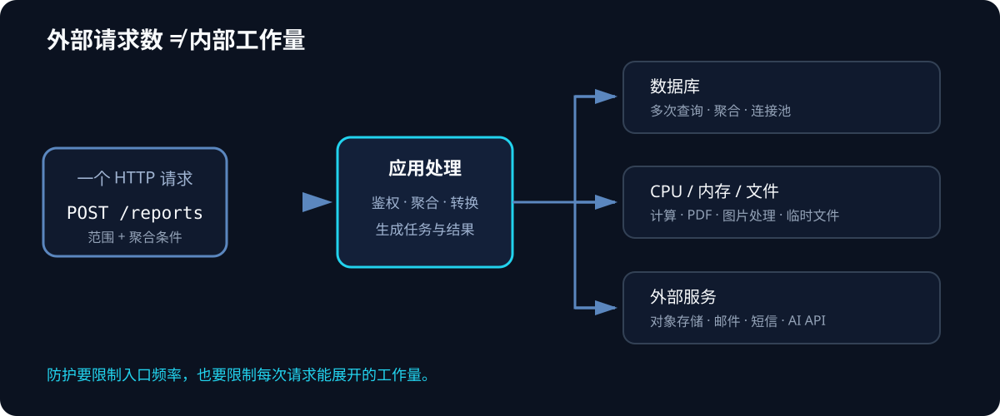
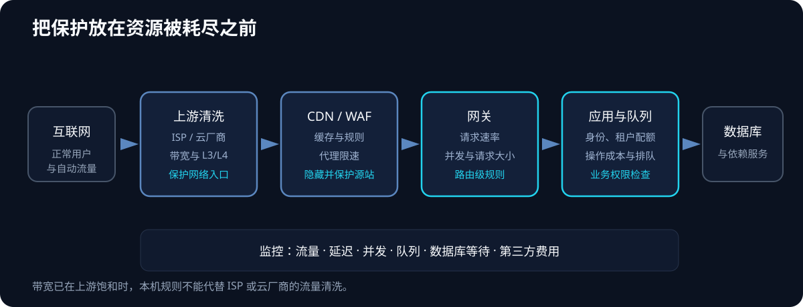
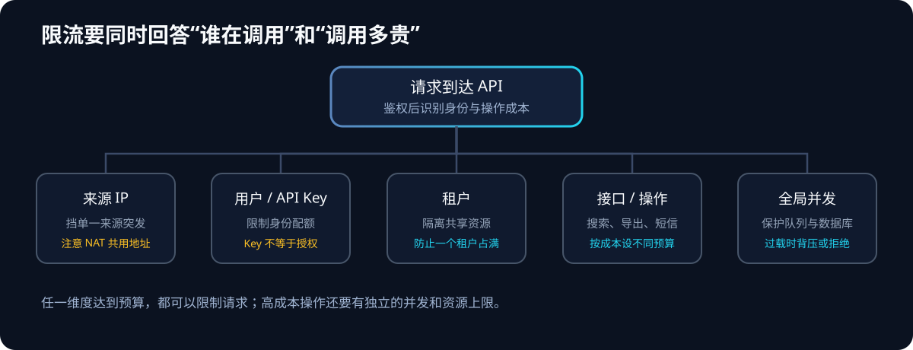

# 接口被“打爆”不只是 DDoS：API 洪水、批量请求与资源耗尽防护

假设有一个报表导出接口：客户端只发一次 `POST /api/reports/export`，服务端却要查几十万行数据、做聚合、生成 PDF，再把文件存进对象存储。对客户端来说是一个请求，对服务器来说可能是几秒钟的 CPU、内存、数据库连接和外部服务调用。

这就是接口防护里容易漏掉的一层：攻击者不一定要送来特别大的网络流量，也不一定需要先找到代码漏洞。只要他能让服务端持续做昂贵的工作，就可能把接口拖慢、耗尽依赖资源，甚至增加短信、邮件、云函数或大模型 API 的账单。

因此，“接口被打”至少要分成三类来处理：**网络带宽和连接被耗尽、API 请求数或并发数过高、单个请求触发了过多内部工作**。限流是重要工具，但要把请求总量、请求成本、用户身份和业务规则一起纳入控制。OWASP API Security Top 10 将资源消耗无限制列为 API4，也单独列出敏感业务流程被自动化滥用的 API6。[OWASP API Security Top 10](https://api-security.owasp.org/editions/2023/en/0x11-t10/)

## 一、先区分：DDoS、接口洪水和业务滥用

**DoS** 是让服务无法正常提供给用户；**DDoS** 是从多个来源同时发起请求或流量，增加过滤难度。HTTP Flood（HTTP 请求洪水）属于常见的应用层 DDoS，但接口滥用不一定是 DDoS：一个登录账号反复触发昂贵任务，或一个合法客户端把批量接口用到超出业务预期，也会造成资源消耗。

从运维角度，别只问“每秒来了多少请求”，还要问三件事：

1. 请求来自哪里，来源地址能不能代表真实用户？
2. 每个请求经过服务端后，会触发多少 CPU、数据库、队列和第三方调用？
3. 哪个资源先到上限：带宽、连接数、应用线程、数据库连接、消息队列，还是外部 API 额度？

| 现象 | 常见方式 | 先检查什么 |
| --- | --- | --- |
| 带宽突然打满 | UDP 洪水、反射放大、超大流量 | 云厂商或 ISP 的流量图、入站带宽、包速率 |
| 连接数或负载均衡状态耗尽 | SYN Flood、连接耗尽 | TCP 连接状态、负载均衡器和防火墙指标 |
| Web 服务收到大量请求 | HTTP Flood、重复访问热点接口 | 每秒请求数、来源分布、路径和状态码 |
| 流量不高，CPU 或数据库却满了 | 搜索、导出、图片处理、复杂查询 | 单请求耗时、查询数、慢查询、并发任务数 |
| 短信或云服务账单突增 | OTP、找回密码、通知发送被滥用 | 用户、手机号、IP、设备、第三方调用量 |
| 库存、预约、优惠或评论异常 | 自动化反复执行业务流程 | 账号行为、资源配额、业务状态变化 |

AWS 将常见 DDoS 分为网络层流量型、传输层协议型和应用层攻击：前两类可能耗尽网络容量或连接状态，应用层则可能用有效的 Web 请求压垮服务。[AWS DDoS 攻击类型说明](https://docs.aws.amazon.com/waf/latest/developerguide/ddos-overview.html)

### RPS 和并发不是一回事

RPS（Requests Per Second）表示每秒请求数；并发表示同一时刻还没处理完的请求数。接口变慢时，即使 RPS 没变，并发也会增加。可用一个近似关系理解稳定状态下的压力：

```text
在途请求数 ≈ 每秒请求数 × 平均处理时间
```

例如一个接口每秒处理 20 个请求，平均需要 2 秒，服务中大约就会有 40 个请求同时占用资源。若平均耗时涨到 10 秒，在同样 RPS 下，在途请求可能升到约 200 个。线程、连接池和任务队列因此被占满，后续请求开始排队，延迟继续上升，最终形成“越慢、积压越多、越慢”的循环。

## 二、一次请求为什么能消耗很多资源

接口层的请求数量只是入口计数。服务端真正付出的成本取决于请求进入应用后调用了什么。



*图 1：对外只有一个请求入口，内部可能扇出多个昂贵操作；应同时限制请求数和操作成本。*

常见放大点包括：

- **批量参数过大**：请求体接受任意多的 ID、文件、记录或操作，单次请求就做上千次处理。
- **无限分页或深度查询**：客户端可以要求返回很大页数，或请求复杂的嵌套关系。
- **昂贵计算**：搜索、报表、PDF、图片缩放、压缩包解压、模型推理等操作远比普通读取耗资源。
- **数据库放大**：一个 API 请求触发 N+1 查询、全表扫描或多个慢查询；请求本身很小，数据库工作量却很大。
- **下游调用放大**：每个用户请求又调用多个短信、邮件、地图、支付或 AI 服务，外部额度和账单也会被消耗。
- **重试放大**：接口过载后，客户端和服务端都立即重试；原请求还在执行，重试又创建新工作。

GraphQL、批量查询接口和消息聚合接口尤其需要注意：网关通常按 HTTP 请求计数，一次 HTTP 请求却可能包含多个操作。OWASP 的 GraphQL 指南因此建议限制查询深度、返回数量、单次批处理规模和查询成本；敏感对象也需要在业务代码中单独限制频率。[OWASP GraphQL Cheat Sheet](https://cheatsheetseries.owasp.org/cheatsheets/GraphQL_Cheat_Sheet.html)

## 三、常见的接口攻击和滥用方式

### 1. HTTP 请求洪水

攻击来源持续访问首页、搜索、登录、API 或随机 URL。目标可能是带宽、TLS 握手、Web 服务工作进程，也可能是应用后面的数据库。请求外观看起来可能是普通 GET 或 POST，因此单纯按固定 IP 拉黑往往不够：来源可能变化，正常用户也可能与攻击流量共用 NAT 出口。

### 2. 并发请求耗尽

一批请求同时发往耗时接口，服务端工作线程、连接池或队列被长时间占用。即使请求数没有特别夸张，只要每个请求耗时够长，也会把服务拖住。这里需要“并发上限”和“超时”，不只需要每秒请求速率。

### 3. 批处理和 GraphQL 查询放大

批量端点让客户端一次提交多个对象或动作。它可能是合法的性能优化，也可能让外围网关把一批工作误认为一个请求。GraphQL 的查询深度、字段展开和批量操作也有类似问题。仅设置“每个 IP 每秒多少次 HTTP 请求”可能漏掉一次请求内部包含的大量工作。

### 4. 登录、验证码和找回密码滥用

攻击者可以反复尝试登录、枚举账号、验证一次性验证码，或触发短信和邮件发送。影响不只是应用负载，还包括账号锁定、用户骚扰、短信费用和第三方 API 额度。应按账号、手机号或邮箱、设备、来源 IP、业务动作和时间窗口组合控制，并避免只按 IP 限制导致共享网络中的正常用户互相影响。

### 5. 敏感业务流程自动化

自动化脚本可以反复抢购、预约、领取优惠、发布内容、注册账号或创建任务。每个请求都可能是合法登录用户发出的，网络层 DDoS 防护未必能判断这种行为是否损害业务。OWASP API6 将“敏感业务流程可被过量自动化访问”单独归类，例子包括抢购、预约占位和内容垃圾。[OWASP API6: Unrestricted Access to Sensitive Business Flows](https://api-security.owasp.org/editions/2023/en/0xa6-unrestricted-access-to-sensitive-business-flows/)

### 6. 资源消耗和账单攻击

上传大文件、提交大量记录、请求高分辨率图片或反复触发付费服务，会占用 CPU、内存、磁盘和第三方调用额度。OWASP API4 的防护建议包括：限制执行时间、内存和文件大小，限制单次批量操作和分页数量，并为第三方服务设置消费上限或账单告警。[OWASP API4: Unrestricted Resource Consumption](https://api-security.owasp.org/editions/2023/en/0xa4-unrestricted-resource-consumption/)

### 7. 爬取和数据枚举

爬虫可能以低速、长时间读取公开数据，也可能通过对象 ID、页码或搜索条件枚举大量记录。它不一定让服务器宕机，却可能造成数据暴露、带宽费用上升或业务内容被批量复制。此时要结合身份授权、数据访问配额、分页上限、异常行为检测和服务条款处理，单纯扩容解决不了数据被读走的问题。

## 四、建立分层防护：从网络入口到业务规则



*图 2：每一层控制不同资源；源站带宽饱和时，本机规则来不及生效，必须由上游服务商处理。*

### 第一层：云厂商、ISP 和 DDoS 清洗

如果攻击流量把服务器的上游带宽占满，本机防火墙或 Nginx 已经看不到完整的正常流量。需要联系云厂商或 ISP 使用网络层清洗、黑洞、路由过滤等上游能力。CDN 和 DDoS 防护服务可以分散或清洗部分流量；选服务时应逐项核对它覆盖的协议、容量、检测方式和响应条款。[CISA DDoS 应对指南](https://www.cisa.gov/sites/default/files/2024-03/understanding-and-responding-to-distributed-denial-of-service-attacks_508c.pdf) · [CISA CDN 缓解建议](https://www.cisa.gov/sites/default/files/2023-09/TLP%20CLEAR%20-DDOS%20Mitigations%20Guidance_508c.pdf)

### 第二层：CDN、WAF 和网关

网站可以把 CDN 或反向代理放在源站前面，处理缓存、TLS、WAF 规则、基础速率限制和明显异常流量。若依赖代理保护源站，还要限制源站只接受预期代理节点的回源流量；否则攻击者可能绕过 CDN，直接访问公网源站 IP。

经过 CDN 后，源站看到的 TCP 对端可能是 CDN 节点。要按服务商文档配置可信代理和真实客户端地址，只信任来自已知代理网段的转发头。不能直接信任任意客户端发来的 `X-Forwarded-For`，否则攻击者可伪造 IP 来绕过按地址限流或污染审计日志。

WAF 擅长基于规则识别部分请求特征，但不知道所有业务的成本和权限。它不能替代服务端鉴权，也无法可靠判断“某个已登录用户是否合理地占了全部预约名额”。高风险操作仍要在应用层做身份、配额和业务状态检查。

### 第三层：按身份、接口和资源成本限流

为同一接口组合多个限制维度；单一的“每 IP 每秒 N 次”规则很难同时覆盖身份和业务成本：



*图 3：身份维度解决单个账号的过量访问，接口维度隔离高成本操作，全局上限保护服务总容量。*

- **来源 IP**：适合挡一部分未登录扫描和单一来源突发；不能作为唯一身份。
- **用户或账号**：适合限制登录用户、验证码、搜索和业务动作；账号也可能被批量创建。
- **API Key 或租户**：适合 B2B、开发者 API 和多租户配额；密钥只用于识别调用方，不能替代用户授权。
- **路由或操作成本**：登录、导出、搜索、上传等接口应该有不同预算；成本高的操作通常要更严。
- **全局并发与队列容量**：保护数据库连接池、Worker 和外部 API；达到上限时排队、拒绝或降级。

常见限流算法有固定窗口、滑动窗口和令牌桶。固定窗口容易在窗口切换时出现短时双倍突发；令牌桶允许可控的小突发，同时限制一段时间内的平均速率。算法选型没有统一答案，关键是明确窗口、突发容量、计数身份和达到上限后的行为。

### 第四层：限制单次请求能做多少工作

对请求本身设置可执行的资源边界：

- 页大小、返回对象数量、批量操作数量和 GraphQL 查询深度都设上限。
- 上传限制文件大小、类型和处理时间；图像、压缩包等还要考虑解码后尺寸、文件数和解压后体积。
- 设置请求体大小、连接超时、上游超时、数据库语句超时和任务最大运行时间。
- 对搜索、报表、导出、图像处理和模型推理做查询成本或任务预算，必要时改成异步任务。
- 给每个账号或租户设置存储、任务数、并发数、短信和第三方 API 调用配额。
- 任何涉及对象 ID 的批量读取，都要逐个执行对象级权限检查；“用户能调用这个批量接口”不代表“用户能读取数组里的所有对象”。

### 第五层：队列、背压和隔离

昂贵工作适合进入有容量上限的队列，接口快速返回任务 ID，由客户端查询结果或接收通知。队列不能无限增长：要设置每账号最大排队数、全局最大队列长度、任务超时和过载时的拒绝策略。对重要的读请求和后台任务分开使用线程池、连接池或队列，避免一个重任务拖垮全部功能。

**背压（Backpressure）** 是在下游处理能力不足时减慢或拒绝上游请求。比如数据库连接池已满，就不要继续把更多工作排进应用线程里；对暂时不可用的任务返回可重试错误，并告诉客户端何时再试。失败后应有退避和随机抖动，避免所有客户端在同一时刻一起重试。

### 第六层：系统与依赖的硬上限

容器、操作系统和数据库连接池可以限制单个服务的 CPU、内存、进程数、文件描述符和连接数。限制的作用是让单个应用不至于吞掉整台机器，不能让应用在该上限下自动正确工作。容器资源限制、数据库连接池、Worker 数量和队列容量应按目标负载联动配置。

## 五、Nginx 限流示例：作为入口保护的一部分

以下配置展示“按客户端地址限制速率和并发”的接入方式。它是结构示例，应把限流指令合并到已有站点配置中，保留现有监听、TLS 证书、日志和代理设置。数字只是示例，不能直接当成所有 API 的生产配额；正常值需要结合接口用途、用户分布、NAT 情况和压测结果调整。Nginx 的 `limit_req` 使用漏桶方式处理请求速率，`burst` 控制允许的突发量；`limit_conn` 用于限制同一 key 的并发连接请求。在 HTTP/2 和 HTTP/3 下，每个并发请求也会分别计入连接限制。[Nginx `limit_req` 文档](https://nginx.org/en/docs/http/ngx_http_limit_req_module.html) · [Nginx `limit_conn` 文档](https://nginx.org/en/docs/http/ngx_http_limit_conn_module.html)

```nginx
http {
    # 以客户端地址为 key；共享内存区由本机 Nginx worker 共享
    limit_req_zone  $binary_remote_addr  zone=api_per_ip:10m  rate=5r/s;
    limit_conn_zone $binary_remote_addr  zone=api_conn_per_ip:10m;

    upstream app {
        server 127.0.0.1:8080;
    }

    server {
        server_name api.example.com;

        location /api/ {
            # 平均速率为每秒 5 个；额外突发最多容纳 10 个
            limit_req zone=api_per_ip burst=10 nodelay;
            limit_req_status 429;

            # 限制同一 key 的并发请求数
            limit_conn api_conn_per_ip 20;
            limit_conn_status 429;

            # 示例值；上传 API 应按业务单独配置
            client_max_body_size 2m;

            proxy_pass http://app;
        }
    }
}
```

这段配置有几个重要边界：

1. **按 IP 限流可能误伤**：公司、校园或移动运营商 NAT 后，很多真实用户会共用一个公网地址。登录、验证码和高成本接口应结合账号、设备或租户维度。
2. **代理后的客户端地址必须可信**：如果前面有 CDN，需仅对 CDN 的已知网段配置真实 IP 恢复。不要照抄不明来源的 `real_ip_header` 配置。
3. **这是单台 Nginx 的配额**：多台网关各自计数时，用户总额度可能随实例数放大。跨实例的全局配额要在 API 网关、共享计数服务或应用中实现。
4. **`nodelay` 会立即放行突发额度**：它不会把突发请求慢慢排队；多出来的请求会在突发额度用尽后被拒绝。对昂贵接口，突发容量要保守。
5. **限流返回码要与语义匹配**：对单个客户端触发频率限制，`429 Too Many Requests` 是合适的信号；根据服务端能否估算等待时间，可提供 `Retry-After`。如果是服务整体过载、暂时无法处理更多请求，则可返回 `503 Service Unavailable`。RFC 6585 定义了 429，并允许响应包含 `Retry-After`。[RFC 6585 第 4 节](https://www.rfc-editor.org/rfc/rfc6585#section-4) · [RFC 9110：503 Service Unavailable](https://www.rfc-editor.org/rfc/rfc9110#name-503-service-unavailable)

修改配置后先用 `nginx -t` 检查语法，再通过预发布或小流量验证限流键、状态码、突发行为和日志。上线时监控被延迟、被拒绝的请求比例；否则合法用户被挡住后，表面上错误率可能下降，体验却已经变差。

## 六、应用内的限流应该如何设计

网关可以看到来源 IP、路径和请求数；应用才能看到用户 ID、租户、业务动作和单次请求的真实成本。建议逐个接口制定资源策略，给不同成本的操作分配不同阈值。

| 接口类型 | 可采用的限制维度 | 额外边界 |
| --- | --- | --- |
| 登录、验证码、密码找回 | IP + 账号/手机号 + 设备 + 时间窗 | 发送间隔、失败次数、总费用告警 |
| 普通读取和列表 | 用户/租户 + 接口 + 全局容量 | 最大页大小、过滤条件、响应大小 |
| 搜索、报表、导出 | 用户/租户 + 并发任务 + 成本 | 时间范围、运行时长、排队上限 |
| 上传、图片和文件处理 | 用户/租户 + 并发 + 存储配额 | 文件大小、类型、解码尺寸、超时 |
| 购买、预约、优惠、评论 | 账号 + 资源对象 + 业务状态 | 幂等、库存/名额原子更新、风控复核 |
| GraphQL 或批量 API | 用户/租户 + 操作成本 | 深度、批量项数、查询复杂度、单次工作量 |

对于资源成本差异很大的接口，可以把请求换算成“成本点”：普通读取计 1 点，复杂搜索计 5 点，导出计 20 点；每个用户在时间窗口内有一个点数预算。这个模型需要根据实际 CPU、数据库和外部服务成本校准，成本点不是安全的数学保证，只是把不同工作量纳入同一预算的工程方法。

多实例部署时，本地内存计数器无法天然形成全局额度：如果四台实例各允许每个用户 10 次/秒，用户可能被放行到每秒 40 次。可将配额放在统一 API 网关或共享计数存储中，也可以把“全局用户配额”和“本机紧急并发上限”结合使用。共享计数服务本身也会成为依赖，要设计超时和失败策略：付费短信、支付和高成本任务通常应保守拒绝；部分只读请求可采用较低的本地保护阈值，避免计数服务故障让整个站点不可用。

**API Key 不是完整的身份认证。** 浏览器或移动端应用里的密钥可能被提取；它更适合识别应用或租户。涉及用户数据和业务动作时，仍要校验用户身份、对象权限和业务状态。

## 七、异步任务和重试也要有上限

把报表和图片处理改成后台任务，能避免 HTTP 请求长期占用线程，但如果任务无限入队，只是把“线程耗尽”改成“队列积压”。异步化时同时做这些限制：

- 每个用户或租户可同时运行和排队多少任务；
- 全局队列长度、单任务运行时间和失败重试次数；
- 重试是否带指数退避和随机抖动；
- 任务是否支持幂等，避免客户端超时后重复创建相同工作；
- 下游服务异常时是否熔断、暂停或降级。

幂等键可以避免网络重试造成的重复写入，但它不能阻止攻击者持续提交不同的请求。配额、身份校验和业务规则仍需独立存在。

## 八、监控要同时看流量、延迟和业务成本

仅看服务器 CPU 不够。建议至少为入口、应用和依赖建立下面这些指标：

- **入口流量**：RPS、入站带宽、包速率、请求方法、路径、来源 ASN 或地区分布。
- **服务延迟**：p50/p95/p99 延迟、超时、4xx/5xx 比例、429 数量。
- **并发与排队**：在途请求、连接数、线程池利用率、队列长度和最老任务等待时间。
- **依赖资源**：数据库连接池等待、慢查询、缓存命中率、外部 API 成功率与延迟。
- **业务费用**：短信、邮件、对象存储、云函数、AI API 的调用量和费用告警。
- **安全事件**：失败登录、验证码发送、权限拒绝、异常账号创建和大量对象枚举。

日志不要无限保存请求体或敏感信息。账号、手机号、Token 和个人数据应该按最小必要原则脱敏或不记录。告警应包含变化趋势和受影响接口，避免只在 CPU 已经到 100% 后才通知。

## 九、发现攻击时按影响层处理

1. **确认症状**：核对是否为带宽被打满、某一路由请求暴涨、应用耗时变长、数据库连接耗尽，还是外部 API 费用异常。
2. **先保护上游**：若带宽或网络设备已饱和，联系云厂商、CDN 服务商或 ISP 请求清洗；不要期待本机防火墙能解决上游拥塞。
3. **临时收紧高成本功能**：降低导出、搜索和批量接口配额；关闭不影响核心交易的昂贵功能；为任务队列设置上限。
4. **保留证据并观察其他系统**：记录开始时间、流量图、请求路径、来源、状态码和告警。DDoS 也可能被用来分散注意力，需继续检查异常登录、权限变化和数据访问。[CISA DDoS 应对建议](https://www.cisa.gov/sites/default/files/2024-03/understanding-and-responding-to-distributed-denial-of-service-attacks_508c.pdf)
5. **恢复后复盘**：找出最先耗尽的资源，补上对应预算、容量上限和告警，再用经授权的压测验证正常流量与过载时的降级行为。

压测应只对自己有权限的系统进行，并设置流量上限、时间窗口和停止条件。生产环境里不做无上限的压测，也不把“用真实攻击试试”当作上线验证方式。

## 十、个人 VPS 或小团队的上线清单

- [ ] 只公开网站需要的端口；数据库、Redis、队列和管理接口不直接暴露公网。
- [ ] 云厂商安全组和主机防火墙都检查过，IPv4 与 IPv6 规则一致。
- [ ] 源站带宽和云厂商的 DDoS 处理渠道清楚；网站使用 CDN 时，源站不能被随意绕过。
- [ ] 每个接口有最大请求体、最大分页、批量项数和合理超时。
- [ ] 登录、验证码、找回密码、导出、上传和付费功能有独立的身份与资源配额。
- [ ] 有每 IP 限速，也有账号或租户维度的限制；不会把共享 NAT 下的用户全部误封。
- [ ] 应用有最大并发和队列长度，数据库连接池和 Worker 也有硬上限。
- [ ] 429、503、重试与 `Retry-After` 的语义明确；客户端重试带退避。
- [ ] 监控 RPS、延迟、并发、队列、慢查询和第三方费用。
- [ ] 有备份和恢复方案；异常流量时知道联系谁、在哪里收紧规则。

把防护做成一条链：**上游清洗保护带宽，网关限制入口速率，应用限制身份和业务成本，队列与系统上限控制故障范围，监控和恢复负责把服务带回来。** 对接口的限额，应同时约束调用频率和每个身份在一定时间内触发的服务端工作量。

## 参考资料

- [OWASP API Security Top 10:2023](https://api-security.owasp.org/editions/2023/en/0x11-t10/)：API 风险分类。
- [OWASP API4: Unrestricted Resource Consumption](https://api-security.owasp.org/editions/2023/en/0xa4-unrestricted-resource-consumption/)：请求频率、批量操作、请求体、分页和外部服务消费的资源边界。
- [OWASP API6: Unrestricted Access to Sensitive Business Flows](https://api-security.owasp.org/editions/2023/en/0xa6-unrestricted-access-to-sensitive-business-flows/)：抢购、预约、评论等业务流程的自动化滥用。
- [OWASP GraphQL Cheat Sheet](https://cheatsheetseries.owasp.org/cheatsheets/GraphQL_Cheat_Sheet.html)：查询深度、批量操作与查询成本限制。
- [NGINX `limit_req` module](https://nginx.org/en/docs/http/ngx_http_limit_req_module.html) 与 [NGINX `limit_conn` module](https://nginx.org/en/docs/http/ngx_http_limit_conn_module.html)：入口请求速率和并发限制。
- [RFC 6585: 429 Too Many Requests](https://www.rfc-editor.org/rfc/rfc6585#section-4)：HTTP 429 状态码及可选的 `Retry-After`。
- [RFC 9110: 503 Service Unavailable](https://www.rfc-editor.org/rfc/rfc9110#name-503-service-unavailable)：服务暂时不可用时的 HTTP 状态码语义。
- [CISA/FBI/MS-ISAC DDoS 应对指南](https://www.cisa.gov/sites/default/files/2024-03/understanding-and-responding-to-distributed-denial-of-service-attacks_508c.pdf)：识别攻击、联系服务商、过滤流量和恢复。
