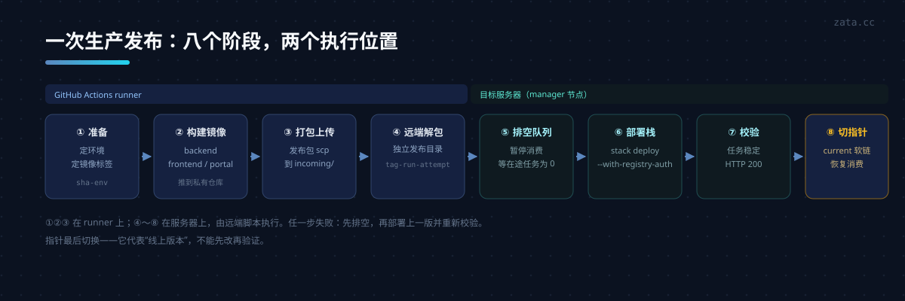
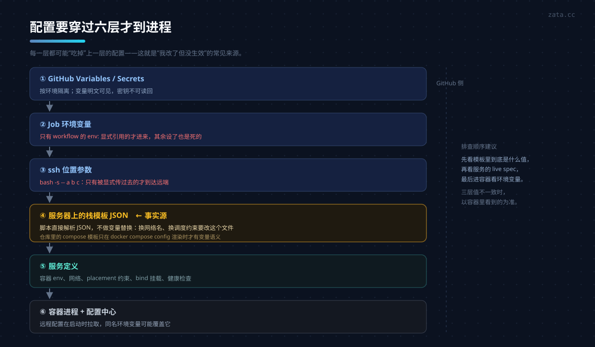
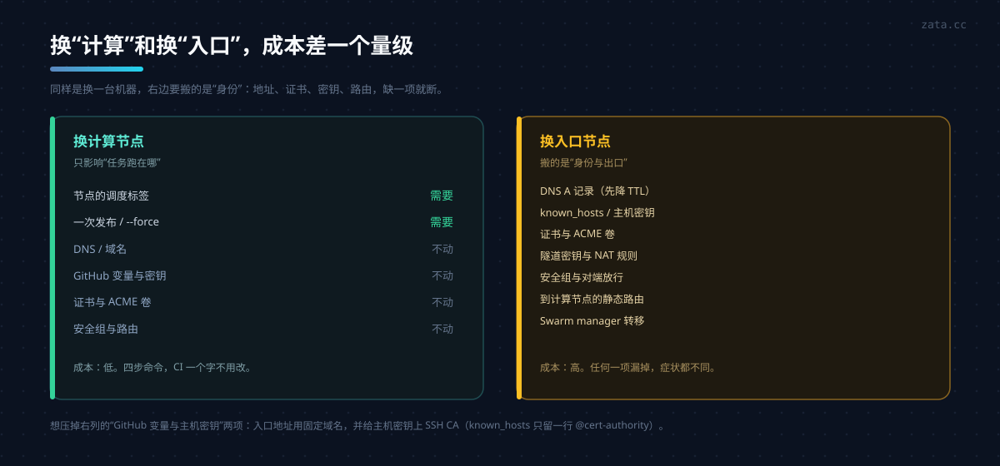

上一篇讲的是迁移过程中踩的坑。这一篇回答更日常的问题：**这套 CD 到底怎么配的、变量在哪一层生效、以后扩容或换机器要动什么。**

先把结论放前面：**目标机应该是一个“角色”，不应该是某个 IP。** 做到这一点，换机器就是改 DNS 和节点标签，而不是改流水线。

## 一、一次生产发布发生了什么

以 Swarm 这条路径为例（staging 走的是另一套平台，这里不展开）：

```text
① push tag / 手动触发
   └→ prepare：决定环境、镜像仓库、镜像标签
② 构建三个镜像（backend / frontend / portal），推到私有 registry
   └→ 标签 = <GIT_SHA>-<environment>，回滚时直接复用历史标签
③ 打包发布包（compose 栈模板 + deploy 脚本）
   └→ scp 到 <RELEASE_DIR>/incoming
④ ssh 到 manager，解包到 <RELEASE_DIR>/<tag>-<run>-<attempt>
   └→ python deploy_nacos.py --release-dir ... --template ... --stack ...
⑤ 脚本内部：
   ├─ 校验模板 + 拉取镜像（在 manager 上）
   ├─ 检查现有栈健康
   ├─ 排空 Celery（暂停消费 → 等在途任务为 0）
   ├─ docker stack deploy
   ├─ 等待任务稳定 + 公网健康入口 200
   ├─ 原子切换 current 软链
   └─ 恢复消费；任一步失败则排空后回滚到上一版
```

注意 ④：**远端的发布脚本用的是参数，不是环境变量**。`ssh host bash -s -- a b c` 后面跟的是位置参数，这决定了第 3 节要讲的“变量在哪儿生效”。



## 二、GitHub 侧的三层配置

| 层 | 放什么 | 特点 |
|---|---|---|
| **Environment** | `production` / `staging` | 隔离变量与密钥；可加人工审批、限分支 |
| **Variables** | 主机、端口、用户、目录、健康 URL、域名 | 明文可见，**不含凭据**；换机改这里 |
| **Secrets** | SSH 私钥、known_hosts、registry 口令、平台 API Key | 不可读回，可轮换 |

一个 production 环境大致需要这些（名称可按项目调整）：

| 名称 | 类型 | 换计算节点时要改吗 | 换入口节点时要改吗 |
|---|---|---|---|
| `SWARM_MANAGER_HOST` | var | 否 | **是**（或用固定域名） |
| `SWARM_MANAGER_PORT` / `USER` | var | 否 | 视新机而定 |
| `SWARM_RELEASE_DIR` | var | 否 | 否（路径保持一致即可） |
| `SWARM_STACK_TEMPLATE` | var | 否 | 否 |
| `SWARM_STACK_NAME` | var | 否 | 否 |
| `HEALTHCHECK_URL` | var | 否 | 仅当域名变 |
| `EXPECTED_PUBLIC_HOSTS` | var | 否 | 仅当域名变 |
| `SWARM_SSH_PRIVATE_KEY` | secret | 否 | 换密钥时才改 |
| `SWARM_KNOWN_HOSTS` | secret | 否 | **是**（新机主机密钥） |
| registry 用户名/口令 | secret | 否 | 否 |

规律很清楚：**计算节点相关的一个都不用改，入口节点相关的基本都要动。** 所以两类机器的“换”成本天生不同。

两个值得现在就做的加固：

1. 给 `production` 环境加 **required reviewers**，避免误触发直接上生产。
2. 删掉已经不用的变量（比如只存在于历史的 `SWARM_ENV_FILE`）。留着不读的变量比删掉更危险——下一个人会以为它生效。

## 三、变量到底在哪一层生效

这是最容易误判的地方。以一次发布为例，配置经过六层：

```text
① GitHub  Variables / Secrets
        ↓  只有被 workflow 的 env: 显式引用的才会进入 job
② Job 环境变量
        ↓  只有被 ssh 命令显式作为参数传过去的才会到达远端
③ 远端 shell 的位置参数
        ↓  deploy_nacos.py 只接收 --template / --image 等参数
④ 服务器上的栈模板 JSON           ← 通常就是“事实源”
        ↓  docker stack deploy
⑤ 服务定义（容器 env / 网络 / 约束 / 挂载）
        ↓  启动时加载
⑥ 容器内的进程环境 + 远程配置中心覆盖
```



几个直接结论：

- **没在 `env:` 里引用的变量，GitHub 上设了也不会生效。** 仓库模板里写 `${SOME_VAR}` 不等于 CD 会传它。
- **模板是 JSON 且由脚本直接读取时，不发生变量替换。** 想让“换网络名 / 换约束”生效，改服务器上的模板文件，不是改 GitHub 变量。
- 容器启动后会从配置中心拉配置，**同名环境变量可能覆盖远程值**，排查“为什么改了配置没生效”时先看容器 env。
- 不要把配置中心返回的内容直接 `source` 进 shell，用解析器读，保留字面值。

## 四、镜像与标签策略

- 标签格式 `<GIT_SHA>-<environment>`：同一提交在 staging / production 的镜像**互不覆盖**，这是必须的。
- 回滚不需要重新构建，直接复用历史标签：`rollback_tag=<sha>-production`。
- 生产发布必须串行：仓库层用 `concurrency` 分组，服务器层再用 `flock` 拿一把文件锁。**两把锁都要有**——手动发布绕过 GitHub，但不能绕过服务器锁。
- staging 可以 `cancel-in-progress`，production 绝对不行。

## 五、四套操作



### A. 扩容计算节点（最便宜的）

```bash
docker swarm join --token <worker-token> <manager>:2377
docker node update --label-add app.example=true <new-node>
docker node update --availability active <new-node>
```

如果服务是 `replicas: 1` + 标签约束，新节点只是“备选”，不会自动分担。要分摊就得先把副本数调大，或者按队列长度做横向扩展。**单副本 + 单 Beat 是有意为之**（避免定时任务双跑），扩容前先想清楚哪些服务能多副本：

| 服务 | 能多副本吗 |
|---|---|
| 无状态 API（前置负载均衡） | 可以 |
| 前端静态服务 | 可以 |
| Celery Worker | 可以（并发按队列分） |
| Celery Beat | **不行**，只能 1 |

### B. 换计算节点（四步，零 CI 改动）

```bash
# 1. 新机入群
docker swarm join --token <worker-token> <manager>:2377
# 2. 先打标签（此时新旧都满足约束，任务可能落新机）
docker node update --label-add app.example=true <new>
# 3. 发布一次，确认新机上的任务健康、公网验证通过
# 4. 摘旧标签再 drain
docker node update --label-rm app.example <old>
docker node update --availability drain <old>
```

顺序的意义：**先加后摘，任何时刻都有节点满足约束。** 反过来会短暂出现“无可用节点”，任务变 unschedulable。

drain 会阻止新任务落到该节点，并把现有任务停掉后重新调度到其他节点；它只等服务配置的 `stop_grace_period`，不会无限等业务任务跑完。需要等在途任务结束时，先做应用层排空（例如暂停 Celery 消费并等在途为 0），再 drain；确认没有任务后再 `docker node rm`。

### C. 换入口节点（成本最高）

入口节点往往同时是四样东西：公网 IP、TLS 终止、Swarm manager、出口 NAT 网关。换它要逐个搬：

```text
1. 新机加入 Swarm 并 promote 成 manager（保持 manager 数量为奇数）
2. 复刻入口组件：反向代理栈、证书卷、出口隧道对端与 NAT 规则
3. 安全组放行：管理端口、overlay 端口（TCP 2377、TCP/UDP 7946、UDP 4789）、隧道端口
4. 降低 DNS TTL（提前一天），再切 A 记录
5. 验证：首页 / 健康 / 证书链 / 出口 IP（容器内看）
6. 旧 manager demote，观察 24h 后再下线
```

容易漏的四个状态：**证书卷、隧道密钥、到计算节点的静态路由、安全组里的对端规则**。漏任何一个，症状分别是“证书报错”“能跑但连不上数据库”“跨节点不通”“overlay 建不起来”。

如果希望这一步以后零改 GitHub，把 `SWARM_MANAGER_HOST` 换成固定域名，并给主机密钥上 SSH CA（`@cert-authority` 一行进 known_hosts）。这是唯一能做到“换机不动机密”的组合。

### D. 回滚

```bash
# 方式一：workflow_dispatch 填 rollback_tag（不重新构建）
# 方式二：用上一次的栈快照重新 deploy
```

回滚前同样要**排空**：新版本可能已经领取了队列消息，直接替换会打断在途任务，留下“业务处理中、队列已丢失”的孤立记录。这类记录不要盲目重放，先核对业务记录和上游是否已完成。

## 六、失败模式速查

| 症状 | 大概率原因 |
|---|---|
| 任务 Pending：`no suitable node` | 约束没人满足（标签摘早了 / 新机没打标签） |
| 任务 Rejected：`no configured subnet contains IP` | 目标节点存在**同名不同驱动**的网络 |
| 发布脚本 `docker inspect` 失败 | 应用跑在 worker，脚本在 manager 上查容器 |
| CD 卡在“等待健康” | 新任务健康检查失败，或公网入口没切过去 |
| 回滚后仍是新版本 | 回滚前的前置检查失败，回滚根本没执行 |
| 改了变量没效果 | 该变量没被 workflow 的 `env:` 引用，或模板是 JSON 不走替换 |

## 七、让“换机”变便宜的三条原则

1. **把所有“机器”抽象成角色**：主机的角色（入口 / 计算）、调度标签、DNS 名。仓库里只出现角色名。
2. **把可变状态显式化**：目录、卷、证书、指针、路由、安全组，全部写进迁移清单，而不是靠记忆。
3. **让回滚走同一条路**：排空、健康判定、指针切换都复用发布流程的函数；回滚路径没被验证过，等于没有回滚。

做到这三条，换机器才真的从“项目”变成“操作”。
