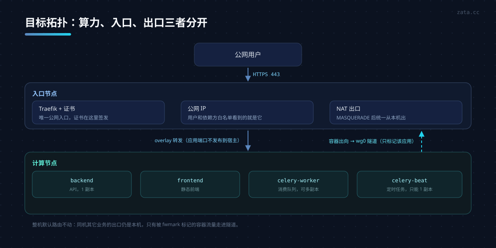
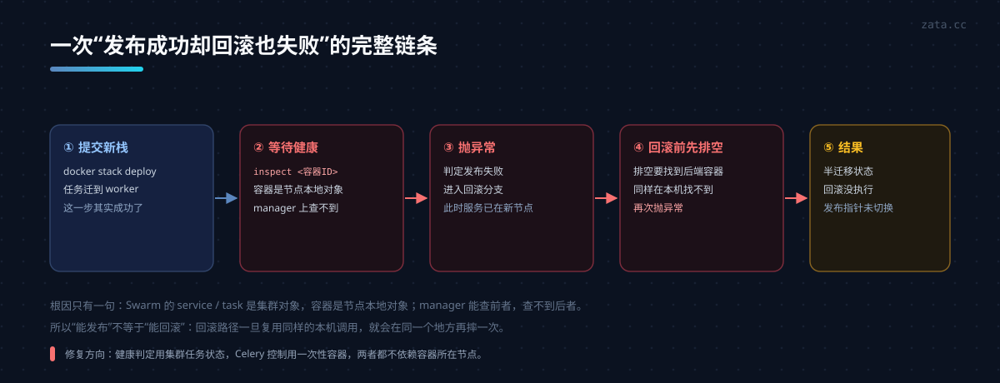
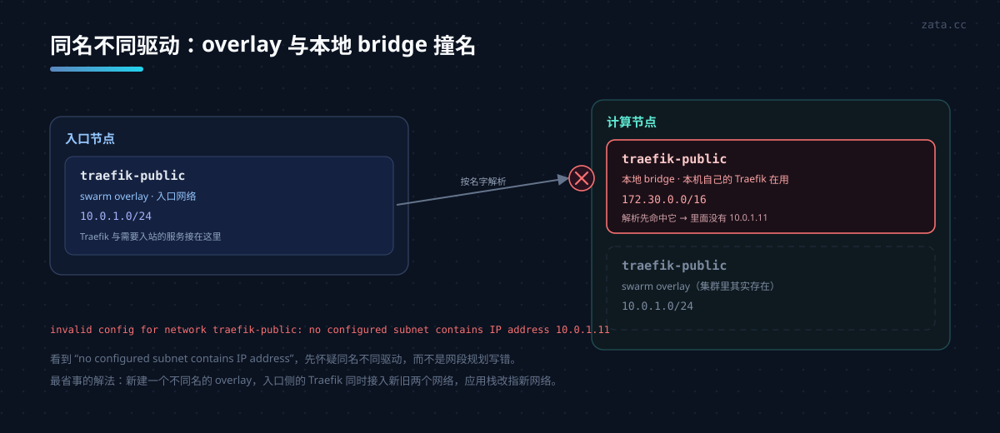
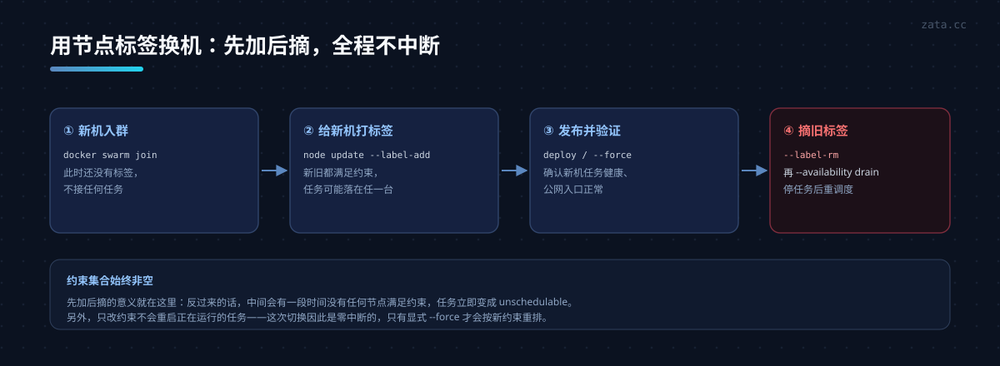

迁移一台正在跑生产的机器，难的不是“把容器搬过去”，而是**所有默认假设被打破之后，你要逐条把它们找出来**。

这次的目标很具体：某个应用原来跑在入口节点上（同时承担公网入口、TLS 和出口 IP），想把它搬到一台新机器上算，但**入站仍然走原节点、出站源 IP 也必须是原节点**。原因很现实——远程数据库、缓存和对象存储的白名单认的是入口节点的公网 IP，换出口就要改一圈外部配置。

下文把整个过程拆成六个坑。网络部分（跨 VPC 为什么不能直接以对端为下一跳、WireGuard 怎么做出口网关）已经单独写过，这里重点讲**调度与发布链路**。



## 一、先破除三个默认假设

| 你可能以为 | 实际 |
|---|---|
| 私网能 ping 通，就能让对端当出口 | ❌ 对等连接是点到点，对端不是可用的三层下一跳 |
| 应用跑在 Swarm 里，在哪台机器上都一样 | ❌ 发布脚本、健康检查、`docker exec` 全都默认“在本机” |
| 换台机器就是改个 IP | ❌ 网络名、数据目录、证书、发布指针、主机密钥都跟着走 |

这三个假设是后面所有问题的根。

## 二、坑一：私网互通 ≠ 可以当出口

两台机器分属不同 VPC，对等连接打通后 `ping` 0.5ms，看起来“就是一张内网”。但看一眼路由表就明白了：

```text
# 计算节点
10.20.1.20 via 10.10.1.1 dev eth0     # 下一跳是 VPC 网关
# 入口节点
10.10.1.10 via 10.20.1.1 dev eth0      # 下一跳也是 VPC 网关
```

两侧的下一跳都是**各自 VPC 的网关**，不是对方。对等连接只保证“目的地址是对方私网 IP”的包能过去，不支持把对端 ECS 当成其它目的地址的下一跳，也不传递路由。

所以下面这种写法是无效的：

```bash
# 反例：以为这样就能让出口流量走对端
ip route add default via 10.20.1.20 dev eth0 onlink
```

`onlink` 只是把 ARP 下一跳变成网关地址，网关仍然按**目的 IP** 选路，去公网的包直接被它送出，不会进入对端。判断口诀：

> **下一跳必须是二层可达的邻居，或者隧道的对端。**

最后用的是 WireGuard：计算节点把**只有该应用容器**的出向流量打 mark，策略路由到 `wg0`；入口节点解封装后 MASQUERADE。整机默认路由不动，同机其它业务的出口不受影响。

几个容易漏的点：

```bash
# 计算节点：只标记容器出向，别动默认路由
iptables -t mangle -A PREROUTING -i docker_gwbridge -j MARK --set-mark 0x64
ip rule add fwmark 0x64 lookup 100
ip route add default dev wg0 table 100

# 两端都要做 MSS clamp，否则表现为“能 ping 通、大包打不开”
iptables -t mangle -A FORWARD -o wg0 -p tcp --tcp-flags SYN,RST SYN \
  -j TCPMSS --clamp-mss-to-pmtu
```

还有一个 WireGuard 自己的坑：计算节点侧的 `AllowedIPs` 必须放行所有目的地址，否则**加密路由会把转发流量丢掉**：

```ini
[Interface]
Address = 10.99.0.2/32
MTU = 1420
Table = off          # 不要让它改默认路由，策略路由自己管

[Peer]
PublicKey = <入口节点公钥>
Endpoint = <入口节点私网>:51820
AllowedIPs = 0.0.0.0/0
PersistentKeepalive = 25
```

`AllowedIPs = <对端>/32` 只能让“目的地是对端”的包进隧道，转发流量会被静默丢弃——症状就是 `wg show` 有握手、有流量计数，但容器里 `curl` 一直超时。

## 三、坑二：发布脚本里的“本机容器”假设

应用搬到 worker 之后，第一次发布失败了。原因不在网络，而在发布脚本里的三处调用：

```python
# ① 排空：只列本机容器
docker ps -q --filter label=com.docker.swarm.service.name=<stack>_backend
if len(containers) != 1:
    raise RuntimeError("Expected one running API container")

# ② 控制 Celery：exec 进那个容器
docker exec -i <container_id> python - <action>

# ③ 健康检查：先查 task（集群对象，OK），再查容器（节点本地对象，失败）
task = docker inspect <task_id>              # ✅ manager 能查
container = docker inspect <container_id>    # ❌ 容器在别的节点上
```

根因一句话：**Swarm 的 service/task 是集群对象，容器是节点本地对象。** manager 能查前者，查不到后者。

更糟的是失败链条：

```text
deploy → 栈提交成功 → 任务迁到 worker
      → wait_healthy 查容器失败 → 抛异常
      → 进入回滚分支 → 回滚前也要 drain → 同样查不到本机容器 → 再次抛异常
      → 回滚没执行，留下半迁移状态
```

所以“能发布”不等于“能回滚”。**任何依赖本机容器对象的步骤，在跨节点调度后都是定时炸弹。**



修复思路是把两类操作分开：

| 目的 | 依赖 | 做法 |
|---|---|---|
| 判断任务是否在跑 | 集群对象 | `docker service ps` + `docker inspect <task>` |
| 判断是否重启循环 | 集群对象 | 同一容器 ID 连续两轮仍在运行 |
| 判断业务是否可用 | 外部视角 | 公网健康入口 200 + Celery 存活探测 |
| 执行 Celery 控制 | 应用环境 | 在 manager 上用**同一镜像 + 同一份环境**起一次性容器 |

一次性容器那段是关键，写法大致是：

```bash
# 环境变量从服务规格里取，写成 600 的临时文件，执行完立即删除
docker run --rm -i --network host --env-file <临时env> \
  -v /opt/app/resources:/app/resources \
  --entrypoint python <应用镜像> - <动作>
```

这样不需要给 worker 开 SSH，也不用在 manager 上复刻一整套启动配置——镜像和环境本来就来自服务定义。

**验证方式**：先跑 `--dry-run`（正常流程里它包含“检查现有栈健康 → 排空 → 不切换”），确认这条路径在 worker 调度下能走通，再动真格。

## 四、坑三：同名网络冲突

第一次迁移时，四个服务里两个起不来，报：

```text
invalid config for network traefik-public: invalid endpoint settings:
no configured subnet contains IP address 10.0.1.11
```

`docker network ls` 在两台机器上都没问题，但名字相同、**驱动不同**：

- 入口节点：swarm overlay `traefik-public`，网段 `10.0.1.0/24`
- 计算节点：本地 bridge `traefik-public`，网段 `172.30.0.0/16`（它自己的 Traefik 用）

worker 上调度任务时，Docker 用**名字**解析网络，命中了本地那个 bridge，于是往 `10.0.1.11` 分配地址失败。



这类问题很容易误判成“overlay 没建好”。看到 `no configured subnet contains IP address` 这种措辞，先怀疑**同名不同驱动**，而不是网段规划。

三种解法，代价递增：

1. **新建一个不同名的 overlay**，入口节点的 Traefik 同时接入新旧两个网络，应用栈改指新网络。（本次采用，改动只在 Traefik 和应用栈，不动计算节点上已有业务）
2. 把计算节点上的本地 bridge 改名，同时改它自己的 compose 与 Traefik 配置。（要重启已有业务）
3. 让两边共用同一个 attachable overlay。（网络生命周期耦合，不推荐）

注意第 1 种做法要改三处：service 的 `networks`、`traefik.docker.network` 标签、以及栈顶层的 `external` 名字。漏掉标签会导致 Traefik 选错网络，表现为 502。

## 五、坑四：目标节点的运行态依赖

容器镜像一样，不代表能跑起来。这次差点漏掉的是：

- **bind 挂载**：`/opt/app/resources` 在目标节点不存在，Docker 会默默创建一个空目录，应用启动后找不到配置文件。
- **属主与 UID**：容器以 `uid=1000` 运行，拷贝目录时要保留数字属主（`tar --numeric-owner`），否则运行时写权限报错。
- **命名卷**：日志卷无所谓，但 Beat 的调度数据库是新的，等价于“调度状态重置”。可接受，但要写进记录。
- **目录权限**：某些目录是 `700`，用普通用户态传输会改变权限。

一条经验：**迁移前先把目标节点的“非镜像依赖”列成清单**，包括目录、属主、卷、时区、内核参数、证书卷。这份清单比迁移步骤本身更重要。

## 六、坑五：两个 `current` 指针

发布目录里通常用一个软链 `current` 指向“当前生效的发布”。这次发现存在两个：

```text
/opt/app/releases/current                     # 手工发布用
/opt/app/releases/production/current          # CI 用（SWARM_RELEASE_DIR 指到 production 子目录）
```

后果是：手工发布成功、CI 发布成功，但两边记录的“线上版本”不一致，回滚时按哪个指针都会有一半人不同意。

统一的做法是把 `SWARM_RELEASE_DIR` 直接指到 `releases/` 根目录，让两条路径共用同一个 `current`，并把这些目录的属主交给部署用户——注意**软链本身属于谁不重要，重要的是它所在目录可写**，否则原子替换会失败。

顺带清理：把历史发布目录和 `incoming/` 从子目录搬回根目录，删掉空的 `production/`，避免下一个人再猜。

## 七、坑六：换机成本——别用角色做约束

原来的调度约束是：

```yaml
placement:
  constraints:
    - "node.role==worker"
```

只有一台 worker 时它等价于“就那台”。想换机，就得同时存在新旧两台 worker，任务会**随机落**；想缩容，又得先改约束。

改成节点标签：

```bash
docker node update --label-add app.example=true <worker>
```

```yaml
placement:
  constraints:
    - "node.labels.app.example==true"
```

换机流程就变成四步，**CI 和模板一个字都不用改**：

```bash
# 新机器
docker swarm join --token <worker-token> <manager>:2377
docker node update --label-add app.example=true <new>
# 发布一次（或 docker service update --force）
# 旧机器
docker node update --label-rm app.example <old>
docker node update --availability drain <old>
```

顺序很重要：**先加新标签、发布、再摘旧标签**。任何时刻都有节点满足约束，否则任务会直接变成 unschedulable。



还有两个细节：

- 只改约束不会重启正在运行的任务（docker 认为现网仍满足新约束），所以这次切换是**零中断**的。想强制按新约束重排，才需要 `--force`。
- `drain` 会阻止新任务落到该节点，并把现有任务停掉后重新调度；它只等 `stop_grace_period`，不会等业务任务自然结束。先做应用层排空再 drain，比直接 `rm` 节点安全得多。

## 八、验证清单

发布这种事，验证项要能在**出问题时快速缩小范围**。这次用的清单：

| 层 | 验证 | 通过标准 |
|---|---|---|
| 调度 | `docker service ps` | 四个服务都在目标节点，无 Rejected |
| 网络 | `curl https://ifconfig.me`（容器内） | 等于入口节点公网 IP |
| 网络 | 同一命令（主机上） | 仍等于计算节点自己的公网 IP |
| 依赖 | 容器内 TCP 连数据库/缓存 | 通 |
| 配置 | 配置中心域名解析、应用启动日志 | 无 bootstrap 失败 |
| 入口 | 首页 / 健康 / 文档 / 静态资源 / CORS 预检 | 全部 200 |
| 后台 | Celery 队列有消费者、`inspect ping` | 有回复，在途任务为 0 或正常完成 |
| 单实例 | Beat 副本数 | 恰好 1，且不在旧节点 |
| 回归 | 目标节点上原有业务的域名 | 200 |

“容器出口等于入口节点 IP、主机出口不变”这条最能证明策略路由没写宽——**只影响该应用的容器**，不是整机。

## 九、上线编排的通用顺序

无论换节点还是换入口，顺序都有共性：

1. **先建后切**：隧道、网络、标签这些“基础设施”先就位并单独验证，再进入发布。
2. **先加后摘**：调度标签先给新节点，发布验证通过后再摘旧节点。
3. **单实例约束**：定时任务（Beat）永远只能有一个，迁移时用同一个栈滚动替换，避免并行双跑。
4. **排空 ≠ 停机**：暂停领取新任务、等在途任务结束，再替换；强制停止会留下“业务处理中、队列已丢失”的孤立记录。
5. **失败也要能回滚**：回滚路径必须和发布路径用同一套检查，否则“发布失败”会退化成“半迁移”。
6. **指针最后动**：`current` 只在验证通过后翻转。

## 十、顺便说说隐私分层

这类操作会写大量文档，而文档最容易泄露真实拓扑。这次的做法可以复用：

- **公开仓库只写占位符**：`<ENTRY_NODE>`、`<APP_DOMAIN>`、`<REGISTRY>`，并在一篇文档里定义好这套记号。
- **真实值单独存放**：主机、账号、私网段、资源 ID 全部落在被 `.gitignore` 排除的私有目录，公开文档只写“见私有清单”。
- **私有资料要能备份和校验**：用脚本做快照、格式化、校验，避免手改导致结构损坏。
- **提交前自查**：`git diff --cached` 扫一遍 IP、域名、仓库地址；会话转写、截图文本这类临时文件加进忽略列表。

原则很简单：**公开文档描述“怎么做”，私有清单记录“在哪做”。**

## 小结

把这次的经验压成几句可复用的判断：

1. **下一跳必须是邻居或隧道对端**，对等连接不是路由器。
2. **跨节点调度后，任何“本机对象”的调用都要重审**：`docker ps`、`docker exec`、`docker inspect <container>`。
3. **同名即冲突**，overlay 与本地 bridge 共享命名空间。
4. **迁移清单里，非镜像依赖往往比镜像更危险**：目录、属主、卷、证书、指针。
5. **用标签表达“谁该跑”，不要用角色**——标签可以随时加摘，角色不行。
6. **回滚路径要跟发布路径一样被验证过**，否则它只是纸面上的退路。

迁移做完之后，最值钱的不是“服务又跑起来了”，而是这几条规则让下一次换机变成十分钟的事。
