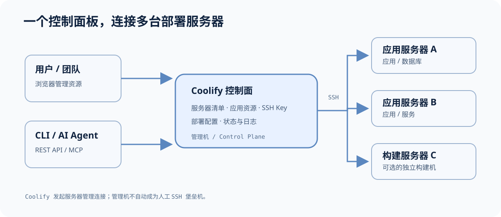
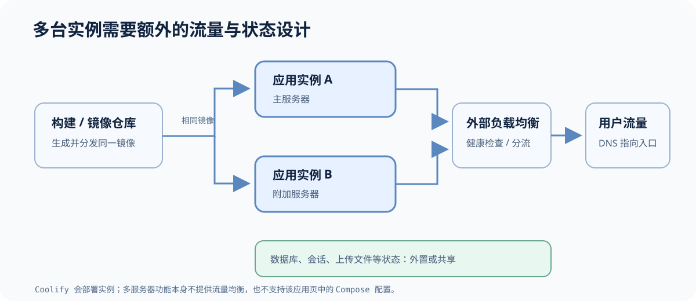
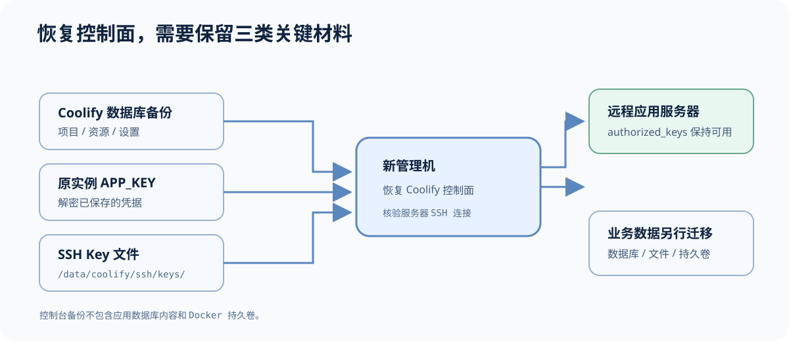

手上有几台 VPS，每台机器跑着不同的 Docker 应用，时间久了，服务器地址、SSH Key、部署目录、域名和备份任务散落在终端历史、Compose 文件和笔记里。Coolify 试图把这类应用交付工作放进一套自托管控制台：你在一个面板里登记服务器、应用和凭据，再让它通过 SSH 把应用部署到选定的机器。

它适合管理以容器为中心的应用部署。它不是通用的 Linux 配置管理系统，也不是 SSH 堡垒机。理解这条边界，才能判断它能不能接手现有的运维流程。

## Coolify 是什么

Coolify 是开源、自托管的 PaaS（平台即服务）。你可以把它理解为部署在自己基础设施上的应用交付控制平面：连接代码仓库或容器镜像，设置环境变量、域名和部署目标，再由 Coolify 构建、启动或更新应用。它也能管理数据库和服务等资源，并记录部署状态。

Coolify 有自托管版和 Coolify Cloud。自托管版的面板运行在你自己的 Linux 机器上；Cloud 由 Coolify 团队托管控制面板，实际运行应用的服务器仍由你连接或创建。两种方式都可以连接部署服务器。本文主要讨论自托管版，因为它最贴近“自己准备一台管理机，统一管理多台服务器”的场景。[服务器文档](https://coolify.io/docs/core/infrastructure/servers/overview)

## 控制台、堡垒机和应用服务器

Coolify 安装后会有一个 `localhost` 服务器，也可以再登记多台远程 Linux 服务器。它通过 SSH 连接远程主机，检查环境并准备 Docker；应用、数据库和服务则部署在你指定的目标服务器上。控制面板与业务工作负载可以放在不同机器上，降低应用构建或故障对面板本身的影响。



*图：用户和自动化工具访问 Coolify 控制面板；Coolify 通过 SSH 管理已登记的服务器。*

这台运行 Coolify 的管理机不等于堡垒机。堡垒机主要提供人员登录入口、身份验证和 SSH 会话审计；Coolify 的 SSH 连接用于准备部署环境和执行应用生命周期操作。若团队需要集中审计人工登录，仍应保留现有堡垒机或 SSH 访问策略。

## 多台服务器和 SSH Key 怎么管理

在 Coolify 里添加服务器时，可以为每台主机设置名称、IP 地址或域名、SSH 端口、连接用户、服务器用途和私钥。这样可以把“应用在哪台机器运行”和“Coolify 用什么凭据连接机器”一并放进控制台管理。服务器可以分别承担构建与部署工作，也可以专门作为构建机。[添加服务器指南](https://coolify.io/docs/core/infrastructure/servers/add-server)

SSH Key 的流程是：在 Coolify 创建或导入私钥，把对应的公钥加入目标服务器用户的 `~/.ssh/authorized_keys`，然后在服务器设置中选择这把私钥并验证连接。私钥留在 Coolify 一侧；Coolify 会加密数据库中的私钥，并在自托管主机上保存 SSH 客户端使用的密钥文件。[SSH Key 文档](https://coolify.io/docs/core/security/credentials/ssh-keys)

首次验证服务器时，Coolify 会检查 SSH、操作系统和所需工具，并安装或确认 Docker Engine、Docker Compose，之后启动 Coolify Proxy。验证过程可能重启 Docker，已有容器有短暂中断的可能。因此，优先在新机器上接入；如果要接入已有业务主机，应先确认影响并安排窗口。[服务器概览](https://coolify.io/docs/core/infrastructure/servers/overview)

轮换密钥时，建议逐台过渡：

1. 在 Coolify 创建新密钥，把公钥加到目标服务器。
2. 在对应服务器设置中切换私钥并执行连接检查。
3. 所有服务器验证通过后，再移除旧公钥和旧私钥。

不要先删旧 Key 再验证新 Key。若一个 Key 被多台主机或代码仓库共用，先盘点依赖，再逐项更换，避免一次变更同时切断多条连接。

## 一个应用部署到两台机器，意味着什么

Coolify 可以把同一个应用部署到主服务器和一个或多个附加服务器上。每台机器运行一个应用实例，但这一步本身不会把访问流量分到各实例。流量分发、健康检查和公共 DNS 仍需要外部负载均衡器或其他流量入口。



*图：部署多个实例和分配用户流量是两件事；负载均衡、共享状态和监控需要单独设计。*

这项多服务器能力有明确限制：Coolify 的应用多服务器设置不支持 Docker Compose 应用；配置了持久化存储的应用也不能直接添加额外服务器。多实例应用应尽量保持无状态，把数据库、会话、队列、缓存和上传文件放在共享或外部服务中；各机器还需要相同 CPU 架构、匹配的代理类型，并能从镜像仓库拉取同一个镜像。[多服务器部署文档](https://coolify.io/docs/core/infrastructure/scaling/multi-server-deployments)

如果你的目标是把两个彼此独立的应用分别放到两台服务器，做法通常是分别创建资源并为它们选择部署目标。如果目标是“同一个应用在两台机器同时运行并自动分流”，就要额外设计负载均衡和共享数据。不要把这两种需求混为一谈。

## CLI 和 AI Agent 能不能用

可以。Coolify 提供官方 CLI，CLI 调用 Coolify 的 REST API，可用于列出资源、执行部署、写脚本或接入 CI；它不是一套绕过 Coolify、直接 SSH 到每台服务器的命令封装。[Coolify CLI 文档](https://coolify.io/docs/cli/what-is-the-coolify-cli)

Coolify 也提供 MCP 端点，兼容的 AI 客户端可以读取基础设施和资源信息，并在令牌允许时执行部署等操作。自托管实例需要启用 API/MCP，为对应团队创建 API Token，再将 `https://你的面板域名/mcp` 配到客户端。给 Agent 单独创建权限尽量小的令牌：只查信息时使用读取权限；确实需要部署时才增加部署权限。令牌等同于可执行操作的凭据，不要写进仓库或普通聊天记录。[MCP 设置指南](https://coolify.io/docs/mcp/setup) · [MCP 工作方式](https://coolify.io/docs/mcp/how-mcp-works)

这让 Coolify 可以成为 Agent 操作部署资源的入口，但 Agent 能做什么仍由团队范围和 API Token 权限决定。建议先从只读盘点开始，再逐步开放部署、重启等写操作。

## 迁移管理机和备份数据

Coolify 的实例备份保存的是控制面数据，例如项目、资源设置、凭据和部署历史；它不包含已部署应用里的数据库内容、文件和 Docker 持久化卷。业务数据仍需按各自服务配置备份。[实例备份说明](https://coolify.io/docs/core/backup-and-recovery/instance-backup)

迁移到另一台管理机时，Coolify 提供恢复流程，但不是“点一下就把一切搬好”。至少要准备实例数据库备份、原实例的 `APP_KEY`、`/data/coolify/ssh/keys/` 中的 SSH Key 文件，并确保远程主机上的 `authorized_keys` 仍授权相应公钥。`APP_KEY` 用于解密备份里的凭据；缺失时，恢复出的私钥和其他加密凭据无法正常读取。应用数据库和持久化卷则要另外迁移或恢复。[实例恢复指南](https://coolify.io/docs/core/backup-and-recovery/instance-restore)



*图：Coolify 控制面恢复与业务数据恢复是两条独立流程。*

因此，应把 Coolify 的数据库备份、`APP_KEY` 和 SSH Key 文件放到管理机之外的受控位置，并定期确认备份可以读取。迁移前在新机器演练恢复，比故障时临时拼凑文件稳妥得多。

## 安装前先看这几件事

官方自托管文档列出的最低资源为 2 核 CPU、2 GB 内存和 10 GB 磁盘；新装建议准备一台干净的 Linux 服务器。官方安装命令是：

```bash
curl -fsSL https://cdn.coollabs.io/coolify/install.sh | bash
```

安装后按终端提示完成初始配置，并尽快设置面板域名、HTTPS 和防火墙。直接通过 IP 访问面板时通常需要开放 8000、6001、6002 等端口，以及 SSH、HTTP/HTTPS；通过代理域名正常访问后，可以按官方防火墙指南收紧面板相关端口，并尽可能限制 SSH 来源。[自托管安装指南](https://coolify.io/docs/start-with-self-hosted) · [防火墙指南](https://coolify.io/docs/core/infrastructure/servers/firewall)

把管理面板和生产应用放在不同机器上，是更容易维护的起点。后续先接入一台非关键服务器，完成 SSH 验证、部署、更新和恢复演练，再把其他机器纳入管理。这样也能观察 Coolify 的服务器验证步骤对现有 Docker 环境是否有影响。

## 它在同类工具里的位置

Coolify 是自托管 PaaS 和应用部署平台中关注度较高的开源项目。截至 2026 年 10 月 19 日，其 GitHub 仓库显示约 6.3 万颗 Star；这可以说明项目有较高的公开关注度，但不能当作真实安装量，也不能据此断言它是所有服务器管理工具中使用最多的。[Coolify GitHub 仓库](https://github.com/coollabsio/coolify)

更实用的分类方式是把它看作容器应用的部署控制面。与 Coolify 的这个定位相比，Ansible 侧重批量配置主机状态，堡垒机侧重控制人工登录路径和审计；它们可以同时存在于一套运维体系中。

## Coolify 适合替代哪一部分工作

| 工作类型 | Coolify 的适配度 | 判断依据 |
|---|---|---|
| 从 Git 或镜像部署容器应用、配置域名和环境变量 | 高 | 这是它的主要工作流 |
| 在几台 VPS 上集中登记应用、目标服务器和 SSH Key | 高 | 控制台可以连接多台远程 Linux 主机 |
| 多个 Docker Compose 项目需要复杂网络和持久卷 | 需评估 | 单应用多服务器部署有 Compose 与持久化限制 |
| 统一配置所有机器的系统包、用户、内核和防火墙策略 | 不宜单独承担 | 这类主机状态配置应继续由 Ansible 或现有运维工具管理 |

如果你现在用 `zata-ops` 处理主机维护、批量命令或自定义运维流程，Coolify 可以接手其中的容器应用部署、服务器登记和部署凭据管理；它不必然是整套 `zata-ops` 的一键替代品。先把应用部署这部分迁进去，系统级配置仍用已有工具维护，会更容易划清责任。

## 小结

Coolify 的价值在于给多台服务器和容器应用提供一个可视化控制面：服务器可以逐台登记，SSH Key 可以按服务器选择，应用也可以指定部署目标；官方 CLI 和 MCP 进一步提供了脚本与 Agent 入口。

在采用前，重点核对三件事：当前部署是否依赖复杂 Docker Compose、多实例应用是否能无状态运行、是否已经备份 `APP_KEY` 和业务数据。若主要问题是“多个 VPS 上的 Docker 应用、部署入口和 SSH 凭据缺少统一管理”，Coolify 值得试用；若需求是全栈主机配置和访问审计，还需要与 Ansible、堡垒机或现有运维工具配合。
