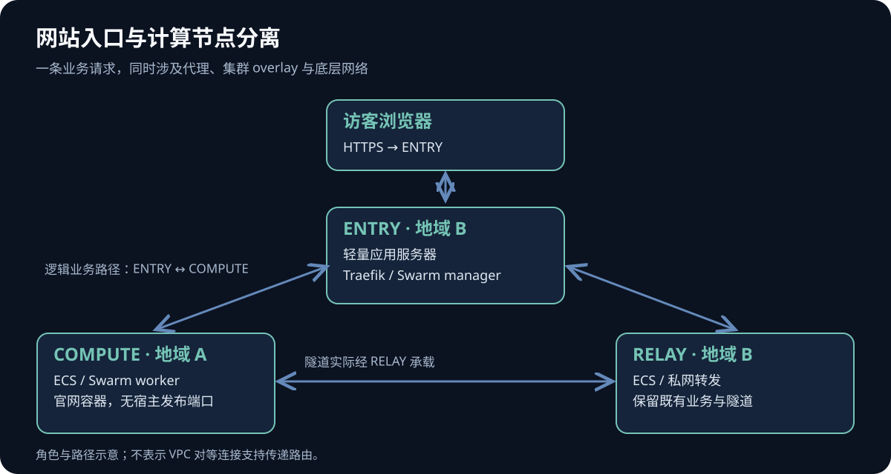
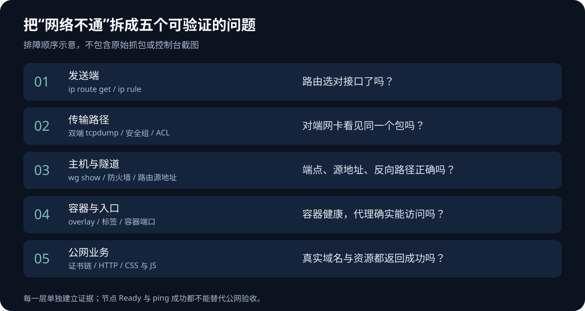
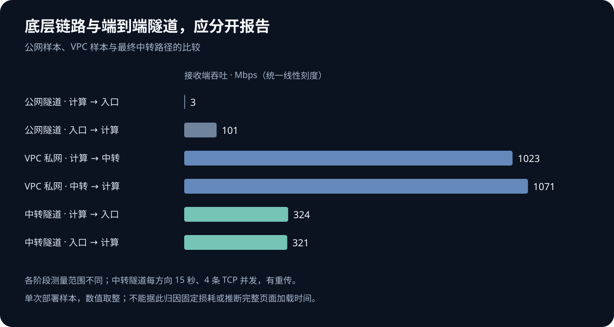

两台主机能互相 ping，Swarm 节点也显示 Ready，网站却仍然超时。抓包看到入口节点发出的 VXLAN 包已经进入计算节点，里面的 TCP SYN 还在重传。

这次部署的目标很简单：把一个 Next.js 官网放到地域 A 的 ECS 上运行，继续使用地域 B 的轻量应用服务器提供 HTTPS 入口。两地之间还有一台已经承载其他业务的 ECS，希望利用它已有的私网连接做中转。

最终官网上线，页面和抽查的静态资源均返回 200，计算节点到入口节点的隧道吞吐约为 320 Mbps。但排障的主要工作，集中在产品网络边界、路由选择与集群通信这几个层面。

本文面向已经用 Docker 部署过应用、准备拆分入口与计算节点的开发者。主机用 `COMPUTE`、`RELAY`、`ENTRY` 代称；地址、域名和资源标识均以占位符表示。图中内容为机制示意，测速为本次部署的样本，不能当作带宽承诺。

## 一、先看最终拓扑：入口、算力、中转各做什么



图 1：访客从 ENTRY 进入；官网容器在 COMPUTE 运行，RELAY 承载两者之间的私网隧道转发。

三个角色的职责如下：

| 角色 | 产品与位置 | 职责 |
|---|---|---|
| COMPUTE | 地域 A，普通 ECS | Swarm worker，运行官网容器 |
| RELAY | 地域 B，普通 ECS | 原有 worker，新增限定范围的隧道转发 |
| ENTRY | 地域 B，轻量应用服务器 | Swarm manager、Traefik、TLS 与公网入口 |

官网容器不发布宿主端口。Traefik 与官网加入同一个 Swarm overlay 网络，由入口代理把请求转给远程容器。服务通过节点标签固定到 COMPUTE，避免调度器把新应用放到已经承载其他业务的机器上。

这里的“从 ENTRY 出口”需要先明确含义。本次完成的是网站的公网入站入口：浏览器连接 ENTRY，ENTRY 代理到 COMPUTE。官网容器主动请求外部 API 时，仍使用 COMPUTE 的默认公网出口。若业务还要求统一出站 IP，需要另加容器策略路由和出口 NAT，并单独验收。

单 manager 也意味着没有 manager 高可用；RELAY 和 ENTRY 都是这条访问路径上的单点。这套方案适合复用已有资源、可接受这些边界的场景。

## 二、轻量服务器的元数据，不能直接当成用户资产归属

排查过程中，一度根据实例元数据返回的账号 ID 和 VPC ID，判断控制台登录了错误账号。随后在轻量服务器控制台核对公网 IP 和私网 IP，才确认：目标主机确实属于当前账号。

问题在于普通 ECS 与轻量应用服务器的网络管理模型不同。轻量服务器使用平台分配的 VPC，用户控制台看到的普通 VPC，未必就是它底层所在的网络。控制台“内网互通”页面进一步说明，发起端 VPC 属于阿里云，用户账户不可见。

因此，元数据应当和产品控制台交叉核对。先确认产品类型，再核对实例、公私网地址、可管理的 VPC 与已有互通关系；不要直接把底层账号标识当成用户账号。

轻量服务器的内网互通有同账号、同地域的支持边界。本次 ENTRY 已经通过这一功能与 RELAY 所在的普通 VPC 互通，但这并不自动扩展到另一个地域。[阿里云：设置内网互通](https://help.aliyun.com/zh/simple-application-server/user-guide/manage-service-interconnection)

## 三、两段对等连接，不能拼成一条传递路由

最初的设想是把两段连接串起来：

```text
COMPUTE 所在 VPC
    → 跨地域对等连接
RELAY 所在 VPC
    → 轻量内网互通
ENTRY 的托管 VPC
```

两端都添加了路由，对等连接也显示已激活，端到端通信却不成立。抓包甚至出现了单向请求能到达、回复没有回来的现象。这种不完整的观察，不能证明平台支持把三张 VPC 串成通用路由。

阿里云明确说明，对等连接不具备路由传递能力；两张 VPC 分别与第三张互连，不代表它们能经第三张互访。VPC 网段重叠也是创建普通对等互通前需要处理的问题，跨地域连接还涉及流量费用。[阿里云：VPC 对等连接](https://help.aliyun.com/zh/vpc/vpc-peer-to-peer-connection)

本次保留了 COMPUTE 与 RELAY 的直接对等连接。需要到达 ENTRY 的流量，则显式封装到隧道里，让 RELAY 处理目的地为自身的包，再转发给下一段。

最终隧道承载关系为：

```text
COMPUTE 的 WireGuard
    → VPC 私网 → RELAY 的限定 UDP 入口
    → DNAT/SNAT → RELAY 与 ENTRY 已有的 WireGuard
    → ENTRY 的新 WireGuard 接口
```

这是主机上的封装与转发，依赖已有连接逐段传送，不能理解成给对等连接增加了传递路由能力。本次选择复用已有同地域隧道，是为了保留现有网络与业务；从零建设时，应先比较业务代理、普通 ECS 直连、云原生转发方案的维护成本。

## 四、Docker 安装后，原本正常的私网路由变了

COMPUTE 原本可以通过私网访问 RELAY，安装 Docker 后，发往 RELAY 的隧道包却消失了。

检查 `ip route get`，发现 Docker 默认 bridge 的网段覆盖了 RELAY 的私网地址。路由更具体，内核自然把包交给 `docker0`；即使该网桥处于 linkdown，内核也不会因为它不通就自动改走预期的云网关。

```bash
# 在每次安装容器运行时、添加隧道或加入集群后执行
ip -4 route
ip rule
ip route get "$RELAY_PRIVATE_IP"
```

解决方法是为新节点规划不冲突的 Docker bridge 地址段。本次在 COMPUTE 尚无业务容器时调整默认 bridge 和地址池，重启 Docker，再检查实际生成的 `docker_gwbridge`。现有生产节点不能直接照搬这一操作：重启、重建网络和地址变化都可能影响容器。

网段规划需要覆盖云 VPC、交换机、Docker bridge、Swarm overlay、隧道地址和已有 VPN。一个地址段没有出现在本机路由表里，也不代表它没有被其他节点使用。

还有一个容易忽略的细节：Swarm 新网络创建后会增加路由，所以加入集群后需要再查一次，而非只做安装前预检。

## 五、WireGuard 能握手，还要确认端点与源地址

### 公网保活会把端点重新“拉回去”

从公网隧道切到私网中转时，只改 COMPUTE 的 `Endpoint` 还不够。ENTRY 如果仍向旧公网端点发送经过认证的保活或握手包，对端可能重新学习到公网地址。

这次测试就出现过：刚设置完私网 Endpoint，过一会儿 `wg show` 又显示公网地址。ping 通了，但测到的路径可能不是刚配置的私网路径。

切换时，需要同时清理旧的主动端点与保活配置，确认新路径能发起握手，再将配置持久化。涉及重建 peer 的操作会中断该隧道上的通信，应放在明确的变更窗口内执行。

验收应包含两端的实际 Endpoint、最近握手时间、收发计数和中转机抓包。只拿 ping 的结果证明路径正确，证据不够。

### overlay 的外层源地址，需要和节点可达地址一致

私网隧道通了以后，官网容器已经 healthy，Traefik 仍然请求超时。抓包看到：入口发出的 VXLAN 包抵达计算节点，内部 SYN 没有得到正常响应。

进一步检查发现，路由自动选择了 WireGuard 接口地址作为外层源地址，与 Swarm 节点登记的私网地址不同。本次通过为对端主机路由指定源地址修复：

```bash
# 占位变量应替换为经过规划的地址；只调整目标主机路由
ip route replace "$PEER_PRIVATE_IP/32" \
  dev "$TUNNEL_IFACE" src "$LOCAL_NODE_PRIVATE_IP"
```

这里的 `LOCAL_NODE_PRIVATE_IP` 必须确实属于本机，并且对端 WireGuard peer 的 `AllowedIPs` 允许接收这一源地址。还要检查反向路径过滤、策略路由与防火墙。这个命令只是本次问题的修复片段，不能替代完整网络设计。

修复后，同一入口的 HTTPS 请求返回 200。随后把路由规则写入隧道启动配置，避免重启后丢失。

## 六、安全组要配到正确产品，Swarm 也要逐项验证



图 2：比较同一报文在发送端和接收端的可见性，可以缩小问题范围；看见报文并不等于应用已处理它。

这次有几轮规则看起来已经添加，测试却没有变化。后来发现，规则加在了轻量服务器上，而需要通信的是 COMPUTE 与 RELAY 两台 ECS。

应从实例详情进入“当前绑定的安全组”，核对账号、地域、实例、方向、协议、目的端口和来源。名称相似的安全组、同账号下另一台服务器的防火墙，都不能替代目标实例的配置。

Swarm 的主要通信要求如下。管理流量与 worker 间的数据流量用途不同，按实际角色限定来源，不向公网开放集群端口。[Docker：Swarm 网络前置条件](https://docs.docker.com/engine/swarm/swarm-tutorial/)

| 协议与端口 | 用途 | 检查方式 |
|---|---|---|
| TCP 2377 | 集群管理，指向 manager | 连接测试与节点状态 |
| TCP/UDP 7946 | 节点发现与通信 | 双向 TCP 测试、UDP 抓包 |
| UDP 4789（默认） | overlay 数据流量 | 抓包与跨节点业务验证 |

UDP 没有 TCP 那样的连接握手，不能只凭客户端命令退出码判断“端口已开”。实际测试时，把发送侧与接收侧抓包时间对齐，检查源地址、目的地址和端口；需要证明 overlay 可用，还应让两个节点上的实际容器互访。

```bash
# 过滤条件限定对端，避免收集无关业务流量
sudo tcpdump -ni "$UNDERLAY_IFACE" \
  "host $PEER_PRIVATE_IP and (port 7946 or udp port 4789)"
```

如果对端网卡看不到包，优先检查发送端路由、出向策略、云路由、对端安全组与网络 ACL；如果包已经到达，再看系统防火墙、内核处理、overlay 和应用监听。TCP 握手成功也只说明这一条连接可达，尚不能证明 TLS、HTTP 或大响应正常。

## 七、容器健康、路由发现、证书签发是三个检查项

服务部署返回成功后，任务可能仍在 Preparing；容器 healthy 后，入口也可能没有发现路由。

本次 Traefik 日志出现了：

```text
both Docker and Swarm labels are defined
```

原因是同一个服务同时设置了旧的 `traefik.docker.network` 和新的 `traefik.swarm.network`。去掉冲突标签后，Swarm provider 才正确接收该服务。不同版本的标签规则要按实际安装版本核对，不要把两套写法一起加上当兼容措施。

服务级路由标签放在 `deploy.labels`，应用加入 Traefik 可达的外部 overlay，并明确容器监听端口。当前 Swarm provider 的配置说明见 [Traefik 官方文档](https://doc.traefik.io/traefik/reference/routing-configuration/other-providers/swarm/)。

```yaml
services:
  website:
    image: ${WEBSITE_IMAGE}
    networks: [website-ingress]
    deploy:
      placement:
        constraints:
          - node.labels.app.website == true
      labels:
        traefik.enable: "true"
        traefik.swarm.network: ${WEBSITE_OVERLAY_NETWORK}
        traefik.http.routers.website.rule: Host(`${WEBSITE_DOMAIN}`)
        traefik.http.routers.website.entrypoints: websecure
        traefik.http.routers.website.tls: "true"
        traefik.http.routers.website.tls.certresolver: letsencrypt
        traefik.http.services.website.loadbalancer.server.port: "3000"
networks:
  website-ingress:
    external: true
    name: ${WEBSITE_OVERLAY_NETWORK}
```

这段是配置摘录，前提是 Traefik 已经启用 Swarm provider，并配置对应 entrypoint 和证书 resolver。它没有发布应用宿主端口；集群 overlay 本身默认也不应被当作加密层，跨不可信网络时需另外规划保护措施。

证书验证也要独立执行。先确认 DNS 和 ACME 挑战可用，再检查真实域名的证书链，不能通过关闭证书校验把默认自签证书误判成上线成功。本次在有效证书下验证了首页、其他页面和抽查的 CSS/JS，原有服务副本也保持正常。

## 八、1 Gbps 私网，为什么最终只有约 320 Mbps



图 3：底层私网与最终中转隧道测的是不同路径，结果不能直接解释成固定的加密性能损耗。

本次几个阶段的样本如下，单位为十进制 Mbps：

| 测试路径 | 方向 | 接收端吞吐 |
|---|---|---:|
| 早期公网主机隧道 | COMPUTE → ENTRY | 约 3 |
| 早期公网主机隧道 | ENTRY → COMPUTE | 约 101 |
| COMPUTE 与 RELAY 的 VPC 私网 | 双向分别测试 | 约 1023～1071 |
| 最终中转隧道 | COMPUTE → ENTRY | 约 324 |
| 最终中转隧道 | ENTRY → COMPUTE | 约 321 |

最终隧道测试使用 iperf3，每个方向 15 秒、4 条 TCP 并发连接。接收端吞吐约为 40 MB/s，两向均存在重传，部分方向更明显。由于测试时间、路径、封装层数和并发条件的差异，不能仅根据两组数字断言“WireGuard 固定损失了多少性能”，也不能把某个方向的速度差全部归因于公网带宽。

VPC 的约 1 Gbps 结果只证明那一段底层链路的样本性能。最终路径还经过 NAT、两层隧道处理、多个节点和容器网络；CPU、MTU、分片、重传与实例限额都可能影响结果。本次没有逐项隔离这些变量，所以暂不把某一项写成唯一瓶颈。

官网首页另做了三次公网请求：首字节约 0.11～0.28 秒，HTML 下载完成约 0.12～0.30 秒。这个结果依赖客户端位置、时刻和缓存状态，只覆盖 HTML 请求，未包含浏览器加载全部资源、执行脚本和完成渲染的时间。吞吐、首字节与完整页面加载应分别报告。

## 九、适用边界与下一步维护

复用已有资源让这次部署得以完成，也增加了网络层次。只有在接受中转单点、跨地域流量成本和后续排障工作时，这个方案才值得维护。如果只是一个低流量官网，直接部署到入口同机，或使用托管静态站点，可能更简单。

这次交付完成了公网 HTTPS、页面与抽查资源、容器健康、节点状态、三类 Swarm 通信以及隧道路径验证。它仍然是一次手动部署：镜像已分发到指定计算节点，没有据此声称自动 CD、灾难恢复或节点重建流程已经完成。

后续维护至少应保留四类记录：角色与当前资产映射、重启后恢复网络的配置、可回滚的镜像与栈文件、分层验证命令。正式维护窗口还应安排重启恢复演练，实际检验 systemd 顺序、Docker 规则重建和隧道路由恢复，而非只检查“已启用开机启动”。

再遇到“主机通、服务不通”时，从一条真实业务请求开始：它实际走哪个接口、以哪个地址发出、对端看到了什么、应用又返回了什么。每一层都有自己的成功判据，把这些判据连起来，才能判断网站是否真的上线。

*技术文档核对日期：2026-11-17。文中性能来自一次部署实测，经过取整展示；示意图不包含真实资产标识。*
