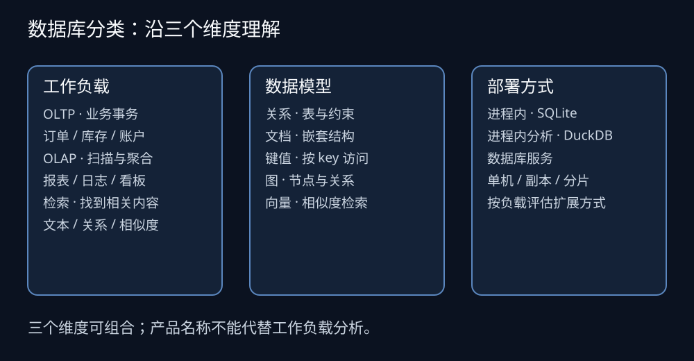
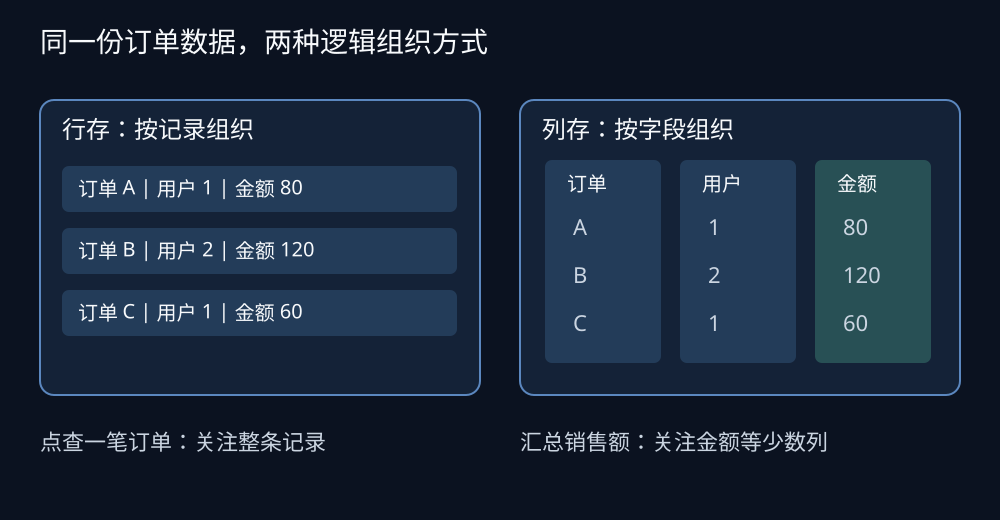
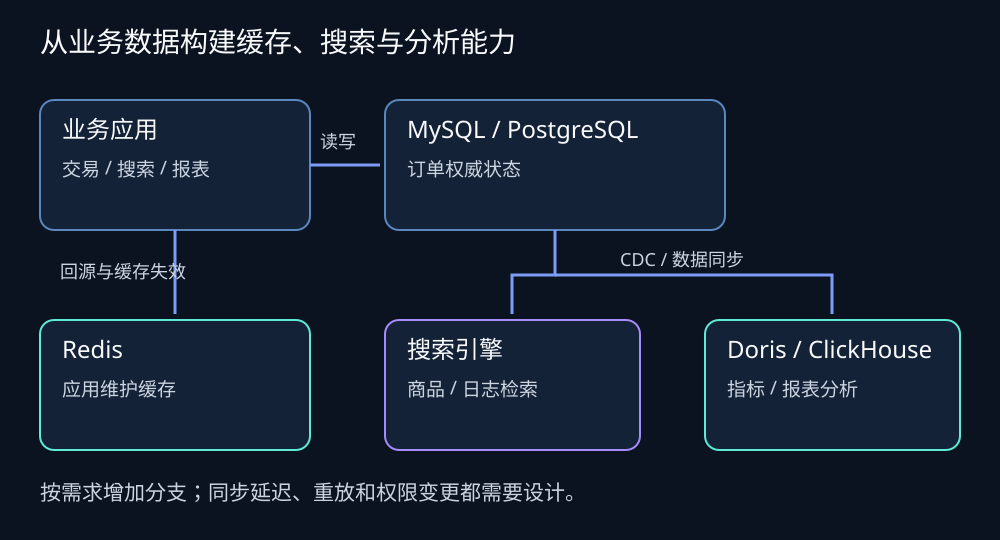

订单状态刚刚从“待付款”变成“已付款”，用户要立即看到结果；运营同时想知道，过去一个月每个渠道的成交额是多少。这两次查询可能来自同一份订单数据，数据库面对的工作却很不一样：一次修改少量记录，一次读取大量记录并聚合。

MySQL、Apache Doris、ClickHouse 都能写 SQL，但它们优化的目标不同。把它们放在一起比较，需要先说清楚业务在做什么，再讨论存储方式、事务、更新和扩容。

这篇文章面向需要理解数据库、为项目选型的开发者。先建立分类框架，再重点拆解 MySQL、PostgreSQL、Doris 和 ClickHouse，接着介绍 Redis、MongoDB、搜索、时序、图和向量数据库，最后用一个电商系统说明它们如何协作。文中的架构是教学示例，选型建议是基于工作负载的判断，不是性能实测排名；产品能力以所链接版本的官方文档为准。

## 一、先问数据库需要回答什么问题

### 1. OLTP：把一笔业务办对

OLTP（Online Transaction Processing，联机事务处理）关心订单创建、账户变更、库存扣减等操作。一次请求通常只涉及少量记录，但并发请求之间可能竞争同一份数据。

例如“创建订单并预占库存”：如果订单写入成功、库存预占失败，业务就进入了不一致状态。数据库事务可以把一组操作组织成一个提交或回滚单元，但库存不能为负、请求不能重复扣减等业务规则，仍要通过条件更新、约束、隔离级别和幂等设计来落实。

### 2. OLAP：从大量记录中算出答案

OLAP（Online Analytical Processing，联机分析处理）关心趋势、分组、排行和多维分析。例如按日期、渠道、品类统计销售额，可能扫描大量订单，再关联商品和渠道维表。

这类查询往往只读取表中的少数列，却要处理很多行。它需要高效扫描、压缩、聚合和并行计算。MySQL、PostgreSQL 也能做分析，数据量和资源消耗尚可时，直接写 SQL 通常就足够；当报表开始影响交易请求，才需要进一步拆分。

### 3. 检索：找到相关内容

搜索商品名、查找相似文档、沿关系寻找共同联系人，分别对应全文检索、向量检索和图遍历。它们的主要成本来自索引和访问路径，与“按主键找一条订单”不同。



*图 1：三个维度可以组合。关系型数据库也能提供 JSON 和向量能力，嵌入式数据库也可以面向分析。*

### 4. 分类名称并不处于同一层

| 分类维度 | 常见选项 | 回答的问题 |
| --- | --- | --- |
| 工作负载 | OLTP、OLAP、混合负载 | 主要处理什么操作？ |
| 数据模型 | 关系、文档、键值、图、向量 | 数据如何表达与访问？ |
| 存储组织 | 行存、列存、混合存储 | 数据如何排列与读取？ |
| 部署形态 | 嵌入式、单机服务、分布式 | 数据库如何运行与扩展？ |

NoSQL 通常泛指一组采用非传统关系模型的系统，并不意味着它们完全不支持 SQL，也不意味着它们没有事务。HTAP 则是混合事务与分析处理的方向，是否能同时满足两类负载，要继续检查资源隔离、数据新鲜度和查询延迟。

## 二、行存、列存和索引：相同 SQL 为什么表现不同

### 1. 行存更容易围绕一条记录工作

假设订单有订单号、用户、状态、金额、时间等字段。行存将一行的字段在存储组织上放得较近，查到订单后可以较方便地取出完整记录；结合合适的索引，点查和小范围更新可以避免全表扫描。

这里的“放得较近”是逻辑解释。真实系统还涉及数据页、溢出存储、索引结构和缓存，不能据此推导“一次请求只产生一次磁盘读取”。索引也有维护成本，给每个字段都建索引会放大写入、存储和维护开销。

### 2. 列存更容易围绕一批字段工作

列存按列组织数据。统计销售额时，可以尽量读取金额、时间、渠道等列，减少无关字段的读取；同列的数据类型和取值常有相似性，也利于压缩。



*图 2：这是逻辑存储示意，不代表某个产品的数据页格式。它解释了点查完整记录与扫描少数列的不同访问需求。*

列存经常配合向量化执行：执行算子一次处理一批值，减少逐行处理的调度成本。分布式分析引擎还会把查询拆到多个节点并行执行，这种方式常称为 MPP（大规模并行处理）。并行并非没有成本，节点之间的数据交换、数据倾斜和慢任务都可能影响整体延迟。

### 3. 不要把存储方式直接当成速度排名

一条带有高选择性索引的 MySQL 查询，可能比扫描大量数据的分析库查询更快；一个分区和排序键设计合理的分析库，也可能显著减少扫描。数据是否命中缓存、过滤条件能否下推、JOIN 是否触发大量网络交换，都会改变结果。

因此，“列存比行存快”“分布式一定比单机快”都缺少必要条件。选型要拿真实查询验证数据访问方式。

## 三、MySQL、PostgreSQL 和 SQLite：先把业务数据存可靠

### 1. MySQL：常见业务系统的事务基础

MySQL 常用于订单、账号、商品和后台管理等业务。讨论事务时，应明确存储引擎：InnoDB 提供事务、提交与回滚、崩溃恢复等能力，不能将其性质无条件推广到所有 MySQL 存储引擎。[来源：MySQL 存储引擎文档](https://dev.mysql.com/doc/refman/26.7/en/storage-engines.html)。

它适合已有 MySQL 运维经验、依赖相关驱动和工具的团队。真正需要规划的包括索引、慢查询、连接池、备份恢复和主从切换。读副本可以分摊部分读取，但复制延迟可能导致用户刚写完就读到旧值。

如果一张表越来越大，应先检查查询、索引、归档和资源使用，再考虑分库分表。分片之后，跨分片关联、唯一性约束和事务处理都会更复杂。

### 2. PostgreSQL：关系模型与扩展能力结合

PostgreSQL 同样适合业务事务和关系查询。它还提供 `json`、`jsonb` 等类型，其中 `jsonb` 支持索引；因此，部分字段结构灵活，并不自动构成引入文档数据库的理由。[来源：PostgreSQL JSON 类型](https://www.postgresql.org/docs/current/datatype-json.html)。

对于同时需要关系约束、复杂 SQL 和部分文档数据的应用，可以把 PostgreSQL 作为候选。事务基础可参见[官方教程](https://www.postgresql.org/docs/current/tutorial-transactions.html)。如果还需要语义检索，可以评估 pgvector 扩展，其提供精确和近似最近邻搜索能力。[来源：pgvector 官方仓库](https://github.com/pgvector/pgvector)。

扩展减少了系统数量，也会共享数据库的 CPU、内存和 I/O。向量建索引、大规模扫描与交易请求混跑时，仍要验证资源竞争。选择 PostgreSQL 或 MySQL，还应考虑团队经验、现有应用依赖和迁移代价，不宜把支持的功能数量当作唯一依据。

### 3. SQLite：应用内的关系型数据库

SQLite 嵌入应用进程，适合本地工具、桌面应用、移动端离线数据和许多低写入并发场景。无需独立数据库服务，部署和交付更简单；它也并非只能处理玩具项目。

它的边界主要在并发写入和部署方式：同一数据库文件同时只能有一个写入者，多进程、多机器共享写入需要谨慎设计。业务明确需要大量并发写入或集中数据库服务时，应评估 MySQL、PostgreSQL 等服务端数据库。[来源：SQLite 适用场景](https://www.sqlite.org/whentouse.html)。

## 四、Apache Doris：面向实时分析的分布式数据库

### 1. Doris 解决什么问题

Doris 面向分析负载：数据持续进入，报表、看板和分析应用持续查询。它采用列式存储与并行执行，支持 SQL，并兼容 MySQL 网络协议，可供相应客户端和 BI 工具接入。[来源：Doris 概览](https://doris.apache.org/docs/dev/getting-started/what-is-apache-doris/)。

“实时”需要定义到业务指标。用户更关心“订单提交后多久能在看板上看到”，这包含源端提交、同步、写入和可见性等阶段，不能只用一次 SQL 的执行时间代表。

### 2. FE 与 BE 如何分工

在存算一体部署中，Frontend（FE）处理请求、SQL 解析与规划、元数据等工作；Backend（BE）承担数据存储与查询执行。Doris 也提供存算分离部署模式，不能把所有部署都理解成数据只放在 BE 本地磁盘上。[来源：Doris 系统架构](https://doris.apache.org/docs/4.x/features-architecture/system-architecture/)。

从应用视角，可以把 FE 理解为协调查询的一层，BE 理解为执行数据任务的一层。查询是否高效，还取决于分区、分桶、数据分布、JOIN 策略和集群资源配置。

### 3. 数据模型影响更新语义

订单分析经常需要把“待付款”更新为“已付款”。Doris 的 Unique Key 模型可以按键维护记录状态，支持 UPSERT 等场景，相关行为还取决于写入模式和表配置。[来源：Doris Unique Key 表](https://doris.apache.org/docs/3.x/table-design/data-model/unique/)。

做 CDC 同步时，应把主键、删除事件、乱序事件和版本顺序一起设计。否则旧状态晚到，就可能覆盖新状态。CDC（Change Data Capture，变更数据捕获）是把源数据库的变化同步出去的机制，并不会自动替你解决目标表模型和业务顺序问题。

### 4. 适合哪些团队

多表分析、交互式看板、订单状态持续变化，以及希望接入 MySQL 生态工具的团队，可以把 Doris 纳入验证。协议兼容有利于连接工具复用，但 SQL 方言、数据类型、事务和管理命令仍需逐项核对。

Doris 的写入和事务能力应按其自身语义使用。支付扣款、库存竞争等业务，还需要数据库约束、隔离、锁和失败处理共同保证；不能仅因 Doris 支持更新，就直接迁移整个交易系统。

## 五、ClickHouse：面向大规模扫描与聚合的列式分析数据库

### 1. 从事件数据理解它的优势

访问日志、监控事件、广告曝光和用户埋点往往持续追加。分析通常围绕时间范围、若干维度和聚合指标展开。ClickHouse 的列式组织适合这类读取少数列、处理大量行的任务。[来源：ClickHouse 列式数据库说明](https://github.com/ClickHouse/clickhouse-docs/blob/main/docs/faq/general/columnar-database.md)。

设计时需要关注排序键、分区、批量写入和数据保留策略。数据有序可以帮助跳过无关范围；过多的小批次写入则可能产生大量数据片段和合并压力。最终收益依赖表结构与查询形态。

### 2. ClickHouse 支持更新，代价与可见性需要具体讨论

“ClickHouse 只能追加、不能更新”是不准确的。官方提供多种更新路径，包括 mutation、专门的表引擎以及随版本演进的更新机制。选择时应检查目标版本、更新粒度、执行成本和结果何时可见。[来源：ClickHouse 更新方式概览](https://github.com/ClickHouse/clickhouse-docs/blob/main/docs/managing-data/updating-data/overview.mdx)。

例如，使用后台合并处理版本的表引擎时，需要理解合并完成前查询能看到什么，以及查询侧如何取得所需的最新状态。它与业务数据库中一次事务更新后的读取体验不能直接等同。

### 3. JOIN 和并发都应进入验证

ClickHouse 能执行 JOIN，但关联规模、数据布局、算法和内存限制会影响成本。宽表可以减少查询时的关联，也会增加维度变化时的维护工作。

因此，日志聚合是值得优先验证的场景，但“ClickHouse 只能做单表查询”“Doris 的并发永远更高”都过于绝对。对于实际业务，应同时测试大扫描、小范围查询、多表 JOIN 和资源竞争，使用相同成本预算比较。

## 六、MySQL、Doris、ClickHouse 的核心差异

这三者的差异可以沿着“写入什么、查询什么、需要什么语义”来理解。下面比较的是常见应用取向，不是能力的绝对边界。

| 维度 | MySQL（InnoDB） | Apache Doris / ClickHouse |
| --- | --- | --- |
| 主要目标 | 业务事务、点查、小范围操作 | 分析查询、聚合、大范围读取 |
| 常见请求 | 创建订单、修改账户、查订单详情 | 趋势分析、多维报表、事件统计 |
| 设计关注点 | 约束、隔离、索引、锁竞争 | 排序与分区、并行度、扫描与交换 |
| 更新判断 | 面向事务语义设计业务 | 核对表模型、版本、成本与可见性 |
| 资源风险 | 长查询挤占交易资源 | 大查询挤占其他分析请求资源 |

再将两种分析库放在相同维度下讨论：

| 验证维度 | Doris 的验证重点 | ClickHouse 的验证重点 |
| --- | --- | --- |
| 数据形态 | 多表模型、状态持续变化的数据 | 追加事件、排序良好的分析数据 |
| JOIN | 关联规模、分布、执行计划 | 算法、内存、数据布局与执行计划 |
| 更新 | Unique Key、部分更新与事件顺序 | 更新机制、表引擎与查询可见性 |
| 交互分析 | 混合查询的尾延迟、资源隔离 | 混合查询的尾延迟、资源隔离 |
| 运维 | 副本或对象存储、扩容与恢复 | 分片副本、合并、扩容与恢复 |

如果主要是交易业务，优先从 MySQL 或 PostgreSQL 开始。如果已有交易库、希望增加持续更新的多维分析，可以先验证 Doris；如果主要是日志、事件和大规模聚合，可以先验证 ClickHouse。这里的“先验证”表达测试顺序，最终结论由真实工作负载决定。

## 七、其他数据库：从访问方式找到各自的位置

### 1. Redis：键值与数据结构，常用于热点访问

Redis 提供字符串、哈希、集合、有序集合、Streams 等数据结构。缓存用户资料、维护排行榜、记录短期状态，都可以利用相应操作。[来源：Redis 数据类型](https://redis.io/docs/latest/develop/data-types/)。

Redis 支持 RDB 快照、AOF 等持久化方式，并非完全不落盘。实际可接受的数据丢失窗口与配置、刷盘和故障方式有关。[来源：Redis 持久化](https://redis.io/docs/latest/operate/oss_and_stack/management/persistence/)。

当 Redis 承担缓存时，要明确过期策略、缓存未命中时的回源和数据库更新后的失效策略。内存容量、热点 key、淘汰策略和故障恢复是成本的一部分。缓存可以提升访问效率，却会引入另一份数据副本及一致性问题。

### 2. MongoDB：围绕文档组织数据

文档模型适合把经常一起访问的嵌套数据放在一起，例如商品的规格和扩展属性。MongoDB 支持嵌入文档，也支持跨文档事务；事务能力不能替代数据建模，分布式事务通常比单文档操作有更多成本。[来源：MongoDB 数据建模实践](https://www.mongodb.com/docs/v8.3/data-modeling/best-practices/)。

需要先判断“什么数据一起变化、一起读取”，再选择嵌入还是引用。无约束地嵌入不断增长的数组、重复保存大量共享属性，都可能增加更新和读取成本。业务字段灵活时，也应把关系库的 JSON 能力放进候选集。

### 3. Elasticsearch：以词项和相关性为中心的搜索

全文搜索经常要处理分词、词项匹配和相关性排序。倒排索引建立从词项到文档的映射，让系统可以从一个词找到相关文档，而不必逐条检查全部正文。[来源：Elastic 全文搜索原理](https://www.elastic.co/docs/solutions/search/full-text/how-full-text-works)。

商品搜索、日志检索和知识库关键词检索可以考虑搜索引擎。这里需要评估分词、召回率、排序质量、索引更新以及分片成本。搜索索引常作为业务数据库的派生数据；在这种架构下，必须能从源数据重建，也要处理删除与权限变更。

### 4. 时序数据库：时间是主要访问轴

监控指标、设备遥测、温度和能耗等数据，常按时间持续写入，再按时间窗口聚合。典型问题是“过去一小时的平均值”“按设备计算每日峰值”。

时序系统通常围绕时间分区、保留和聚合设计。以 TimescaleDB 的 hypertable 为例，它将表按时间分成 chunks，便于管理持续增长的数据。[来源：Tiger Data hypertable 文档](https://www.tigerdata.com/docs/learn/hypertables/creating-and-configuring-hypertables)。

时序能力也可能由关系数据库扩展或分析库提供。设备标签的基数、乱序写入、保留周期和历史聚合需求，比“表里有没有时间字段”更有选型价值。

### 5. 图数据库：关系本身成为查询对象

图数据库用节点、关系和属性表达数据。Neo4j 的属性图模型可以直接表示用户、设备和它们之间的连接。[来源：Neo4j 图数据库概念](https://neo4j.com/docs/getting-started/graph-database/)。

例如反欺诈分析：找出与某账户共享设备、再通过设备关联到的其他账户。多跳路径如果经常变化，图遍历值得评估；若只是固定的一次表关联，关系数据库通常已经能很好地表达。

查询关系的深度、分支数量和超级节点会影响遍历代价，不能认为图模型消除了组合爆炸。

### 6. 向量数据库：按相似度检索内容

文本、图片等内容可以由嵌入模型转换为向量。查询时，系统比较查询向量与候选向量的距离或相似度，并返回相关结果。Milvus 提供向量检索和不同相似度度量。[来源：Milvus 向量搜索](https://milvus.io/docs/single-vector-search.md)、[相似度度量](https://milvus.io/docs/metric.md)。

近似最近邻搜索通过索引在速度、内存与召回率之间取舍。它不保证语义上永远正确，效果还取决于嵌入模型、文档切分、过滤和重排。相似度高，也不代表内容真实或用户有权读取。

RAG 项目可以比较 PostgreSQL + pgvector 和 Milvus 等独立系统：前者有利于复用现有关系数据与运维，后者值得在向量规模、检索负载和独立扩容成为主要需求时验证。没有脱离维度、过滤条件和召回率目标的固定数据量分界线。

### 7. DuckDB：进程内完成分析

DuckDB 是面向分析的嵌入式数据库，适合本地数据分析、脚本和读取文件进行 SQL 分析的场景。它与 SQLite 都可以嵌入进程，但设计目标不同：一个偏分析，一个常用于应用本地事务数据。[来源：DuckDB 官方文档](https://duckdb.org/)。

如果需求是分析本地 CSV、Parquet 或数据导出文件，应先评估这种轻量方案。多租户在线查询、持续摄入与高可用服务则涉及更多系统能力，不能只用一段本地 SQL 的性能代表整体服务能力。

### 8. 分布式 SQL：把事务与横向扩展结合

当业务事务本身需要跨节点扩展时，可以评估 TiDB 这类分布式 SQL 数据库。它的 SQL 层把请求转换为底层分布式键值操作，再组装结果。[来源：TiDB 计算层](https://docs.pingcap.com/tidb/stable/tidb-computing/)。

跨节点协调、热点分布和网络延迟会带来成本。是否需要分布式数据库，应由容量、写入压力、可用性目标和团队运维能力共同决定。协议兼容同样需要进行应用级验证。

## 八、事务、一致性和“实时”：选型时要拆开的三个词

### 1. ACID 不等于业务自动正确

ACID 中，原子性指事务作为整体提交或回滚；一致性关注事务维持约束和业务不变量；隔离性规定并发事务如何相互影响；持久性关注已提交结果在故障后如何保留。

隔离性不是简单的“有或没有”。不同隔离级别允许的并发现象不同，应用仍需处理死锁、冲突和重试。转账、库存、唯一订单号等问题，都需要具体的约束与并发设计。

### 2. ACID 的一致性与副本一致性不同

读到一个副本时，它是否已包含刚刚提交的写入，是副本读取与同步问题。一次数据库事务成功，也不意味着缓存、搜索索引和分析库同时更新成功。

CAP 讨论的是发生网络分区时，系统如何在一致性和可用性要求之间取舍。它不能简化成给所有数据库贴上“三选二”标签；具体读写路径、配置和故障条件仍需展开。

### 3. 实时分析要写出端到端目标

可把分析数据的新鲜度拆成：

```text
端到端可见延迟 ≈ 源端提交后等待
                + 捕获与传输
                + 排队和批处理
                + 目标写入及可见性等待
```

查询耗时还要单独测量。实际阶段可能重叠，这个表达用于排查和建立预算，不是严格性能公式。目标应写成“源库提交后，绝大多数记录在约定时间内能被看板查询到”，并明确统计比例、时间窗口和异常处理。

## 九、一个电商系统如何逐步使用不同数据库

### 1. 起步阶段：业务数据库先形成闭环

一个早期电商后台，可以用 MySQL 或 PostgreSQL 保存用户、商品、订单和库存。简单报表直接查库；通过查询优化和适当资源配置控制成本。这个阶段的重点是业务约束、备份、恢复和可观测性。

缓存、搜索和分析库都应对应明确的问题。先引入一整套系统，意味着提前承担同步、权限、监控和恢复成本。

### 2. 根据瓶颈添加专门能力

当热点访问给业务库造成压力时，增加 Redis；当搜索相关性无法满足需求时，增加搜索引擎；当分析扫描影响交易延迟时，再评估独立分析库。每引入一个派生存储，都需要指定权威数据来源。



*图 3：示例架构中的业务数据库保存权威订单状态。搜索和分析数据由同步链路构建，缓存由应用按策略维护；各分支可按需求独立引入。*

### 3. 同步链路要处理故障和重放

CDC 链路会遇到重复事件、乱序、删除、字段变更和消费积压。假设同一订单的“已付款”先到、“待付款”后到，目标表如果直接按到达顺序覆盖，就可能恢复成旧状态。需要利用合适的事件位置或业务版本控制顺序，不能仅依靠时间戳碰巧递增。

跨表事务同步还需要明确分析侧是否会短暂看到部分结果。故障恢复时，要能定位消费进度，重放事件并校验结果；全量初始化与增量接续之间也不能留下缺口。

如果业务要求“付款后立即显示订单状态”，应读取满足该一致性要求的业务路径。分析库通常适合统计展示，不能在未证明同步语义之前承担交易判定。

### 4. 数据湖、对象存储和查询引擎也有区别

对象存储保存文件，Parquet 是文件格式，Iceberg 等提供数据湖表格式能力，查询引擎负责执行 SQL。这些概念不等价。分析系统可以把热数据放在专门的分析库，将长期数据放到对象存储，但还需要规划目录、权限、维护和查询成本。

“把数据放进数据湖”并不会自动获得高效查询与可靠业务语义。应继续检查文件组织、元数据和计算引擎如何协作。

## 十、用一套可执行的方法完成选型

### 1. 把需求写成可以测量的负载

| 需求维度 | 需要记录的内容 | 影响的决策 |
| --- | --- | --- |
| 数据 | 行数、行宽、增长、保留周期、倾斜 | 容量、分区、冷热策略 |
| 写入 | 速率、批次、更新和删除比例 | 引擎、模型、同步方式 |
| 查询 | 真实 SQL、过滤、JOIN、返回规模 | 索引、排序、执行计划 |
| 并发 | 同时执行的请求与查询类型 | 排队、资源隔离、扩容 |
| 正确性 | 约束、隔离、新鲜度、容忍丢失量 | 事务与恢复架构 |
| 运维 | 团队经验、预算、恢复目标 | 自建、托管、系统数量 |

并发用户数、QPS 和数据库内同时执行的查询数不是同一个指标。同样的 QPS 下，主键查询和跨月大扫描所需资源可能相差很大。

### 2. 用真实数据做概念验证

1. **准备代表数据。** 保留字段分布、热点、宽度、时间跨度和关联规模，避免只用均匀随机数据。
2. **固定比较边界。** 记录产品版本、节点规格、副本、数据模型、配置与成本，同时说明每种方案的调优范围。
3. **覆盖真实查询。** 测点查、过滤、聚合、JOIN，以及实际使用的更新和删除路径。
4. **混合读写测试。** 在持续写入时测查询，再加入重查询，观察排队、合并、压实和资源竞争。
5. **验证故障恢复。** 测节点故障、同步中断、重复事件、乱序和全量重建，并检查最终数据。
6. **保存验收证据。** 留下 SQL、数据集说明、配置、执行计划、结果校验和成本，确保结论能够复现。

### 3. 不只看平均耗时

至少观察 p50、p95、p99 查询延迟、吞吐、错误率、数据可见延迟、资源用量，以及恢复时间。p99 表示约 99% 的观测请求不超过该耗时；它必须结合请求量、观察窗口和查询类别一起解读。

向量检索还要看召回率与过滤后的质量，搜索要看相关性，业务数据库要看并发下的约束是否成立。一个查询返回得很快，却返回旧状态或漏掉有权限读取的内容，并不意味着方案达标。

恢复也要有目标：RPO 表示可接受的数据丢失窗口，RTO 表示希望多久恢复服务。副本可以帮助应对节点故障，但误删可能复制到所有副本，所以还需要独立备份和恢复演练。

## 十一、按场景收敛候选方案

| 主要需求 | 优先验证的候选 | 先确认的边界 |
| --- | --- | --- |
| 常规业务与交易 | MySQL、PostgreSQL | 事务、隔离、索引、恢复 |
| 本地应用与离线数据 | SQLite | 写入并发、文件与部署方式 |
| 本地文件分析 | DuckDB | 内存、数据规模、服务化需求 |
| 多维报表与状态分析 | Doris；同时比较 ClickHouse | JOIN、更新、同步与尾延迟 |
| 日志与事件聚合 | ClickHouse；同时比较 Doris | 排序、写入批次、扫描成本 |

检索与专门访问需求：

| 主要需求 | 优先验证的候选 | 先确认的边界 |
| --- | --- | --- |
| 热点缓存与排行榜 | Redis | 淘汰、持久化、回源与失效 |
| 嵌套文档 | MongoDB；同时比较关系库 JSON | 聚合边界、跨文档操作 |
| 全文搜索 | Elasticsearch 等搜索引擎 | 分词、相关性、重建与权限 |
| 时间窗口指标 | 时序系统或现有分析库 | 基数、保留、乱序与聚合 |
| 多跳关系查询 | Neo4j 等图数据库 | 路径深度、超级节点 |
| 语义相似检索 | pgvector、Milvus 等 | 召回率、过滤、成本和同步 |
| 事务横向扩展 | TiDB 等分布式 SQL | 网络协调、热点、兼容性 |

回到开头的订单问题：订单提交与库存处理需要可靠的业务事务路径，按月统计渠道成交额则需要合适的分析路径。起步时，两者可能由一个关系数据库承担；负载增长后，再通过明确的数据同步与一致性边界拆分。

开始选型前，先拿出三条代表查询、一组真实数据，以及能够验收的正确性和延迟目标。数据库的价值，要在这些具体约束里判断。
