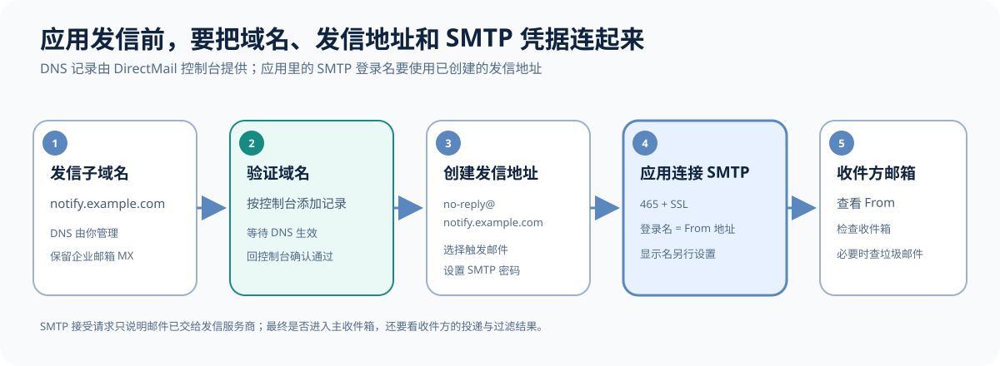
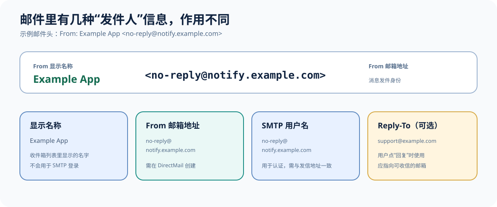
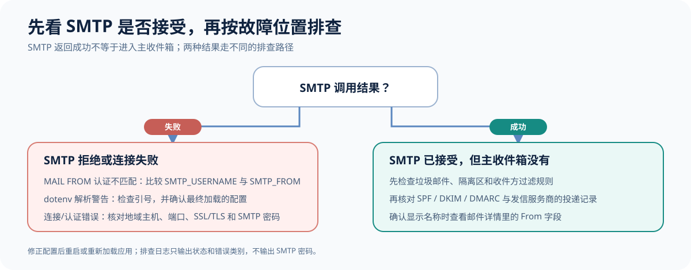

# 阿里云 DirectMail SMTP 配置实战

给应用发送验证码、密码重置码或系统通知时，阿里云邮件推送（DirectMail）可以提供托管的 SMTP 发信服务。实际配置不只是填 SMTP 密码：还要验证发信域名、创建发信地址，并让应用使用同一个地址进行 SMTP 认证和发信。

本文使用 `example.com` 和虚构地址举例，不包含真实账号、域名、收件人或凭据。

## 先区分 DirectMail 和企业邮箱

- **阿里邮箱/企业邮箱**提供可登录的邮箱账户，通常负责收信，也可在允许第三方客户端时通过 SMTP 发信。
- **DirectMail**是应用发信服务，适合验证码、密码重置、订单等触发邮件。创建 DirectMail 发信地址不等于创建了可登录、可收信的邮箱。

如果邮件需要用户回复，给邮件设置一个真实可收信的 `Reply-To` 地址。DirectMail 的 SMTP 发信本身不会提供收件箱。

## 配置发信域名

先确认自己拥有域名的 DNS 管理权限。在 DirectMail 控制台添加发信域名，再按控制台给出的记录配置 DNS 并完成验证。记录值应以控制台显示为准；不同域名和地域可能不同。

如果根域名已用于企业邮箱，建议使用专门的发信子域名，例如 `notify.example.com`。不要为了配置 DirectMail 覆盖企业邮箱现有的 MX 记录，以免影响企业邮箱收信。阿里云域名配置也建议使用独立的发信域名或子域名。[发信域名配置说明](https://help.aliyun.com/zh/direct-mail/user-guide/how-to-configure-sending-domain-names)



## 创建发信地址

在 DirectMail 的“发信地址”中选择已验证的发信域名，创建一个清楚易认的地址，例如：

```text
no-reply@notify.example.com
```

验证码、密码重置和系统事件通知选择**触发邮件**。之后为这个发信地址单独设置 SMTP 密码。该密码是 DirectMail 的 SMTP 凭据，不是阿里云控制台密码，也不是 AccessKey。阿里云 SMTP 要求登录账号与发信地址一致。[发信地址与 SMTP 密码](https://help.aliyun.com/zh/direct-mail/user-guide/setup-sender-addresses) · [SMTP 发信说明](https://help.aliyun.com/zh/direct-mail/user-guide/send-emails-using-smtp)

## 配置应用 SMTP

按发信地址所在地域选择 SMTP 主机。以下以阿里云邮件推送的 `smtpdm.aliyun.com` 为例，实际值以控制台和地域文档为准。[SMTP 服务地址](https://help.aliyun.com/zh/direct-mail/smtp-endpoints)

```toml
# 非敏感配置
smtp_host = "smtpdm.aliyun.com"
smtp_port = 465
smtp_username = "no-reply@notify.example.com"
smtp_from = "no-reply@notify.example.com"
smtp_use_ssl = true
smtp_use_tls = false
email_sender_name = "Example App"
```

```dotenv
# 密码放在 .env / .env.local 或部署环境变量中
SMTP_PASSWORD=replace-with-the-sender-smtp-password
```

端口和加密方式要配套。使用 SSL 端口 465 时设 `smtp_use_ssl = true`；如果服务商要求 STARTTLS，则按其提供的端口设 `smtp_use_ssl = false`、`smtp_use_tls = true`。不要同时开启 SSL 与 STARTTLS 后猜测实际连接模式；很多实现会优先走 SSL。

## 设置收件人看到的名称

SMTP 登录地址仍是完整邮箱地址。收件人看到的显示名称由邮件头 `From` 控制，例如：

```text
Example App <no-reply@notify.example.com>
```

Python 应用可以用 `email.utils.formataddr` 生成：

```python
from email.utils import formataddr

message["From"] = formataddr(("Example App", sender_email_address))
```



显示名称不会替代 SMTP 用户名或发信地址。收件人邮箱是否额外显示“via/代发”标记，由发信认证、邮件头和收件方客户端决定，无法保证所有客户端完全一致。使用自己已验证的域名，不要伪装成第三方域名。

## 常见错误与验证

### 发件地址与 SMTP 登录账号不匹配

出现 `MAIL FROM doesn't conform with authentication` 一类错误时，检查 `smtp_username` 与 `smtp_from` 是否为 DirectMail 中同一个完整发信地址，并确认应用实际加载了修改后的配置。

### `.env.local` 格式错误导致旧值仍在生效

dotenv 文件支持 `KEY=value`，也支持成对的引号。多余或不匹配的引号可能触发解析警告，使该行没有按预期加载；应用可能继续使用 TOML 或其他来源的旧值。修改后重启应用，并只检查非敏感配置是否加载正确，不要把 SMTP 密码打印到终端或日志。

### 测试成功但收件箱没有显示

SMTP 返回成功通常表示发信服务器接受了邮件，不代表它一定进入主收件箱。测试时用自己可访问的邮箱，检查收件箱、垃圾邮件和服务商的投递记录；验证显示名称时看邮件详情中的 From 字段。



## 配置检查清单

- 发信域名已通过 DirectMail 验证，原企业邮箱的 MX 记录仍指向企业邮箱。
- 发信地址已创建，验证码等系统邮件选择“触发邮件”。
- SMTP 密码来自该发信地址的 SMTP 设置。
- SMTP 登录账号和 From 地址一致，主机、端口及 SSL/TLS 模式匹配。
- 发件人显示名称与邮箱地址分别配置；测试时用自有收件邮箱确认实际展示。

更多信息：[阿里云发信域名配置](https://help.aliyun.com/zh/direct-mail/user-guide/how-to-configure-sending-domain-names) · [创建发信地址](https://help.aliyun.com/zh/direct-mail/user-guide/setup-sender-addresses) · [SMTP 服务地址](https://help.aliyun.com/zh/direct-mail/smtp-endpoints)
