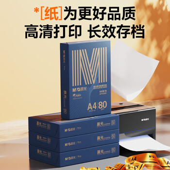
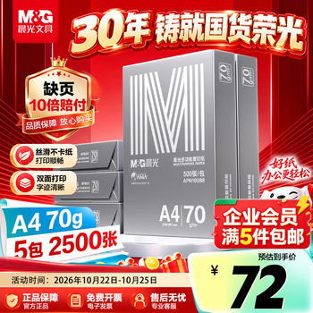
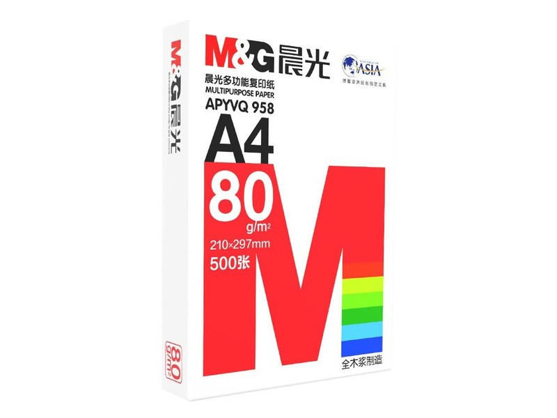
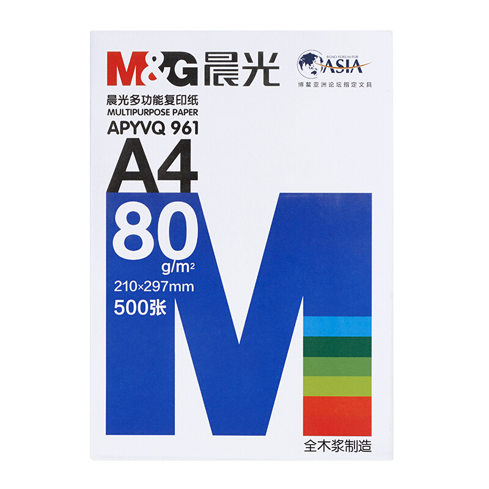
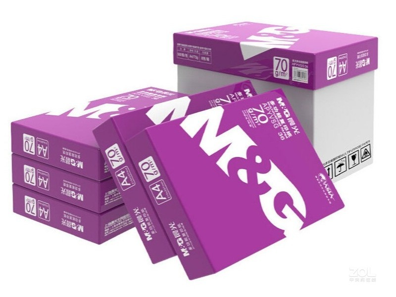
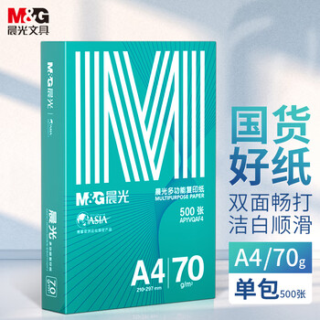
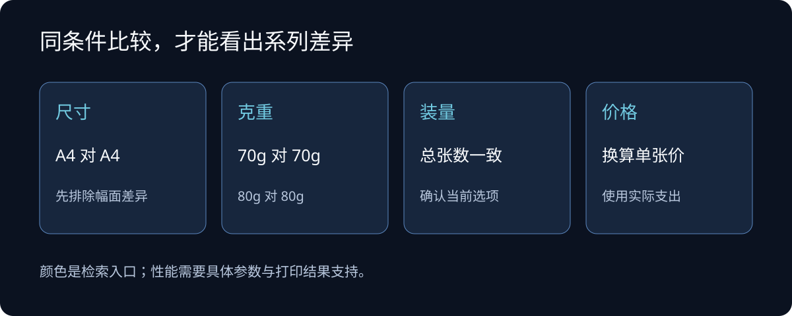
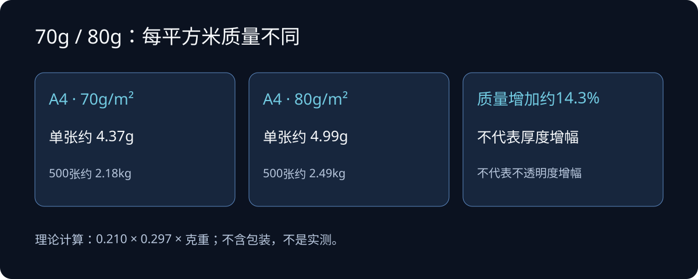
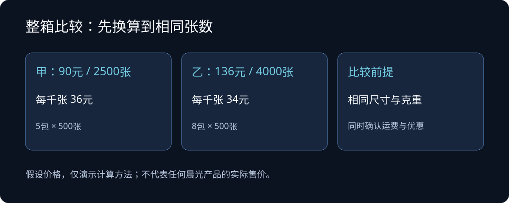

金晨光、银晨光、红晨光、蓝晨光，再加上紫晨光、绿晨光，一排名字摆在一起，很容易让人以为晨光给复印纸划了一条清晰的等级线：颜色越“贵气”，纸就越好。

但买纸时需要比较的是：同样的尺寸、同样的克重、同样的张数，多花的钱换来了什么？一包金晨光80g和一包银晨光70g，差别既可能来自系列，也可能来自克重，不能把厚实感全算在“金”字上。

**选晨光纸，先定用途和克重，再比较具体型号与到手单张价。** 对日常文字打印，经济系列经过试用就可能足够；对经常双面打印的资料，80g值得优先考虑；对外提交的文件，再判断高档系列是否值得溢价。

本文讨论的是晨光白色办公打印、复印纸，颜色主要指系列命名，并非纸张颜色。资料核对截至2026年10月24日，属于公开资料分析，没有进行六系列实物横评。下面的使用建议是基于规格和打印原理的判断，不能当成实测排名。

## 一、先认型号：六种颜色没有一张通用成绩单

先把可查到的产品对应起来。这张表列的是代表规格，同一系列可能还有其他克重、尺寸和箱规；不要用一行覆盖整个系列。

| 系列与包装图 | 可核对的代表型号 | 代表规格与来源 |
| --- | --- | --- |
| 金晨光  | APYVQ28L | A4、80g、500张单包；[京东商品页](https://item.jd.com/product/46IxhgRWU0vQHSbu8g4GkQ.html) |
| 银晨光  | APN1B088 | A4、70g、500张/包、5包/箱；[京东商品页](https://item.jd.com/product/ju_-8gXk10pzxDHptHrHMA.html) |
| 红晨光  | APYVQ958 | A4、80g；[中关村在线产品资料](https://detail.zol.com.cn/print_medium/index1421513.shtml) |
| 蓝晨光  | APYVQ961 | A4、80g；[政府采购合同](https://obs.gcy.zfcg.gxzf.gov.cn/guangxi-gov-open-doc/1035IC/1c516f11-b5a6-4f3c-9bca-abc6f2d06902.pdf) |
| 紫晨光  | APYVSG36 | A4、70g、500张/包、5包/箱；[中关村在线产品资料](https://detail.zol.com.cn/print_medium/index1380510.shtml) |
| 绿晨光  | APYVQAF4 | A4、70g、500张单包；[促销平台商品记录](https://m.smzdm.com/p/180142350/) |

这些来源的证据用途不同：商品页和采购合同可以帮助确认型号、克重与装量；促销平台记录只用来识别在售规格。它们都不能证明某系列卡纸更少、纸粉更少，或在所有打印机上表现更好。

公开资料也提醒我们不要固化颜色与克重的关系。2024年《分析测试学报》的一篇复印纸鉴别研究，样本表包含“晨光-金-70”“晨光-银-70”和“晨光-银-80”。这能说明研究采样时存在这些标识的样品，但研究目的在于文件鉴别，不能拿它给当前在售纸张排打印质量名次。[研究论文，表1](https://journals.indexcopernicus.com/api/file/viewByFileId/2375165)

*比较条件示意：先对齐规格和价格口径，再判断系列溢价。图中没有质量排名。*

## 二、影响打印体验的几个参数

### 70g、75g、80g：克重不等于厚度

纸包装上的70g、80g，一般是每平方米纸张的质量，单位为g/m²。它不表示一张纸重70克，也不直接给出厚度。

以标准A4面积计算，可以得到下面的理论质量，不含包装，也不是实物称重。

| 克重 | 单张理论质量 | 500张理论质量 |
| --- | --- | --- |
| 70g/m² | 约4.37克 | 约2.18公斤 |
| 80g/m² | 约4.99克 | 约2.49公斤 |

80g每平方米用料质量比70g多约14.3%，但纸张厚度、挺度和不透明度还取决于纸的结构与加工。

选购时，可以把70g看作控制成本和资料重量的起点，把80g看作追求更厚实手感、改善双面阅读的候选。不能据此承诺“所有80g都比70g更不透字”，更不能说80g绝不会卡纸。

*按A4面积计算的理论值，不是实物称重，也不表示厚度增加14.3%。*

### 双面透字与墨水渗透，要分开看

背面文字隐约可见，可能是纸张不够遮光；墨水穿到背面，则还涉及吸墨和表面处理。激光打印用碳粉，喷墨打印用液态墨水，两者遇到的问题也不完全相同。

对双面黑白资料，关注不透明度和阅读时背面字迹的干扰；对喷墨彩色资料，还要观察小字是否洇开、色块处是否起皱。华为针对其喷墨设备说明，大面积彩色打印可能使普通纸起皱，潮湿环境下更明显，并建议使用80g及以上A4普通纸。这支持“喷墨大覆盖率任务可以先试更高克重”的建议，不能外推成所有打印机的统一保证。[华为支持说明](https://consumer.huawei.com/cn/support/content/zh-cn15909572/)

### 白度最高的是哪一款？有历史样本数据，缺少当前全系列对照

就目前找到的同一研究样本看，“晨光-959-70”的白度数值高于表内金、银、紫、绿的对应样本；把美印系列也算入晨光品牌，则“晨光-美印-80”的数值更高。这里必须保留样本名称和时间，不能把它们写成当前在售系列的永久排名。

2024年《分析测试学报》发表的研究使用了2023年3月网上统一购置的复印纸，表1将下列指标列为“CIE whiteness value”。摘录如下：[期刊原文，表1](https://www.fxcsxb.com/zh/article/doi/10.12452/j.fxcsxb.24042404/)。

| 论文样本标识 | 表列白度值 | 解读范围 |
| --- | --- | --- |
| 晨光-美印-80 | 86.8 | 表内晨光样本数值最高 |
| 晨光-959-70 | 86.4 | 论文使用型号简写，未直接写“蓝晨光” |
| 晨光-银-70 | 86.2 | 只代表该次70g样本 |
| 晨光-绿-70 | 86.1 | 只代表该次70g样本 |
| 晨光-金-70 | 86.0 | 不可套给本文配图的金80g |
| 晨光-紫-70 | 86.0 | 只代表该次70g样本 |
| 晨光-银-80 | 85.7 | 同系列更高克重也不保证更白 |

论文没有以“红晨光”名称明确列出样本，样本简写也不能直接对应所有当前包装。因此，这些数据足以说明“金晨光未必最白”“80g未必比70g更白”，但不足以确定今天六个系列谁最白。数值接近也不等于肉眼一定能分辨出差别。

如果购买目标就是高白度，应要求商家提供具体型号、同一检测标准与条件下的检测报告。不同页面的“白度”“亮度”和不同检测口径的数字不能直接混排；产品图则受光照、曝光和修图影响，不能充当白度对照。

### 不卡纸，不能只归功于系列颜色

纸张平整度、裁切、含水状态，以及打印机搓纸轮、装纸量，都会影响进纸。把一次卡纸直接归结为“蓝晨光不行”，或者把一次顺利打印归结为“金晨光绝不卡”，都缺少对照。

惠普的纸张使用说明明确指出，即便纸张符合规格，操作、温度和湿度也可能影响效果，并建议使用前保留原包装、防止受潮。对家庭用户，买能及时用完的装量、开封后妥善保存，往往比长期囤高档纸更实际。[惠普纸张使用说明](https://support.hp.com/cn-zh/document/c03020638)

## 三、六个系列，分别有什么优缺点？

以下用同一把尺子比较：购买理由、需要承担的代价、适合的任务。凡涉及定位，只作为商品命名和销售描述的线索，不视作独立检测结果。

### 金晨光：适合作为高档候选，溢价需要具体理由

*金晨光包装示例（APYVQ28L，A4、80g）。图片来源：[京东商品页](https://item.jd.com/product/46IxhgRWU0vQHSbu8g4GkQ.html)；包装版本可能变化，图片中的宣传文字与价格不作为本文实测结论或当前报价。*

APYVQ28L商品页把它称为“高档品质款”，并标明80g、500张。这说明其销售定位面向更看重纸张品质的用户，但“高档”本身没有告诉我们：比另一款80g纸的不透明度高多少、连续打印故障率低多少。[金晨光商品页](https://item.jd.com/product/46IxhgRWU0vQHSbu8g4GkQ.html)

它的购买理由是：正式文件、需要拿在手里阅读的报告，值得把80g金晨光纳入试用；当与其他80g系列价差很小，尝试成本也有限。它的不足则是，若售价有明显溢价，而用途只是单面草稿，目前资料不足以证明这笔钱能带来同等明显的收益。

我的建议是，把它作为“正式文件用纸候选”。与红晨光、蓝晨光比较时也选80g，实际看手感、背面干扰和打印效果，再决定是否长期购买。

### 银晨光：70g日常用纸候选，不能凭名字排第二

*银晨光包装示例（APN1B088，A4、70g、5包装）。图片来源：[京东商品页](https://item.jd.com/product/ju_-8gXk10pzxDHptHrHMA.html)；包装版本可能变化，图片中的宣传文字与价格不作为本文实测结论或当前报价。*

银晨光APN1B088能核对到70g、每包500张、每箱2500张。它并不是只能靠模糊商品标题才能识别的系列，但目前这些资料仍不足以建立银晨光与其他系列的完整性能关系。[银晨光商品页](https://item.jd.com/product/ju_-8gXk10pzxDHptHrHMA.html)

它的优势在于：对于单面文字、草稿和大量练习资料，70g规格可以进入预算比较；若同规格到手价较低，且在自己的机器上试印合格，就有明确的购买价值。局限是，70g版本未必满足对厚实手感、密集双面阅读的要求，具体遮光效果仍要试。

不要因为“银”字就认定它仅次于金，也不要因为商家用“特惠”称呼它就断言纸质差。这里的推荐条件是价格和实际效果，不是贵金属顺序。

### 蓝晨光：适合建立日常办公基准

*蓝晨光包装示例（APYVQ961，A4、80g）。图片来源：[阳光校采商品页](https://mall.icw.buaa.edu.cn/SzhtShop/detail/lxwl/10769097)；包装版本可能变化，图片中的宣传文字与价格不作为本文实测结论或当前报价。*

蓝晨光能查到70g与80g规格：销售目录列有APYVS959的70g款，政府采购合同则列出APYVQ961的80g款。因此，“蓝晨光就是70g”这一说法不成立。[销售目录](https://www.nmmdbg.com/search/index/%E6%99%A8%E5%85%89?cat_id=19&page=1)、[采购合同](https://obs.gcy.zfcg.gxzf.gov.cn/guangxi-gov-open-doc/1035IC/1c516f11-b5a6-4f3c-9bca-abc6f2d06902.pdf)

蓝晨光的实用价值是，同一系列里可以按任务选择克重：普通单面文字先试70g，常打双面资料再试80g。选定一个表现稳定的型号后，补货也有明确参照。

它的限制是，“常见办公款”不能代替性能保证。同样是蓝晨光，不同克重、箱规和储存状态都可能影响购买体验。它适合当对照样本，但没有证据支持“闭眼买也一定合适”。

### 红晨光：正式资料的比较对象，先看与蓝晨光的同克重差异

*红晨光包装示例（APYVQ958，A4、80g）。图片来源：[中关村在线产品图库](https://detail.zol.com.cn/print_medium/index1421513.shtml)；包装版本可能变化，图片中的宣传文字与价格不作为本文实测结论或当前报价。*

红晨光也有70g和80g记录，常见型号包括APYVQ957、APYVQ958。采购文件可以确认70g型号，产品资料则把APYVQ958列为红晨光80g双面打印纸。[70g采购记录](https://www.ccgp-shaanxi.gov.cn/uploader-gpms/upload/commoninfo/2025/4/10/1744284752461_3904.pdf?accessCode=59a0fd56fd55bb6cafdc4b40152554b6)、[80g产品资料](https://detail.zol.com.cn/print_medium/index1421513.shtml)

它值得考虑的场景是正式办公文字、报告与双面材料，尤其是80g版本。但这一建议来自用途和规格匹配，并不表示已经证实红晨光比蓝晨光更白、更厚或更少掉粉。

购买时，把红80g和蓝80g放在一起看。如果红款贵出的部分有你能核对的参数优势，或样张效果确实更合意，就有升级理由；若规格、样张效果相近，价格更低的一方更划算。红70g与蓝80g之间，更不能只按颜色做判断。

### 紫晨光：可进入批量文字打印的预算比较

*紫晨光包装示例（APYVSG36，A4、70g）。图片来源：[中关村在线产品图库](https://detail.zol.com.cn/print_medium/index1380510.shtml)；包装版本可能变化，图片中的宣传文字与价格不作为本文实测结论或当前报价。*

紫晨光APYVSG36可核对到A4、70g、每包500张、每箱5包。它适合作为大量文字打印的候选，与银晨光、绿晨光以及蓝晨光70g按同规格比较。[紫晨光产品资料](https://detail.zol.com.cn/print_medium/index1380510.shtml)

它的潜在优点是，在价格合适时，以标准办公规格满足草稿、内部通知和练习资料的需求。局限仍是具体70g纸的遮光、挺度和进纸表现需要确认，不能从“紫色包装”推导出某种工艺。

如果紫晨光70g与其他70g款价差很小，选择已经试用稳定的型号，比为了换颜色重新赌一次更省事。

### 绿晨光：适合关注性价比，但绿色不代表特殊环保属性

*绿晨光包装示例（APYVQAF4，A4、70g）。图片来源：[阳光校采商品页](https://mall.icw.buaa.edu.cn/SzhtShop/detail/jd/100035629496)；包装版本可能变化，图片中的宣传文字与价格不作为本文实测结论或当前报价。*

绿晨光APYVQAF4的商品记录为A4、70g、500张单包，销售描述强调性价比。这个描述可以解释它为什么会出现在预算选购清单里，却不能证明它永远是晨光最便宜的纸。[商品记录](https://m.smzdm.com/p/180142350/)

它的购买理由是：日常单面文字和草稿不一定需要高档系列，单包装也适合先买来试。局限是，促销价格会变，同系列还有其他型号，不能把一个型号的宣传和售价套给所有“绿晨光”。

绿色包装也不能用来判断再生浆含量、认证情况或阅读舒适度。关心这些属性，应查看具体包装和对应证书；买普通办公纸，则直接比较规格、样张和单张成本。

## 四、别只看一箱多少钱：换算后再比较

一箱5包、8包、10包，都可能出现在商品选项里。标题里还可能混着不同克重和试用装，必须确认当前选中规格。

假设甲款每箱90元、5包、每包500张，单张纸成本是0.036元；乙款每箱136元、8包、每包500张，单张是0.034元。这只是计算示例，不是晨光实时售价。乙款箱价更高，单张却更低。

*假设价格演示：比较时还要对齐尺寸、克重，并计入运费、优惠及其他实际支出。*

计算方法很简单：

> 单张纸成本＝实际购纸支出÷总张数。  
> 每千张成本＝单张成本×1000。

双面打印时，一张纸承载两个页面，比较耗纸量时要区分“张”和“页”。用双面替代单面可能节省用纸，但也要把可读性、废页和重打成本考虑进去。

## 五、按场景选，比背颜色排名更有用

| 使用场景 | 优先比较的候选 | 需要接受或确认的取舍 |
| --- | --- | --- |
| 草稿、临时单面文字 | 银、紫、绿、蓝的70g款 | 按单张价选择，先确认进纸与字迹效果 |
| 普通办公文字 | 已经试用稳定的70g或80g型号 | 70g减轻重量；80g增加用料与采购支出 |
| 经常双面打印的学习资料 | 蓝、红、金等具体80g款 | 检查背面文字干扰，不能只看“双面”宣传 |
| 对外报告、正式材料 | 金、红、蓝的80g款对照试印 | 为实际手感与版面效果付费，确认价差值得 |
| 喷墨彩色图表 | 设备支持的80g及以上适用纸 | 观察洇墨和起皱；照片需求另选适配相纸 |
| 大量采购 | 已通过机器试用的具体型号 | 锁定克重、装量、供货与仓储条件 |

这张表里的颜色是候选范围，不是每个系列独占的用途。比如银晨光70g也可能满足某份正式文件，金晨光80g也可以拿来打草稿；区别在于是否值得为该任务承担相应成本。

拿不准时，买两款小包装，用同一台打印机、同一个文件和同一套设置做对照：一份普通文字、一份密集双面文字；使用喷墨设备，再加一份常见彩色图表。对每款记录背面干扰、字迹边缘、纸张卷曲和进纸问题，先从少量试印开始。

小样本能帮助排除明显不合适的纸，却不足以证明低卡纸率。大量采购前，再用接近日常任务的连续打印验证；某次卡纸也要结合机器状态和纸张是否受潮判断。

对于目前没有具体打印需求的人，我建议从一款价格合适的70g日常用纸开始；已经明确经常双面阅读，就直接把80g纳入首轮比较。高档系列的价值，应该体现在你能看到、摸到、用到的差异上。

买晨光纸，把颜色当作找商品的入口，把型号、克重和自己的打印结果当作决定依据。
