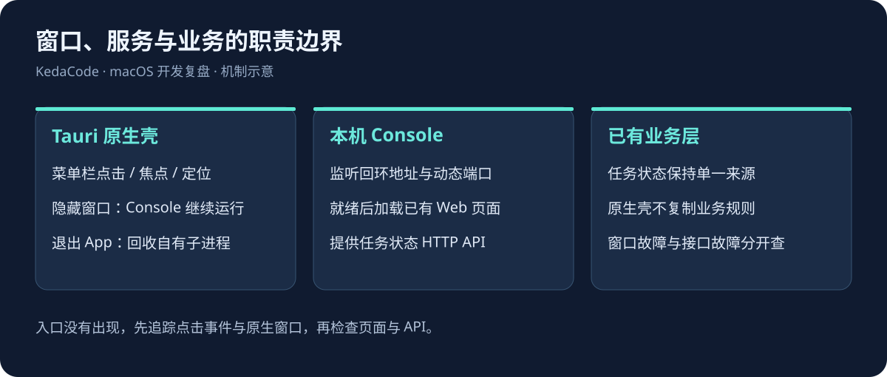
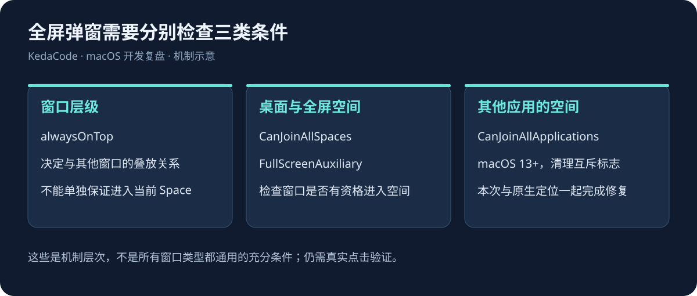
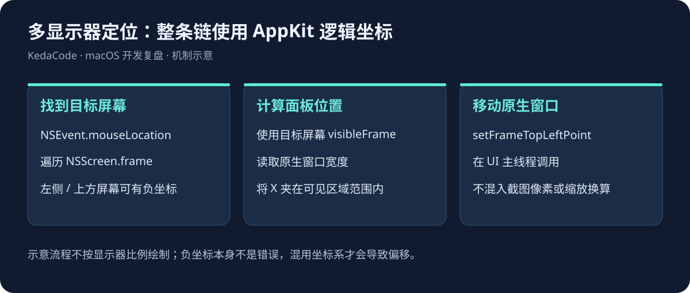
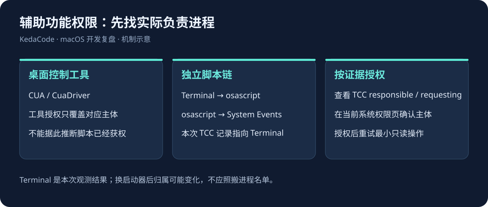

浏览器已经全屏，再点击菜单栏里的 KedaCode 图标，状态面板没有出现。App 进程还在，Console 接口也正常，Rust 编译和本地构建都能通过，用户却用不了这个入口。

这次问题的主要修复，是给原生窗口补上允许加入其他应用全屏空间的行为配置。只有“置顶”不够；先补 `FullScreenAuxiliary` 后，现场仍未通过，继续加入 macOS 13 起提供的 `CanJoinAllApplications`，用户点击和后台观测才共同确认正常弹出。过程中还发现了混合缩放、多显示器负坐标下的定位隐患。

同一个入口后来又暴露出两类问题，它们和全屏无关，却同样让“点了没反应”：面板加载的本机页面被 ACL 拒绝调用原生命令，以及双击 App 时主界面根本没有被创建。这篇把三件事放在一起写，因为它们共享同一条判据——**用户能不能用，只由真实入口的最后一次点击决定**。

这篇记录面向正在做菜单栏工具、任务监控面板、悬浮窗或 Web 技术桌面壳的开发者。重点是如何把窗口行为、进程、权限与验证连接起来。示例来自 KedaCode 的 Tauri 2 客户端；其中的 macOS 概念也适用于其他框架，但具体实现需要按各自窗口类型重新验证。

## 一、先把“弹出来”写成可以检查的行为

这次需要满足的场景是：另一个软件继续保持全屏，用户点击 KedaCode 菜单栏图标，面板直接出现在当前全屏空间上方。测试时退出全屏，再证明面板可以打开，无法覆盖这个需求。

一个看似简单的状态面板，实际至少包含以下约定：

- **菜单栏入口**：程序常驻菜单栏，左键展开或收起面板，右键提供退出入口。
- **临时面板**：没有普通标题栏；离开面板时自动收起，关闭按钮也可以只隐藏窗口。
- **固定悬浮**：同一个窗口切换为带标题栏的置顶窗口，失焦后继续显示。
- **空间行为**：能在普通桌面、其他应用的全屏空间里打开，并且显示在用户正在操作的屏幕上。
- **退出行为**：退出 App 时，回收它自己启动的 Console；不影响其他实例和正在运行的任务。

这几个行为应分别测试。把它们都交给一个 `alwaysOnTop` 开关，会遗漏窗口所属空间、焦点和生命周期等条件。

本次记录的环境与版本如下，不能据此声称覆盖所有 macOS 或 Tauri 版本：

| 项目 | 本次环境 | 需要保留的边界 |
| --- | --- | --- |
| 系统 | 本机 `sw_vers` 输出 macOS 27.0.1，Apple Silicon | 没有在 macOS 12 实机复测 |
| 桌面框架 | Rust + Tauri 2.12.4 | 不是 SwiftUI 或 Electron 的直接验证 |
| 原生绑定 | `objc2` 0.6.5、`objc2-app-kit` 0.3.2 | 主线程、所有权与系统版本仍需检查 |
| 显示器 | 三块屏幕，包含负坐标和不同缩放比例 | 未系统覆盖热插拔、旋转与所有排列 |
| 数据来源 | 本机 Console 的已有 HTTP API | 原生壳不再实现一套任务状态业务逻辑 |

## 二、桌面壳负责窗口，Console 负责业务

KedaCode 原本已经有网页看板和本机 Console。桌面需求是让状态更容易被看到，因此复用已有页面和 API，比再做一套原生业务界面更合适。

当前菜单栏 App 启动自己的 `kc console --no-browser --port <动态端口>`，等待就绪后，在 WebView 中加载这个 Console 的精简页面。任务状态、影响树等数据仍由已有后端负责。原生部分处理菜单栏、窗口样式、位置和子进程。



*机制示意：图中的箭头表示职责与读取关系，不是运行截图。它解释了为什么窗口不出现时，应该先检查原生入口，而不是直接重写任务 API。*

仓库中还保留了 pywebview 独立窗口路径。两者的产品边界需要说清：

| 路径 | 适合的用途 | 不能自动获得的能力 |
| --- | --- | --- |
| 浏览器看板 | 查看任务、执行完整管理流程 | 常驻系统菜单栏与原生窗口行为 |
| pywebview 小窗 | 从网页临时打开一个独立窗口 | 安装 WebView 依赖不会自动变成菜单栏 App |
| Tauri 菜单栏 App | 点击顶部图标展开状态、切换固定悬浮 | 仍需处理 macOS 空间、焦点、权限和打包 |

框架选择应围绕入口需求。只是需要一个临时网页窗口时，没有必要先做完整桌面发行链路；明确需要菜单栏、悬浮模式和 App 生命周期时，才值得承担原生壳的维护成本。

## 三、置顶、跨桌面和跨应用全屏是不同条件

### 1. 窗口层级不能替代空间归属

“置顶”主要处理窗口层级。macOS 的 Space 则决定窗口出现在哪个桌面或全屏空间。窗口层级足够高，也可能没有进入用户当前所在的 Space。

本次先设置置顶，再补充 `CanJoinAllSpaces` 和 `FullScreenAuxiliary`，仍未满足现场需求。Apple 对 `canJoinAllApplications` 的说明明确针对浮动窗口和系统覆盖层：允许符合条件的窗口加入其他应用的全屏空间与 Stage Manager 窗口集合。三个 Stage Manager 行为标志 `primary`、`auxiliary`、`canJoinAllApplications` 彼此互斥，配置时需要清理冲突。[Apple：canJoinAllApplications](https://developer.apple.com/documentation/appkit/nswindow/collectionbehavior-swift.struct/canjoinallapplications)



*机制示意：三个条件解决不同问题。最后一项对应本次“其他软件保持全屏时弹出面板”的实际入口。*

### 2. 本次落地的原生窗口配置

下面片段来自实现中的核心配置，省略了 Tauri `setup` 外层。`window` 是当前仍存活的 `WebviewWindow`，这段代码在 UI 主线程执行：

```rust
use objc2_app_kit::{NSWindow, NSWindowCollectionBehavior};

app.set_activation_policy(tauri::ActivationPolicy::Accessory);

let native_pointer = window.ns_window()?;
// 指针由仍存活的 Tauri 窗口持有，只借用，不释放或转移所有权。
let native_window = unsafe { &*native_pointer.cast::<NSWindow>() };

let collection_behavior = (native_window.collectionBehavior()
    & !NSWindowCollectionBehavior::FullScreenPrimary)
    | NSWindowCollectionBehavior::CanJoinAllSpaces
    | NSWindowCollectionBehavior::FullScreenAuxiliary;

let collection_behavior = if objc2::available!(macos = 13.0) {
    (collection_behavior
        & !(NSWindowCollectionBehavior::Primary
            | NSWindowCollectionBehavior::Auxiliary))
        | NSWindowCollectionBehavior::CanJoinAllApplications
} else {
    collection_behavior
};

native_window.setCollectionBehavior(collection_behavior);
```

`Accessory` 用于菜单栏型应用的激活策略。本项目通过运行时调用设置；本次没有把 `LSUIElement` 写入 `Info.plist`，也没有通过额外设置该键做对照实验，不能把这次修复归因于它。[Apple：Accessory 激活策略](https://developer.apple.com/documentation/appkit/nsapplication/activationpolicy-swift.enum/accessory)

系统版本判断来自实际 SDK：本机 `NSWindow.h` 将 `CanJoinAllApplications` 标为 macOS 13.0 起可用。保留旧系统分支，只能说明代码有兼容处理，不能说明 macOS 12 的用户流程已经通过。

这一轮也没有把 `NSWindow` 改造成 `NSPanel`。如果现有窗口行为配置已经满足产品需求，先保留窗口实现；确实需要非激活面板、特殊键盘行为等能力时，再单独评估 `NSPanel`，不要把没有实测的方案记成已完成的修复。

### 3. 不要把最终组合修复写成充分的单变量实验

这次可以确认：前一版用户反馈“完全没有弹出”，补充跨应用空间行为后，用户实际点击确认“正常弹出”，后台同时记录到屏幕内可见窗口与另一个应用的全屏状态。

但整个过程中还改过定位逻辑，也使用过诊断构建。现有证据支持这套组合修复在本机环境生效，没有完成每个标志逐一增删的完整实验。因此经验可以推广为排查顺序和实现参考，不应写成“任何框架只加这一行就一定解决”。

## 四、多显示器定位：统一坐标系，再做边界约束

### 1. 主屏左侧和上方出现负坐标是正常布局

本机的显示器布局包含这些桌面坐标：

```text
主屏：       origin=(0, 0)        size=(1710, 1112)
上方屏幕：   origin=(0, -1440)    size=(2560, 1440)
左侧屏幕：   origin=(-1080,-1200) size=(1080, 1920)
```

不能因为坐标是负数，就直接把它截断到零。那会把本来位于上方或左侧屏幕的窗口拉回主屏。

排查时还观察到过窗口坐标落在所有屏幕之外。它是需要处理的独立定位隐患；由于没有做隔离对照，不把它单独认定为最初全屏故障的唯一原因。



*布局示意，不按实际屏幕比例绘制。它支撑的结论是：负坐标合法，混合缩放时应明确坐标来源。*

### 2. 不要混用截图像素、框架物理坐标和 AppKit 坐标

本次真实菜单栏点击日志出现过物理坐标约 `x=2383`，而窗口观测使用的是另一套桌面坐标。把这些数值直接拼在一起计算，可能重复缩放；拿截图上的像素去模拟点击，也需要确认工具的坐标映射。

Tauri 提供了 Physical/Logical 类型，AppKit 也有自己的坐标系统。框架里的通用定位插件可以作为起点，但在多个不同缩放比例的屏幕上，仍需核查它怎样取得托盘矩形、使用哪个屏幕的缩放因子，以及窗口位置 API 最终接受什么单位。

本次 macOS 分支统一使用 AppKit 的逻辑坐标：

1. **找当前屏幕**：读取 `NSEvent::mouseLocation()`，在 `NSScreen::screens()` 中找到包含该点的屏幕。
2. **取得可见区域**：使用该屏幕的 `visibleFrame()`，避免只拿整块屏幕的尺寸。
3. **取得窗口尺寸**：读取原生 `NSWindow.frame()`，保持与屏幕相同的坐标系统。
4. **计算位置**：横向以鼠标为中心，约束在屏幕可见范围内；纵向放到可见区域顶部。
5. **一次性交给原生 API**：调用 `setFrameTopLeftPoint()`，不再经过一轮物理像素换算。

AppKit 屏幕坐标通常以左下角为基准，而许多桌面工具和窗口观测接口采用左上角方向。这个流程让计算与设置都留在同一套 API 内，减少人为翻转和缩放。

核心计算如下，片段中的 `pointer`、`visible_frame` 和 `native_window` 都来自上述 AppKit 路径：

```rust
use objc2_foundation::NSPoint;

let window_width = native_window.frame().size.width;
let rightmost_x = (visible_frame.origin.x
    + visible_frame.size.width
    - window_width)
    .max(visible_frame.origin.x);

let panel_x = (pointer.x - window_width / 2.0)
    .clamp(visible_frame.origin.x, rightmost_x);

native_window.setFrameTopLeftPoint(NSPoint::new(
    panel_x,
    visible_frame.origin.y + visible_frame.size.height,
));
```

这段实现针对当前尺寸的面板。窗口高于可见区域、屏幕热插拔、旋转、菜单栏自动隐藏以及切换模式期间鼠标已离开图标等情况，还需要各自的验证。使用鼠标位置定位也意味着：程序化打开窗口时，需要另外明确目标屏幕，不能假定鼠标一定在菜单栏图标上。

原生调用必须留在 UI 主线程。当前实现用 `MainThreadMarker::new()` 检查前提，失败时返回错误。以后若把调用入口改到后台任务或异步工作线程，应显式调度回主线程，不能因为拿到了一个指针就直接使用 AppKit。

## 五、菜单栏面板与固定窗口要有明确的状态转换

临时面板和固定悬浮窗可以复用一个窗口，但它们对失焦的处理不同。当前约定是：未固定时失焦自动隐藏；固定后保留显示，并提供原生标题栏。

实现时先更新 `pinned` 状态，再切换装饰、置顶和焦点。否则切换窗口样式引起的失焦事件，可能仍按旧状态把窗口藏起来。切换失败时，至少要恢复状态和已经调整的外观，并把失败告诉界面；不应让按钮显示“已固定”，窗口却仍按临时面板运行。

菜单栏点击、失焦和关闭应分开理解：

- **图标切换**：当前显示时收起，当前隐藏时定位并显示。
- **面板失焦**：按是否固定决定隐藏，不等于退出 App。
- **窗口关闭**：可以拦截关闭请求并隐藏，保留菜单栏入口。
- **菜单退出**：退出 App，触发自有资源回收。

不要静默丢弃 `show()`、`set_focus()` 或定位失败。用户看到的都是“不出现”，开发者却需要区分调用失败、位置不对、没有进入当前 Space，以及刚显示就被隐藏。

这次还出现过一次验证误判：用户点击后回到聊天窗口回复，面板按约定失焦收起。此时再读取“没有窗口”，不能说明它刚才没有弹出。需要在点击前启动观察，保留状态变化，而不是只查询回复后的瞬间。

## 六、验证原生窗口，要保留全屏和点击入口

### 1. 编译、接口和真实点击各证明一件事

本次运行了 Rust 格式检查、Clippy、release 构建和文档构建，也检查了安装后的 Console 版本端点。它们分别能证明代码可编译、静态检查通过、产物存在和服务就绪，无法单独证明全屏覆盖行为。

实际验证必须保留这些条件：另一个应用处于全屏、用户点击原生菜单栏入口、原生窗口真实显示在屏幕内。用浏览器直接打开精简页面，或者手动调用一个窗口显示函数，都不能替代这一条路径。

自动化工具也遇到了两个限制：后台菜单栏 App 没有可读窗口时，工具会超时；System Events 的菜单项动作以及若干坐标点击，没有稳定触发 Tauri 自定义托盘视图的点击回调。这是本次工具路径的观测结果，不能推广为所有 macOS 菜单栏 App 都无法自动化。

### 2. 最终采用人工触发，后台记录真实窗口

在自动触发不可靠时，改由用户实际点击，后台先启动轮询。诊断日志确认点击的 Down 和 Up 都进入了托盘回调；WindowServer 记录屏幕内可见窗口；同时读取 Safari 的 `AXFullScreen`。

本次一条实际观测的摘要如下，时间为机器记录的 UTC：

```json
{
  "observed_at": "2026-10-20T05:27:59.587339+00:00",
  "visible": true,
  "window": {
    "kCGWindowIsOnscreen": true,
    "bounds": {"X": 965, "Y": 40, "Width": 418, "Height": 616}
  },
  "safari_fullscreen": "true"
}
```

随后用户明确反馈“正常弹出”。这里的 `"true"` 是 AppleScript 原始文本返回值，不是重新设计的 API JSON 布尔契约。

这组证据同时包含真实输入、系统观察和用户确认，足以支持“本机这次全屏弹出正常”。但单独一个 `AXFullScreen=true` 并不能证明窗口间的遮挡关系；窗口屏幕坐标、可见观测与人的实际确认仍然需要一起看。

### 3. 证据的限制也要保存

可见状态记录的两个区间分别约为一秒和三秒，不能写成“连续显示满五秒”或“长时间稳定性验证通过”。完整屏幕截图没有成功取得，本文的配图均为机制示意。

完成真实点击验证的是源码诊断构建。随后移除临时诊断输出，构建本地 release App、核对构建产物与安装副本的二进制哈希，并重新检查 Console 启动。没有在安装后的 release 构建上再独立完成一次相同全屏点击，因此也不把启动检查写成 release 全流程验收。

后续复测可以沿下面的表执行；这里列的是回归范围，不代表本次全部完成：

| 场景 | 要观察的结果 | 本次证据 |
| --- | --- | --- |
| 其他软件全屏时点击图标 | 当前空间出现面板 | 用户真实点击、系统可见记录、用户确认 |
| 失焦后收起 | 未固定面板隐藏 | 现场观察到状态变化，未做完整专项对照 |
| 固定后切换其他软件 | 窗口保留，仍可交互 | 未完成系统化复测 |
| 不同缩放、负坐标屏幕 | 面板在目标屏幕可见范围内 | 有现场排查和修复，未覆盖所有排列 |
| 屏幕热插拔、旋转 | 位置恢复且没有失联窗口 | 未验证 |
| macOS 12 | 兼容分支实际可用 | 未验证 |
| release 安装后重跑全屏点击 | 与诊断构建行为一致 | 只做了安装哈希和启动检查 |

## 七、辅助功能已开启，脚本为什么还被拒绝

### 1. 桌面工具与脚本可能属于不同授权主体

本次最初看见 Codex Computer Use 和 CuaDriver 已开启相关权限，但从命令执行环境运行 AppleScript，仍返回：

```text
osascript is not allowed assistive access
```

随后曾根据父进程链，把 `codex` 后台程序加入权限列表，仍未解决。这个判断不准确：进程父子关系不足以代替 macOS 的实际权限归属。

查询 TCC 审计日志后，才确认这次请求的 `responsible` 是 Terminal，`requesting` 是 `osascript`。用户开启 Terminal 的权限后，同一脚本才成功读取菜单栏和窗口信息。这里的结论仅适用于本次启动链路；从其他 IDE、任务服务或 App 启动时，归属可能不同。



*本次权限归属示意：桌面工具授权成功，不会自动证明另一条脚本执行链也有权限。图中的 Terminal 来自 TCC 实际记录。*

遇到类似报错，可以先执行最小只读探针，再看系统日志：

```bash
osascript -e 'tell application "System Events" to get name of first application process whose frontmost is true'

/usr/bin/log show --last 5m --style compact \
  --predicate 'subsystem == "com.apple.TCC" AND eventMessage CONTAINS "osascript"'
```

日志输出和字段会受系统版本、日志保留及隐私设置影响。本次能看到归属，不等于任何机器都能得到同样完整的信息。优先查证拒绝原因，再让用户授权相应程序，避免让用户反复开关一个已经正确授权、却与当前请求无关的应用。

### 2. 权限入口的名称也有版本差异

可以通过这个系统链接调起权限页：

```bash
open 'x-apple.systempreferences:com.apple.preference.security?Privacy_Accessibility'
```

资料里常把它称作“隐私与安全性 → 辅助功能”。本次机器打开后的实际英文页面标题是 `Device Control and Data Access`，与用户按“辅助功能”寻找入口时的预期不同。说明操作步骤时，应同时给出系统链接，并以当前页面内容为准，不要坚持旧名称一定能在所有版本上找到。[Apple：允许辅助功能应用访问 Mac](https://support.apple.com/guide/mac-help/allow-accessibility-apps-to-access-your-mac-mh43185/mac)

辅助功能、自动化、屏幕录制是不同权限。能够通过 System Events 读取和操作 UI，不代表 `screencapture` 一定能成功。本次就遇到了窗口控制恢复、完整屏幕截图仍未取得的情况。

权限由用户决定。应用或 Agent 应说明具体需要控制哪个入口、由哪个程序提出请求，并让用户完成系统授权；没有必要通过关闭系统保护或批量授予无关权限来排查。

## 八、Console 是子进程，窗口隐藏不等于服务退出

### 1. 所有权要落在进程句柄上

菜单栏 App 启动自己的 Console 后，保存 Rust 的 `Child` 句柄。用户隐藏面板时保留服务；从菜单里退出 App 时，只回收自己持有的子进程，并执行 `wait()`。

不要用 `killall python` 或匹配所有 `kc` 进程的方式收尾。同一台开发机器可能同时运行网页 Console、多个仓库的 daemon、任务执行器和临时小窗，名称相近不代表归同一个窗口所有。

启动也有竞态：如果用户在 Console 尚未准备好时退出，后台启动线程可能刚创建子进程。当前实现用 `shutting_down` 状态和子进程槽位锁协调；发现 App 已在退出，就立即回收新建子进程，而不继续登记为正常运行。

### 2. 随机端口只解决一部分问题

本项目先分配回环地址上的空闲端口，再启动 Console，轮询版本端点，确认服务可用后才导航 WebView。不能把“spawn 成功”写成“页面已经能用”。

探针还应设置请求超时和整体启动期限，识别子进程提前退出，并把失败写入用户能找到的日志。本项目的桌面日志位于：

```text
~/Library/Logs/KedaCode/desktop-console.log
```

绑定空闲端口后释放、再交给子进程绑定，仍存在短暂的端口竞争窗口；这次没有做竞争压力测试。若以后问题频繁出现，可以再评估重试或更直接的监听句柄传递，不必提前把简单启动器扩成一套服务编排平台。

### 3. 前端更新与后端更新的生效方式不同

静态网页资源可以在请求时从磁盘读取；后端路由和业务模块通常在 Console 进程启动时装配。只重建页面、刷新 WebView，无法保证正在运行的后端加载了新的状态判定逻辑。

本项目因此区分：仅更新前端静态产物时刷新页面；涉及后端代码时重启相应 Console；涉及 Rust 原生代码时重新构建、安装并重启桌面 App。重启时要认准当前窗口自己使用的 Console，不要顺手中断任务执行 daemon。

## 九、桌面壳还要处理启动环境与本机桥接边界

### 1. Finder 启动环境不同于终端

命令在终端能运行，双击 App 却提示找不到 `kc`，需要先检查启动环境。Tauri 官方文档也提醒，GUI 应用不会直接继承 shell dotfiles 中配置的 PATH。[Tauri：macOS Application Bundle](https://v2.tauri.app/distribute/macos-application-bundle/)

当前实现会检查用户目录下的 CLI 安装位置、Homebrew 常见位置，再检查进程 PATH。它没有假设 Finder 会加载 `.zshrc`，也没有在失败时自动安装全局工具。

开发中还可以从源码路径推导工作目录。本项目这么做能服务当前本机源码构建，但复制 App 到另一台没有源码的机器上时不能依赖它；公开分发需要另行设计资源和外部运行时的查找方式。

### 2. 本机页面获得原生能力，也要有范围

当前面板加载动态端口上的 `127.0.0.1` 页面，通过 Tauri 命令切换固定状态和隐藏窗口。允许一个来源调用桥接命令，是独立于“HTTP 请求能否访问接口”的边界。Tauri 的 Runtime Authority 会检查调用来源、capability 与权限范围。[Tauri：Runtime Authority](https://v2.tauri.app/security/runtime-authority/)

动态端口与同一份前端页面有复用价值，但“本机”不等于“任何本机页面都应拥有同样能力”。原生壳不应接受外部页面随意指定导航 URL、shell 命令或窗口加载目标。

这句话在本次排查里以一条运行时报错的形式出现：

```text
打开控制台失败：Command open_console_window not allowed by ACL
```

第一反应会回头检查 capability 写没写——写了。`menubar-panel` 确实指向 `main` 窗口，也声明了 `remote.urls: ["http://127.0.0.1:*/*"]`。问题出在权限列表只有一个 `core:default`：**Tauri 2 对远程来源的 IPC 一律要过 ACL，应用自己用 `#[tauri::command]` 定义的命令不会自动放行**。同一批命令由打包进 App 的本地页面调用是通的，换成动态端口的 `127.0.0.1` 页面就被拒。

这条限制还是“整条通道”级别的。前端真正调用了三个命令，`open_console_window` 只因为新增了按钮才暴露出来；`set_panel_pinned`（固定悬浮）和 `hide_panel`（隐藏）同样被拒，表现却只是“点了没反应”——错误信息只出现在面板底部的一行小字里，很容易被读成“窗口又没弹出来”。第五节说“不要静默丢弃失败”，在这里变成了一笔具体的旧账。

修复要两步，缺一步都不行。第一步让构建期为每个应用命令生成权限：

```rust
// 修复前
fn main() {
    tauri_build::build()
}

// 修复后：为面板会调用的每个命令生成 allow-<command>
fn main() {
    tauri_build::try_build(
        tauri_build::Attributes::new().app_manifest(
            tauri_build::AppManifest::new().commands(&[
                "open_console_window",
                "notify_task",
                "set_panel_pinned",
                "hide_panel",
            ]),
        ),
    )
    .expect("failed to run tauri-build");
}
```

第二步在 capability 里显式授予，名字是命令 snake_case 转成 kebab-case 的结果：

```json
"permissions": [
  "core:default",
  "allow-open-console-window",
  "allow-notify-task",
  "allow-set-panel-pinned",
  "allow-hide-panel"
]
```

两处都写对之后，构建会在 `permissions/autogenerated/commands/` 下生成权限文件，并在 `capabilities.json` 里解析出对应的 `allow-*`；漏掉第一步则构建期直接报 permission not found，比运行期静默拒绝好排查得多。这也说明“已经配置 capability”和“命令被放行”是两件事，前者只是申明了边界，后者才决定边界内有什么。

还有一个吃时间的细节：Tauri 的 `invoke` 失败过 IPC 之后返回的是**字符串**，不是 `Error` 实例。前端原来写 `error instanceof Error ? error.message : "打开控制台失败。"`，真实原因被这行判断吞掉，界面上只剩一句“失败”。换成 `String(error)` 之后，`not allowed by ACL` 才第一次出现在屏幕上——同一条错误，看见和看不见差了一个下午。

本次本地壳仍有宽泛回环 URL 匹配和未启用 CSP 等配置，并未完成正式发行级别的收紧与安全验收。记录中保留这个现状，不能因为已经配置 capability 就声称所有桥接风险已解决。

## 十、菜单栏 App 也要有主窗口

双击 `KedaCode.app`，桌面上什么都没出现，只是菜单栏多了一个图标。第一判断是“App 没启动成功”，但进程在，Console 也在跑，日志里连一条报错都没有。

原因在启动路径：App 用 `ActivationPolicy::Accessory` 常驻菜单栏，没有 Dock 图标，也不进 Cmd+Tab；启动时它只做了一件事——把那个 420×620 的**隐藏**面板导航到 companion 页面。完整控制台窗口要等用户右键菜单才会被创建。于是“双击 App”在用户眼里就等于“没反应”。

这个问题不是加个菜单项就能补上的。用户对“双击一个 App”的预期就是主界面出现在前台，这条预期必须在启动路径里兑现：

- 启动后创建并显示 1280×860 的控制台窗口，同时切到 `ActivationPolicy::Regular`（有 Dock 图标、进 Cmd+Tab）；
- 关掉这个窗口再退回 `Accessory`，回到纯菜单栏形态；
- 点 Dock 图标或从 Cmd+Tab 回来时，用 `RunEvent::Reopen` 把同一个窗口拉回前台；
- 单实例：第二次双击只复用已有窗口，不再拉起第二个 Console；
- 登录自启带 `--autostart` 参数，这条路径保持静默，只驻留菜单栏。

顺序是这里最容易踩的坑。直觉写法是“先激活 App，再建窗口”，实际效果是窗口出现在后台：激活发生在窗口存在之前，App 拿到前台之后又立刻被别的进程抢回去。可用的顺序是建窗 → `show()` → `set_focus()` → 激活，而且 AppKit 的激活只能在主线程做：

```rust
// 修复后：窗口已经存在之后再激活
let console_window = /* 复用已有窗口或新建 */;
console_window.show()?;
console_window.set_focus()?;
let activation_handle = app.clone();
let _ = activation_handle.run_on_main_thread(activate_app);
```

验证这类行为不能只看“窗口对象存在”。本次有效的证据是三条同时成立：`NSWorkspace.frontmostApplication()` 是 KedaCode、`activationPolicy()` 为 `Regular`（枚举值 0）、窗口矩形是 1280×860 且落在主屏可见区域内。只查 `CGWindowList` 会拿到一堆处于隐藏状态的窗口——面板、菜单栏影子窗口都在列表里，它们都不代表用户看得见什么。

## 十一、做出本机 App 与完成公开发行是两条交付线

这次交付的是本机自用的 `KedaCode.app`，不是已经签名、公证并公开发布的安装包。也没有在测试通过后顺手发布 PyPI、GitHub Release 或推送版本标签。

本项目完整本地构建入口包括前端静态产物同步和 App 构建：

```bash
just desktop-install
```

仅改 Rust 原生逻辑、已有前端产物不变时，这次使用过以下较窄的构建路径：

```bash
cargo fmt --check --manifest-path desktop/src-tauri/Cargo.toml
cargo clippy --manifest-path desktop/src-tauri/Cargo.toml --offline -- -D warnings
pnpm --dir desktop exec tauri build --ci --bundles app -- --offline
```

这里的 `--offline` 依赖本机已有完整依赖缓存，不能当作新机器的首次安装命令。项目完整入口也可能随仓库演进变化，应以当前 `justfile` 为准。

构建目录与安装目录要分清：

```text
构建产物：desktop/src-tauri/target/release/bundle/macos/KedaCode.app
本机安装：~/Applications/KedaCode.app
```

替换前先退出旧实例，并确认目标 App 的 bundle identifier，避免覆盖同名的其他应用。退出是异步过程，本次也遇到过刚发出退出请求就立刻重开导致 `-600` 的情况；等待旧实例退出后再启动，问题消失。复制后可核对二进制哈希，再检查新进程与它的 Console 是否就绪。

App bundle 本身包含可执行文件、`Info.plist`、资源等内容，复制一个文件或仅保留构建目录中的旧 App，都不能说明当前安装已更新。Tauri 会为 macOS 生成 `.app`，并允许通过额外 `Info.plist` 扩展配置。[Tauri：App bundle 结构与原生配置](https://v2.tauri.app/distribute/macos-application-bundle/)

如果以后要给其他用户安装，应单独规划 Developer ID 签名、公证、运行时与资源分发、更新和回滚。Apple 官方提供了站外分发的签名与公证流程；本次没有执行这些步骤。[Apple：Developer ID](https://developer.apple.com/developer-id/)、[Apple：分发前公证](https://developer.apple.com/documentation/security/notarizing-macos-software-before-distribution)

## 十二、状态面板还要区分当前状态与历史结果

这次开发最初还遇到过另一类误报：几个已关闭 Issue 在小窗里显示“阻塞”。它与原生窗口弹出是两件独立的事，不能用修窗口来解释状态错误。

原因在数据回落：监控快照主要扫描队列中的开放 Issue；Issue 关闭或离开队列后，快照不再包含它。任务摘要回退到本地运行账本，把以前某次执行的 `failed/blocked` 当成当前仍需值守的阻塞。

修复后的规则是：当前快照明确记录已关闭，就优先显示关闭；存在当前阻塞标签，才依据当前事实显示阻塞；只有历史失败、缺少当前状态时，保留上次结果并把当前状态记为“未知”。“没有读到当前状态”不能直接解释成“已关闭”，也不能继续解释成“现在阻塞”。

对于一个常驻菜单栏的小面板，这种语义尤其重要。窗口面积越小，红色状态标记越容易被当作当前事实；历史与当前混在一起，会让一个已经收口的任务长期占据活动列表。

## 十三、下一次按什么顺序排查

再次遇到“菜单栏点了没反应”，可以按证据逐层缩小范围：

1. **确认原生实例**：记录 App 路径、PID、二进制版本或哈希，确认不是只重建了源码，却仍运行旧安装副本。
2. **先读前端看到的错误**：`invoke` 失败返回的是字符串，用 `String(error)` 原样展示；`not allowed by ACL` 与“窗口没弹出来”是两类完全不同的问题。
3. **确认真实入口**：其他软件是否确实全屏；图标点击是否产生原生 Down/Up 事件；自动化是否实际命中了当前屏幕上的图标。
4. **检查窗口位置**：记录窗口矩形、各屏幕原点、可见区域与缩放比例，先判断窗口是否在任何可见屏幕内。
5. **检查空间行为**：分别核对置顶、跨 Space、加入其他应用全屏空间的配置，以及系统版本和互斥标志。
6. **记录显示与焦点**：保留显示调用结果、焦点变化、隐藏原因；观察应在点击前启动，避免把事后失焦当作从未显示。还要分清“窗口已 show”和“App 已激活”——菜单栏应用常见的是窗口在后台或被失焦收起。
7. **核对权限归属**：脚本失败时查具体拒绝和 TCC 归属，不凭应用显示名称或父进程链直接让用户授权。
8. **检查服务与资源**：确认 Console 就绪、页面资源存在、前后端改动已被对应进程加载。
9. **完成目标构建验证**：本机调试通过后，核对安装产物，并补上对应 release、系统版本和显示器场景的验证。

给每一层留下能回答问题的证据，比一开始加入一组自动重启、全局置顶或清理进程的“兜底”更有用。这次可以复用的经验是：把原生窗口放进真实的全屏空间、显示器布局和权限链路里验证，才能判断一个菜单栏入口是否真的可用。
